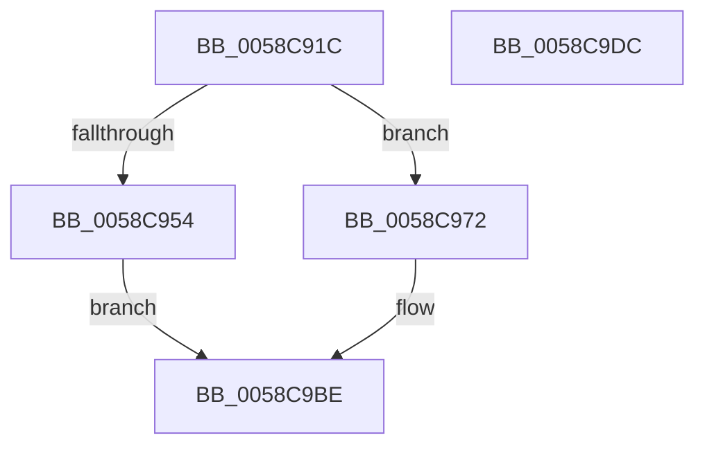

# HvlpLogProcessorStartupFailure

- RVA: `0x0058C91C`–`0x0058C9DD` (길이 `193` bytes)
- VA: `0x000000014058C91C`
- 실행 섹션: `.text`
- PDB 이름 있음: `예`; PDB Function 태그: `아니요`
- unwind 정보 RVA: `0x000B05B8`
- 디코드: `42`개 명령, `193/193` bytes 표시
- 미해석 바이트: `0` (있으면 어셈블리에 `.byte`로 보존)

> 이 문서는 커널 이미지의 기계어와 PDB 기호를 분석해 생성했습니다. 4번과 5번은 함수 원형과 자료형을 바이너리 사용 방식에서 추정한 C 해석이며 원본 소스 복구 결과는 아닙니다.

## 1. Dependencies

- 직접 호출 지점: **2**; 고유 호출 대상: **2**
- 직접 호출자로 확인된 함수: **1**
- RIP 상대 이미지 참조: **3**

### Outgoing calls
- `0x0058C9C2` → [HvlpWriteEventLog](HvlpWriteEventLog_function_0058C9E4.md) (function, `0x0058C9E4`)
- `0x0058C9CE` → [_security_check_cookie](../6A/_security_check_cookie_function_006AC640.md) (function, `0x006AC640`)

### Direct callers
- [HvlPhase2Initialize](HvlPhase2Initialize_function_00583EA0.md) at `0x00584080`

### Static image references
- `0x0058C931` → RVA `0x00E0A740` (`.data`; read)
- `0x0058C964` → RVA `0x00026968` (`.rdata`; read)
- `0x0058C982` → RVA `0x00026998` (`.rdata`; read)

## 2. Other-region calls and transfers

- 다른 실행 섹션으로 향하는 call: **0**
- 별도 외부 분기/꼬리 이동을 확인하지 못했습니다.

## 3. Assembly (complete function range)

```asm
0058C91C  89 54 24 10                     mov dword ptr [rsp + 0x10], edx
0058C920  89 4C 24 08                     mov dword ptr [rsp + 8], ecx
0058C924  55                              push rbp
0058C925  48 8D 6C 24 A9                  lea rbp, [rsp - 0x57]
0058C92A  48 81 EC 90 00 00 00            sub rsp, 0x90
0058C931  48 8B 05 08 DE 87 00            mov rax, qword ptr [rip + 0x87de08]
0058C938  48 33 C4                        xor rax, rsp
0058C93B  48 89 45 47                     mov qword ptr [rbp + 0x47], rax
0058C93F  48 C7 45 EF 04 00 00 00         mov qword ptr [rbp - 0x11], 4
0058C947  48 8D 45 67                     lea rax, [rbp + 0x67]
0058C94B  48 89 45 E7                     mov qword ptr [rbp - 0x19], rax
0058C94F  83 FA 3C                        cmp edx, 0x3c
0058C952  74 1E                           je 0x14058c972
0058C954  48 8D 45 6F                     lea rax, [rbp + 0x6f]
0058C958  48 C7 45 FF 04 00 00 00         mov qword ptr [rbp - 1], 4
0058C960  48 89 45 F7                     mov qword ptr [rbp - 9], rax
0058C964  48 8D 0D FD 9F A9 FF            lea rcx, [rip - 0x566003]
0058C96B  BA 02 00 00 00                  mov edx, 2
0058C970  EB 4C                           jmp 0x14058c9be
0058C972  49 8D 40 08                     lea rax, [r8 + 8]
0058C976  48 C7 45 FF 08 00 00 00         mov qword ptr [rbp - 1], 8
0058C97E  48 89 45 F7                     mov qword ptr [rbp - 9], rax
0058C982  48 8D 0D 0F A0 A9 FF            lea rcx, [rip - 0x565ff1]
0058C989  49 8D 40 10                     lea rax, [r8 + 0x10]
0058C98D  48 C7 45 0F 08 00 00 00         mov qword ptr [rbp + 0xf], 8
0058C995  48 89 45 07                     mov qword ptr [rbp + 7], rax
0058C999  BA 05 00 00 00                  mov edx, 5
0058C99E  49 8D 40 18                     lea rax, [r8 + 0x18]
0058C9A2  48 C7 45 1F 08 00 00 00         mov qword ptr [rbp + 0x1f], 8
0058C9AA  48 89 45 17                     mov qword ptr [rbp + 0x17], rax
0058C9AE  49 8D 40 20                     lea rax, [r8 + 0x20]
0058C9B2  48 89 45 27                     mov qword ptr [rbp + 0x27], rax
0058C9B6  48 C7 45 2F 08 00 00 00         mov qword ptr [rbp + 0x2f], 8
0058C9BE  4C 8D 45 E7                     lea r8, [rbp - 0x19]
0058C9C2  E8 1D 00 00 00                  call 0x14058c9e4
0058C9C7  48 8B 4D 47                     mov rcx, qword ptr [rbp + 0x47]
0058C9CB  48 33 CC                        xor rcx, rsp
0058C9CE  E8 6D FC 11 00                  call 0x1406ac640
0058C9D3  48 81 C4 90 00 00 00            add rsp, 0x90
0058C9DA  5D                              pop rbp
0058C9DB  C3                              ret
0058C9DC  CC                              int3
```

## 4. C-style interpretation (structured pseudocode)

```c
__int64 __fastcall HvlpLogProcessorStartupFailure(int a1, int a2, __int64 a3)
{
    __int64 result;
    __int64 v_rsp;
    unsigned __int64 v_stack_m18;
    unsigned __int64 v_stack_m30;
    unsigned __int64 v_stack_m38;
    unsigned __int64 v_stack_m40;
    unsigned __int64 v_stack_m48;
    unsigned __int64 v_stack_m50;
    unsigned __int64 v_stack_m58;
    unsigned __int64 v_stack_m5F;
    unsigned __int64 v_stack_m60;
    unsigned __int64 v_stack_m68;
    unsigned __int64 v_stack_m70;
    unsigned __int64 v_stack_m78;
    unsigned int v_stack_p10;
    unsigned int v_stack_p8;

    v_stack_p10 = a2;
    v_stack_p8 = a1;
    v_rsp = (v_rsp) - (144);
    result = (*(unsigned __int64 *)(v_rip + 8904200)) ^ (v_rsp);
    v_stack_m18 = result;
    v_stack_m70 = 4;
    v_stack_m78 = v_stack_p8;
    if (a2 == 60) goto loc_0058C972;
    v_stack_m60 = 4;
    v_stack_m68 = v_stack_p10;
    goto loc_0058C9BE;
loc_0058C972:
    v_stack_m60 = 8;
    v_stack_m68 = a3 + 8;
    v_stack_m50 = 8;
    v_stack_m58 = a3 + 16;
    v_stack_m40 = 8;
    v_stack_m48 = a3 + 24;
    v_stack_m38 = a3 + 32;
    v_stack_m30 = 8;
loc_0058C9BE:
    result = HvlpWriteEventLog(v_rip - 5660657, 5, v_stack_m78, a4);
    a1 = (v_stack_m18) ^ (v_rsp);
    result = _security_check_cookie(a1, 5, v_stack_m78, a4);
    v_rsp = (v_rsp) + (144);
    return result;
}
```

## 5. (Beta) C Style

```c
int64_t HvlpLogProcessorStartupFailure(int32_t Arg1, int32_t Arg2, void *Arg3)
{
    uint8_t *arg3 = (uint8_t *)Arg3;

    int64_t result;
    int64_t local_rsp;
    uint64_t v_stack_m18;
    uint64_t v_stack_m30;
    uint64_t v_stack_m38;
    uint64_t v_stack_m40;
    uint64_t v_stack_m48;
    uint64_t v_stack_m50;
    uint64_t v_stack_m58;
    uint64_t v_stack_m5F;
    uint64_t v_stack_m60;
    uint64_t v_stack_m68;
    uint64_t v_stack_m70;
    uint64_t v_stack_m78;
    uint32_t v_stack_p10;
    uint32_t v_stack_p8;

    v_stack_p10 = Arg2;
    v_stack_p8 = Arg1;
    local_rsp = (local_rsp) - (144);
    result = (*(uint64_t *)(v_rip + 0x87DE08)) ^ (local_rsp);
    v_stack_m18 = result;
    v_stack_m70 = 4;
    v_stack_m78 = v_stack_p8;
    if (Arg2 == 60) goto loc_0058C972;
    v_stack_m60 = 4;
    v_stack_m68 = v_stack_p10;
    goto loc_0058C9BE;
loc_0058C972:
    v_stack_m60 = 8;
    v_stack_m68 = Arg3 + 8;
    v_stack_m50 = 8;
    v_stack_m58 = Arg3 + 16;
    v_stack_m40 = 8;
    v_stack_m48 = Arg3 + 24;
    v_stack_m38 = Arg3 + 32;
    v_stack_m30 = 8;
loc_0058C9BE:
    result = HvlpWriteEventLog(v_rip - 5660657, 5, v_stack_m78, a4);
    Arg1 = (v_stack_m18) ^ (local_rsp);
    result = _security_check_cookie(Arg1, 5, v_stack_m78, a4);
    local_rsp = (local_rsp) + (144);
    return result;
}
```

### 관측된 메모리 오프셋

구조체 형식이 확인되지 않은 접근은 인자 기준의 오프셋으로만 기록했습니다.

| 기준 인자 | 오프셋 표현 | 폭 (bit) | 접근 |
|---|---:|---:|---|
| `Arg3` | `+ 0x8` | `64` | `R` |
| `Arg3` | `+ 0x10` | `64` | `R` |
| `Arg3` | `+ 0x18` | `64` | `R` |
| `Arg3` | `+ 0x20` | `64` | `R` |

## 6. Execution-region graph

[열기: 2D/3D 그래프와 함수 탐색 컨트롤 패널](../../../control-panel.html?section=text&rva=0x0058C91C&view=graph)

- 2D 그래프는 위에서 아래로 흐르고, 3D 그래프는 빈 공간을 드래그해 회전합니다. Shift+드래그는 이동, 휠은 확대·축소, 함수 노드 선택은 대상 보고서 이동입니다.

### Static fallback


