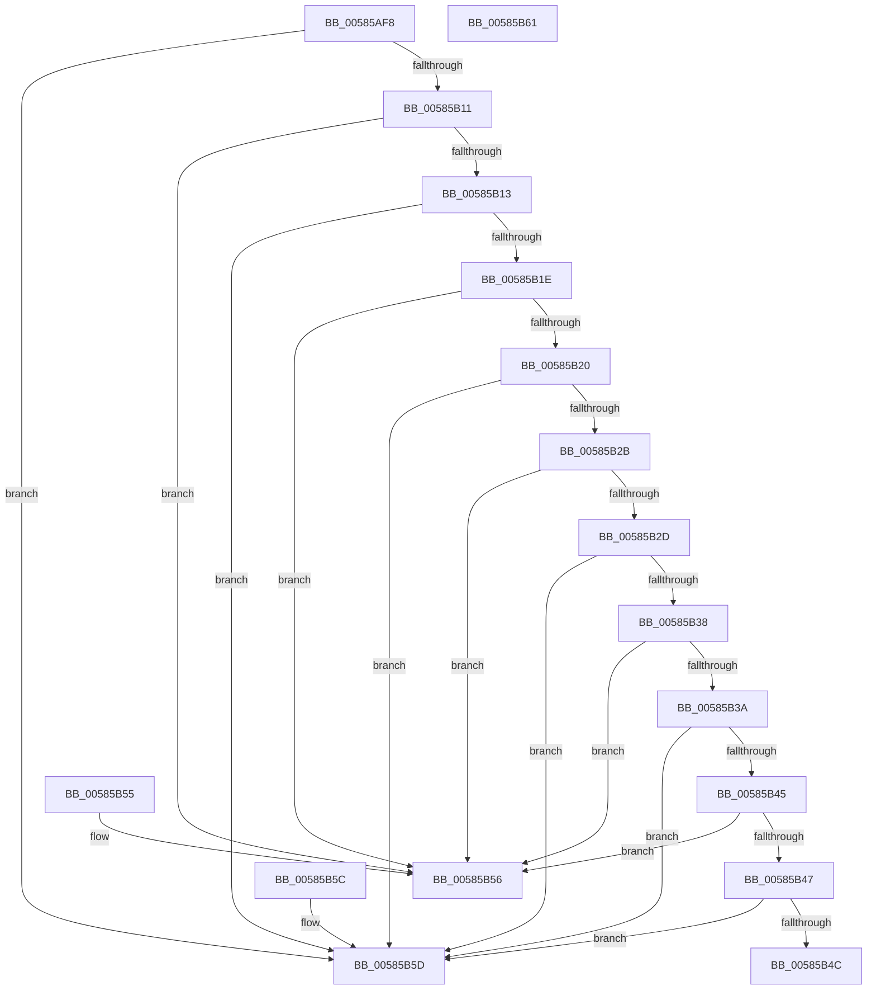

# HvlpLpComparison

- RVA: `0x00585AF8`–`0x00585B62` (길이 `106` bytes)
- VA: `0x0000000140585AF8`
- 실행 섹션: `.text`
- PDB 이름 있음: `예`; PDB Function 태그: `아니요`
- unwind 정보 RVA: `0x000DB714`
- 디코드: `37`개 명령, `106/106` bytes 표시
- 미해석 바이트: `0` (있으면 어셈블리에 `.byte`로 보존)

> 이 문서는 커널 이미지의 기계어와 PDB 기호를 분석해 생성했습니다. 4번과 5번은 함수 원형과 자료형을 바이너리 사용 방식에서 추정한 C 해석이며 원본 소스 복구 결과는 아닙니다.

## 1. Dependencies

- 직접 호출 지점: **0**; 고유 호출 대상: **0**
- 직접 호출자로 확인된 함수: **2**
- RIP 상대 이미지 참조: **0**

### Outgoing calls
- 직접 디코드된 call 명령이 없습니다.

### Direct callers
- [HvlpSelectLpSet](HvlpSelectLpSet_function_00585D30.md) at `0x0058608A`
- [HvlpSelectVpSet](HvlpSelectVpSet_function_0058616C.md) at `0x0058669E`

### Static image references
- 디코드된 RIP-relative 메모리 참조가 없습니다.

## 2. Other-region calls and transfers

- 다른 실행 섹션으로 향하는 call: **0**
- 별도 외부 분기/꼬리 이동을 확인하지 못했습니다.

## 3. Assembly (complete function range)

```asm
00585AF8  41 8B C1                        mov eax, r9d
00585AFB  45 8B D8                        mov r11d, r8d
00585AFE  4C 8D 14 80                     lea r10, [rax + rax*4]
00585B02  4B 8D 0C 9B                     lea rcx, [r11 + r11*4]
00585B06  8B 44 CA 10                     mov eax, dword ptr [rdx + rcx*8 + 0x10]
00585B0A  42 3B 44 D2 10                  cmp eax, dword ptr [rdx + r10*8 + 0x10]
00585B0F  72 4C                           jb 0x140585b5d
00585B11  77 43                           ja 0x140585b56
00585B13  8B 44 CA 14                     mov eax, dword ptr [rdx + rcx*8 + 0x14]
00585B17  42 3B 44 D2 14                  cmp eax, dword ptr [rdx + r10*8 + 0x14]
00585B1C  72 3F                           jb 0x140585b5d
00585B1E  77 36                           ja 0x140585b56
00585B20  8B 44 CA 18                     mov eax, dword ptr [rdx + rcx*8 + 0x18]
00585B24  42 3B 44 D2 18                  cmp eax, dword ptr [rdx + r10*8 + 0x18]
00585B29  77 32                           ja 0x140585b5d
00585B2B  72 29                           jb 0x140585b56
00585B2D  8B 44 CA 1C                     mov eax, dword ptr [rdx + rcx*8 + 0x1c]
00585B31  42 3B 44 D2 1C                  cmp eax, dword ptr [rdx + r10*8 + 0x1c]
00585B36  77 25                           ja 0x140585b5d
00585B38  72 1C                           jb 0x140585b56
00585B3A  8B 44 CA 20                     mov eax, dword ptr [rdx + rcx*8 + 0x20]
00585B3E  42 3B 44 D2 20                  cmp eax, dword ptr [rdx + r10*8 + 0x20]
00585B43  77 18                           ja 0x140585b5d
00585B45  72 0F                           jb 0x140585b56
00585B47  45 3B D9                        cmp r11d, r9d
00585B4A  72 11                           jb 0x140585b5d
00585B4C  33 C0                           xor eax, eax
00585B4E  45 3B D9                        cmp r11d, r9d
00585B51  0F 97 C0                        seta al
00585B54  C3                              ret
00585B55  CC                              int3
00585B56  B8 01 00 00 00                  mov eax, 1
00585B5B  C3                              ret
00585B5C  CC                              int3
00585B5D  83 C8 FF                        or eax, 0xffffffff
00585B60  C3                              ret
00585B61  CC                              int3
```

## 4. C-style interpretation (structured pseudocode)

```c
__int64 __fastcall HvlpLpComparison(__int64 a1, __int64 a2, int a3, int a4)
{
    __int64 result;

    if (((unsigned int)((unsigned int)(*(unsigned int *)(a2 + (unsigned int)(a3) + (unsigned int)(a3) * 4 * 8 + 16)))) < (*(unsigned int *)(a2 + (unsigned int)(a4) + (unsigned int)(a4) * 4 * 8 + 16))) goto loc_00585B5D;
    if (((unsigned int)((unsigned int)(*(unsigned int *)(a2 + (unsigned int)(a3) + (unsigned int)(a3) * 4 * 8 + 16)))) > (*(unsigned int *)(a2 + (unsigned int)(a4) + (unsigned int)(a4) * 4 * 8 + 16))) goto loc_00585B56;
    if (((unsigned int)((unsigned int)(*(unsigned int *)(a2 + (unsigned int)(a3) + (unsigned int)(a3) * 4 * 8 + 20)))) < (*(unsigned int *)(a2 + (unsigned int)(a4) + (unsigned int)(a4) * 4 * 8 + 20))) goto loc_00585B5D;
    if (((unsigned int)((unsigned int)(*(unsigned int *)(a2 + (unsigned int)(a3) + (unsigned int)(a3) * 4 * 8 + 20)))) > (*(unsigned int *)(a2 + (unsigned int)(a4) + (unsigned int)(a4) * 4 * 8 + 20))) goto loc_00585B56;
    if (((unsigned int)((unsigned int)(*(unsigned int *)(a2 + (unsigned int)(a3) + (unsigned int)(a3) * 4 * 8 + 24)))) > (*(unsigned int *)(a2 + (unsigned int)(a4) + (unsigned int)(a4) * 4 * 8 + 24))) goto loc_00585B5D;
    if (((unsigned int)((unsigned int)(*(unsigned int *)(a2 + (unsigned int)(a3) + (unsigned int)(a3) * 4 * 8 + 24)))) < (*(unsigned int *)(a2 + (unsigned int)(a4) + (unsigned int)(a4) * 4 * 8 + 24))) goto loc_00585B56;
    if (((unsigned int)((unsigned int)(*(unsigned int *)(a2 + (unsigned int)(a3) + (unsigned int)(a3) * 4 * 8 + 28)))) > (*(unsigned int *)(a2 + (unsigned int)(a4) + (unsigned int)(a4) * 4 * 8 + 28))) goto loc_00585B5D;
    if (((unsigned int)((unsigned int)(*(unsigned int *)(a2 + (unsigned int)(a3) + (unsigned int)(a3) * 4 * 8 + 28)))) < (*(unsigned int *)(a2 + (unsigned int)(a4) + (unsigned int)(a4) * 4 * 8 + 28))) goto loc_00585B56;
    if (((unsigned int)((unsigned int)(*(unsigned int *)(a2 + (unsigned int)(a3) + (unsigned int)(a3) * 4 * 8 + 32)))) > (*(unsigned int *)(a2 + (unsigned int)(a4) + (unsigned int)(a4) * 4 * 8 + 32))) goto loc_00585B5D;
    if (((unsigned int)((unsigned int)(*(unsigned int *)(a2 + (unsigned int)(a3) + (unsigned int)(a3) * 4 * 8 + 32)))) < (*(unsigned int *)(a2 + (unsigned int)(a4) + (unsigned int)(a4) * 4 * 8 + 32))) goto loc_00585B56;
    if (((unsigned int)((unsigned int)(a3))) < a4) goto loc_00585B5D;
    result = 0;
    result = (((unsigned int)((unsigned int)(a3))) > a4) ? 1 : 0;
    return result;
loc_00585B56:
    return 1;
loc_00585B5D:
    result = (unsigned int)((1) | (0xFFFFFFFFULL));
    return result;
}
```

## 5. (Beta) C Style

```c
int64_t HvlpLpComparison(int64_t Arg1, void *Arg2, void *Arg3, void *Arg4)
{
    uint8_t *arg2 = (uint8_t *)Arg2;
    uint8_t *arg3 = (uint8_t *)Arg3;
    uint8_t *arg4 = (uint8_t *)Arg4;

    int64_t result;

    if (((uint32_t)((uint32_t)(*(uint32_t *)(arg2 + (uint32_t)(arg3) + (uint32_t)(arg3) * 4 * 8 + 0x10)))) < (*(uint32_t *)(arg2 + (uint32_t)(arg4) + (uint32_t)(arg4) * 4 * 8 + 0x10))) goto loc_00585B5D;
    if (((uint32_t)((uint32_t)(*(uint32_t *)(arg2 + (uint32_t)(arg3) + (uint32_t)(arg3) * 4 * 8 + 0x10)))) > (*(uint32_t *)(arg2 + (uint32_t)(arg4) + (uint32_t)(arg4) * 4 * 8 + 0x10))) goto loc_00585B56;
    if (((uint32_t)((uint32_t)(*(uint32_t *)(arg2 + (uint32_t)(arg3) + (uint32_t)(arg3) * 4 * 8 + 0x14)))) < (*(uint32_t *)(arg2 + (uint32_t)(arg4) + (uint32_t)(arg4) * 4 * 8 + 0x14))) goto loc_00585B5D;
    if (((uint32_t)((uint32_t)(*(uint32_t *)(arg2 + (uint32_t)(arg3) + (uint32_t)(arg3) * 4 * 8 + 0x14)))) > (*(uint32_t *)(arg2 + (uint32_t)(arg4) + (uint32_t)(arg4) * 4 * 8 + 0x14))) goto loc_00585B56;
    if (((uint32_t)((uint32_t)(*(uint32_t *)(arg2 + (uint32_t)(arg3) + (uint32_t)(arg3) * 4 * 8 + 0x18)))) > (*(uint32_t *)(arg2 + (uint32_t)(arg4) + (uint32_t)(arg4) * 4 * 8 + 0x18))) goto loc_00585B5D;
    if (((uint32_t)((uint32_t)(*(uint32_t *)(arg2 + (uint32_t)(arg3) + (uint32_t)(arg3) * 4 * 8 + 0x18)))) < (*(uint32_t *)(arg2 + (uint32_t)(arg4) + (uint32_t)(arg4) * 4 * 8 + 0x18))) goto loc_00585B56;
    if (((uint32_t)((uint32_t)(*(uint32_t *)(arg2 + (uint32_t)(arg3) + (uint32_t)(arg3) * 4 * 8 + 0x1C)))) > (*(uint32_t *)(arg2 + (uint32_t)(arg4) + (uint32_t)(arg4) * 4 * 8 + 0x1C))) goto loc_00585B5D;
    if (((uint32_t)((uint32_t)(*(uint32_t *)(arg2 + (uint32_t)(arg3) + (uint32_t)(arg3) * 4 * 8 + 0x1C)))) < (*(uint32_t *)(arg2 + (uint32_t)(arg4) + (uint32_t)(arg4) * 4 * 8 + 0x1C))) goto loc_00585B56;
    if (((uint32_t)((uint32_t)(*(uint32_t *)(arg2 + (uint32_t)(arg3) + (uint32_t)(arg3) * 4 * 8 + 0x20)))) > (*(uint32_t *)(arg2 + (uint32_t)(arg4) + (uint32_t)(arg4) * 4 * 8 + 0x20))) goto loc_00585B5D;
    if (((uint32_t)((uint32_t)(*(uint32_t *)(arg2 + (uint32_t)(arg3) + (uint32_t)(arg3) * 4 * 8 + 0x20)))) < (*(uint32_t *)(arg2 + (uint32_t)(arg4) + (uint32_t)(arg4) * 4 * 8 + 0x20))) goto loc_00585B56;
    if (((uint32_t)((uint32_t)(Arg3))) < Arg4) goto loc_00585B5D;
    result = 0;
    result = (((uint32_t)((uint32_t)(Arg3))) > Arg4) ? 1 : 0;
    return result;
loc_00585B56:
    return 1;
loc_00585B5D:
    result = (uint32_t)((1) | (0xFFFFFFFFULL));
    return result;
}
```

### 관측된 메모리 오프셋

구조체 형식이 확인되지 않은 접근은 인자 기준의 오프셋으로만 기록했습니다.

| 기준 인자 | 오프셋 표현 | 폭 (bit) | 접근 |
|---|---:|---:|---|
| `Arg2` | `+ 0x10 + r10*8` | `32` | `R` |
| `Arg2` | `+ 0x10 + rcx*8` | `32` | `R` |
| `Arg2` | `+ 0x14 + r10*8` | `32` | `R` |
| `Arg2` | `+ 0x14 + rcx*8` | `32` | `R` |
| `Arg2` | `+ 0x18 + r10*8` | `32` | `R` |
| `Arg2` | `+ 0x18 + rcx*8` | `32` | `R` |
| `Arg2` | `+ 0x1C + r10*8` | `32` | `R` |
| `Arg2` | `+ 0x1C + rcx*8` | `32` | `R` |
| `Arg2` | `+ 0x20 + r10*8` | `32` | `R` |
| `Arg2` | `+ 0x20 + rcx*8` | `32` | `R` |
| `Arg3` | `+ 0x0 + r11*4` | `64` | `R` |
| `Arg4` | `+ 0x0 + rax*4` | `64` | `R` |

## 6. Execution-region graph

[열기: 2D/3D 그래프와 함수 탐색 컨트롤 패널](../../../control-panel.html?section=text&rva=0x00585AF8&view=graph)

- 2D 그래프는 위에서 아래로 흐르고, 3D 그래프는 빈 공간을 드래그해 회전합니다. Shift+드래그는 이동, 휠은 확대·축소, 함수 노드 선택은 대상 보고서 이동입니다.

### Static fallback


