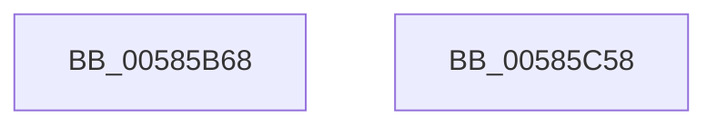

# HvlpMapStatisticsPage

- RVA: `0x00585B68`–`0x00585C59` (길이 `241` bytes)
- VA: `0x0000000140585B68`
- 실행 섹션: `.text`
- PDB 이름 있음: `예`; PDB Function 태그: `아니요`
- unwind 정보 RVA: `0x000C6620`
- 디코드: `66`개 명령, `241/241` bytes 표시
- 미해석 바이트: `0` (있으면 어셈블리에 `.byte`로 보존)

> 이 문서는 커널 이미지의 기계어와 PDB 기호를 분석해 생성했습니다. 4번과 5번은 함수 원형과 자료형을 바이너리 사용 방식에서 추정한 C 해석이며 원본 소스 복구 결과는 아닙니다.

## 1. Dependencies

- 직접 호출 지점: **6**; 고유 호출 대상: **4**
- 직접 호출자로 확인된 함수: **3**
- RIP 상대 이미지 참조: **1**

### Outgoing calls
- `0x00585BC7` → [HvlpAcquireHypercallPage](../47/HvlpAcquireHypercallPage_function_00471410.md) (function, `0x00471410`)
- `0x00585BE1` → [HvlpAcquireHypercallPage](../47/HvlpAcquireHypercallPage_function_00471410.md) (function, `0x00471410`)
- `0x00585C01` → [HvcallInitiateHypercall](../31/HvcallInitiateHypercall_function_00313630.md) (function, `0x00313630`)
- `0x00585C17` → [HvlpReleaseHypercallPage](../31/HvlpReleaseHypercallPage_function_00313480.md) (function, `0x00313480`)
- `0x00585C20` → [HvlpReleaseHypercallPage](../31/HvlpReleaseHypercallPage_function_00313480.md) (function, `0x00313480`)
- `0x00585C36` → [_security_check_cookie](../6A/_security_check_cookie_function_006AC640.md) (function, `0x006AC640`)

### Direct callers
- [HvlPhase1Initialize](HvlPhase1Initialize_function_00583D80.md) at `0x00583E2F`
- [HvlpEnableNextLogicalProcessor](HvlpEnableNextLogicalProcessor_function_00585680.md) at `0x00585709`
- [HvlpInitializeBootProcessor](HvlpInitializeBootProcessor_function_00585964.md) at `0x00585AB7`

### Static image references
- `0x00585B87` → RVA `0x00E0A740` (`.data`; read)

## 2. Other-region calls and transfers

- 다른 실행 섹션으로 향하는 call: **0**
- 별도 외부 분기/꼬리 이동을 확인하지 못했습니다.

## 3. Assembly (complete function range)

```asm
00585B68  48 8B C4                        mov rax, rsp
00585B6B  48 89 58 08                     mov qword ptr [rax + 8], rbx
00585B6F  48 89 70 10                     mov qword ptr [rax + 0x10], rsi
00585B73  48 89 78 20                     mov qword ptr [rax + 0x20], rdi
00585B77  55                              push rbp
00585B78  41 56                           push r14
00585B7A  41 57                           push r15
00585B7C  48 8D 68 A1                     lea rbp, [rax - 0x5f]
00585B80  48 81 EC B0 00 00 00            sub rsp, 0xb0
00585B87  48 8B 05 B2 4B 88 00            mov rax, qword ptr [rip + 0x884bb2]
00585B8E  48 33 C4                        xor rax, rsp
00585B91  48 89 45 37                     mov qword ptr [rbp + 0x37], rax
00585B95  33 C0                           xor eax, eax
00585B97  0F 57 C0                        xorps xmm0, xmm0
00585B9A  4D 8B F8                        mov r15, r8
00585B9D  48 89 45 E7                     mov qword ptr [rbp - 0x19], rax
00585BA1  4C 8B F2                        mov r14, rdx
00585BA4  89 45 EF                        mov dword ptr [rbp - 0x11], eax
00585BA7  8B F1                           mov esi, ecx
00585BA9  48 89 45 C7                     mov qword ptr [rbp - 0x39], rax
00585BAD  44 8D 48 18                     lea r9d, [rax + 0x18]
00585BB1  89 45 CF                        mov dword ptr [rbp - 0x31], eax
00585BB4  8D 50 01                        lea edx, [rax + 1]
00585BB7  4C 8D 45 07                     lea r8, [rbp + 7]
00585BBB  48 8D 4D D7                     lea rcx, [rbp - 0x29]
00585BBF  0F 11 45 D7                     movups xmmword ptr [rbp - 0x29], xmm0
00585BC3  0F 11 45 B7                     movups xmmword ptr [rbp - 0x49], xmm0
00585BC7  E8 44 B8 EE FF                  call 0x140471410
00585BCC  41 B9 08 00 00 00               mov r9d, 8
00585BD2  4C 8D 45 F7                     lea r8, [rbp - 9]
00585BD6  48 8D 4D B7                     lea rcx, [rbp - 0x49]
00585BDA  48 8B D8                        mov rbx, rax
00585BDD  41 8D 51 FA                     lea edx, [r9 - 6]
00585BE1  E8 2A B8 EE FF                  call 0x140471410
00585BE6  41 0F 10 06                     movups xmm0, xmmword ptr [r14]
00585BEA  4C 8B 45 CF                     mov r8, qword ptr [rbp - 0x31]
00585BEE  B9 6C 00 00 00                  mov ecx, 0x6c
00585BF3  48 8B 55 EF                     mov rdx, qword ptr [rbp - 0x11]
00585BF7  48 8B F8                        mov rdi, rax
00585BFA  F3 0F 7F 43 08                  movdqu xmmword ptr [rbx + 8], xmm0
00585BFF  89 33                           mov dword ptr [rbx], esi
00585C01  E8 2A DA D8 FF                  call 0x140313630
00585C06  48 8B D8                        mov rbx, rax
00585C09  48 8D 4D B7                     lea rcx, [rbp - 0x49]
00585C0D  48 8B 07                        mov rax, qword ptr [rdi]
00585C10  48 C1 E0 0C                     shl rax, 0xc
00585C14  49 89 07                        mov qword ptr [r15], rax
00585C17  E8 64 D8 D8 FF                  call 0x140313480
00585C1C  48 8D 4D D7                     lea rcx, [rbp - 0x29]
00585C20  E8 5B D8 D8 FF                  call 0x140313480
00585C25  66 F7 DB                        neg bx
00585C28  1B C0                           sbb eax, eax
00585C2A  25 01 00 00 C0                  and eax, 0xc0000001
00585C2F  48 8B 4D 37                     mov rcx, qword ptr [rbp + 0x37]
00585C33  48 33 CC                        xor rcx, rsp
00585C36  E8 05 6A 12 00                  call 0x1406ac640
00585C3B  4C 8D 9C 24 B0 00 00 00         lea r11, [rsp + 0xb0]
00585C43  49 8B 5B 20                     mov rbx, qword ptr [r11 + 0x20]
00585C47  49 8B 73 28                     mov rsi, qword ptr [r11 + 0x28]
00585C4B  49 8B 7B 38                     mov rdi, qword ptr [r11 + 0x38]
00585C4F  49 8B E3                        mov rsp, r11
00585C52  41 5F                           pop r15
00585C54  41 5E                           pop r14
00585C56  5D                              pop rbp
00585C57  C3                              ret
00585C58  CC                              int3
```

## 4. C-style interpretation (structured pseudocode)

```c
__int64 __fastcall HvlpMapStatisticsPage(int a1, __int64 a2, __int64 a3)
{
    __int64 result;
    __int64 v_rbx;
    __int64 v_rsp;
    unsigned __int64 v_stack_m18;

    *(unsigned __int64 *)(v_rsp + 8) = v_rbx;
    *(unsigned __int64 *)(v_rsp + 16) = v_rsi;
    *(unsigned __int64 *)(v_rsp + 32) = v_rdi;
    v_rsp = (v_rsp) - (176);
    result = (*(unsigned __int64 *)(v_rip + 8932274)) ^ (v_rsp);
    *(unsigned __int64 *)(v_rsp - 95 + 55) = result;
    result = 0;
    *(unsigned __int64 *)(v_rsp - 95 - 25) = 0;
    *(unsigned int *)(v_rsp - 95 - 17) = 0;
    *(unsigned __int64 *)(v_rsp - 95 - 57) = 0;
    *(unsigned int *)(v_rsp - 95 - 49) = 0;
    *(unsigned __int64 *)(v_rsp - 95 - 41) = v_xmm0;
    *(unsigned __int64 *)(v_rsp - 95 - 73) = v_xmm0;
    result = HvlpAcquireHypercallPage(v_rsp - 95 - 41, result + 1, v_rsp - 95 + 7, result + 24);
    result = HvlpAcquireHypercallPage(v_rsp - 95 - 73, 8 - 6, v_rsp - 95 - 9, 8);
    *(unsigned __int64 *)(result + 8) = v_xmm0;
    *(unsigned int *)(result) = (unsigned int)((unsigned int)(a1));
    result = HvcallInitiateHypercall(108, *(unsigned __int64 *)(v_rsp - 95 - 17), *(unsigned __int64 *)(v_rsp - 95 - 49), 8);
    result = (*(unsigned __int64 *)(result)) << (12);
    *(unsigned __int64 *)(a3) = result;
    result = HvlpReleaseHypercallPage(v_rsp - 95 - 73, *(unsigned __int64 *)(v_rsp - 95 - 17), *(unsigned __int64 *)(v_rsp - 95 - 49), 8);
    result = HvlpReleaseHypercallPage(v_rsp - 95 - 41, *(unsigned __int64 *)(v_rsp - 95 - 17), *(unsigned __int64 *)(v_rsp - 95 - 49), 8);
    v_rbx = (unsigned __int16)(-(result));
    result = (unsigned int)((result) & (0xC0000001ULL));
    a1 = (*(unsigned __int64 *)(v_rsp - 95 + 55)) ^ (v_rsp);
    result = _security_check_cookie(a1, *(unsigned __int64 *)(v_rsp - 95 - 17), *(unsigned __int64 *)(v_rsp - 95 - 49), 8);
    return result;
}
```

## 5. (Beta) C Style

```c
int64_t HvlpMapStatisticsPage(int32_t Arg1, void *Arg2, void *Arg3)
{
    uint8_t *arg2 = (uint8_t *)Arg2;
    uint8_t *arg3 = (uint8_t *)Arg3;

    int64_t result;
    int64_t local_rbx;
    int64_t local_rsp;
    uint64_t v_stack_m18;

    *(uint64_t *)(local_rsp + 0x8) = local_rbx;
    *(uint64_t *)(local_rsp + 0x10) = local_rsi;
    *(uint64_t *)(local_rsp + 0x20) = local_rdi;
    local_rsp = (local_rsp) - (176);
    result = (*(uint64_t *)(v_rip + 0x884BB2)) ^ (local_rsp);
    *(uint64_t *)(local_rsp - 0x5F + 0x37) = result;
    result = 0;
    *(uint64_t *)(local_rsp - 0x5F - 0x19) = 0;
    *(uint32_t *)(local_rsp - 0x5F - 0x11) = 0;
    *(uint64_t *)(local_rsp - 0x5F - 0x39) = 0;
    *(uint32_t *)(local_rsp - 0x5F - 0x31) = 0;
    *(uint64_t *)(local_rsp - 0x5F - 0x29) = v_xmm0;
    *(uint64_t *)(local_rsp - 0x5F - 0x49) = v_xmm0;
    result = HvlpAcquireHypercallPage(local_rsp - 95 - 41, result + 1, local_rsp - 95 + 7, result + 24);
    result = HvlpAcquireHypercallPage(local_rsp - 95 - 73, 8 - 6, local_rsp - 95 - 9, 8);
    *(uint64_t *)(result + 0x8) = v_xmm0;
    *(uint32_t *)(result) = (uint32_t)((uint32_t)(Arg1));
    result = HvcallInitiateHypercall(108, *(uint64_t *)(local_rsp - 0x5F - 0x11), *(uint64_t *)(local_rsp - 0x5F - 0x31), 8);
    result = (*(uint64_t *)(result)) << (12);
    *(uint64_t *)(arg3) = result;
    result = HvlpReleaseHypercallPage(local_rsp - 95 - 73, *(uint64_t *)(local_rsp - 0x5F - 0x11), *(uint64_t *)(local_rsp - 0x5F - 0x31), 8);
    result = HvlpReleaseHypercallPage(local_rsp - 95 - 41, *(uint64_t *)(local_rsp - 0x5F - 0x11), *(uint64_t *)(local_rsp - 0x5F - 0x31), 8);
    local_rbx = (uint16_t)(-(result));
    result = (uint32_t)((result) & (0xC0000001ULL));
    Arg1 = (*(uint64_t *)(local_rsp - 0x5F + 0x37)) ^ (local_rsp);
    result = _security_check_cookie(Arg1, *(uint64_t *)(local_rsp - 0x5F - 0x11), *(uint64_t *)(local_rsp - 0x5F - 0x31), 8);
    return result;
}
```

### 관측된 메모리 오프셋

구조체 형식이 확인되지 않은 접근은 인자 기준의 오프셋으로만 기록했습니다.

| 기준 인자 | 오프셋 표현 | 폭 (bit) | 접근 |
|---|---:|---:|---|
| `Arg2` | `+ 0x0` | `128` | `R` |
| `Arg3` | `+ 0x0` | `64` | `W` |

## 6. Execution-region graph

[열기: 2D/3D 그래프와 함수 탐색 컨트롤 패널](../../../control-panel.html?section=text&rva=0x00585B68&view=graph)

- 2D 그래프는 위에서 아래로 흐르고, 3D 그래프는 빈 공간을 드래그해 회전합니다. Shift+드래그는 이동, 휠은 확대·축소, 함수 노드 선택은 대상 보고서 이동입니다.

### Static fallback


