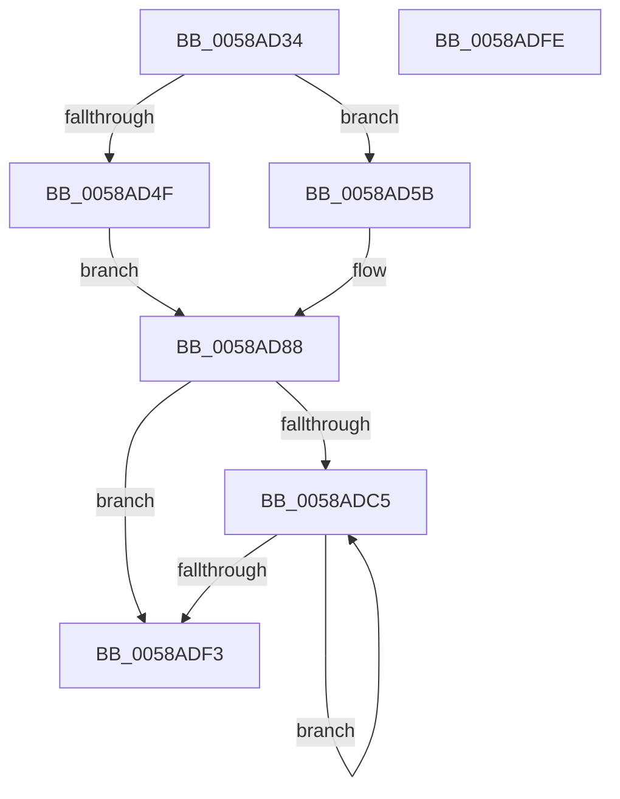

# HvlpMarkHvlPagesForHibernation

- RVA: `0x0058AD34`–`0x0058ADFF` (길이 `203` bytes)
- VA: `0x000000014058AD34`
- 실행 섹션: `.text`
- PDB 이름 있음: `예`; PDB Function 태그: `아니요`
- unwind 정보 RVA: `0x000C6858`
- 디코드: `50`개 명령, `203/203` bytes 표시
- 미해석 바이트: `0` (있으면 어셈블리에 `.byte`로 보존)

> 이 문서는 커널 이미지의 기계어와 PDB 기호를 분석해 생성했습니다. 4번과 5번은 함수 원형과 자료형을 바이너리 사용 방식에서 추정한 C 해석이며 원본 소스 복구 결과는 아닙니다.

## 1. Dependencies

- 직접 호출 지점: **6**; 고유 호출 대상: **3**
- 직접 호출자로 확인된 함수: **1**
- RIP 상대 이미지 참조: **4**

### Outgoing calls
- `0x0058AD72` → [PoSetHiberRange](../47/PoSetHiberRange_function_0047C580.md) (function, `0x0047C580`)
- `0x0058AD90` → [PoSetHiberRange](../47/PoSetHiberRange_function_0047C580.md) (function, `0x0047C580`)
- `0x0058ADAE` → [PoSetHiberRange](../47/PoSetHiberRange_function_0047C580.md) (function, `0x0047C580`)
- `0x0058ADB8` → [KeQueryActiveProcessorCountEx](../24/KeQueryActiveProcessorCountEx_function_00249EF0.md) (function, `0x00249EF0`)
- `0x0058ADC7` → [KeGetPrcb](../2D/KeGetPrcb_function_002D85D0.md) (function, `0x002D85D0`)
- `0x0058ADE8` → [PoSetHiberRange](../47/PoSetHiberRange_function_0047C580.md) (function, `0x0047C580`)

### Direct callers
- [HvlMarkHiberPhase](HvlMarkHiberPhase_function_0058A5EC.md) at `0x0058A639`

### Static image references
- `0x0058AD3E` → RVA `0x00FC6A90` (`ALMOSTRO`; read)
- `0x0058AD52` → RVA `0x002DDBC0` (`HvlGetReferenceTimeUsingTscPage`; read)
- `0x0058AD5B` → RVA `0x00FC6D88` (`ALMOSTRO`; read)
- `0x0058AD77` → RVA `0x01201850` (`CFGRO`; read)

## 2. Other-region calls and transfers

- 다른 실행 섹션으로 향하는 call: **0**
- 별도 외부 분기/꼬리 이동을 확인하지 못했습니다.

## 3. Assembly (complete function range)

```asm
0058AD34  48 89 74 24 08                  mov qword ptr [rsp + 8], rsi
0058AD39  57                              push rdi
0058AD3A  48 83 EC 30                     sub rsp, 0x30
0058AD3E  8B 05 4C BD A3 00               mov eax, dword ptr [rip + 0xa3bd4c]
0058AD44  33 C9                           xor ecx, ecx
0058AD46  BA 00 00 01 00                  mov edx, 0x10000
0058AD4B  A8 02                           test al, 2
0058AD4D  74 0C                           je 0x14058ad5b
0058AD4F  45 33 C9                        xor r9d, r9d
0058AD52  4C 8D 05 67 2E D5 FF            lea r8, [rip - 0x2ad199]
0058AD59  EB 2D                           jmp 0x14058ad88
0058AD5B  4C 8B 05 26 C0 A3 00            mov r8, qword ptr [rip + 0xa3c026]
0058AD62  BF 00 10 00 00                  mov edi, 0x1000
0058AD67  44 8B CF                        mov r9d, edi
0058AD6A  C7 44 24 20 48 76 6C 64         mov dword ptr [rsp + 0x20], 0x646c7648
0058AD72  E8 09 18 EF FF                  call 0x14047c580
0058AD77  4C 8B 05 D2 6A C7 00            mov r8, qword ptr [rip + 0xc76ad2]
0058AD7E  44 8B CF                        mov r9d, edi
0058AD81  BA 00 00 01 00                  mov edx, 0x10000
0058AD86  33 C9                           xor ecx, ecx
0058AD88  C7 44 24 20 48 76 6C 63         mov dword ptr [rsp + 0x20], 0x636c7648
0058AD90  E8 EB 17 EF FF                  call 0x14047c580
0058AD95  45 33 C9                        xor r9d, r9d
0058AD98  C7 44 24 20 48 76 6C 64         mov dword ptr [rsp + 0x20], 0x646c7648
0058ADA0  4C 8D 05 E9 BC A3 00            lea r8, [rip + 0xa3bce9]
0058ADA7  BA 00 00 01 00                  mov edx, 0x10000
0058ADAC  33 C9                           xor ecx, ecx
0058ADAE  E8 CD 17 EF FF                  call 0x14047c580
0058ADB3  B9 FF FF 00 00                  mov ecx, 0xffff
0058ADB8  E8 33 F1 CB FF                  call 0x140249ef0
0058ADBD  33 FF                           xor edi, edi
0058ADBF  8B F0                           mov esi, eax
0058ADC1  85 C0                           test eax, eax
0058ADC3  74 2E                           je 0x14058adf3
0058ADC5  8B CF                           mov ecx, edi
0058ADC7  E8 04 D8 D4 FF                  call 0x1402d85d0
0058ADCC  41 B9 00 60 00 00               mov r9d, 0x6000
0058ADD2  C7 44 24 20 48 76 6C 64         mov dword ptr [rsp + 0x20], 0x646c7648
0058ADDA  BA 00 00 01 00                  mov edx, 0x10000
0058ADDF  33 C9                           xor ecx, ecx
0058ADE1  4C 8B 80 00 8C 00 00            mov r8, qword ptr [rax + 0x8c00]
0058ADE8  E8 93 17 EF FF                  call 0x14047c580
0058ADED  FF C7                           inc edi
0058ADEF  3B FE                           cmp edi, esi
0058ADF1  72 D2                           jb 0x14058adc5
0058ADF3  48 8B 74 24 40                  mov rsi, qword ptr [rsp + 0x40]
0058ADF8  48 83 C4 30                     add rsp, 0x30
0058ADFC  5F                              pop rdi
0058ADFD  C3                              ret
0058ADFE  CC                              int3
```

## 4. C-style interpretation (structured pseudocode)

```c
__int64 __fastcall HvlpMarkHvlPagesForHibernation(int a1, __int64 a2, __int64 a3, int a4)
{
    __int64 result;
    __int64 v_rdi;
    __int64 v_rsp;
    unsigned int v_stack_m18;
    unsigned __int64 v_stack_p8;

    v_stack_p8 = v_rsi;
    v_rsp = (v_rsp) - (48);
    a1 = 0;
    if ((((unsigned __int8)((unsigned int)(*(unsigned int *)(v_rip + 10730828)))) & (2)) == 0) goto loc_0058AD5B;
    a4 = 0;
    goto loc_0058AD88;
loc_0058AD5B:
    v_stack_m18 = 0x646C7648ULL;
    result = PoSetHiberRange(a1, (unsigned int)(0x10000ULL), *(unsigned __int64 *)(v_rip + 10731558), (unsigned int)((unsigned int)((unsigned int)(0x1000ULL))));
    a1 = 0;
loc_0058AD88:
    v_stack_m18 = 0x636C7648ULL;
    result = PoSetHiberRange(a1, (unsigned int)(0x10000ULL), *(unsigned __int64 *)(v_rip + 13069010), (unsigned int)((unsigned int)((unsigned int)(0x1000ULL))));
    a4 = 0;
    v_stack_m18 = 0x646C7648ULL;
    a1 = 0;
    result = PoSetHiberRange(a1, (unsigned int)(0x10000ULL), v_rip + 10730729, a4);
    result = KeQueryActiveProcessorCountEx((unsigned int)(0xFFFFULL), (unsigned int)(0x10000ULL), v_rip + 10730729, a4);
    v_rdi = 0;
    if ((unsigned int)(result) == 0) goto loc_0058ADF3;
loc_0058ADC5:
    result = KeGetPrcb(0, (unsigned int)(0x10000ULL), v_rip + 10730729, a4);
    v_stack_m18 = 0x646C7648ULL;
    a1 = 0;
    result = PoSetHiberRange(a1, (unsigned int)(0x10000ULL), *(unsigned __int64 *)(result + 35840), (unsigned int)(0x6000ULL));
    v_rdi = (unsigned int)((v_rdi) + 1);
    if (((unsigned int)(v_rdi)) < ((unsigned int)((unsigned int)((unsigned int)(result))))) goto loc_0058ADC5;
loc_0058ADF3:
    v_rsp = (v_rsp) + (48);
    return result;
}
```

## 5. (Beta) C Style

```c
int64_t HvlpMarkHvlPagesForHibernation(int32_t Arg1, int64_t Arg2, int64_t Arg3, int32_t Arg4)
{
    int64_t result;
    int64_t local_rdi;
    int64_t local_rsp;
    uint32_t v_stack_m18;
    uint64_t v_stack_p8;

    v_stack_p8 = local_rsi;
    local_rsp = (local_rsp) - (48);
    Arg1 = 0;
    if ((((uint8_t)((uint32_t)(*(uint32_t *)(v_rip + 0xA3BD4C)))) & (2)) == 0) goto loc_0058AD5B;
    Arg4 = 0;
    goto loc_0058AD88;
loc_0058AD5B:
    v_stack_m18 = 0x646C7648ULL;
    result = PoSetHiberRange(Arg1, (uint32_t)(0x10000ULL), *(uint64_t *)(v_rip + 0xA3C026), (uint32_t)((uint32_t)((uint32_t)(0x1000ULL))));
    Arg1 = 0;
loc_0058AD88:
    v_stack_m18 = 0x636C7648ULL;
    result = PoSetHiberRange(Arg1, (uint32_t)(0x10000ULL), *(uint64_t *)(v_rip + 0xC76AD2), (uint32_t)((uint32_t)((uint32_t)(0x1000ULL))));
    Arg4 = 0;
    v_stack_m18 = 0x646C7648ULL;
    Arg1 = 0;
    result = PoSetHiberRange(Arg1, (uint32_t)(0x10000ULL), v_rip + 10730729, Arg4);
    result = KeQueryActiveProcessorCountEx((uint32_t)(0xFFFFULL), (uint32_t)(0x10000ULL), v_rip + 10730729, Arg4);
    local_rdi = 0;
    if ((uint32_t)(result) == 0) goto loc_0058ADF3;
loc_0058ADC5:
    result = KeGetPrcb(0, (uint32_t)(0x10000ULL), v_rip + 10730729, Arg4);
    v_stack_m18 = 0x646C7648ULL;
    Arg1 = 0;
    result = PoSetHiberRange(Arg1, (uint32_t)(0x10000ULL), *(uint64_t *)(result + 0x8C00), (uint32_t)(0x6000ULL));
    local_rdi = (uint32_t)((local_rdi) + 1);
    if (((uint32_t)(local_rdi)) < ((uint32_t)((uint32_t)((uint32_t)(result))))) goto loc_0058ADC5;
loc_0058ADF3:
    local_rsp = (local_rsp) + (48);
    return result;
}
```

## 6. Execution-region graph

[열기: 2D/3D 그래프와 함수 탐색 컨트롤 패널](../../../control-panel.html?section=text&rva=0x0058AD34&view=graph)

- 2D 그래프는 위에서 아래로 흐르고, 3D 그래프는 빈 공간을 드래그해 회전합니다. Shift+드래그는 이동, 휠은 확대·축소, 함수 노드 선택은 대상 보고서 이동입니다.

### Static fallback


