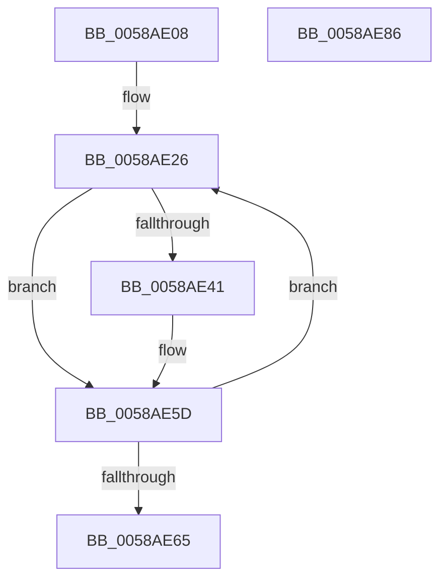

# HvlpMarkHypervisorPagesForHibernation

- RVA: `0x0058AE08`–`0x0058AE87` (길이 `127` bytes)
- VA: `0x000000014058AE08`
- 실행 섹션: `.text`
- PDB 이름 있음: `예`; PDB Function 태그: `아니요`
- unwind 정보 RVA: `0x00097BC4`
- 디코드: `36`개 명령, `127/127` bytes 표시
- 미해석 바이트: `0` (있으면 어셈블리에 `.byte`로 보존)

> 이 문서는 커널 이미지의 기계어와 PDB 기호를 분석해 생성했습니다. 4번과 5번은 함수 원형과 자료형을 바이너리 사용 방식에서 추정한 C 해석이며 원본 소스 복구 결과는 아닙니다.

## 1. Dependencies

- 직접 호출 지점: **4**; 고유 호출 대상: **4**
- 직접 호출자로 확인된 함수: **1**
- RIP 상대 이미지 참조: **0**

### Outgoing calls
- `0x0058AE21` → [HvlpStartPageListIteration](HvlpStartPageListIteration_function_0058D8E4.md) (function, `0x0058D8E4`)
- `0x0058AE32` → [HvlpGetPageList](HvlpGetPageList_function_0058D6D8.md) (function, `0x0058D6D8`)
- `0x0058AE58` → [PoSetHiberRange](../47/PoSetHiberRange_function_0047C580.md) (function, `0x0047C580`)
- `0x0058AE67` → [HvlpGetPageListIterator](HvlpGetPageListIterator_function_0058D790.md) (function, `0x0058D790`)

### Direct callers
- [HvlMarkHiberPhase](HvlMarkHiberPhase_function_0058A5EC.md) at `0x0058A603`

### Static image references
- 디코드된 RIP-relative 메모리 참조가 없습니다.

## 2. Other-region calls and transfers

- 다른 실행 섹션으로 향하는 call: **0**
- 별도 외부 분기/꼬리 이동을 확인하지 못했습니다.

## 3. Assembly (complete function range)

```asm
0058AE08  48 89 5C 24 18                  mov qword ptr [rsp + 0x18], rbx
0058AE0D  57                              push rdi
0058AE0E  48 83 EC 30                     sub rsp, 0x30
0058AE12  33 FF                           xor edi, edi
0058AE14  33 D2                           xor edx, edx
0058AE16  33 C9                           xor ecx, ecx
0058AE18  48 89 7C 24 48                  mov qword ptr [rsp + 0x48], rdi
0058AE1D  89 7C 24 40                     mov dword ptr [rsp + 0x40], edi
0058AE21  E8 BE 2A 00 00                  call 0x14058d8e4
0058AE26  4C 8D 44 24 40                  lea r8, [rsp + 0x40]
0058AE2B  33 C9                           xor ecx, ecx
0058AE2D  48 8D 54 24 48                  lea rdx, [rsp + 0x48]
0058AE32  E8 A1 28 00 00                  call 0x14058d6d8
0058AE37  8B D8                           mov ebx, eax
0058AE39  8B 44 24 40                     mov eax, dword ptr [rsp + 0x40]
0058AE3D  85 C0                           test eax, eax
0058AE3F  74 1C                           je 0x14058ae5d
0058AE41  4C 8B 44 24 48                  mov r8, qword ptr [rsp + 0x48]
0058AE46  44 8B C8                        mov r9d, eax
0058AE49  BA 00 40 01 00                  mov edx, 0x14000
0058AE4E  C7 44 24 20 48 76 6C 68         mov dword ptr [rsp + 0x20], 0x686c7648
0058AE56  33 C9                           xor ecx, ecx
0058AE58  E8 23 17 EF FF                  call 0x14047c580
0058AE5D  81 FB 05 01 00 00               cmp ebx, 0x105
0058AE63  74 C1                           je 0x14058ae26
0058AE65  33 C9                           xor ecx, ecx
0058AE67  E8 24 29 00 00                  call 0x14058d790
0058AE6C  48 8B 5C 24 50                  mov rbx, qword ptr [rsp + 0x50]
0058AE71  48 89 78 08                     mov qword ptr [rax + 8], rdi
0058AE75  66 89 38                        mov word ptr [rax], di
0058AE78  66 89 78 03                     mov word ptr [rax + 3], di
0058AE7C  40 88 78 02                     mov byte ptr [rax + 2], dil
0058AE80  48 83 C4 30                     add rsp, 0x30
0058AE84  5F                              pop rdi
0058AE85  C3                              ret
0058AE86  CC                              int3
```

## 4. C-style interpretation (structured pseudocode)

```c
__int64 __fastcall HvlpMarkHypervisorPagesForHibernation(int a1, int a2)
{
    __int64 result;
    __int64 v_rdi;
    __int64 v_rsp;
    unsigned int v_stack_m18;
    unsigned __int64 v_stack_p10;
    unsigned __int64 v_stack_p18;
    unsigned int v_stack_p8;

    v_stack_p18 = v_rbx;
    v_rsp = (v_rsp) - (48);
    v_rdi = 0;
    a2 = 0;
    a1 = 0;
    v_stack_p10 = 0;
    v_stack_p8 = 0;
    result = HvlpStartPageListIteration(a1, a2, a3, a4);
loc_0058AE26:
    a1 = 0;
    result = HvlpGetPageList(a1, v_stack_p10, v_stack_p8, a4);
    result = (unsigned int)(v_stack_p8);
    if ((unsigned int)((unsigned int)(v_stack_p8)) != 0) {
        a3 = v_stack_p10;
        a4 = (unsigned int)((unsigned int)(v_stack_p8));
        a2 = 0x14000ULL;
        v_stack_m18 = 0x686C7648ULL;
        a1 = 0;
        result = PoSetHiberRange(a1, a2, a3, a4);
    }
    if (((unsigned int)((unsigned int)((unsigned int)(result)))) == 261) goto loc_0058AE26;
    a1 = 0;
    result = HvlpGetPageListIterator(a1, a2, a3, a4);
    *(unsigned __int64 *)(result + 8) = 0;
    *(unsigned __int16 *)(result) = 0;
    *(unsigned __int16 *)(result + 3) = 0;
    *(unsigned __int8 *)(result + 2) = 0;
    v_rsp = (v_rsp) + (48);
    return result;
}
```

## 5. (Beta) C Style

```c
int64_t HvlpMarkHypervisorPagesForHibernation(int32_t Arg1, int32_t Arg2)
{
    int64_t result;
    int64_t local_rdi;
    int64_t local_rsp;
    uint32_t v_stack_m18;
    uint64_t v_stack_p10;
    uint64_t v_stack_p18;
    uint32_t v_stack_p8;

    v_stack_p18 = local_rbx;
    local_rsp = (local_rsp) - (48);
    local_rdi = 0;
    Arg2 = 0;
    Arg1 = 0;
    v_stack_p10 = 0;
    v_stack_p8 = 0;
    result = HvlpStartPageListIteration(Arg1, Arg2, a3, a4);
loc_0058AE26:
    Arg1 = 0;
    result = HvlpGetPageList(Arg1, v_stack_p10, v_stack_p8, a4);
    result = (uint32_t)(v_stack_p8);
    if ((uint32_t)((uint32_t)(v_stack_p8)) != 0) {
        a3 = v_stack_p10;
        a4 = (uint32_t)((uint32_t)(v_stack_p8));
        Arg2 = 0x14000ULL;
        v_stack_m18 = 0x686C7648ULL;
        Arg1 = 0;
        result = PoSetHiberRange(Arg1, Arg2, a3, a4);
    }
    if (((uint32_t)((uint32_t)((uint32_t)(result)))) == 261) goto loc_0058AE26;
    Arg1 = 0;
    result = HvlpGetPageListIterator(Arg1, Arg2, a3, a4);
    *(uint64_t *)(result + 0x8) = 0;
    *(uint16_t *)(result) = 0;
    *(uint16_t *)(result + 0x3) = 0;
    *(uint8_t *)(result + 0x2) = 0;
    local_rsp = (local_rsp) + (48);
    return result;
}
```

## 6. Execution-region graph

[열기: 2D/3D 그래프와 함수 탐색 컨트롤 패널](../../../control-panel.html?section=text&rva=0x0058AE08&view=graph)

- 2D 그래프는 위에서 아래로 흐르고, 3D 그래프는 빈 공간을 드래그해 회전합니다. Shift+드래그는 이동, 휠은 확대·축소, 함수 노드 선택은 대상 보고서 이동입니다.

### Static fallback


