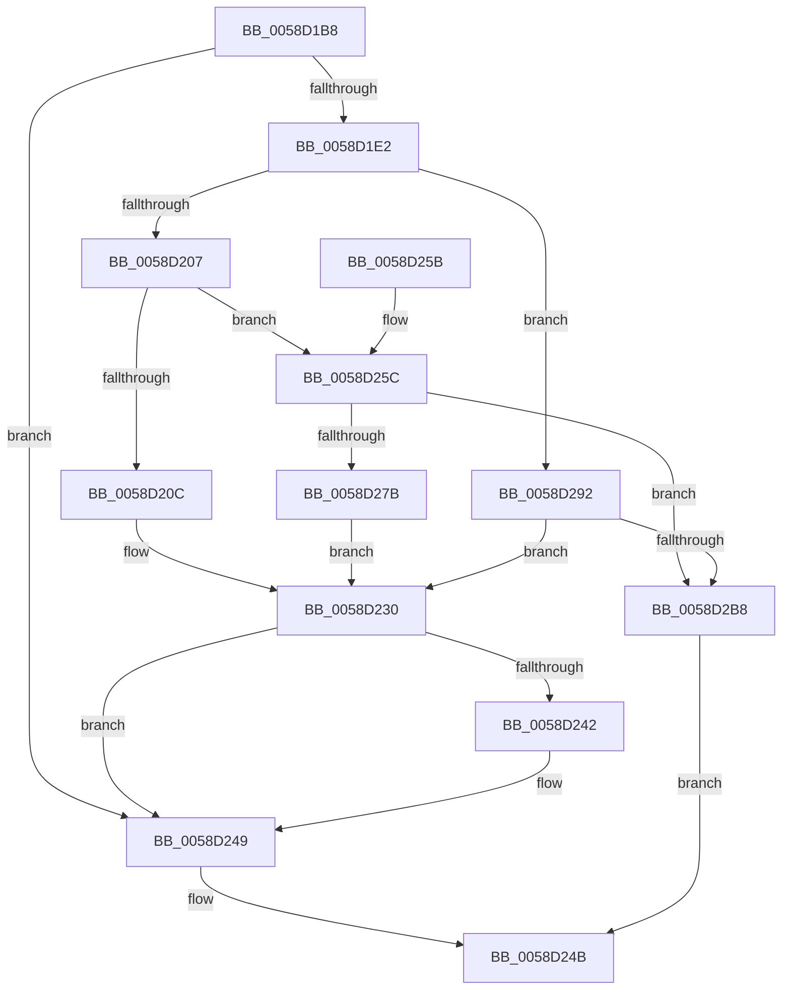

# HvlpPhase0Enlightenments

- RVA: `0x0058D1B8`–`0x0058D2BF` (길이 `263` bytes)
- VA: `0x000000014058D1B8`
- 실행 섹션: `.text`
- PDB 이름 있음: `예`; PDB Function 태그: `아니요`
- unwind 정보 RVA: `0x000C69E0`
- 디코드: `65`개 명령, `263/263` bytes 표시
- 미해석 바이트: `0` (있으면 어셈블리에 `.byte`로 보존)

> 이 문서는 커널 이미지의 기계어와 PDB 기호를 분석해 생성했습니다. 4번과 5번은 함수 원형과 자료형을 바이너리 사용 방식에서 추정한 C 해석이며 원본 소스 복구 결과는 아닙니다.

## 1. Dependencies

- 직접 호출 지점: **5**; 고유 호출 대상: **5**
- 직접 호출자로 확인된 함수: **2**
- RIP 상대 이미지 참조: **4**

### Outgoing calls
- `0x0058D1EB` → [HvlpGetRegister64](../37/HvlpGetRegister64_function_00379050.md) (function, `0x00379050`)
- `0x0058D213` → [MmGetPhysicalAddress](../23/MmGetPhysicalAddress_function_0023A500.md) (function, `0x0023A500`)
- `0x0058D238` → [HvlpSetRegister64](../4D/HvlpSetRegister64_function_004DDA70.md) (function, `0x004DDA70`)
- `0x0058D26E` → [HvlpAllocateEarlyPages](HvlpAllocateEarlyPages_function_0058D3DC.md) (function, `0x0058D3DC`)
- `0x0058D2A7` → [HvlpMapEarlyPages](HvlpMapEarlyPages_function_0058D504.md) (function, `0x0058D504`)

### Direct callers
- [HvlRestoreEnlightenment](HvlRestoreEnlightenment_function_005843CC.md) at `0x0058441B`
- [HvlPhase0Initialize](../../page/71/HvlPhase0Initialize_function_00717AC8.md) at `0x00717BA4`

### Static image references
- `0x0058D1D6` → RVA `0x00FC6AB8` (`ALMOSTRO`; read)
- `0x0058D1F5` → RVA `0x00FC6A90` (`ALMOSTRO`; read)
- `0x0058D20C` → RVA `0x00FC6D88` (`ALMOSTRO`; read)
- `0x0058D242` → RVA `0x00FC6D88` (`ALMOSTRO`; write)

## 2. Other-region calls and transfers

- 다른 실행 섹션으로 향하는 call: **0**
- 별도 외부 분기/꼬리 이동을 확인하지 못했습니다.

## 3. Assembly (complete function range)

```asm
0058D1B8  48 8B C4                        mov rax, rsp
0058D1BB  48 89 58 18                     mov qword ptr [rax + 0x18], rbx
0058D1BF  48 89 70 20                     mov qword ptr [rax + 0x20], rsi
0058D1C3  57                              push rdi
0058D1C4  48 83 EC 20                     sub rsp, 0x20
0058D1C8  48 83 60 10 00                  and qword ptr [rax + 0x10], 0
0058D1CD  33 FF                           xor edi, edi
0058D1CF  48 21 78 08                     and qword ptr [rax + 8], rdi
0058D1D3  48 8B F1                        mov rsi, rcx
0058D1D6  F7 05 D8 98 A3 00 00 01 00 00   test dword ptr [rip + 0xa398d8], 0x100
0058D1E0  74 67                           je 0x14058d249
0058D1E2  48 8D 50 10                     lea rdx, [rax + 0x10]
0058D1E6  B9 17 00 09 00                  mov ecx, 0x90017
0058D1EB  E8 60 BE DE FF                  call 0x140379050
0058D1F0  48 8B 5C 24 38                  mov rbx, qword ptr [rsp + 0x38]
0058D1F5  8B 05 95 98 A3 00               mov eax, dword ptr [rip + 0xa39895]
0058D1FB  48 83 CB 01                     or rbx, 1
0058D1FF  A8 02                           test al, 2
0058D201  0F 85 8B 00 00 00               jne 0x14058d292
0058D207  48 85 F6                        test rsi, rsi
0058D20A  75 50                           jne 0x14058d25c
0058D20C  48 8B 0D 75 9B A3 00            mov rcx, qword ptr [rip + 0xa39b75]
0058D213  E8 E8 D2 CA FF                  call 0x14023a500
0058D218  48 8B C8                        mov rcx, rax
0058D21B  48 8B C3                        mov rax, rbx
0058D21E  48 81 E1 00 F0 FF FF            and rcx, 0xfffffffffffff000
0058D225  25 FF 0F 00 00                  and eax, 0xfff
0058D22A  48 8B D9                        mov rbx, rcx
0058D22D  48 0B D8                        or rbx, rax
0058D230  48 8B D3                        mov rdx, rbx
0058D233  B9 17 00 09 00                  mov ecx, 0x90017
0058D238  E8 33 08 F5 FF                  call 0x1404dda70
0058D23D  48 85 FF                        test rdi, rdi
0058D240  74 07                           je 0x14058d249
0058D242  48 89 3D 3F 9B A3 00            mov qword ptr [rip + 0xa39b3f], rdi
0058D249  33 C0                           xor eax, eax
0058D24B  48 8B 5C 24 40                  mov rbx, qword ptr [rsp + 0x40]
0058D250  48 8B 74 24 48                  mov rsi, qword ptr [rsp + 0x48]
0058D255  48 83 C4 20                     add rsp, 0x20
0058D259  5F                              pop rdi
0058D25A  C3                              ret
0058D25B  CC                              int3
0058D25C  41 B9 04 00 00 00               mov r9d, 4
0058D262  4C 8D 44 24 30                  lea r8, [rsp + 0x30]
0058D267  48 8B CE                        mov rcx, rsi
0058D26A  41 8D 51 FD                     lea edx, [r9 - 3]
0058D26E  E8 69 01 00 00                  call 0x14058d3dc
0058D273  48 8B F8                        mov rdi, rax
0058D276  48 85 C0                        test rax, rax
0058D279  74 3D                           je 0x14058d2b8
0058D27B  48 8B 4C 24 30                  mov rcx, qword ptr [rsp + 0x30]
0058D280  81 E3 FF 0F 00 00               and ebx, 0xfff
0058D286  48 81 E1 00 F0 FF FF            and rcx, 0xfffffffffffff000
0058D28D  48 0B D9                        or rbx, rcx
0058D290  EB 9E                           jmp 0x14058d230
0058D292  48 8B CB                        mov rcx, rbx
0058D295  41 B8 04 00 00 00               mov r8d, 4
0058D29B  48 81 E1 00 F0 FF FF            and rcx, 0xfffffffffffff000
0058D2A2  48 89 4C 24 30                  mov qword ptr [rsp + 0x30], rcx
0058D2A7  E8 58 02 00 00                  call 0x14058d504
0058D2AC  48 8B F8                        mov rdi, rax
0058D2AF  48 85 C0                        test rax, rax
0058D2B2  0F 85 78 FF FF FF               jne 0x14058d230
0058D2B8  B8 9A 00 00 C0                  mov eax, 0xc000009a
0058D2BD  EB 8C                           jmp 0x14058d24b
```

## 4. C-style interpretation (structured pseudocode)

```c
__int64 __fastcall HvlpPhase0Enlightenments(__int64 a1)
{
    __int64 result;
    __int64 v_rbx;
    __int64 v_rdi;
    __int64 v_rsp;
    unsigned __int64 v_stack_p10;
    unsigned __int64 v_stack_p18;
    unsigned __int64 v_stack_p20;
    unsigned __int64 v_stack_p30;

    *(unsigned __int64 *)(v_rsp + 24) = v_rbx;
    *(unsigned __int64 *)(v_rsp + 32) = v_rsi;
    v_rsp = (v_rsp) - (32);
    v_rdi = 0;
    if (((*(unsigned int *)(v_rip + 10721496)) & (256)) == 0) goto loc_0058D249;
    result = HvlpGetRegister64((unsigned int)(0x90017ULL), v_rsp + 16, a3, a4);
    v_rbx = (v_stack_p10) | (1);
    if ((((unsigned __int8)((unsigned int)(*(unsigned int *)(v_rip + 10721429)))) & (2)) != 0) goto loc_0058D292;
    if (a1 != 0) goto loc_0058D25C;
    result = MmGetPhysicalAddress(*(unsigned __int64 *)(v_rip + 10722165), v_rsp + 16, a3, a4);
    a1 = (result) & (0xFFFFFFFFFFFFF000ULL);
    result = (unsigned int)((v_rbx) & (0xFFFULL));
    v_rbx = (a1) | (result);
loc_0058D230:
    result = HvlpSetRegister64((unsigned int)(0x90017ULL), v_rbx, a3, a4);
    if (0 != 0) {
        *(unsigned __int64 *)(v_rip + 10722111) = 0;
    }
    result = 0;
loc_0058D24B:
    v_rsp = (v_rsp) + (32);
    return result;
loc_0058D25C:
    result = HvlpAllocateEarlyPages(v_stack_p20, 4 - 3, v_stack_p30, 4);
    if (result == 0) goto loc_0058D2B8;
    v_rbx = (unsigned int)((v_stack_p18) & (0xFFFULL));
    a1 = (v_stack_p30) & (0xFFFFFFFFFFFFF000ULL);
    v_rbx = (v_rbx) | (a1);
    goto loc_0058D230;
loc_0058D292:
    a1 = (v_rbx) & (0xFFFFFFFFFFFFF000ULL);
    v_stack_p30 = a1;
    result = HvlpMapEarlyPages(a1, 4 - 3, 4, 4);
    if (result != 0) goto loc_0058D230;
loc_0058D2B8:
    goto loc_0058D24B;
}
```

## 5. (Beta) C Style

```c
int64_t HvlpPhase0Enlightenments(int64_t Arg1)
{
    int64_t result;
    int64_t local_rbx;
    int64_t local_rdi;
    int64_t local_rsp;
    uint64_t v_stack_p10;
    uint64_t v_stack_p18;
    uint64_t v_stack_p20;
    uint64_t v_stack_p30;

    *(uint64_t *)(local_rsp + 0x18) = local_rbx;
    *(uint64_t *)(local_rsp + 0x20) = local_rsi;
    local_rsp = (local_rsp) - (32);
    local_rdi = 0;
    if (((*(uint32_t *)(v_rip + 0xA398D8)) & (256)) == 0) goto loc_0058D249;
    result = HvlpGetRegister64((uint32_t)(0x90017ULL), local_rsp + 16, a3, a4);
    local_rbx = (v_stack_p10) | (1);
    if ((((uint8_t)((uint32_t)(*(uint32_t *)(v_rip + 0xA39895)))) & (2)) != 0) goto loc_0058D292;
    if (Arg1 != 0) goto loc_0058D25C;
    result = MmGetPhysicalAddress(*(uint64_t *)(v_rip + 0xA39B75), local_rsp + 16, a3, a4);
    Arg1 = (result) & (0xFFFFFFFFFFFFF000ULL);
    result = (uint32_t)((local_rbx) & (0xFFFULL));
    local_rbx = (Arg1) | (result);
loc_0058D230:
    result = HvlpSetRegister64((uint32_t)(0x90017ULL), local_rbx, a3, a4);
    if (0 != 0) {
        *(uint64_t *)(v_rip + 0xA39B3F) = 0;
    }
    result = 0;
loc_0058D24B:
    local_rsp = (local_rsp) + (32);
    return result;
loc_0058D25C:
    result = HvlpAllocateEarlyPages(v_stack_p20, 4 - 3, v_stack_p30, 4);
    if (result == 0) goto loc_0058D2B8;
    local_rbx = (uint32_t)((v_stack_p18) & (0xFFFULL));
    Arg1 = (v_stack_p30) & (0xFFFFFFFFFFFFF000ULL);
    local_rbx = (local_rbx) | (Arg1);
    goto loc_0058D230;
loc_0058D292:
    Arg1 = (local_rbx) & (0xFFFFFFFFFFFFF000ULL);
    v_stack_p30 = Arg1;
    result = HvlpMapEarlyPages(Arg1, 4 - 3, 4, 4);
    if (result != 0) goto loc_0058D230;
loc_0058D2B8:
    goto loc_0058D24B;
}
```

## 6. Execution-region graph

[열기: 2D/3D 그래프와 함수 탐색 컨트롤 패널](../../../control-panel.html?section=text&rva=0x0058D1B8&view=graph)

- 2D 그래프는 위에서 아래로 흐르고, 3D 그래프는 빈 공간을 드래그해 회전합니다. Shift+드래그는 이동, 휠은 확대·축소, 함수 노드 선택은 대상 보고서 이동입니다.

### Static fallback


