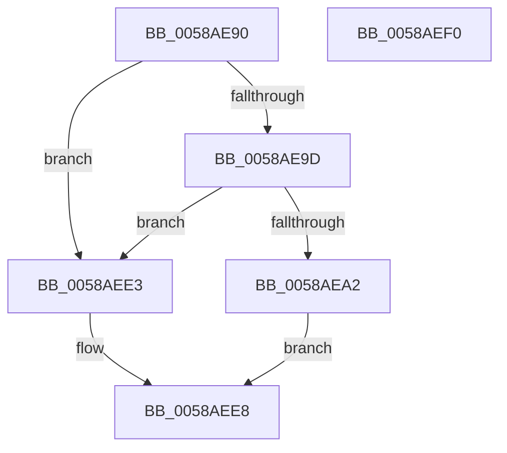

# HvlpPowerPolicySettingCallback

- RVA: `0x0058AE90`–`0x0058AEF1` (길이 `97` bytes)
- VA: `0x000000014058AE90`
- 실행 섹션: `.text`
- PDB 이름 있음: `예`; PDB Function 태그: `아니요`
- unwind 정보 RVA: `0x000C68C0`
- 디코드: `24`개 명령, `97/97` bytes 표시
- 미해석 바이트: `0` (있으면 어셈블리에 `.byte`로 보존)

> 이 문서는 커널 이미지의 기계어와 PDB 기호를 분석해 생성했습니다. 4번과 5번은 함수 원형과 자료형을 바이너리 사용 방식에서 추정한 C 해석이며 원본 소스 복구 결과는 아닙니다.

## 1. Dependencies

- 직접 호출 지점: **2**; 고유 호출 대상: **2**
- 직접 호출자로 확인된 함수: **0**
- RIP 상대 이미지 참조: **0**

### Outgoing calls
- `0x0058AEC0` → [memset](../6C/memset_function_006C6C40.md) (function, `0x006C6C40`)
- `0x0058AEDC` → [HvlpSetPowerProperty](../4C/HvlpSetPowerProperty_function_004C9124.md) (function, `0x004C9124`)

### Direct callers
- 이 함수 시작 RVA로 연결되는 직접 call은 확인되지 않았습니다. 간접 호출은 완전히 역산할 수 없습니다.

### Static image references
- 디코드된 RIP-relative 메모리 참조가 없습니다.

## 2. Other-region calls and transfers

- 다른 실행 섹션으로 향하는 call: **0**
- 별도 외부 분기/꼬리 이동을 확인하지 못했습니다.

## 3. Assembly (complete function range)

```asm
0058AE90  48 81 EC 48 02 00 00            sub rsp, 0x248
0058AE97  41 83 F8 04                     cmp r8d, 4
0058AE9B  75 46                           jne 0x14058aee3
0058AE9D  48 85 D2                        test rdx, rdx
0058AEA0  74 41                           je 0x14058aee3
0058AEA2  8B 02                           mov eax, dword ptr [rdx]
0058AEA4  48 8D 4C 24 28                  lea rcx, [rsp + 0x28]
0058AEA9  89 44 24 24                     mov dword ptr [rsp + 0x24], eax
0058AEAD  33 D2                           xor edx, edx
0058AEAF  33 C0                           xor eax, eax
0058AEB1  44 89 4C 24 20                  mov dword ptr [rsp + 0x20], r9d
0058AEB6  41 B8 14 02 00 00               mov r8d, 0x214
0058AEBC  89 44 24 2C                     mov dword ptr [rsp + 0x2c], eax
0058AEC0  E8 7B BD 13 00                  call 0x1406c6c40
0058AEC5  48 8B 44 24 20                  mov rax, qword ptr [rsp + 0x20]
0058AECA  48 8D 4C 24 28                  lea rcx, [rsp + 0x28]
0058AECF  48 89 44 24 30                  mov qword ptr [rsp + 0x30], rax
0058AED4  C7 44 24 28 05 00 00 00         mov dword ptr [rsp + 0x28], 5
0058AEDC  E8 43 E2 F3 FF                  call 0x1404c9124
0058AEE1  EB 05                           jmp 0x14058aee8
0058AEE3  B8 0D 00 00 C0                  mov eax, 0xc000000d
0058AEE8  48 81 C4 48 02 00 00            add rsp, 0x248
0058AEEF  C3                              ret
0058AEF0  CC                              int3
```

## 4. C-style interpretation (structured pseudocode)

```c
__int64 __fastcall HvlpPowerPolicySettingCallback(__int64 a1, __int64 a2, int a3, int a4)
{
    __int64 result;
    __int64 v_rsp;
    unsigned __int64 v_stack_m218;
    unsigned int v_stack_m21C;
    unsigned __int64 v_stack_m220;
    unsigned int v_stack_m224;
    unsigned int v_stack_m228;

    v_rsp = (v_rsp) - (584);
    if (a3 != 4) goto loc_0058AEE3;
    if (a2 == 0) goto loc_0058AEE3;
    v_stack_m224 = (unsigned int)((unsigned int)(*(unsigned int *)(a2)));
    a2 = 0;
    result = 0;
    v_stack_m228 = a4;
    v_stack_m21C = 0;
    result = memset(v_stack_m220, a2, 532, a4);
    v_stack_m218 = v_stack_m228;
    v_stack_m220 = 5;
    result = HvlpSetPowerProperty(v_stack_m220, a2, 532, a4);
    goto loc_0058AEE8;
loc_0058AEE3:
loc_0058AEE8:
    v_rsp = (v_rsp) + (584);
    return (unsigned int)(0xC000000DULL);
}
```

## 5. (Beta) C Style

```c
int64_t HvlpPowerPolicySettingCallback(int64_t Arg1, int64_t Arg2, int32_t Arg3, int32_t Arg4)
{
    int64_t result;
    int64_t local_rsp;
    uint64_t v_stack_m218;
    uint32_t v_stack_m21C;
    uint64_t v_stack_m220;
    uint32_t v_stack_m224;
    uint32_t v_stack_m228;

    local_rsp = (local_rsp) - (584);
    if (Arg3 != 4) goto loc_0058AEE3;
    if (Arg2 == 0) goto loc_0058AEE3;
    v_stack_m224 = (uint32_t)((uint32_t)(*(uint32_t *)(Arg2)));
    Arg2 = 0;
    result = 0;
    v_stack_m228 = Arg4;
    v_stack_m21C = 0;
    result = memset(v_stack_m220, Arg2, 532, Arg4);
    v_stack_m218 = v_stack_m228;
    v_stack_m220 = 5;
    result = HvlpSetPowerProperty(v_stack_m220, Arg2, 532, Arg4);
    goto loc_0058AEE8;
loc_0058AEE3:
loc_0058AEE8:
    local_rsp = (local_rsp) + (584);
    return (uint32_t)(0xC000000DULL);
}
```

## 6. Execution-region graph

[열기: 2D/3D 그래프와 함수 탐색 컨트롤 패널](../../../control-panel.html?section=text&rva=0x0058AE90&view=graph)

- 2D 그래프는 위에서 아래로 흐르고, 3D 그래프는 빈 공간을 드래그해 회전합니다. Shift+드래그는 이동, 휠은 확대·축소, 함수 노드 선택은 대상 보고서 이동입니다.

### Static fallback


