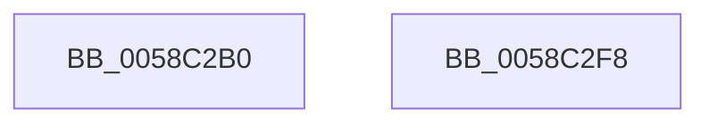

# HvlpProcessIommuPrq

- RVA: `0x0058C2B0`–`0x0058C2F9` (길이 `73` bytes)
- VA: `0x000000014058C2B0`
- 실행 섹션: `.text`
- PDB 이름 있음: `예`; PDB Function 태그: `아니요`
- unwind 정보 RVA: `0x000697A4`
- 디코드: `18`개 명령, `73/73` bytes 표시
- 미해석 바이트: `0` (있으면 어셈블리에 `.byte`로 보존)

> 이 문서는 커널 이미지의 기계어와 PDB 기호를 분석해 생성했습니다. 4번과 5번은 함수 원형과 자료형을 바이너리 사용 방식에서 추정한 C 해석이며 원본 소스 복구 결과는 아닙니다.

## 1. Dependencies

- 직접 호출 지점: **1**; 고유 호출 대상: **1**
- 직접 호출자로 확인된 함수: **0**
- RIP 상대 이미지 참조: **0**

### Outgoing calls
- `0x0058C2E6` → [HvcallFastExtended](../31/HvcallFastExtended_function_003130E0.md) (function, `0x003130E0`)

### Direct callers
- 이 함수 시작 RVA로 연결되는 직접 call은 확인되지 않았습니다. 간접 호출은 완전히 역산할 수 없습니다.

### Static image references
- 디코드된 RIP-relative 메모리 참조가 없습니다.

## 2. Other-region calls and transfers

- 다른 실행 섹션으로 향하는 call: **0**
- 별도 외부 분기/꼬리 이동을 확인하지 못했습니다.

## 3. Assembly (complete function range)

```asm
0058C2B0  40 53                           push rbx
0058C2B2  48 83 EC 40                     sub rsp, 0x40
0058C2B6  8B 01                           mov eax, dword ptr [rcx]
0058C2B8  48 8D 54 24 30                  lea rdx, [rsp + 0x30]
0058C2BD  83 64 24 20 00                  and dword ptr [rsp + 0x20], 0
0058C2C2  45 33 C9                        xor r9d, r9d
0058C2C5  48 C7 44 24 50 C3 00 00 00      mov qword ptr [rsp + 0x50], 0xc3
0058C2CE  48 8B D9                        mov rbx, rcx
0058C2D1  C7 44 24 50 C3 00 01 00         mov dword ptr [rsp + 0x50], 0x100c3
0058C2D9  48 8B 4C 24 50                  mov rcx, qword ptr [rsp + 0x50]
0058C2DE  45 8D 41 08                     lea r8d, [r9 + 8]
0058C2E2  89 44 24 30                     mov dword ptr [rsp + 0x30], eax
0058C2E6  E8 F5 6D D8 FF                  call 0x1403130e0
0058C2EB  C7 43 04 01 00 00 00            mov dword ptr [rbx + 4], 1
0058C2F2  48 83 C4 40                     add rsp, 0x40
0058C2F6  5B                              pop rbx
0058C2F7  C3                              ret
0058C2F8  CC                              int3
```

## 4. C-style interpretation (structured pseudocode)

```c
__int64 __fastcall HvlpProcessIommuPrq(__int64 a1, __int64 a2, __int64 a3, int a4)
{
    __int64 result;
    __int64 v_rsp;
    unsigned __int64 v_stack_m18;
    unsigned int v_stack_m28;
    unsigned __int64 v_stack_p8;

    v_rsp = (v_rsp) - (64);
    a4 = 0;
    v_stack_p8 = 195;
    v_stack_p8 = 0x100C3ULL;
    v_stack_m18 = (unsigned int)((unsigned int)(*(unsigned int *)(a1)));
    result = HvcallFastExtended(v_stack_p8, v_stack_m18, a4 + 8, a4);
    *(unsigned int *)(a1 + 4) = 1;
    v_rsp = (v_rsp) + (64);
    return result;
}
```

## 5. (Beta) C Style

```c
int64_t HvlpProcessIommuPrq(void *Arg1, int64_t Arg2, int64_t Arg3, int32_t Arg4)
{
    uint8_t *arg1 = (uint8_t *)Arg1;

    int64_t result;
    int64_t local_rsp;
    uint64_t v_stack_m18;
    uint32_t v_stack_m28;
    uint64_t v_stack_p8;

    local_rsp = (local_rsp) - (64);
    Arg4 = 0;
    v_stack_p8 = 195;
    v_stack_p8 = 0x100C3ULL;
    v_stack_m18 = (uint32_t)((uint32_t)(*(uint32_t *)(arg1)));
    result = HvcallFastExtended(v_stack_p8, v_stack_m18, Arg4 + 8, Arg4);
    *(uint32_t *)(arg1 + 0x4) = 1;
    local_rsp = (local_rsp) + (64);
    return result;
}
```

### 관측된 메모리 오프셋

구조체 형식이 확인되지 않은 접근은 인자 기준의 오프셋으로만 기록했습니다.

| 기준 인자 | 오프셋 표현 | 폭 (bit) | 접근 |
|---|---:|---:|---|
| `Arg1` | `+ 0x0` | `32` | `R` |
| `Arg1` | `+ 0x4` | `32` | `W` |

## 6. Execution-region graph

[열기: 2D/3D 그래프와 함수 탐색 컨트롤 패널](../../../control-panel.html?section=text&rva=0x0058C2B0&view=graph)

- 2D 그래프는 위에서 아래로 흐르고, 3D 그래프는 빈 공간을 드래그해 회전합니다. Shift+드래그는 이동, 휠은 확대·축소, 함수 노드 선택은 대상 보고서 이동입니다.

### Static fallback


