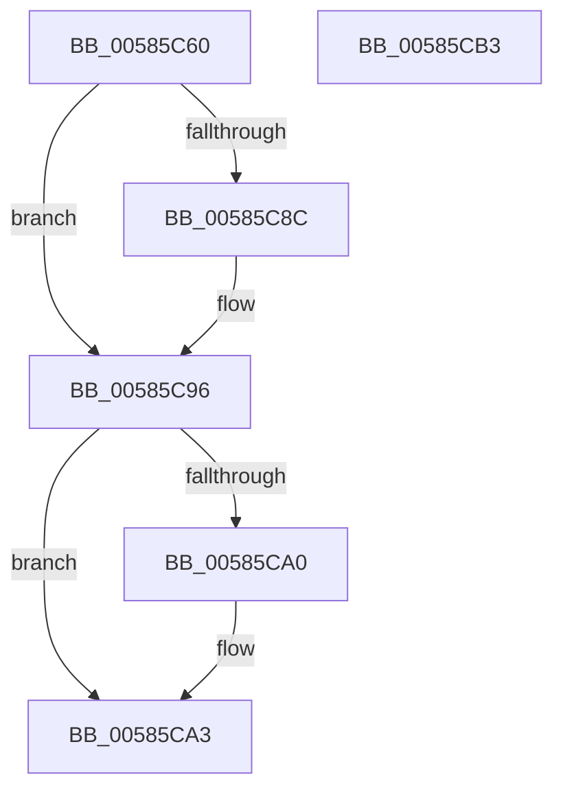

# HvlpQueryApicIdAndNumaNode

- RVA: `0x00585C60`–`0x00585CB4` (길이 `84` bytes)
- VA: `0x0000000140585C60`
- 실행 섹션: `.text`
- PDB 이름 있음: `예`; PDB Function 태그: `예`
- unwind 정보 RVA: `0x00060BC4`
- 디코드: `24`개 명령, `84/84` bytes 표시
- 미해석 바이트: `0` (있으면 어셈블리에 `.byte`로 보존)

> 이 문서는 커널 이미지의 기계어와 PDB 기호를 분석해 생성했습니다. 4번과 5번은 함수 원형과 자료형을 바이너리 사용 방식에서 추정한 C 해석이며 원본 소스 복구 결과는 아닙니다.

## 1. Dependencies

- 직접 호출 지점: **1**; 고유 호출 대상: **1**
- 직접 호출자로 확인된 함수: **2**
- RIP 상대 이미지 참조: **2**

### Outgoing calls
- `0x00585C96` → [guard_dispatch_icall](../6B/guard_dispatch_icall_function_006BAAD0.md) (function, `0x006BAAD0`)

### Direct callers
- [HvlStartBootLogicalProcessors](HvlStartBootLogicalProcessors_function_00584E18.md) at `0x00584FBE`
- [HvlpSelectLpSet](HvlpSelectLpSet_function_00585D30.md) at `0x00585E73`

### Static image references
- `0x00585C74` → RVA `0x00FC6EE8` (`ALMOSTRO`; read)
- `0x00585C8C` → RVA `0x00E00A28` (`.data`; read)

## 2. Other-region calls and transfers

- 다른 실행 섹션으로 향하는 call: **0**
- 별도 외부 분기/꼬리 이동을 확인하지 못했습니다.

## 3. Assembly (complete function range)

```asm
00585C60  48 89 5C 24 08                  mov qword ptr [rsp + 8], rbx
00585C65  48 89 74 24 10                  mov qword ptr [rsp + 0x10], rsi
00585C6A  57                              push rdi
00585C6B  48 83 EC 20                     sub rsp, 0x20
00585C6F  83 0A FF                        or dword ptr [rdx], 0xffffffff
00585C72  33 FF                           xor edi, edi
00585C74  48 8B 05 6D 12 A4 00            mov rax, qword ptr [rip + 0xa4126d]
00585C7B  BE FF FF 00 00                  mov esi, 0xffff
00585C80  66 41 89 30                     mov word ptr [r8], si
00585C84  49 8B D8                        mov rbx, r8
00585C87  48 85 C0                        test rax, rax
00585C8A  75 0A                           jne 0x140585c96
00585C8C  48 8B 05 95 AD 87 00            mov rax, qword ptr [rip + 0x87ad95]
00585C93  45 33 C0                        xor r8d, r8d
00585C96  E8 35 4E 13 00                  call 0x1406baad0
00585C9B  66 39 33                        cmp word ptr [rbx], si
00585C9E  75 03                           jne 0x140585ca3
00585CA0  66 89 3B                        mov word ptr [rbx], di
00585CA3  48 8B 5C 24 30                  mov rbx, qword ptr [rsp + 0x30]
00585CA8  48 8B 74 24 38                  mov rsi, qword ptr [rsp + 0x38]
00585CAD  48 83 C4 20                     add rsp, 0x20
00585CB1  5F                              pop rdi
00585CB2  C3                              ret
00585CB3  CC                              int3
```

## 4. C-style interpretation (structured pseudocode)

```c
__int64 __fastcall HvlpQueryApicIdAndNumaNode(__int64 a1, __int64 a2, __int64 a3)
{
    __int64 result;
    __int64 v_rdi;
    __int64 v_rsp;
    unsigned __int64 v_stack_p10;
    unsigned __int64 v_stack_p8;

    v_stack_p8 = v_rbx;
    v_stack_p10 = v_rsi;
    v_rsp = (v_rsp) - (32);
    v_rdi = 0;
    *(unsigned __int16 *)(a3) = (unsigned __int16)((unsigned int)(0xFFFFULL));
    result = *(unsigned __int64 *)(v_rip + 10752621);
    if (*(unsigned __int64 *)(v_rip + 10752621) == 0) {
        result = *(unsigned __int64 *)(v_rip + 8891797);
        a3 = 0;
    }
    result = guard_dispatch_icall(a1, a2, a3, a4);
    if ((*(unsigned __int16 *)(a3)) == ((unsigned __int16)((unsigned int)(0xFFFFULL)))) {
        *(unsigned __int16 *)(a3) = 0;
    }
    v_rsp = (v_rsp) + (32);
    return result;
}
```

## 5. (Beta) C Style

```c
int64_t HvlpQueryApicIdAndNumaNode(int64_t Arg1, void *Arg2, void *Arg3)
{
    uint8_t *arg2 = (uint8_t *)Arg2;
    uint8_t *arg3 = (uint8_t *)Arg3;

    int64_t result;
    int64_t local_rdi;
    int64_t local_rsp;
    uint64_t v_stack_p10;
    uint64_t v_stack_p8;

    v_stack_p8 = local_rbx;
    v_stack_p10 = local_rsi;
    local_rsp = (local_rsp) - (32);
    local_rdi = 0;
    *(uint16_t *)(arg3) = (uint16_t)((uint32_t)(0xFFFFULL));
    result = *(uint64_t *)(v_rip + 0xA4126D);
    if (*(uint64_t *)(v_rip + 0xA4126D) == 0) {
        result = *(uint64_t *)(v_rip + 0x87AD95);
        Arg3 = 0;
    }
    result = guard_dispatch_icall(Arg1, Arg2, Arg3, a4);
    if ((*(uint16_t *)(arg3)) == ((uint16_t)((uint32_t)(0xFFFFULL)))) {
        *(uint16_t *)(arg3) = 0;
    }
    local_rsp = (local_rsp) + (32);
    return result;
}
```

### 관측된 메모리 오프셋

구조체 형식이 확인되지 않은 접근은 인자 기준의 오프셋으로만 기록했습니다.

| 기준 인자 | 오프셋 표현 | 폭 (bit) | 접근 |
|---|---:|---:|---|
| `Arg2` | `+ 0x0` | `32` | `R/W` |
| `Arg3` | `+ 0x0` | `16` | `R` |
| `Arg3` | `+ 0x0` | `16` | `W` |

## 6. Execution-region graph

[열기: 2D/3D 그래프와 함수 탐색 컨트롤 패널](../../../control-panel.html?section=text&rva=0x00585C60&view=graph)

- 2D 그래프는 위에서 아래로 흐르고, 3D 그래프는 빈 공간을 드래그해 회전합니다. Shift+드래그는 이동, 휠은 확대·축소, 함수 노드 선택은 대상 보고서 이동입니다.

### Static fallback


