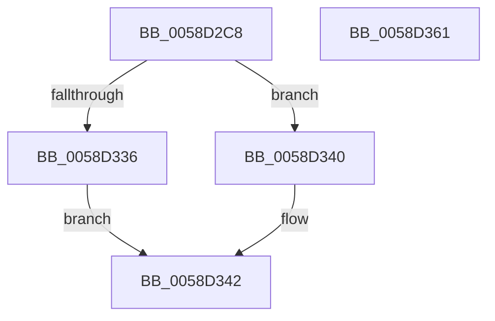

# HvlpQueryExtendedCapabilities

- RVA: `0x0058D2C8`–`0x0058D362` (길이 `154` bytes)
- VA: `0x000000014058D2C8`
- 실행 섹션: `.text`
- PDB 이름 있음: `예`; PDB Function 태그: `아니요`
- unwind 정보 RVA: `0x000C69C4`
- 디코드: `44`개 명령, `154/154` bytes 표시
- 미해석 바이트: `0` (있으면 어셈블리에 `.byte`로 보존)

> 이 문서는 커널 이미지의 기계어와 PDB 기호를 분석해 생성했습니다. 4번과 5번은 함수 원형과 자료형을 바이너리 사용 방식에서 추정한 C 해석이며 원본 소스 복구 결과는 아닙니다.

## 1. Dependencies

- 직접 호출 지점: **4**; 고유 호출 대상: **4**
- 직접 호출자로 확인된 함수: **1**
- RIP 상대 이미지 참조: **1**

### Outgoing calls
- `0x0058D30B` → [HvlpAcquireHypercallPage](../47/HvlpAcquireHypercallPage_function_00471410.md) (function, `0x00471410`)
- `0x0058D31F` → [HvcallInitiateHypercall](../31/HvcallInitiateHypercall_function_00313630.md) (function, `0x00313630`)
- `0x0058D32C` → [HvlpReleaseHypercallPage](../31/HvlpReleaseHypercallPage_function_00313480.md) (function, `0x00313480`)
- `0x0058D34A` → [_security_check_cookie](../6A/_security_check_cookie_function_006AC640.md) (function, `0x006AC640`)

### Direct callers
- [HvlpDetermineEnlightenments](HvlpDetermineEnlightenments_function_0058CC9C.md) at `0x0058D102`

### Static image references
- `0x0058D2D8` → RVA `0x00E0A740` (`.data`; read)

## 2. Other-region calls and transfers

- 다른 실행 섹션으로 향하는 call: **0**
- 별도 외부 분기/꼬리 이동을 확인하지 못했습니다.

## 3. Assembly (complete function range)

```asm
0058D2C8  4C 8B DC                        mov r11, rsp
0058D2CB  49 89 5B 10                     mov qword ptr [r11 + 0x10], rbx
0058D2CF  49 89 73 18                     mov qword ptr [r11 + 0x18], rsi
0058D2D3  57                              push rdi
0058D2D4  48 83 EC 60                     sub rsp, 0x60
0058D2D8  48 8B 05 61 D4 87 00            mov rax, qword ptr [rip + 0x87d461]
0058D2DF  48 33 C4                        xor rax, rsp
0058D2E2  48 89 44 24 50                  mov qword ptr [rsp + 0x50], rax
0058D2E7  33 C0                           xor eax, eax
0058D2E9  4D 8D 43 D8                     lea r8, [r11 - 0x28]
0058D2ED  0F 57 C0                        xorps xmm0, xmm0
0058D2F0  48 8B F9                        mov rdi, rcx
0058D2F3  0F 11 44 24 20                  movups xmmword ptr [rsp + 0x20], xmm0
0058D2F8  49 89 43 C8                     mov qword ptr [r11 - 0x38], rax
0058D2FC  49 8D 4B B8                     lea rcx, [r11 - 0x48]
0058D300  44 8D 48 08                     lea r9d, [rax + 8]
0058D304  89 44 24 38                     mov dword ptr [rsp + 0x38], eax
0058D308  8D 50 02                        lea edx, [rax + 2]
0058D30B  E8 00 41 EE FF                  call 0x140471410
0058D310  4C 8B 44 24 38                  mov r8, qword ptr [rsp + 0x38]
0058D315  33 D2                           xor edx, edx
0058D317  B9 01 80 00 00                  mov ecx, 0x8001
0058D31C  48 8B F0                        mov rsi, rax
0058D31F  E8 0C 63 D8 FF                  call 0x140313630
0058D324  48 8D 4C 24 20                  lea rcx, [rsp + 0x20]
0058D329  48 8B D8                        mov rbx, rax
0058D32C  E8 4F 61 D8 FF                  call 0x140313480
0058D331  66 85 DB                        test bx, bx
0058D334  75 0A                           jne 0x14058d340
0058D336  48 8B 06                        mov rax, qword ptr [rsi]
0058D339  48 89 07                        mov qword ptr [rdi], rax
0058D33C  B0 01                           mov al, 1
0058D33E  EB 02                           jmp 0x14058d342
0058D340  32 C0                           xor al, al
0058D342  48 8B 4C 24 50                  mov rcx, qword ptr [rsp + 0x50]
0058D347  48 33 CC                        xor rcx, rsp
0058D34A  E8 F1 F2 11 00                  call 0x1406ac640
0058D34F  4C 8D 5C 24 60                  lea r11, [rsp + 0x60]
0058D354  49 8B 5B 18                     mov rbx, qword ptr [r11 + 0x18]
0058D358  49 8B 73 20                     mov rsi, qword ptr [r11 + 0x20]
0058D35C  49 8B E3                        mov rsp, r11
0058D35F  5F                              pop rdi
0058D360  C3                              ret
0058D361  CC                              int3
```

## 4. C-style interpretation (structured pseudocode)

```c
__int64 __fastcall HvlpQueryExtendedCapabilities(__int64 a1)
{
    __int64 result;
    __int64 v_rsp;
    unsigned __int64 v_stack_m18;
    unsigned int v_stack_m30;
    unsigned __int64 v_stack_m48;
    unsigned __int64 v_stack_m8;

    *(unsigned __int64 *)(v_rsp + 16) = v_rbx;
    *(unsigned __int64 *)(v_rsp + 24) = v_rsi;
    v_rsp = (v_rsp) - (96);
    result = (*(unsigned __int64 *)(v_rip + 8901729)) ^ (v_rsp);
    v_stack_m18 = result;
    result = 0;
    v_stack_m48 = v_xmm0;
    *(unsigned __int64 *)(v_rsp - 56) = 0;
    v_stack_m30 = 0;
    result = HvlpAcquireHypercallPage(v_rsp - 72, result + 2, v_rsp - 40, result + 8);
    a2 = 0;
    result = HvcallInitiateHypercall((unsigned int)(0x8001ULL), a2, v_stack_m30, result + 8);
    result = HvlpReleaseHypercallPage(v_stack_m48, a2, v_stack_m30, result + 8);
    if ((unsigned __int16)(result) != 0) goto loc_0058D340;
    *(unsigned __int64 *)(a1) = *(unsigned __int64 *)(result);
    goto loc_0058D342;
loc_0058D340:
    result = 0;
loc_0058D342:
    a1 = (v_stack_m18) ^ (v_rsp);
    result = _security_check_cookie(a1, a2, v_stack_m30, result + 8);
    return result;
}
```

## 5. (Beta) C Style

```c
int64_t HvlpQueryExtendedCapabilities(void *Arg1)
{
    uint8_t *arg1 = (uint8_t *)Arg1;

    int64_t result;
    int64_t local_rsp;
    uint64_t v_stack_m18;
    uint32_t v_stack_m30;
    uint64_t v_stack_m48;
    uint64_t v_stack_m8;

    *(uint64_t *)(local_rsp + 0x10) = local_rbx;
    *(uint64_t *)(local_rsp + 0x18) = local_rsi;
    local_rsp = (local_rsp) - (96);
    result = (*(uint64_t *)(v_rip + 0x87D461)) ^ (local_rsp);
    v_stack_m18 = result;
    result = 0;
    v_stack_m48 = v_xmm0;
    *(uint64_t *)(local_rsp - 0x38) = 0;
    v_stack_m30 = 0;
    result = HvlpAcquireHypercallPage(local_rsp - 72, result + 2, local_rsp - 40, result + 8);
    a2 = 0;
    result = HvcallInitiateHypercall((uint32_t)(0x8001ULL), a2, v_stack_m30, result + 8);
    result = HvlpReleaseHypercallPage(v_stack_m48, a2, v_stack_m30, result + 8);
    if ((uint16_t)(result) != 0) goto loc_0058D340;
    *(uint64_t *)(arg1) = *(uint64_t *)(result);
    goto loc_0058D342;
loc_0058D340:
    result = 0;
loc_0058D342:
    Arg1 = (v_stack_m18) ^ (local_rsp);
    result = _security_check_cookie(Arg1, a2, v_stack_m30, result + 8);
    return result;
}
```

### 관측된 메모리 오프셋

구조체 형식이 확인되지 않은 접근은 인자 기준의 오프셋으로만 기록했습니다.

| 기준 인자 | 오프셋 표현 | 폭 (bit) | 접근 |
|---|---:|---:|---|
| `Arg1` | `+ 0x0` | `64` | `W` |

## 6. Execution-region graph

[열기: 2D/3D 그래프와 함수 탐색 컨트롤 패널](../../../control-panel.html?section=text&rva=0x0058D2C8&view=graph)

- 2D 그래프는 위에서 아래로 흐르고, 3D 그래프는 빈 공간을 드래그해 회전합니다. Shift+드래그는 이동, 휠은 확대·축소, 함수 노드 선택은 대상 보고서 이동입니다.

### Static fallback


