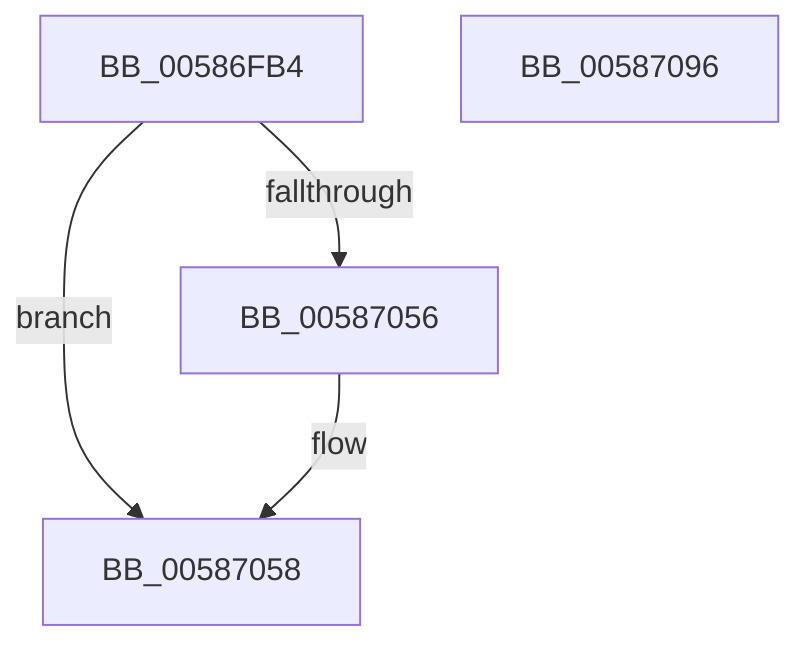

# HvlpQueryHypervisorSchedulerType

- RVA: `0x00586FB4`–`0x00587097` (길이 `227` bytes)
- VA: `0x0000000140586FB4`
- 실행 섹션: `.text`
- PDB 이름 있음: `예`; PDB Function 태그: `아니요`
- unwind 정보 RVA: `0x000C6410`
- 디코드: `55`개 명령, `227/227` bytes 표시
- 미해석 바이트: `0` (있으면 어셈블리에 `.byte`로 보존)

> 이 문서는 커널 이미지의 기계어와 PDB 기호를 분석해 생성했습니다. 4번과 5번은 함수 원형과 자료형을 바이너리 사용 방식에서 추정한 C 해석이며 원본 소스 복구 결과는 아닙니다.

## 1. Dependencies

- 직접 호출 지점: **6**; 고유 호출 대상: **4**
- 직접 호출자로 확인된 함수: **2**
- RIP 상대 이미지 참조: **1**

### Outgoing calls
- `0x00587017` → [HvlpAcquireHypercallPage](../47/HvlpAcquireHypercallPage_function_00471410.md) (function, `0x00471410`)
- `0x00587031` → [HvlpAcquireHypercallPage](../47/HvlpAcquireHypercallPage_function_00471410.md) (function, `0x00471410`)
- `0x0058704C` → [HvcallInitiateHypercall](../31/HvcallInitiateHypercall_function_00313630.md) (function, `0x00313630`)
- `0x0058705D` → [HvlpReleaseHypercallPage](../31/HvlpReleaseHypercallPage_function_00313480.md) (function, `0x00313480`)
- `0x00587067` → [HvlpReleaseHypercallPage](../31/HvlpReleaseHypercallPage_function_00313480.md) (function, `0x00313480`)
- `0x00587078` → [_security_check_cookie](../6A/_security_check_cookie_function_006AC640.md) (function, `0x006AC640`)

### Direct callers
- [HvlPhase2Initialize](HvlPhase2Initialize_function_00583EA0.md) at `0x00583FB4`
- [HvlpDetermineEnlightenments](HvlpDetermineEnlightenments_function_0058CC9C.md) at `0x0058CF7F`

### Static image references
- `0x00586FD2` → RVA `0x00E0A740` (`.data`; read)

## 2. Other-region calls and transfers

- 다른 실행 섹션으로 향하는 call: **0**
- 별도 외부 분기/꼬리 이동을 확인하지 못했습니다.

## 3. Assembly (complete function range)

```asm
00586FB4  48 8B C4                        mov rax, rsp
00586FB7  48 89 58 08                     mov qword ptr [rax + 8], rbx
00586FBB  48 89 70 10                     mov qword ptr [rax + 0x10], rsi
00586FBF  48 89 78 18                     mov qword ptr [rax + 0x18], rdi
00586FC3  55                              push rbp
00586FC4  48 8D A8 58 F8 FF FF            lea rbp, [rax - 0x7a8]
00586FCB  48 81 EC A0 08 00 00            sub rsp, 0x8a0
00586FD2  48 8B 05 67 37 88 00            mov rax, qword ptr [rip + 0x883767]
00586FD9  48 33 C4                        xor rax, rsp
00586FDC  48 89 85 90 07 00 00            mov qword ptr [rbp + 0x790], rax
00586FE3  33 C0                           xor eax, eax
00586FE5  4C 8D 44 24 60                  lea r8, [rsp + 0x60]
00586FEA  0F 57 C0                        xorps xmm0, xmm0
00586FED  48 89 44 24 50                  mov qword ptr [rsp + 0x50], rax
00586FF2  48 8D 4C 24 40                  lea rcx, [rsp + 0x40]
00586FF7  89 44 24 58                     mov dword ptr [rsp + 0x58], eax
00586FFB  0F 11 44 24 40                  movups xmmword ptr [rsp + 0x40], xmm0
00587000  44 8D 48 10                     lea r9d, [rax + 0x10]
00587004  48 89 44 24 30                  mov qword ptr [rsp + 0x30], rax
00587009  8D 50 01                        lea edx, [rax + 1]
0058700C  89 44 24 38                     mov dword ptr [rsp + 0x38], eax
00587010  0F 11 44 24 20                  movups xmmword ptr [rsp + 0x20], xmm0
00587015  33 FF                           xor edi, edi
00587017  E8 F4 A3 EE FF                  call 0x140471410
0058701C  41 B9 08 04 00 00               mov r9d, 0x408
00587022  4C 8D 45 80                     lea r8, [rbp - 0x80]
00587026  8D 57 02                        lea edx, [rdi + 2]
00587029  48 8B D8                        mov rbx, rax
0058702C  48 8D 4C 24 20                  lea rcx, [rsp + 0x20]
00587031  E8 DA A3 EE FF                  call 0x140471410
00587036  4C 8B 44 24 38                  mov r8, qword ptr [rsp + 0x38]
0058703B  8D 4F 7B                        lea ecx, [rdi + 0x7b]
0058703E  48 8B 54 24 58                  mov rdx, qword ptr [rsp + 0x58]
00587043  48 8B F0                        mov rsi, rax
00587046  C7 03 0F 00 00 00               mov dword ptr [rbx], 0xf
0058704C  E8 DF C5 D8 FF                  call 0x140313630
00587051  66 85 C0                        test ax, ax
00587054  75 02                           jne 0x140587058
00587056  8B 3E                           mov edi, dword ptr [rsi]
00587058  48 8D 4C 24 20                  lea rcx, [rsp + 0x20]
0058705D  E8 1E C4 D8 FF                  call 0x140313480
00587062  48 8D 4C 24 40                  lea rcx, [rsp + 0x40]
00587067  E8 14 C4 D8 FF                  call 0x140313480
0058706C  8B C7                           mov eax, edi
0058706E  48 8B 8D 90 07 00 00            mov rcx, qword ptr [rbp + 0x790]
00587075  48 33 CC                        xor rcx, rsp
00587078  E8 C3 55 12 00                  call 0x1406ac640
0058707D  4C 8D 9C 24 A0 08 00 00         lea r11, [rsp + 0x8a0]
00587085  49 8B 5B 10                     mov rbx, qword ptr [r11 + 0x10]
00587089  49 8B 73 18                     mov rsi, qword ptr [r11 + 0x18]
0058708D  49 8B 7B 20                     mov rdi, qword ptr [r11 + 0x20]
00587091  49 8B E3                        mov rsp, r11
00587094  5D                              pop rbp
00587095  C3                              ret
00587096  CC                              int3
```

## 4. C-style interpretation (structured pseudocode)

```c
__int64 __fastcall HvlpQueryHypervisorSchedulerType(void)
{
    __int64 result;
    __int64 v_rdi;
    __int64 v_rsp;
    unsigned __int64 v_stack_m8;
    unsigned __int64 v_stack_m848;
    unsigned int v_stack_m850;
    unsigned __int64 v_stack_m858;
    unsigned __int64 v_stack_m868;
    unsigned int v_stack_m870;
    unsigned __int64 v_stack_m878;
    unsigned __int64 v_stack_m888;

    *(unsigned __int64 *)(v_rsp + 8) = v_rbx;
    *(unsigned __int64 *)(v_rsp + 16) = v_rsi;
    *(unsigned __int64 *)(v_rsp + 24) = v_rdi;
    v_rsp = (v_rsp) - (0x8A0ULL);
    result = (*(unsigned __int64 *)(v_rip + 8927079)) ^ (v_rsp);
    *(unsigned __int64 *)(v_rsp - 1960 + 1936) = result;
    result = 0;
    v_stack_m858 = 0;
    v_stack_m850 = 0;
    v_stack_m868 = v_xmm0;
    v_stack_m878 = 0;
    v_stack_m870 = 0;
    v_stack_m888 = v_xmm0;
    v_rdi = 0;
    result = HvlpAcquireHypercallPage(v_stack_m868, result + 1, v_stack_m848, result + 16);
    result = HvlpAcquireHypercallPage(v_stack_m888, v_rdi + 2, v_rsp - 1960 - 128, (unsigned int)(0x408ULL));
    *(unsigned int *)(result) = 15;
    result = HvcallInitiateHypercall(v_rdi + 123, v_stack_m850, v_stack_m870, (unsigned int)(0x408ULL));
    if ((unsigned __int16)(result) == 0) {
        v_rdi = *(unsigned int *)(result);
    }
    result = HvlpReleaseHypercallPage(v_stack_m888, v_stack_m850, v_stack_m870, (unsigned int)(0x408ULL));
    result = HvlpReleaseHypercallPage(v_stack_m868, v_stack_m850, v_stack_m870, (unsigned int)(0x408ULL));
    a1 = (*(unsigned __int64 *)(v_rsp - 1960 + 1936)) ^ (v_rsp);
    result = _security_check_cookie(a1, v_stack_m850, v_stack_m870, (unsigned int)(0x408ULL));
    return result;
}
```

## 5. (Beta) C Style

```c
void HvlpQueryHypervisorSchedulerType(void)
{
    int64_t result;
    int64_t local_rdi;
    int64_t local_rsp;
    uint64_t v_stack_m8;
    uint64_t v_stack_m848;
    uint32_t v_stack_m850;
    uint64_t v_stack_m858;
    uint64_t v_stack_m868;
    uint32_t v_stack_m870;
    uint64_t v_stack_m878;
    uint64_t v_stack_m888;

    *(uint64_t *)(local_rsp + 0x8) = local_rbx;
    *(uint64_t *)(local_rsp + 0x10) = local_rsi;
    *(uint64_t *)(local_rsp + 0x18) = local_rdi;
    local_rsp = (local_rsp) - (0x8A0ULL);
    result = (*(uint64_t *)(v_rip + 0x883767)) ^ (local_rsp);
    *(uint64_t *)(local_rsp - 0x7A8 + 0x790) = result;
    result = 0;
    v_stack_m858 = 0;
    v_stack_m850 = 0;
    v_stack_m868 = v_xmm0;
    v_stack_m878 = 0;
    v_stack_m870 = 0;
    v_stack_m888 = v_xmm0;
    local_rdi = 0;
    result = HvlpAcquireHypercallPage(v_stack_m868, result + 1, v_stack_m848, result + 16);
    result = HvlpAcquireHypercallPage(v_stack_m888, local_rdi + 2, local_rsp - 1960 - 128, (uint32_t)(0x408ULL));
    *(uint32_t *)(result) = 15;
    result = HvcallInitiateHypercall(local_rdi + 123, v_stack_m850, v_stack_m870, (uint32_t)(0x408ULL));
    if ((uint16_t)(result) == 0) {
        local_rdi = *(uint32_t *)(result);
    }
    result = HvlpReleaseHypercallPage(v_stack_m888, v_stack_m850, v_stack_m870, (uint32_t)(0x408ULL));
    result = HvlpReleaseHypercallPage(v_stack_m868, v_stack_m850, v_stack_m870, (uint32_t)(0x408ULL));
    a1 = (*(uint64_t *)(local_rsp - 0x7A8 + 0x790)) ^ (local_rsp);
    result = _security_check_cookie(a1, v_stack_m850, v_stack_m870, (uint32_t)(0x408ULL));
    return result;
}
```

## 6. Execution-region graph

[열기: 2D/3D 그래프와 함수 탐색 컨트롤 패널](../../../control-panel.html?section=text&rva=0x00586FB4&view=graph)

- 2D 그래프는 위에서 아래로 흐르고, 3D 그래프는 빈 공간을 드래그해 회전합니다. Shift+드래그는 이동, 휠은 확대·축소, 함수 노드 선택은 대상 보고서 이동입니다.

### Static fallback


