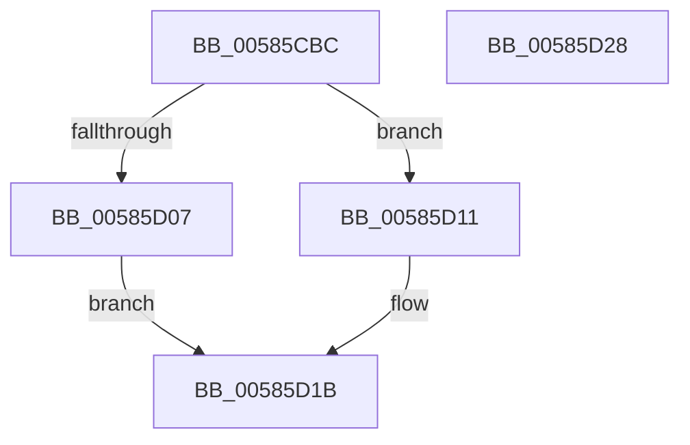

# HvlpReadPerfRegister

- RVA: `0x00585CBC`–`0x00585D29` (길이 `109` bytes)
- VA: `0x0000000140585CBC`
- 실행 섹션: `.text`
- PDB 이름 있음: `예`; PDB Function 태그: `예`
- unwind 정보 RVA: `0x00089EA4`
- 디코드: `31`개 명령, `109/109` bytes 표시
- 미해석 바이트: `0` (있으면 어셈블리에 `.byte`로 보존)

> 이 문서는 커널 이미지의 기계어와 PDB 기호를 분석해 생성했습니다. 4번과 5번은 함수 원형과 자료형을 바이너리 사용 방식에서 추정한 C 해석이며 원본 소스 복구 결과는 아닙니다.

## 1. Dependencies

- 직접 호출 지점: **2**; 고유 호출 대상: **2**
- 직접 호출자로 확인된 함수: **2**
- RIP 상대 이미지 참조: **0**

### Outgoing calls
- `0x00585CFD` → [HvcallFastExtended](../31/HvcallFastExtended_function_003130E0.md) (function, `0x003130E0`)
- `0x00585D14` → [HvlpHvToNtStatus](../30/HvlpHvToNtStatus_function_00307BD8.md) (function, `0x00307BD8`)

### Direct callers
- [HvlReadPerfIoPort](HvlReadPerfIoPort_function_00584C30.md) at `0x00584C8E`
- [HvlReadPerfMsr](HvlReadPerfMsr_function_00584CB0.md) at `0x00584CCC`

### Static image references
- 디코드된 RIP-relative 메모리 참조가 없습니다.

## 2. Other-region calls and transfers

- 다른 실행 섹션으로 향하는 call: **0**
- 별도 외부 분기/꼬리 이동을 확인하지 못했습니다.

## 3. Assembly (complete function range)

```asm
00585CBC  48 8B C4                        mov rax, rsp
00585CBF  48 89 58 08                     mov qword ptr [rax + 8], rbx
00585CC3  57                              push rdi
00585CC4  48 83 EC 50                     sub rsp, 0x50
00585CC8  33 DB                           xor ebx, ebx
00585CCA  48 C7 44 24 68 1C 00 00 00      mov qword ptr [rsp + 0x68], 0x1c
00585CD3  49 8B F8                        mov rdi, r8
00585CD6  89 48 D8                        mov dword ptr [rax - 0x28], ecx
00585CD9  48 89 50 E0                     mov qword ptr [rax - 0x20], rdx
00585CDD  4C 8D 48 E8                     lea r9, [rax - 0x18]
00585CE1  C7 44 24 68 1C 00 01 00         mov dword ptr [rsp + 0x68], 0x1001c
00585CE9  48 8D 50 D8                     lea rdx, [rax - 0x28]
00585CED  48 8B 4C 24 68                  mov rcx, qword ptr [rsp + 0x68]
00585CF2  44 8D 43 10                     lea r8d, [rbx + 0x10]
00585CF6  44 89 40 C8                     mov dword ptr [rax - 0x38], r8d
00585CFA  89 58 DC                        mov dword ptr [rax - 0x24], ebx
00585CFD  E8 DE D3 D8 FF                  call 0x1403130e0
00585D02  66 85 C0                        test ax, ax
00585D05  75 0A                           jne 0x140585d11
00585D07  48 8B 44 24 40                  mov rax, qword ptr [rsp + 0x40]
00585D0C  48 89 07                        mov qword ptr [rdi], rax
00585D0F  EB 0A                           jmp 0x140585d1b
00585D11  0F B7 C8                        movzx ecx, ax
00585D14  E8 BF 1E D8 FF                  call 0x140307bd8
00585D19  8B D8                           mov ebx, eax
00585D1B  8B C3                           mov eax, ebx
00585D1D  48 8B 5C 24 60                  mov rbx, qword ptr [rsp + 0x60]
00585D22  48 83 C4 50                     add rsp, 0x50
00585D26  5F                              pop rdi
00585D27  C3                              ret
00585D28  CC                              int3
```

## 4. C-style interpretation (structured pseudocode)

```c
__int64 __fastcall HvlpReadPerfRegister(int a1, __int64 a2, __int64 a3)
{
    __int64 result;
    __int64 v_rbx;
    __int64 v_rsp;
    unsigned __int64 v_stack_m18;
    unsigned __int64 v_stack_p10;
    unsigned __int64 v_stack_p8;

    *(unsigned __int64 *)(v_rsp + 8) = v_rbx;
    v_rsp = (v_rsp) - (80);
    v_rbx = 0;
    v_stack_p10 = 28;
    *(unsigned int *)(v_rsp - 40) = a1;
    *(unsigned __int64 *)(v_rsp - 32) = a2;
    v_stack_p10 = 0x1001CULL;
    *(unsigned int *)(v_rsp - 56) = (unsigned int)(v_rbx + 16);
    *(unsigned int *)(v_rsp - 36) = 0;
    result = HvcallFastExtended(v_stack_p10, v_rsp - 40, v_rbx + 16, v_rsp - 24);
    if ((unsigned __int16)(result) != 0) goto loc_00585D11;
    *(unsigned __int64 *)(a3) = v_stack_m18;
    goto loc_00585D1B;
loc_00585D11:
    result = HvlpHvToNtStatus((unsigned __int16)(v_stack_m18), v_rsp - 40, v_rbx + 16, v_rsp - 24);
loc_00585D1B:
    v_rsp = (v_rsp) + (80);
    return (unsigned int)((unsigned int)((unsigned int)((unsigned int)(result))));
}
```

## 5. (Beta) C Style

```c
int64_t HvlpReadPerfRegister(int32_t Arg1, int64_t Arg2, void *Arg3)
{
    uint8_t *arg3 = (uint8_t *)Arg3;

    int64_t result;
    int64_t local_rbx;
    int64_t local_rsp;
    uint64_t v_stack_m18;
    uint64_t v_stack_p10;
    uint64_t v_stack_p8;

    *(uint64_t *)(local_rsp + 0x8) = local_rbx;
    local_rsp = (local_rsp) - (80);
    local_rbx = 0;
    v_stack_p10 = 28;
    *(uint32_t *)(local_rsp - 0x28) = Arg1;
    *(uint64_t *)(local_rsp - 0x20) = Arg2;
    v_stack_p10 = 0x1001CULL;
    *(uint32_t *)(local_rsp - 0x38) = (uint32_t)(local_rbx + 16);
    *(uint32_t *)(local_rsp - 0x24) = 0;
    result = HvcallFastExtended(v_stack_p10, local_rsp - 40, local_rbx + 16, local_rsp - 24);
    if ((uint16_t)(result) != 0) goto loc_00585D11;
    *(uint64_t *)(arg3) = v_stack_m18;
    goto loc_00585D1B;
loc_00585D11:
    result = HvlpHvToNtStatus((uint16_t)(v_stack_m18), local_rsp - 40, local_rbx + 16, local_rsp - 24);
loc_00585D1B:
    local_rsp = (local_rsp) + (80);
    return (uint32_t)((uint32_t)((uint32_t)((uint32_t)(result))));
}
```

### 관측된 메모리 오프셋

구조체 형식이 확인되지 않은 접근은 인자 기준의 오프셋으로만 기록했습니다.

| 기준 인자 | 오프셋 표현 | 폭 (bit) | 접근 |
|---|---:|---:|---|
| `Arg3` | `+ 0x0` | `64` | `W` |

## 6. Execution-region graph

[열기: 2D/3D 그래프와 함수 탐색 컨트롤 패널](../../../control-panel.html?section=text&rva=0x00585CBC&view=graph)

- 2D 그래프는 위에서 아래로 흐르고, 3D 그래프는 빈 공간을 드래그해 회전합니다. Shift+드래그는 이동, 휠은 확대·축소, 함수 노드 선택은 대상 보고서 이동입니다.

### Static fallback


