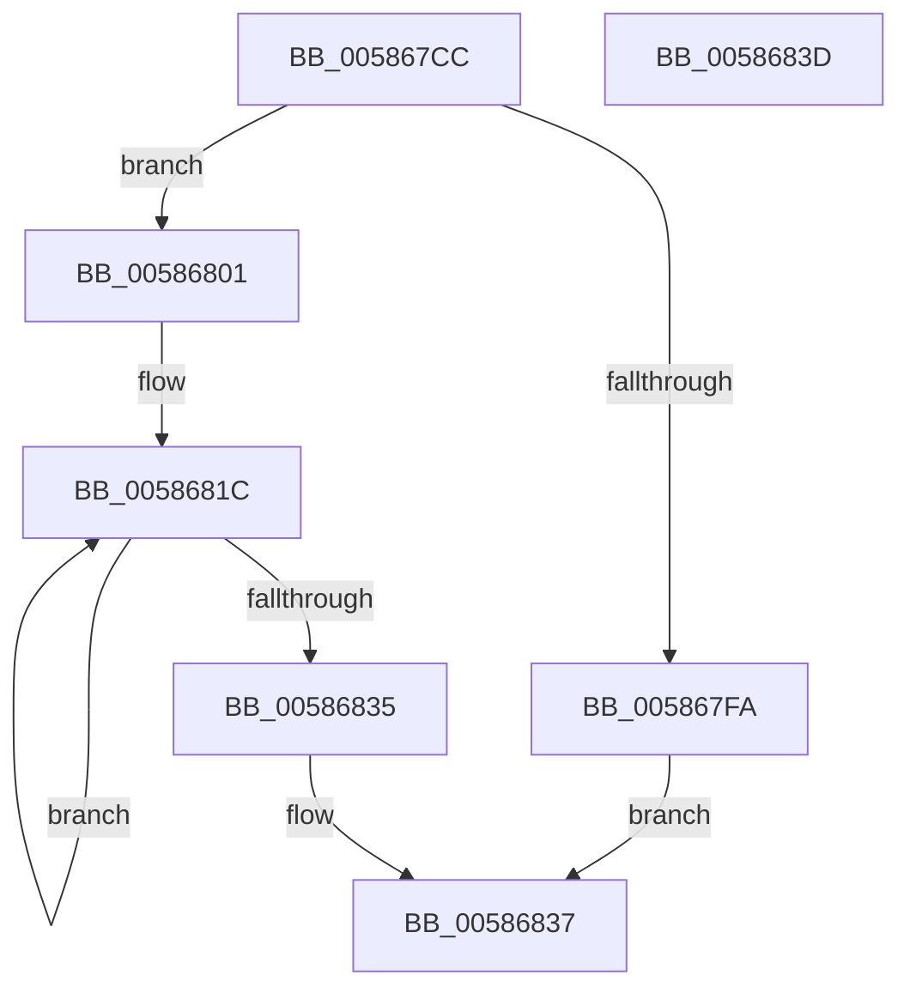

# HvlpSetupBootProcessorEarlyHypercallPages

- RVA: `0x005867CC`–`0x0058683E` (길이 `114` bytes)
- VA: `0x00000001405867CC`
- 실행 섹션: `.text`
- PDB 이름 있음: `예`; PDB Function 태그: `아니요`
- unwind 정보 RVA: `0x0005CF00`
- 디코드: `29`개 명령, `114/114` bytes 표시
- 미해석 바이트: `0` (있으면 어셈블리에 `.byte`로 보존)

> 이 문서는 커널 이미지의 기계어와 PDB 기호를 분석해 생성했습니다. 4번과 5번은 함수 원형과 자료형을 바이너리 사용 방식에서 추정한 C 해석이며 원본 소스 복구 결과는 아닙니다.

## 1. Dependencies

- 직접 호출 지점: **1**; 고유 호출 대상: **1**
- 직접 호출자로 확인된 함수: **1**
- RIP 상대 이미지 참조: **0**

### Outgoing calls
- `0x005867F0` → [HvlpAllocateEarlyPages](HvlpAllocateEarlyPages_function_0058D3DC.md) (function, `0x0058D3DC`)

### Direct callers
- [HvlPhase0Initialize](../../page/71/HvlPhase0Initialize_function_00717AC8.md) at `0x00717B1F`

### Static image references
- 디코드된 RIP-relative 메모리 참조가 없습니다.

## 2. Other-region calls and transfers

- 다른 실행 섹션으로 향하는 call: **0**
- 별도 외부 분기/꼬리 이동을 확인하지 못했습니다.

## 3. Assembly (complete function range)

```asm
005867CC  40 53                           push rbx
005867CE  48 83 EC 20                     sub rsp, 0x20
005867D2  48 83 64 24 38 00               and qword ptr [rsp + 0x38], 0
005867D8  4C 8D 44 24 38                  lea r8, [rsp + 0x38]
005867DD  65 48 8B 1C 25 20 00 00 00      mov rbx, qword ptr gs:[0x20]
005867E6  41 B9 04 00 00 00               mov r9d, 4
005867EC  41 8D 51 02                     lea edx, [r9 + 2]
005867F0  E8 E7 6B 00 00                  call 0x14058d3dc
005867F5  48 85 C0                        test rax, rax
005867F8  75 07                           jne 0x140586801
005867FA  B8 9A 00 00 C0                  mov eax, 0xc000009a
005867FF  EB 36                           jmp 0x140586837
00586801  48 89 83 00 8C 00 00            mov qword ptr [rbx + 0x8c00], rax
00586808  48 8D 48 10                     lea rcx, [rax + 0x10]
0058680C  48 8B 44 24 38                  mov rax, qword ptr [rsp + 0x38]
00586811  BA 02 00 00 00                  mov edx, 2
00586816  41 B8 00 10 00 00               mov r8d, 0x1000
0058681C  48 89 01                        mov qword ptr [rcx], rax
0058681F  49 03 C8                        add rcx, r8
00586822  48 8B 44 24 38                  mov rax, qword ptr [rsp + 0x38]
00586827  49 03 C0                        add rax, r8
0058682A  48 89 44 24 38                  mov qword ptr [rsp + 0x38], rax
0058682F  48 83 EA 01                     sub rdx, 1
00586833  75 E7                           jne 0x14058681c
00586835  33 C0                           xor eax, eax
00586837  48 83 C4 20                     add rsp, 0x20
0058683B  5B                              pop rbx
0058683C  C3                              ret
0058683D  CC                              int3
```

## 4. C-style interpretation (structured pseudocode)

```c
__int64 __fastcall HvlpSetupBootProcessorEarlyHypercallPages(void)
{
    __int64 result;
    __int64 v_rsp;
    unsigned __int64 v_stack_p10;

    v_rsp = (v_rsp) - (32);
    result = HvlpAllocateEarlyPages(a1, 4 + 2, v_stack_p10, 4);
    if (result != 0) goto loc_00586801;
    goto loc_00586837;
loc_00586801:
    *(unsigned __int64 *)(*(unsigned __int64 *)(gs_base + (0 + 32)) + 35840) = (unsigned int)(0xC000009AULL);
loc_0058681C:
    *(unsigned __int64 *)((unsigned int)(0xC000009AULL) + 16) = v_stack_p10;
    a1 = ((unsigned int)(0xC000009AULL) + 16) + ((unsigned int)(0x1000ULL));
    result = (v_stack_p10) + ((unsigned int)(0x1000ULL));
    v_stack_p10 = result;
    a2 = (2) - (1);
    if (condition_is_not_equal) goto loc_0058681C;
    result = 0;
loc_00586837:
    v_rsp = (v_rsp) + (32);
    return result;
}
```

## 5. (Beta) C Style

```c
void HvlpSetupBootProcessorEarlyHypercallPages(void)
{
    int64_t result;
    int64_t local_rsp;
    uint64_t v_stack_p10;

    local_rsp = (local_rsp) - (32);
    result = HvlpAllocateEarlyPages(a1, 4 + 2, v_stack_p10, 4);
    if (result != 0) goto loc_00586801;
    goto loc_00586837;
loc_00586801:
    *(uint64_t *)(*(uint64_t *)(gs_base + (0 + 0x20)) + 0x8C00) = (uint32_t)(0xC000009AULL);
loc_0058681C:
    *(uint64_t *)((uint32_t)(0xC000009AULL) + 0x10) = v_stack_p10;
    a1 = ((uint32_t)(0xC000009AULL) + 16) + ((uint32_t)(0x1000ULL));
    result = (v_stack_p10) + ((uint32_t)(0x1000ULL));
    v_stack_p10 = result;
    a2 = (2) - (1);
    if (condition_is_not_equal) goto loc_0058681C;
    result = 0;
loc_00586837:
    local_rsp = (local_rsp) + (32);
    return result;
}
```

## 6. Execution-region graph

[열기: 2D/3D 그래프와 함수 탐색 컨트롤 패널](../../../control-panel.html?section=text&rva=0x005867CC&view=graph)

- 2D 그래프는 위에서 아래로 흐르고, 3D 그래프는 빈 공간을 드래그해 회전합니다. Shift+드래그는 이동, 휠은 확대·축소, 함수 노드 선택은 대상 보고서 이동입니다.

### Static fallback


