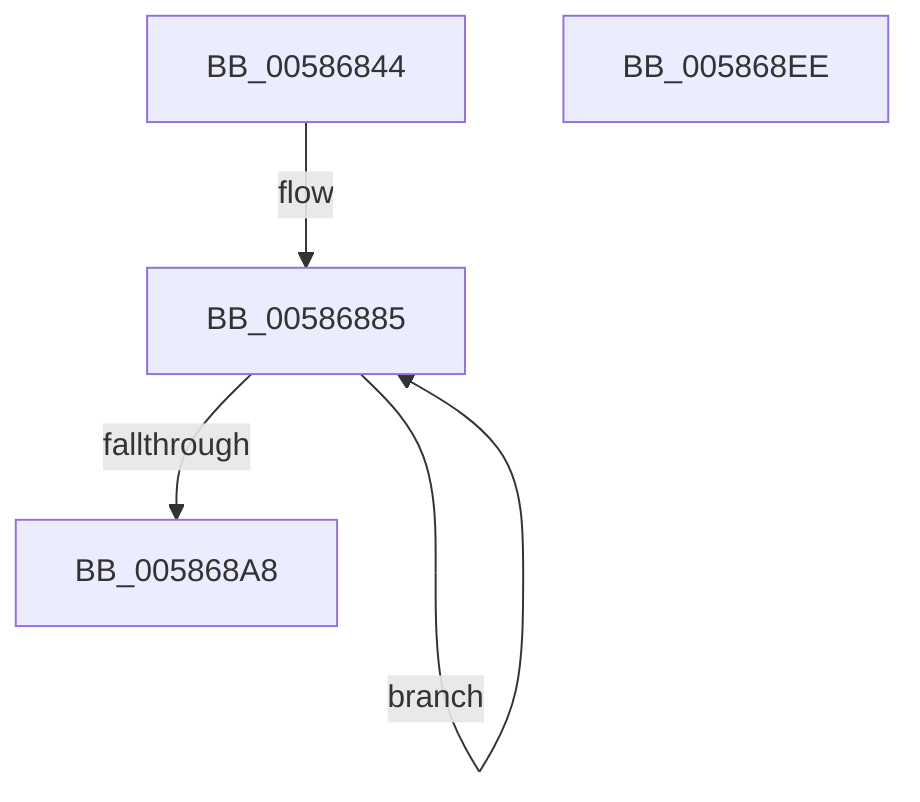

# HvlpSetupCachedHypercallPages

- RVA: `0x00586844`–`0x005868EF` (길이 `171` bytes)
- VA: `0x0000000140586844`
- 실행 섹션: `.text`
- PDB 이름 있음: `예`; PDB Function 태그: `아니요`
- unwind 정보 RVA: `0x0005E6B4`
- 디코드: `41`개 명령, `171/171` bytes 표시
- 미해석 바이트: `0` (있으면 어셈블리에 `.byte`로 보존)

> 이 문서는 커널 이미지의 기계어와 PDB 기호를 분석해 생성했습니다. 4번과 5번은 함수 원형과 자료형을 바이너리 사용 방식에서 추정한 C 해석이며 원본 소스 복구 결과는 아닙니다.

## 1. Dependencies

- 직접 호출 지점: **4**; 고유 호출 대상: **3**
- 직접 호출자로 확인된 함수: **2**
- RIP 상대 이미지 참조: **0**

### Outgoing calls
- `0x00586875` → [InitializeSListHead](../46/InitializeSListHead_function_00468A90.md) (function, `0x00468A90`)
- `0x00586888` → [MmGetPhysicalAddress](../23/MmGetPhysicalAddress_function_0023A500.md) (function, `0x0023A500`)
- `0x005868B2` → [MmGetPhysicalAddress](../23/MmGetPhysicalAddress_function_0023A500.md) (function, `0x0023A500`)
- `0x005868CE` → [InterlockedPushListSList](../6B/InterlockedPushListSList_function_006BA620.md) (function, `0x006BA620`)

### Direct callers
- [HvlPhase1Initialize](HvlPhase1Initialize_function_00583D80.md) at `0x00583E04`
- [HvlInitializeProcessor](../../page/71/HvlInitializeProcessor_function_0071804C.md) at `0x00718258`

### Static image references
- 디코드된 RIP-relative 메모리 참조가 없습니다.

## 2. Other-region calls and transfers

- 다른 실행 섹션으로 향하는 call: **0**
- 별도 외부 분기/꼬리 이동을 확인하지 못했습니다.

## 3. Assembly (complete function range)

```asm
00586844  48 8B C4                        mov rax, rsp
00586847  48 89 58 08                     mov qword ptr [rax + 8], rbx
0058684B  48 89 68 10                     mov qword ptr [rax + 0x10], rbp
0058684F  48 89 70 18                     mov qword ptr [rax + 0x18], rsi
00586853  48 89 78 20                     mov qword ptr [rax + 0x20], rdi
00586857  41 56                           push r14
00586859  48 83 EC 20                     sub rsp, 0x20
0058685D  48 8B B9 00 8C 00 00            mov rdi, qword ptr [rcx + 0x8c00]
00586864  4C 8D B1 C0 8B 00 00            lea r14, [rcx + 0x8bc0]
0058686B  48 81 C7 00 20 00 00            add rdi, 0x2000
00586872  49 8B CE                        mov rcx, r14
00586875  E8 16 22 EE FF                  call 0x140468a90
0058687A  48 8B DF                        mov rbx, rdi
0058687D  48 8B F7                        mov rsi, rdi
00586880  BD 03 00 00 00                  mov ebp, 3
00586885  48 8B CE                        mov rcx, rsi
00586888  E8 73 3C CB FF                  call 0x14023a500
0058688D  48 81 C6 00 10 00 00            add rsi, 0x1000
00586894  48 89 43 10                     mov qword ptr [rbx + 0x10], rax
00586898  48 89 33                        mov qword ptr [rbx], rsi
0058689B  48 8D 9B 00 10 00 00            lea rbx, [rbx + 0x1000]
005868A2  48 83 ED 01                     sub rbp, 1
005868A6  75 DD                           jne 0x140586885
005868A8  48 8D 9F 00 30 00 00            lea rbx, [rdi + 0x3000]
005868AF  48 8B CB                        mov rcx, rbx
005868B2  E8 49 3C CB FF                  call 0x14023a500
005868B7  48 21 2B                        and qword ptr [rbx], rbp
005868BA  44 8D 4D 04                     lea r9d, [rbp + 4]
005868BE  4C 8B C3                        mov r8, rbx
005868C1  48 89 87 10 30 00 00            mov qword ptr [rdi + 0x3010], rax
005868C8  48 8B D7                        mov rdx, rdi
005868CB  49 8B CE                        mov rcx, r14
005868CE  E8 4D 3D 13 00                  call 0x1406ba620
005868D3  48 8B 5C 24 30                  mov rbx, qword ptr [rsp + 0x30]
005868D8  48 8B 6C 24 38                  mov rbp, qword ptr [rsp + 0x38]
005868DD  48 8B 74 24 40                  mov rsi, qword ptr [rsp + 0x40]
005868E2  48 8B 7C 24 48                  mov rdi, qword ptr [rsp + 0x48]
005868E7  48 83 C4 20                     add rsp, 0x20
005868EB  41 5E                           pop r14
005868ED  C3                              ret
005868EE  CC                              int3
```

## 4. C-style interpretation (structured pseudocode)

```c
__int64 __fastcall HvlpSetupCachedHypercallPages(__int64 a1)
{
    __int64 result;
    __int64 v_rbp;
    __int64 v_rdi;
    __int64 v_rsi;
    __int64 v_rsp;
    unsigned __int64 v_stack_p10;
    unsigned __int64 v_stack_p18;
    unsigned __int64 v_stack_p20;
    unsigned __int64 v_stack_p8;

    *(unsigned __int64 *)(v_rsp + 8) = v_rbx;
    *(unsigned __int64 *)(v_rsp + 16) = v_rbp;
    *(unsigned __int64 *)(v_rsp + 24) = v_rsi;
    *(unsigned __int64 *)(v_rsp + 32) = v_rdi;
    v_rsp = (v_rsp) - (32);
    v_rdi = (*(unsigned __int64 *)(a1 + 35840)) + (0x2000ULL);
    result = InitializeSListHead(a1 + 35776, a2, a3, a4);
loc_00586885:
    result = MmGetPhysicalAddress(v_rdi, a2, a3, a4);
    v_rsi = (v_rdi) + (0x1000ULL);
    *(unsigned __int64 *)(v_rdi + 16) = result;
    *(unsigned __int64 *)(v_rdi) = v_rsi;
    v_rbp = (3) - (1);
    if (condition_is_not_equal) goto loc_00586885;
    result = MmGetPhysicalAddress(v_rdi + 12288, a2, a3, a4);
    *(unsigned __int64 *)(v_rdi + 12304) = result;
    result = InterlockedPushListSList(a1 + 35776, v_rdi, v_rdi + 12288, v_rbp + 4);
    v_rsp = (v_rsp) + (32);
    return result;
}
```

## 5. (Beta) C Style

```c
int64_t HvlpSetupCachedHypercallPages(void *Arg1)
{
    uint8_t *arg1 = (uint8_t *)Arg1;

    int64_t result;
    int64_t local_rbp;
    int64_t local_rdi;
    int64_t local_rsi;
    int64_t local_rsp;
    uint64_t v_stack_p10;
    uint64_t v_stack_p18;
    uint64_t v_stack_p20;
    uint64_t v_stack_p8;

    *(uint64_t *)(local_rsp + 0x8) = local_rbx;
    *(uint64_t *)(local_rsp + 0x10) = local_rbp;
    *(uint64_t *)(local_rsp + 0x18) = local_rsi;
    *(uint64_t *)(local_rsp + 0x20) = local_rdi;
    local_rsp = (local_rsp) - (32);
    local_rdi = (*(uint64_t *)(arg1 + 0x8C00)) + (0x2000ULL);
    result = InitializeSListHead(Arg1 + 35776, a2, a3, a4);
loc_00586885:
    result = MmGetPhysicalAddress(local_rdi, a2, a3, a4);
    local_rsi = (local_rdi) + (0x1000ULL);
    *(uint64_t *)(local_rdi + 0x10) = result;
    *(uint64_t *)(local_rdi) = local_rsi;
    local_rbp = (3) - (1);
    if (condition_is_not_equal) goto loc_00586885;
    result = MmGetPhysicalAddress(local_rdi + 12288, a2, a3, a4);
    *(uint64_t *)(local_rdi + 0x3010) = result;
    result = InterlockedPushListSList(Arg1 + 35776, local_rdi, local_rdi + 12288, local_rbp + 4);
    local_rsp = (local_rsp) + (32);
    return result;
}
```

### 관측된 메모리 오프셋

구조체 형식이 확인되지 않은 접근은 인자 기준의 오프셋으로만 기록했습니다.

| 기준 인자 | 오프셋 표현 | 폭 (bit) | 접근 |
|---|---:|---:|---|
| `Arg1` | `+ 0x8BC0` | `64` | `R` |
| `Arg1` | `+ 0x8C00` | `64` | `R` |

## 6. Execution-region graph

[열기: 2D/3D 그래프와 함수 탐색 컨트롤 패널](../../../control-panel.html?section=text&rva=0x00586844&view=graph)

- 2D 그래프는 위에서 아래로 흐르고, 3D 그래프는 빈 공간을 드래그해 회전합니다. Shift+드래그는 이동, 휠은 확대·축소, 함수 노드 선택은 대상 보고서 이동입니다.

### Static fallback


