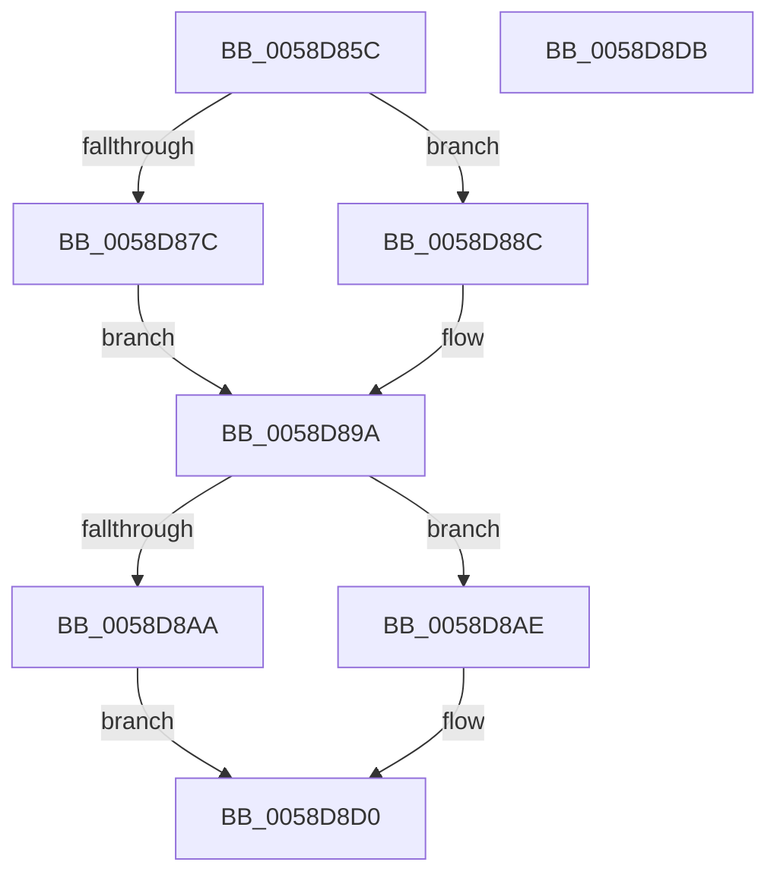

# HvlpSetupPageListIteration

- RVA: `0x0058D85C`–`0x0058D8DC` (길이 `128` bytes)
- VA: `0x000000014058D85C`
- 실행 섹션: `.text`
- PDB 이름 있음: `예`; PDB Function 태그: `아니요`
- unwind 정보 RVA: `0x0005CAAC`
- 디코드: `38`개 명령, `128/128` bytes 표시
- 미해석 바이트: `0` (있으면 어셈블리에 `.byte`로 보존)

> 이 문서는 커널 이미지의 기계어와 PDB 기호를 분석해 생성했습니다. 4번과 5번은 함수 원형과 자료형을 바이너리 사용 방식에서 추정한 C 해석이며 원본 소스 복구 결과는 아닙니다.

## 1. Dependencies

- 직접 호출 지점: **2**; 고유 호출 대상: **2**
- 직접 호출자로 확인된 함수: **2**
- RIP 상대 이미지 참조: **2**

### Outgoing calls
- `0x0058D868` → [HvlpGetPageListIterator](HvlpGetPageListIterator_function_0058D790.md) (function, `0x0058D790`)
- `0x0058D8AE` → [MmGetPhysicalAddress](../23/MmGetPhysicalAddress_function_0023A500.md) (function, `0x0023A500`)

### Direct callers
- [HvlpStartPageListIteration](HvlpStartPageListIteration_function_0058D8E4.md) at `0x0058D8E8`
- [HvlpStartSecurePageListIteration](HvlpStartSecurePageListIteration_function_0058D908.md) at `0x0058D935`

### Static image references
- `0x0058D87C` → RVA `0x00F8ECA0` (`.data`; read)
- `0x0058D883` → RVA `0x00F8EDF0` (`.data`; read)

## 2. Other-region calls and transfers

- 다른 실행 섹션으로 향하는 call: **0**
- 별도 외부 분기/꼬리 이동을 확인하지 못했습니다.

## 3. Assembly (complete function range)

```asm
0058D85C  48 89 5C 24 08                  mov qword ptr [rsp + 8], rbx
0058D861  57                              push rdi
0058D862  48 83 EC 20                     sub rsp, 0x20
0058D866  8B FA                           mov edi, edx
0058D868  E8 23 FF FF FF                  call 0x14058d790
0058D86D  33 D2                           xor edx, edx
0058D86F  48 8B D8                        mov rbx, rax
0058D872  89 10                           mov dword ptr [rax], edx
0058D874  88 50 04                        mov byte ptr [rax + 4], dl
0058D877  83 F9 01                        cmp ecx, 1
0058D87A  75 10                           jne 0x14058d88c
0058D87C  48 8B 0D 1D 14 A0 00            mov rcx, qword ptr [rip + 0xa0141d]
0058D883  48 8B 05 66 15 A0 00            mov rax, qword ptr [rip + 0xa01566]
0058D88A  EB 0E                           jmp 0x14058d89a
0058D88C  48 8B 0D 5D 15 A0 00            mov rcx, qword ptr [rip + 0xa0155d]
0058D893  48 8B 05 06 14 A0 00            mov rax, qword ptr [rip + 0xa01406]
0058D89A  48 85 C9                        test rcx, rcx
0058D89D  48 0F 44 C8                     cmove rcx, rax
0058D8A1  48 89 4B 08                     mov qword ptr [rbx + 8], rcx
0058D8A5  48 85 C9                        test rcx, rcx
0058D8A8  75 04                           jne 0x14058d8ae
0058D8AA  33 C0                           xor eax, eax
0058D8AC  EB 22                           jmp 0x14058d8d0
0058D8AE  E8 4D CC CA FF                  call 0x14023a500
0058D8B3  48 89 43 10                     mov qword ptr [rbx + 0x10], rax
0058D8B7  40 8A C7                        mov al, dil
0058D8BA  24 01                           and al, 1
0058D8BC  D1 EF                           shr edi, 1
0058D8BE  40 80 E7 01                     and dil, 1
0058D8C2  88 43 03                        mov byte ptr [rbx + 3], al
0058D8C5  40 88 7B 04                     mov byte ptr [rbx + 4], dil
0058D8C9  48 8B C3                        mov rax, rbx
0058D8CC  C6 43 02 01                     mov byte ptr [rbx + 2], 1
0058D8D0  48 8B 5C 24 30                  mov rbx, qword ptr [rsp + 0x30]
0058D8D5  48 83 C4 20                     add rsp, 0x20
0058D8D9  5F                              pop rdi
0058D8DA  C3                              ret
0058D8DB  CC                              int3
```

## 4. C-style interpretation (structured pseudocode)

```c
__int64 __fastcall HvlpSetupPageListIteration(int a1, int a2)
{
    __int64 result;
    __int64 v_rdi;
    __int64 v_rsp;
    unsigned __int64 v_stack_p8;

    v_stack_p8 = v_rbx;
    v_rsp = (v_rsp) - (32);
    result = HvlpGetPageListIterator(a1, a2, a3, a4);
    a2 = 0;
    *(unsigned int *)(result) = 0;
    *(unsigned __int8 *)(result + 4) = 0;
    if (a1 != 1) goto loc_0058D88C;
    goto loc_0058D89A;
loc_0058D88C:
loc_0058D89A:
    a1 = *(unsigned __int64 *)(v_rip + 10491229);
    if (*(unsigned __int64 *)(v_rip + 10491229) == 0) { a1 = *(unsigned __int64 *)(v_rip + 10490886); }
    *(unsigned __int64 *)(result + 8) = a1;
    if (a1 != 0) goto loc_0058D8AE;
    result = 0;
    goto loc_0058D8D0;
loc_0058D8AE:
    result = MmGetPhysicalAddress(a1, a2, a3, a4);
    *(unsigned __int64 *)(result + 16) = result;
    result = (unsigned __int8)(((unsigned __int8)((unsigned int)(a2))) & (1));
    v_rdi = (unsigned int)(((unsigned int)(a2)) >> (1));
    v_rdi = (unsigned __int8)((v_rdi) & (1));
    *(unsigned __int8 *)(result + 3) = (unsigned __int8)(result);
    *(unsigned __int8 *)(result + 4) = (unsigned __int8)(v_rdi);
    *(unsigned __int8 *)(result + 2) = 1;
loc_0058D8D0:
    v_rsp = (v_rsp) + (32);
    return result;
}
```

## 5. (Beta) C Style

```c
int64_t HvlpSetupPageListIteration(int32_t Arg1, int32_t Arg2)
{
    int64_t result;
    int64_t local_rdi;
    int64_t local_rsp;
    uint64_t v_stack_p8;

    v_stack_p8 = local_rbx;
    local_rsp = (local_rsp) - (32);
    result = HvlpGetPageListIterator(Arg1, Arg2, a3, a4);
    Arg2 = 0;
    *(uint32_t *)(result) = 0;
    *(uint8_t *)(result + 0x4) = 0;
    if (Arg1 != 1) goto loc_0058D88C;
    goto loc_0058D89A;
loc_0058D88C:
loc_0058D89A:
    Arg1 = *(uint64_t *)(v_rip + 0xA0155D);
    if (*(uint64_t *)(v_rip + 0xA0155D) == 0) { Arg1 = *(uint64_t *)(v_rip + 0xA01406); }
    *(uint64_t *)(result + 0x8) = Arg1;
    if (Arg1 != 0) goto loc_0058D8AE;
    result = 0;
    goto loc_0058D8D0;
loc_0058D8AE:
    result = MmGetPhysicalAddress(Arg1, Arg2, a3, a4);
    *(uint64_t *)(result + 0x10) = result;
    result = (uint8_t)(((uint8_t)((uint32_t)(Arg2))) & (1));
    local_rdi = (uint32_t)(((uint32_t)(Arg2)) >> (1));
    local_rdi = (uint8_t)((local_rdi) & (1));
    *(uint8_t *)(result + 0x3) = (uint8_t)(result);
    *(uint8_t *)(result + 0x4) = (uint8_t)(local_rdi);
    *(uint8_t *)(result + 0x2) = 1;
loc_0058D8D0:
    local_rsp = (local_rsp) + (32);
    return result;
}
```

## 6. Execution-region graph

[열기: 2D/3D 그래프와 함수 탐색 컨트롤 패널](../../../control-panel.html?section=text&rva=0x0058D85C&view=graph)

- 2D 그래프는 위에서 아래로 흐르고, 3D 그래프는 빈 공간을 드래그해 회전합니다. Shift+드래그는 이동, 휠은 확대·축소, 함수 노드 선택은 대상 보고서 이동입니다.

### Static fallback


