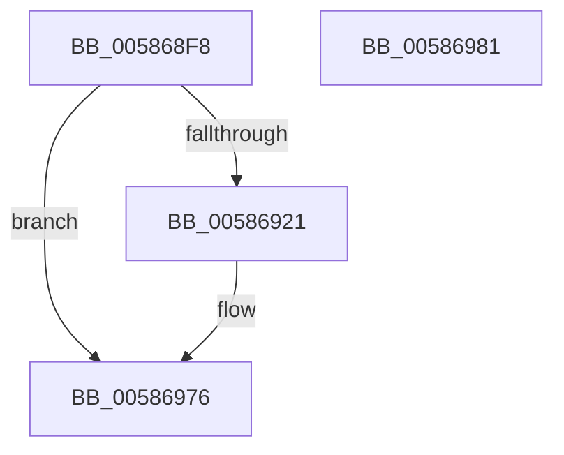

# HvlpSetupSchedulerAssist

- RVA: `0x005868F8`–`0x00586982` (길이 `138` bytes)
- VA: `0x00000001405868F8`
- 실행 섹션: `.text`
- PDB 이름 있음: `예`; PDB Function 태그: `아니요`
- unwind 정보 RVA: `0x00065960`
- 디코드: `35`개 명령, `138/138` bytes 표시
- 미해석 바이트: `0` (있으면 어셈블리에 `.byte`로 보존)

> 이 문서는 커널 이미지의 기계어와 PDB 기호를 분석해 생성했습니다. 4번과 5번은 함수 원형과 자료형을 바이너리 사용 방식에서 추정한 C 해석이며 원본 소스 복구 결과는 아닙니다.

## 1. Dependencies

- 직접 호출 지점: **4**; 고유 호출 대상: **4**
- 직접 호출자로 확인된 함수: **1**
- RIP 상대 이미지 참조: **0**

### Outgoing calls
- `0x00586939` → [HvlpAcquireHypercallPage](../47/HvlpAcquireHypercallPage_function_00471410.md) (function, `0x00471410`)
- `0x00586951` → [MmGetPhysicalAddress](../23/MmGetPhysicalAddress_function_0023A500.md) (function, `0x0023A500`)
- `0x00586967` → [HvcallInitiateHypercall](../31/HvcallInitiateHypercall_function_00313630.md) (function, `0x00313630`)
- `0x00586971` → [HvlpReleaseHypercallPage](../31/HvlpReleaseHypercallPage_function_00313480.md) (function, `0x00313480`)

### Direct callers
- [HvlEnlightenProcessor](../4D/HvlEnlightenProcessor_function_004DCD9C.md) at `0x004DCEB3`

### Static image references
- 디코드된 RIP-relative 메모리 참조가 없습니다.

## 2. Other-region calls and transfers

- 다른 실행 섹션으로 향하는 call: **0**
- 별도 외부 분기/꼬리 이동을 확인하지 못했습니다.

## 3. Assembly (complete function range)

```asm
005868F8  48 89 5C 24 08                  mov qword ptr [rsp + 8], rbx
005868FD  57                              push rdi
005868FE  48 83 EC 40                     sub rsp, 0x40
00586902  48 8B B9 B8 8E 00 00            mov rdi, qword ptr [rcx + 0x8eb8]
00586909  33 C0                           xor eax, eax
0058690B  48 89 44 24 30                  mov qword ptr [rsp + 0x30], rax
00586910  0F 57 C0                        xorps xmm0, xmm0
00586913  89 44 24 38                     mov dword ptr [rsp + 0x38], eax
00586917  0F 11 44 24 20                  movups xmmword ptr [rsp + 0x20], xmm0
0058691C  48 85 FF                        test rdi, rdi
0058691F  74 55                           je 0x140586976
00586921  C7 07 08 08 00 00               mov dword ptr [rdi], 0x808
00586927  44 8D 48 10                     lea r9d, [rax + 0x10]
0058692B  45 33 C0                        xor r8d, r8d
0058692E  89 47 04                        mov dword ptr [rdi + 4], eax
00586931  8D 50 01                        lea edx, [rax + 1]
00586934  48 8D 4C 24 20                  lea rcx, [rsp + 0x20]
00586939  E8 D2 AA EE FF                  call 0x140471410
0058693E  48 8B CF                        mov rcx, rdi
00586941  48 8B D8                        mov rbx, rax
00586944  C7 00 05 00 00 00               mov dword ptr [rax], 5
0058694A  C7 40 04 01 00 00 00            mov dword ptr [rax + 4], 1
00586951  E8 AA 3B CB FF                  call 0x14023a500
00586956  48 8B 54 24 38                  mov rdx, qword ptr [rsp + 0x38]
0058695B  45 33 C0                        xor r8d, r8d
0058695E  B9 05 80 00 00                  mov ecx, 0x8005
00586963  48 89 43 08                     mov qword ptr [rbx + 8], rax
00586967  E8 C4 CC D8 FF                  call 0x140313630
0058696C  48 8D 4C 24 20                  lea rcx, [rsp + 0x20]
00586971  E8 0A CB D8 FF                  call 0x140313480
00586976  48 8B 5C 24 50                  mov rbx, qword ptr [rsp + 0x50]
0058697B  48 83 C4 40                     add rsp, 0x40
0058697F  5F                              pop rdi
00586980  C3                              ret
00586981  CC                              int3
```

## 4. C-style interpretation (structured pseudocode)

```c
__int64 __fastcall HvlpSetupSchedulerAssist(__int64 a1, __int64 a2, int a3)
{
    __int64 result;
    __int64 v_rbx;
    __int64 v_rsp;
    unsigned int v_stack_m10;
    unsigned __int64 v_stack_m18;
    unsigned __int64 v_stack_m28;
    unsigned __int64 v_stack_p8;

    v_stack_p8 = v_rbx;
    v_rsp = (v_rsp) - (64);
    result = 0;
    v_stack_m18 = 0;
    v_stack_m10 = 0;
    v_stack_m28 = v_xmm0;
    if (*(unsigned __int64 *)(a1 + 36536) != 0) {
        *(unsigned int *)(*(unsigned __int64 *)(a1 + 36536)) = 0x808ULL;
        a4 = result + 16;
        a3 = 0;
        *(unsigned int *)(*(unsigned __int64 *)(a1 + 36536) + 4) = 0;
        a2 = result + 1;
        a1 = v_stack_m28;
        result = HvlpAcquireHypercallPage(a1, a2, a3, a4);
        a1 = *(unsigned __int64 *)(a1 + 36536);
        v_rbx = result;
        *(unsigned int *)(result) = 5;
        *(unsigned int *)(result + 4) = 1;
        result = MmGetPhysicalAddress(a1, a2, a3, a4);
        a2 = v_stack_m10;
        a3 = 0;
        a1 = 0x8005ULL;
        *(unsigned __int64 *)(v_rbx + 8) = result;
        result = HvcallInitiateHypercall(a1, a2, a3, a4);
        a1 = v_stack_m28;
        result = HvlpReleaseHypercallPage(a1, a2, a3, a4);
    }
    v_rsp = (v_rsp) + (64);
    return result;
}
```

## 5. (Beta) C Style

```c
int64_t HvlpSetupSchedulerAssist(void *Arg1, int64_t Arg2, int32_t Arg3)
{
    uint8_t *arg1 = (uint8_t *)Arg1;

    int64_t result;
    int64_t local_rbx;
    int64_t local_rsp;
    uint32_t v_stack_m10;
    uint64_t v_stack_m18;
    uint64_t v_stack_m28;
    uint64_t v_stack_p8;

    v_stack_p8 = local_rbx;
    local_rsp = (local_rsp) - (64);
    result = 0;
    v_stack_m18 = 0;
    v_stack_m10 = 0;
    v_stack_m28 = v_xmm0;
    if (*(uint64_t *)(arg1 + 0x8EB8) != 0) {
        *(uint32_t *)(*(uint64_t *)(arg1 + 0x8EB8)) = 0x808ULL;
        a4 = result + 16;
        Arg3 = 0;
        *(uint32_t *)(*(uint64_t *)(arg1 + 0x8EB8) + 0x4) = 0;
        Arg2 = result + 1;
        Arg1 = v_stack_m28;
        result = HvlpAcquireHypercallPage(Arg1, Arg2, Arg3, a4);
        Arg1 = *(uint64_t *)(arg1 + 0x8EB8);
        local_rbx = result;
        *(uint32_t *)(result) = 5;
        *(uint32_t *)(result + 0x4) = 1;
        result = MmGetPhysicalAddress(Arg1, Arg2, Arg3, a4);
        Arg2 = v_stack_m10;
        Arg3 = 0;
        Arg1 = 0x8005ULL;
        *(uint64_t *)(local_rbx + 0x8) = result;
        result = HvcallInitiateHypercall(Arg1, Arg2, Arg3, a4);
        Arg1 = v_stack_m28;
        result = HvlpReleaseHypercallPage(Arg1, Arg2, Arg3, a4);
    }
    local_rsp = (local_rsp) + (64);
    return result;
}
```

### 관측된 메모리 오프셋

구조체 형식이 확인되지 않은 접근은 인자 기준의 오프셋으로만 기록했습니다.

| 기준 인자 | 오프셋 표현 | 폭 (bit) | 접근 |
|---|---:|---:|---|
| `Arg1` | `+ 0x8EB8` | `64` | `R` |

## 6. Execution-region graph

[열기: 2D/3D 그래프와 함수 탐색 컨트롤 패널](../../../control-panel.html?section=text&rva=0x005868F8&view=graph)

- 2D 그래프는 위에서 아래로 흐르고, 3D 그래프는 빈 공간을 드래그해 회전합니다. Shift+드래그는 이동, 휠은 확대·축소, 함수 노드 선택은 대상 보고서 이동입니다.

### Static fallback


