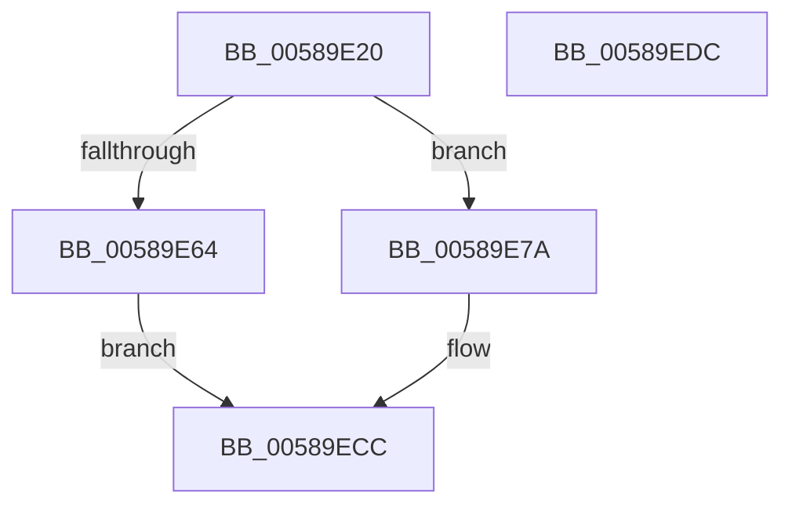

# HvlpSlowAcknowledgePageRequest

- RVA: `0x00589E20`–`0x00589EDD` (길이 `189` bytes)
- VA: `0x0000000140589E20`
- 실행 섹션: `.text`
- PDB 이름 있음: `예`; PDB Function 태그: `아니요`
- unwind 정보 RVA: `0x000718AC`
- 디코드: `54`개 명령, `189/189` bytes 표시
- 미해석 바이트: `0` (있으면 어셈블리에 `.byte`로 보존)

> 이 문서는 커널 이미지의 기계어와 PDB 기호를 분석해 생성했습니다. 4번과 5번은 함수 원형과 자료형을 바이너리 사용 방식에서 추정한 C 해석이며 원본 소스 복구 결과는 아닙니다.

## 1. Dependencies

- 직접 호출 지점: **5**; 고유 호출 대상: **5**
- 직접 호출자로 확인된 함수: **1**
- RIP 상대 이미지 참조: **0**

### Outgoing calls
- `0x00589E57` → [HvlpAcquireHypercallPage](../47/HvlpAcquireHypercallPage_function_00471410.md) (function, `0x00471410`)
- `0x00589E73` → [HvlpFastAcknowledgePageRequest](HvlpFastAcknowledgePageRequest_function_00589DC8.md) (function, `0x00589DC8`)
- `0x00589E84` → [memcpy](../6C/memcpy_function_006C6840.md) (function, `0x006C6840`)
- `0x00589EAA` → [HvcallInitiateHypercall](../31/HvcallInitiateHypercall_function_00313630.md) (function, `0x00313630`)
- `0x00589EBC` → [HvlpReleaseHypercallPage](../31/HvlpReleaseHypercallPage_function_00313480.md) (function, `0x00313480`)

### Direct callers
- [HvlAcknowledgePageRequest](HvlAcknowledgePageRequest_function_005870A0.md) at `0x005870DE`

### Static image references
- 디코드된 RIP-relative 메모리 참조가 없습니다.

## 2. Other-region calls and transfers

- 다른 실행 섹션으로 향하는 call: **0**
- 별도 외부 분기/꼬리 이동을 확인하지 못했습니다.

## 3. Assembly (complete function range)

```asm
00589E20  4C 8B DC                        mov r11, rsp
00589E23  49 89 5B 08                     mov qword ptr [r11 + 8], rbx
00589E27  49 89 73 10                     mov qword ptr [r11 + 0x10], rsi
00589E2B  57                              push rdi
00589E2C  48 83 EC 40                     sub rsp, 0x40
00589E30  33 C0                           xor eax, eax
00589E32  8B D9                           mov ebx, ecx
00589E34  0F 57 C0                        xorps xmm0, xmm0
00589E37  49 8D 4B D8                     lea rcx, [r11 - 0x28]
00589E3B  49 8B F8                        mov rdi, r8
00589E3E  48 8B F2                        mov rsi, rdx
00589E41  0F 11 44 24 20                  movups xmmword ptr [rsp + 0x20], xmm0
00589E46  49 89 43 E8                     mov qword ptr [r11 - 0x18], rax
00589E4A  8D 50 05                        lea edx, [rax + 5]
00589E4D  45 33 C9                        xor r9d, r9d
00589E50  89 44 24 38                     mov dword ptr [rsp + 0x38], eax
00589E54  45 33 C0                        xor r8d, r8d
00589E57  E8 B4 75 EE FF                  call 0x140471410
00589E5C  48 8B D6                        mov rdx, rsi
00589E5F  48 85 C0                        test rax, rax
00589E62  75 16                           jne 0x140589e7a
00589E64  B8 03 00 00 00                  mov eax, 3
00589E69  4C 8B C7                        mov r8, rdi
00589E6C  3B D8                           cmp ebx, eax
00589E6E  0F 43 D8                        cmovae ebx, eax
00589E71  8B CB                           mov ecx, ebx
00589E73  E8 50 FF FF FF                  call 0x140589dc8
00589E78  EB 52                           jmp 0x140589ecc
00589E7A  4C 8B C3                        mov r8, rbx
00589E7D  48 8B C8                        mov rcx, rax
00589E80  49 C1 E0 05                     shl r8, 5
00589E84  E8 B7 C9 13 00                  call 0x1406c6840
00589E89  48 8B 54 24 38                  mov rdx, qword ptr [rsp + 0x38]
00589E8E  BE FF 0F 00 00                  mov esi, 0xfff
00589E93  48 C7 44 24 68 A6 00 00 00      mov qword ptr [rsp + 0x68], 0xa6
00589E9C  23 DE                           and ebx, esi
00589E9E  89 5C 24 6C                     mov dword ptr [rsp + 0x6c], ebx
00589EA2  45 33 C0                        xor r8d, r8d
00589EA5  48 8B 4C 24 68                  mov rcx, qword ptr [rsp + 0x68]
00589EAA  E8 81 97 D8 FF                  call 0x140313630
00589EAF  48 8D 4C 24 20                  lea rcx, [rsp + 0x20]
00589EB4  48 89 44 24 68                  mov qword ptr [rsp + 0x68], rax
00589EB9  48 8B D8                        mov rbx, rax
00589EBC  E8 BF 95 D8 FF                  call 0x140313480
00589EC1  8B 44 24 6C                     mov eax, dword ptr [rsp + 0x6c]
00589EC5  23 C6                           and eax, esi
00589EC7  89 07                           mov dword ptr [rdi], eax
00589EC9  0F B7 C3                        movzx eax, bx
00589ECC  48 8B 5C 24 50                  mov rbx, qword ptr [rsp + 0x50]
00589ED1  48 8B 74 24 58                  mov rsi, qword ptr [rsp + 0x58]
00589ED6  48 83 C4 40                     add rsp, 0x40
00589EDA  5F                              pop rdi
00589EDB  C3                              ret
00589EDC  CC                              int3
```

## 4. C-style interpretation (structured pseudocode)

```c
__int64 __fastcall HvlpSlowAcknowledgePageRequest(int a1, __int64 a2, __int64 a3, int a4)
{
    __int64 result;
    __int64 v_rbx;
    __int64 v_rsp;
    unsigned int v_stack_m10;
    unsigned __int64 v_stack_m28;
    unsigned __int64 v_stack_p10;
    unsigned __int64 v_stack_p20;
    unsigned int v_stack_p24;
    unsigned __int64 v_stack_p8;

    *(unsigned __int64 *)(v_rsp + 8) = v_rbx;
    *(unsigned __int64 *)(v_rsp + 16) = v_rsi;
    v_rsp = (v_rsp) - (64);
    result = 0;
    v_stack_m28 = v_xmm0;
    *(unsigned __int64 *)(v_rsp - 24) = 0;
    a4 = 0;
    v_stack_m10 = 0;
    a3 = 0;
    result = HvlpAcquireHypercallPage(v_rsp - 40, result + 5, a3, a4);
    if (result != 0) goto loc_00589E7A;
    v_rbx = (unsigned int)(a1);
    if (((unsigned int)((unsigned int)(a1))) >= 3) { v_rbx = 3; }
    result = HvlpFastAcknowledgePageRequest((unsigned int)((unsigned int)(v_rbx)), a2, 0, a4);
    goto loc_00589ECC;
loc_00589E7A:
    a3 = (v_rbx) << (5);
    result = memcpy(result, a2, a3, a4);
    v_stack_p20 = 166;
    v_rbx = (unsigned int)((v_rbx) & ((unsigned int)((unsigned int)(0xFFFULL))));
    v_stack_p24 = (unsigned int)(v_rbx);
    a3 = 0;
    result = HvcallInitiateHypercall(v_stack_p20, v_stack_m10, a3, a4);
    v_stack_p20 = result;
    result = HvlpReleaseHypercallPage(v_stack_m28, v_stack_m10, a3, a4);
    result = (unsigned int)(((unsigned int)(v_stack_p24)) & ((unsigned int)((unsigned int)(0xFFFULL))));
    *(unsigned int *)(a3) = (unsigned int)(result);
loc_00589ECC:
    v_rsp = (v_rsp) + (64);
    return (unsigned __int16)(result);
}
```

## 5. (Beta) C Style

```c
int64_t HvlpSlowAcknowledgePageRequest(int32_t Arg1, int64_t Arg2, void *Arg3, int32_t Arg4)
{
    uint8_t *arg3 = (uint8_t *)Arg3;

    int64_t result;
    int64_t local_rbx;
    int64_t local_rsp;
    uint32_t v_stack_m10;
    uint64_t v_stack_m28;
    uint64_t v_stack_p10;
    uint64_t v_stack_p20;
    uint32_t v_stack_p24;
    uint64_t v_stack_p8;

    *(uint64_t *)(local_rsp + 0x8) = local_rbx;
    *(uint64_t *)(local_rsp + 0x10) = local_rsi;
    local_rsp = (local_rsp) - (64);
    result = 0;
    v_stack_m28 = v_xmm0;
    *(uint64_t *)(local_rsp - 0x18) = 0;
    Arg4 = 0;
    v_stack_m10 = 0;
    Arg3 = 0;
    result = HvlpAcquireHypercallPage(local_rsp - 40, result + 5, Arg3, Arg4);
    if (result != 0) goto loc_00589E7A;
    local_rbx = (uint32_t)(Arg1);
    if (((uint32_t)((uint32_t)(Arg1))) >= 3) { local_rbx = 3; }
    result = HvlpFastAcknowledgePageRequest((uint32_t)((uint32_t)(local_rbx)), Arg2, 0, Arg4);
    goto loc_00589ECC;
loc_00589E7A:
    Arg3 = (local_rbx) << (5);
    result = memcpy(result, Arg2, Arg3, Arg4);
    v_stack_p20 = 166;
    local_rbx = (uint32_t)((local_rbx) & ((uint32_t)((uint32_t)(0xFFFULL))));
    v_stack_p24 = (uint32_t)(local_rbx);
    Arg3 = 0;
    result = HvcallInitiateHypercall(v_stack_p20, v_stack_m10, Arg3, Arg4);
    v_stack_p20 = result;
    result = HvlpReleaseHypercallPage(v_stack_m28, v_stack_m10, Arg3, Arg4);
    result = (uint32_t)(((uint32_t)(v_stack_p24)) & ((uint32_t)((uint32_t)(0xFFFULL))));
    *(uint32_t *)(arg3) = (uint32_t)(result);
loc_00589ECC:
    local_rsp = (local_rsp) + (64);
    return (uint16_t)(result);
}
```

### 관측된 메모리 오프셋

구조체 형식이 확인되지 않은 접근은 인자 기준의 오프셋으로만 기록했습니다.

| 기준 인자 | 오프셋 표현 | 폭 (bit) | 접근 |
|---|---:|---:|---|
| `Arg3` | `+ 0x0` | `32` | `W` |

## 6. Execution-region graph

[열기: 2D/3D 그래프와 함수 탐색 컨트롤 패널](../../../control-panel.html?section=text&rva=0x00589E20&view=graph)

- 2D 그래프는 위에서 아래로 흐르고, 3D 그래프는 빈 공간을 드래그해 회전합니다. Shift+드래그는 이동, 휠은 확대·축소, 함수 노드 선택은 대상 보고서 이동입니다.

### Static fallback


