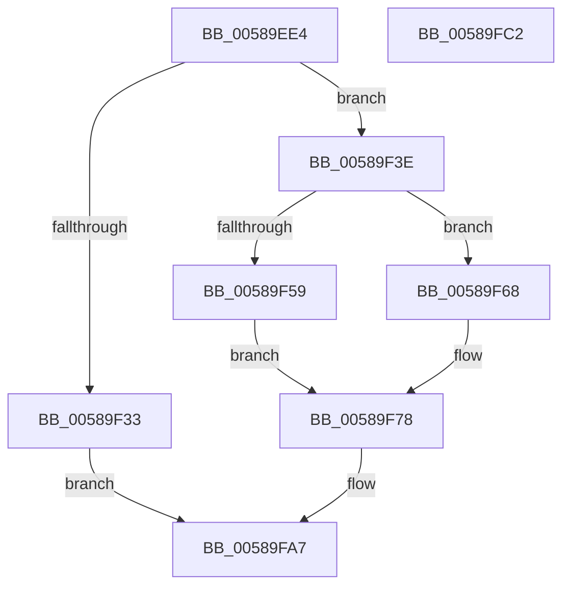

# HvlpSlowFlushPasidAddressList

- RVA: `0x00589EE4`–`0x00589FC3` (길이 `223` bytes)
- VA: `0x0000000140589EE4`
- 실행 섹션: `.text`
- PDB 이름 있음: `예`; PDB Function 태그: `아니요`
- unwind 정보 RVA: `0x00091ECC`
- 디코드: `61`개 명령, `223/223` bytes 표시
- 미해석 바이트: `0` (있으면 어셈블리에 `.byte`로 보존)

> 이 문서는 커널 이미지의 기계어와 PDB 기호를 분석해 생성했습니다. 4번과 5번은 함수 원형과 자료형을 바이너리 사용 방식에서 추정한 C 해석이며 원본 소스 복구 결과는 아닙니다.

## 1. Dependencies

- 직접 호출 지점: **6**; 고유 호출 대상: **6**
- 직접 호출자로 확인된 함수: **1**
- RIP 상대 이미지 참조: **0**

### Outgoing calls
- `0x00589F26` → [HvlpAcquireHypercallPage](../47/HvlpAcquireHypercallPage_function_00471410.md) (function, `0x00471410`)
- `0x00589F37` → [HvlpFlushPasidAddressSpace](../4A/HvlpFlushPasidAddressSpace_function_004A1D60.md) (function, `0x004A1D60`)
- `0x00589F61` → [HvlpCopyFlushVaList](../31/HvlpCopyFlushVaList_function_00313CC0.md) (function, `0x00313CC0`)
- `0x00589F6F` → [memcpy](../6C/memcpy_function_006C6840.md) (function, `0x006C6840`)
- `0x00589F98` → [HvcallInitiateHypercall](../31/HvcallInitiateHypercall_function_00313630.md) (function, `0x00313630`)
- `0x00589FA2` → [HvlpReleaseHypercallPage](../31/HvlpReleaseHypercallPage_function_00313480.md) (function, `0x00313480`)

### Direct callers
- [HvlFlushPasid](../4A/HvlFlushPasid_function_004A1C30.md) at `0x004A1C5F`

### Static image references
- 디코드된 RIP-relative 메모리 참조가 없습니다.

## 2. Other-region calls and transfers

- 다른 실행 섹션으로 향하는 call: **0**
- 별도 외부 분기/꼬리 이동을 확인하지 못했습니다.

## 3. Assembly (complete function range)

```asm
00589EE4  4C 8B DC                        mov r11, rsp
00589EE7  49 89 5B 08                     mov qword ptr [r11 + 8], rbx
00589EEB  49 89 6B 10                     mov qword ptr [r11 + 0x10], rbp
00589EEF  49 89 73 18                     mov qword ptr [r11 + 0x18], rsi
00589EF3  49 89 7B 20                     mov qword ptr [r11 + 0x20], rdi
00589EF7  41 56                           push r14
00589EF9  48 83 EC 50                     sub rsp, 0x50
00589EFD  33 C0                           xor eax, eax
00589EFF  41 8B F8                        mov edi, r8d
00589F02  0F 57 C0                        xorps xmm0, xmm0
00589F05  4D 8B F1                        mov r14, r9
00589F08  8B F2                           mov esi, edx
00589F0A  8B E9                           mov ebp, ecx
00589F0C  0F 11 44 24 28                  movups xmmword ptr [rsp + 0x28], xmm0
00589F11  49 89 43 E0                     mov qword ptr [r11 - 0x20], rax
00589F15  8D 50 05                        lea edx, [rax + 5]
00589F18  45 33 C9                        xor r9d, r9d
00589F1B  89 44 24 40                     mov dword ptr [rsp + 0x40], eax
00589F1F  45 33 C0                        xor r8d, r8d
00589F22  49 8D 4B D0                     lea rcx, [r11 - 0x30]
00589F26  E8 E5 74 EE FF                  call 0x140471410
00589F2B  48 8B D8                        mov rbx, rax
00589F2E  48 85 C0                        test rax, rax
00589F31  75 0B                           jne 0x140589f3e
00589F33  8B D6                           mov edx, esi
00589F35  8B CD                           mov ecx, ebp
00589F37  E8 24 7E F1 FF                  call 0x1404a1d60
00589F3C  EB 69                           jmp 0x140589fa7
00589F3E  48 83 60 08 00                  and qword ptr [rax + 8], 0
00589F43  48 8D 48 10                     lea rcx, [rax + 0x10]
00589F47  80 BC 24 80 00 00 00 00         cmp byte ptr [rsp + 0x80], 0
00589F4F  49 8B D6                        mov rdx, r14
00589F52  89 68 04                        mov dword ptr [rax + 4], ebp
00589F55  89 30                           mov dword ptr [rax], esi
00589F57  75 0F                           jne 0x140589f68
00589F59  4C 8B C9                        mov r9, rcx
00589F5C  45 33 C0                        xor r8d, r8d
00589F5F  8B CF                           mov ecx, edi
00589F61  E8 5A 9D D8 FF                  call 0x140313cc0
00589F66  EB 10                           jmp 0x140589f78
00589F68  4C 8B C7                        mov r8, rdi
00589F6B  49 C1 E0 03                     shl r8, 3
00589F6F  E8 CC C8 13 00                  call 0x1406c6840
00589F74  83 4B 08 01                     or dword ptr [rbx + 8], 1
00589F78  48 8B 54 24 40                  mov rdx, qword ptr [rsp + 0x40]
00589F7D  81 E7 FF 0F 00 00               and edi, 0xfff
00589F83  48 C7 44 24 20 A1 00 00 00      mov qword ptr [rsp + 0x20], 0xa1
00589F8C  45 33 C0                        xor r8d, r8d
00589F8F  89 7C 24 24                     mov dword ptr [rsp + 0x24], edi
00589F93  48 8B 4C 24 20                  mov rcx, qword ptr [rsp + 0x20]
00589F98  E8 93 96 D8 FF                  call 0x140313630
00589F9D  48 8D 4C 24 28                  lea rcx, [rsp + 0x28]
00589FA2  E8 D9 94 D8 FF                  call 0x140313480
00589FA7  48 8B 5C 24 60                  mov rbx, qword ptr [rsp + 0x60]
00589FAC  48 8B 6C 24 68                  mov rbp, qword ptr [rsp + 0x68]
00589FB1  48 8B 74 24 70                  mov rsi, qword ptr [rsp + 0x70]
00589FB6  48 8B 7C 24 78                  mov rdi, qword ptr [rsp + 0x78]
00589FBB  48 83 C4 50                     add rsp, 0x50
00589FBF  41 5E                           pop r14
00589FC1  C3                              ret
00589FC2  CC                              int3
```

## 4. C-style interpretation (structured pseudocode)

```c
__int64 __fastcall HvlpSlowFlushPasidAddressList(int a1, int a2, int a3, __int64 a4, unsigned __int8 a5)
{
    __int64 result;
    __int64 v_rdi;
    __int64 v_rsp;
    unsigned int v_stack_m18;
    unsigned __int64 v_stack_m30;
    unsigned int v_stack_m34;
    unsigned __int64 v_stack_m38;
    unsigned __int64 v_stack_p10;
    unsigned __int64 v_stack_p18;
    unsigned __int64 v_stack_p20;
    unsigned __int64 v_stack_p8;

    *(unsigned __int64 *)(v_rsp + 8) = v_rbx;
    *(unsigned __int64 *)(v_rsp + 16) = v_rbp;
    *(unsigned __int64 *)(v_rsp + 24) = v_rsi;
    *(unsigned __int64 *)(v_rsp + 32) = v_rdi;
    v_rsp = (v_rsp) - (80);
    result = 0;
    v_stack_m30 = v_xmm0;
    *(unsigned __int64 *)(v_rsp - 32) = 0;
    a4 = 0;
    v_stack_m18 = 0;
    a3 = 0;
    result = HvlpAcquireHypercallPage(v_rsp - 48, result + 5, a3, a4);
    if (result != 0) goto loc_00589F3E;
    result = HvlpFlushPasidAddressSpace((unsigned int)((unsigned int)((unsigned int)(a1))), (unsigned int)((unsigned int)((unsigned int)(a2))), a3, a4);
    goto loc_00589FA7;
loc_00589F3E:
    *(unsigned int *)(result + 4) = (unsigned int)((unsigned int)(a1));
    *(unsigned int *)(result) = (unsigned int)((unsigned int)(a2));
    if (a5 != 0) goto loc_00589F68;
    a3 = 0;
    result = HvlpCopyFlushVaList((unsigned int)((unsigned int)((unsigned int)(a3))), 0, a3, result + 16);
    goto loc_00589F78;
loc_00589F68:
    a3 = ((unsigned int)(a3)) << (3);
    result = memcpy((unsigned int)((unsigned int)((unsigned int)(a3))), 0, a3, result + 16);
loc_00589F78:
    v_rdi = (unsigned int)(((unsigned int)(a3)) & (0xFFFULL));
    v_stack_m38 = 161;
    a3 = 0;
    v_stack_m34 = (unsigned int)(v_rdi);
    result = HvcallInitiateHypercall(v_stack_m38, v_stack_m18, a3, result + 16);
    result = HvlpReleaseHypercallPage(v_stack_m30, v_stack_m18, a3, result + 16);
loc_00589FA7:
    v_rsp = (v_rsp) + (80);
    return result;
}
```

## 5. (Beta) C Style

```c
int64_t HvlpSlowFlushPasidAddressList(int32_t Arg1, int32_t Arg2, int32_t Arg3, int64_t Arg4, uint8_t Arg5)
{
    int64_t result;
    int64_t local_rdi;
    int64_t local_rsp;
    uint32_t v_stack_m18;
    uint64_t v_stack_m30;
    uint32_t v_stack_m34;
    uint64_t v_stack_m38;
    uint64_t v_stack_p10;
    uint64_t v_stack_p18;
    uint64_t v_stack_p20;
    uint64_t v_stack_p8;

    *(uint64_t *)(local_rsp + 0x8) = local_rbx;
    *(uint64_t *)(local_rsp + 0x10) = local_rbp;
    *(uint64_t *)(local_rsp + 0x18) = local_rsi;
    *(uint64_t *)(local_rsp + 0x20) = local_rdi;
    local_rsp = (local_rsp) - (80);
    result = 0;
    v_stack_m30 = v_xmm0;
    *(uint64_t *)(local_rsp - 0x20) = 0;
    Arg4 = 0;
    v_stack_m18 = 0;
    Arg3 = 0;
    result = HvlpAcquireHypercallPage(local_rsp - 48, result + 5, Arg3, Arg4);
    if (result != 0) goto loc_00589F3E;
    result = HvlpFlushPasidAddressSpace((uint32_t)((uint32_t)((uint32_t)(Arg1))), (uint32_t)((uint32_t)((uint32_t)(Arg2))), Arg3, Arg4);
    goto loc_00589FA7;
loc_00589F3E:
    *(uint32_t *)(result + 0x4) = (uint32_t)((uint32_t)(Arg1));
    *(uint32_t *)(result) = (uint32_t)((uint32_t)(Arg2));
    if (Arg5 != 0) goto loc_00589F68;
    Arg3 = 0;
    result = HvlpCopyFlushVaList((uint32_t)((uint32_t)((uint32_t)(Arg3))), 0, Arg3, result + 16);
    goto loc_00589F78;
loc_00589F68:
    Arg3 = ((uint32_t)(Arg3)) << (3);
    result = memcpy((uint32_t)((uint32_t)((uint32_t)(Arg3))), 0, Arg3, result + 16);
loc_00589F78:
    local_rdi = (uint32_t)(((uint32_t)(Arg3)) & (0xFFFULL));
    v_stack_m38 = 161;
    Arg3 = 0;
    v_stack_m34 = (uint32_t)(local_rdi);
    result = HvcallInitiateHypercall(v_stack_m38, v_stack_m18, Arg3, result + 16);
    result = HvlpReleaseHypercallPage(v_stack_m30, v_stack_m18, Arg3, result + 16);
loc_00589FA7:
    local_rsp = (local_rsp) + (80);
    return result;
}
```

## 6. Execution-region graph

[열기: 2D/3D 그래프와 함수 탐색 컨트롤 패널](../../../control-panel.html?section=text&rva=0x00589EE4&view=graph)

- 2D 그래프는 위에서 아래로 흐르고, 3D 그래프는 빈 공간을 드래그해 회전합니다. Shift+드래그는 이동, 휠은 확대·축소, 함수 노드 선택은 대상 보고서 이동입니다.

### Static fallback


