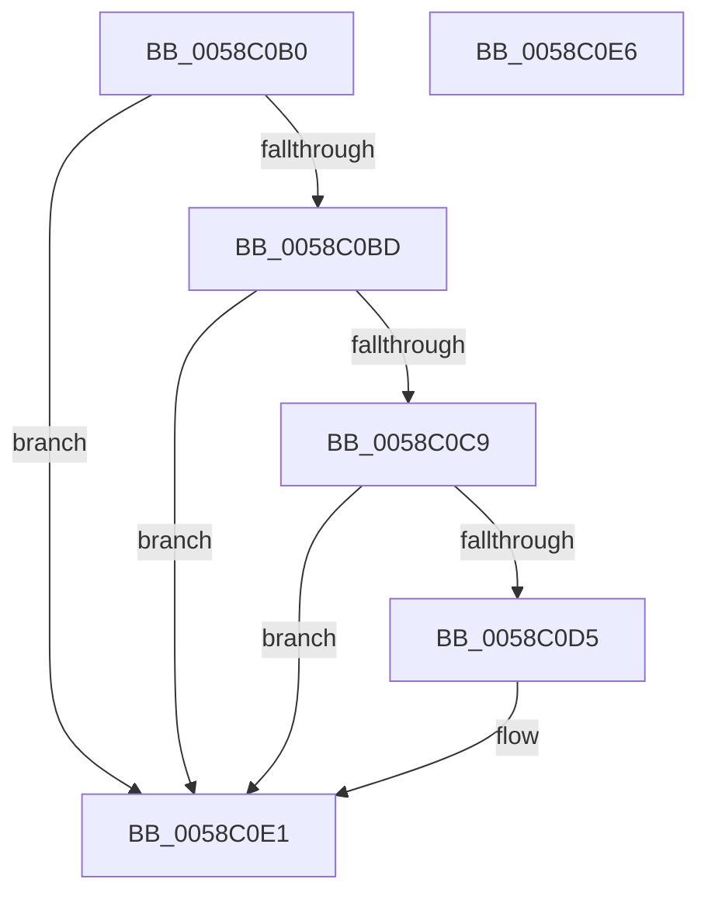

# HvlpSnapshotCrashArea

- RVA: `0x0058C0B0`–`0x0058C0E7` (길이 `55` bytes)
- VA: `0x000000014058C0B0`
- 실행 섹션: `.text`
- PDB 이름 있음: `예`; PDB Function 태그: `아니요`
- unwind 정보 RVA: `0x0005C788`
- 디코드: `14`개 명령, `55/55` bytes 표시
- 미해석 바이트: `0` (있으면 어셈블리에 `.byte`로 보존)

> 이 문서는 커널 이미지의 기계어와 PDB 기호를 분석해 생성했습니다. 4번과 5번은 함수 원형과 자료형을 바이너리 사용 방식에서 추정한 C 해석이며 원본 소스 복구 결과는 아닙니다.

## 1. Dependencies

- 직접 호출 지점: **1**; 고유 호출 대상: **1**
- 직접 호출자로 확인된 함수: **3**
- RIP 상대 이미지 참조: **4**

### Outgoing calls
- `0x0058C0DC` → [memcpy](../6C/memcpy_function_006C6840.md) (function, `0x006C6840`)

### Direct callers
- [HvlCollectLivedump](HvlCollectLivedump_function_0058B460.md) at `0x0058B4B7`
- [HvlCrashdumpCallbackRoutine](HvlCrashdumpCallbackRoutine_function_0058B650.md) at `0x0058B656`
- [HvlSkCrashdumpCallbackRoutine](HvlSkCrashdumpCallbackRoutine_function_0058B870.md) at `0x0058B88A`

### Static image references
- `0x0058C0B4` → RVA `0x00F8ECAC` (`.data`; read)
- `0x0058C0BD` → RVA `0x00F8EDA0` (`.data`; read)
- `0x0058C0C9` → RVA `0x00F8ECB0` (`.data`; read)
- `0x0058C0D5` → RVA `0x00F8ECB8` (`.data`; read)

## 2. Other-region calls and transfers

- 다른 실행 섹션으로 향하는 call: **0**
- 별도 외부 분기/꼬리 이동을 확인하지 못했습니다.

## 3. Assembly (complete function range)

```asm
0058C0B0  48 83 EC 28                     sub rsp, 0x28
0058C0B4  80 3D F1 2B A0 00 00            cmp byte ptr [rip + 0xa02bf1], 0
0058C0BB  74 24                           je 0x14058c0e1
0058C0BD  48 8B 15 DC 2C A0 00            mov rdx, qword ptr [rip + 0xa02cdc]
0058C0C4  48 85 D2                        test rdx, rdx
0058C0C7  74 18                           je 0x14058c0e1
0058C0C9  48 8B 0D E0 2B A0 00            mov rcx, qword ptr [rip + 0xa02be0]
0058C0D0  48 85 C9                        test rcx, rcx
0058C0D3  74 0C                           je 0x14058c0e1
0058C0D5  44 8B 05 DC 2B A0 00            mov r8d, dword ptr [rip + 0xa02bdc]
0058C0DC  E8 5F A7 13 00                  call 0x1406c6840
0058C0E1  48 83 C4 28                     add rsp, 0x28
0058C0E5  C3                              ret
0058C0E6  CC                              int3
```

## 4. C-style interpretation (structured pseudocode)

```c
__int64 __fastcall HvlpSnapshotCrashArea(void)
{
    __int64 result;
    __int64 v_rsp;

    v_rsp = (v_rsp) - (40);
    if ((*(unsigned __int8 *)(v_rip + 10497009)) == 0) goto loc_0058C0E1;
    if (*(unsigned __int64 *)(v_rip + 10497244) == 0) goto loc_0058C0E1;
    if (*(unsigned __int64 *)(v_rip + 10496992) != 0) {
        a3 = *(unsigned int *)(v_rip + 10496988);
        result = memcpy(*(unsigned __int64 *)(v_rip + 10496992), *(unsigned __int64 *)(v_rip + 10497244), a3, a4);
    }
    v_rsp = (v_rsp) + (40);
    return result;
}
```

## 5. (Beta) C Style

```c
void HvlpSnapshotCrashArea(void)
{
    int64_t result;
    int64_t local_rsp;

    local_rsp = (local_rsp) - (40);
    if ((*(uint8_t *)(v_rip + 0xA02BF1)) == 0) goto loc_0058C0E1;
    if (*(uint64_t *)(v_rip + 0xA02CDC) == 0) goto loc_0058C0E1;
    if (*(uint64_t *)(v_rip + 0xA02BE0) != 0) {
        a3 = *(uint32_t *)(v_rip + 0xA02BDC);
        result = memcpy(*(uint64_t *)(v_rip + 0xA02BE0), *(uint64_t *)(v_rip + 0xA02CDC), a3, a4);
    }
    local_rsp = (local_rsp) + (40);
    return result;
}
```

## 6. Execution-region graph

[열기: 2D/3D 그래프와 함수 탐색 컨트롤 패널](../../../control-panel.html?section=text&rva=0x0058C0B0&view=graph)

- 2D 그래프는 위에서 아래로 흐르고, 3D 그래프는 빈 공간을 드래그해 회전합니다. Shift+드래그는 이동, 휠은 확대·축소, 함수 노드 선택은 대상 보고서 이동입니다.

### Static fallback


