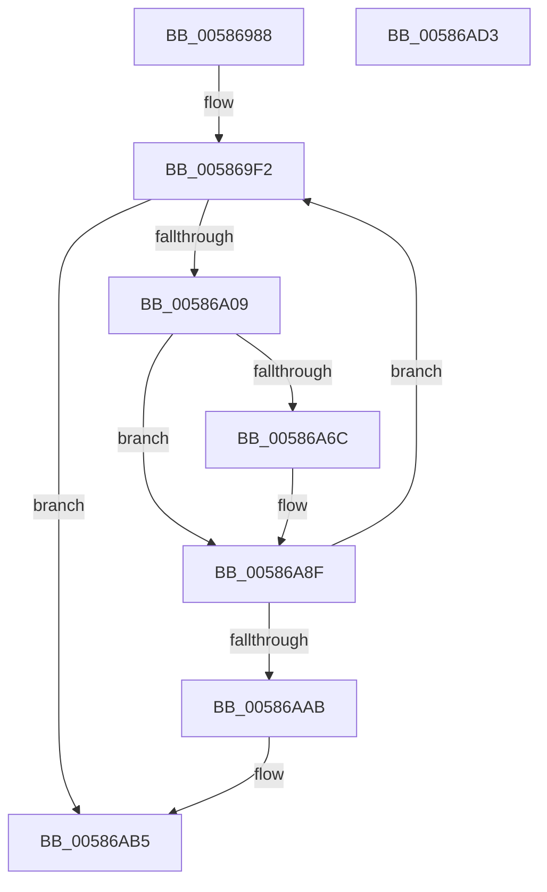

# HvlpStartLogicalProcessor

- RVA: `0x00586988`–`0x00586AD4` (길이 `332` bytes)
- VA: `0x0000000140586988`
- 실행 섹션: `.text`
- PDB 이름 있음: `예`; PDB Function 태그: `예`
- unwind 정보 RVA: `0x000BE68C`
- 디코드: `90`개 명령, `332/332` bytes 표시
- 미해석 바이트: `0` (있으면 어셈블리에 `.byte`로 보존)

> 이 문서는 커널 이미지의 기계어와 PDB 기호를 분석해 생성했습니다. 4번과 5번은 함수 원형과 자료형을 바이너리 사용 방식에서 추정한 C 해석이며 원본 소스 복구 결과는 아닙니다.

## 1. Dependencies

- 직접 호출 지점: **6**; 고유 호출 대상: **4**
- 직접 호출자로 확인된 함수: **1**
- RIP 상대 이미지 참조: **1**

### Outgoing calls
- `0x005869FC` → [HvlpDepositPages](HvlpDepositPages_function_00585474.md) (function, `0x00585474`)
- `0x00586A17` → [HvlpAcquireHypercallPage](../47/HvlpAcquireHypercallPage_function_00471410.md) (function, `0x00471410`)
- `0x00586A30` → [HvlpAcquireHypercallPage](../47/HvlpAcquireHypercallPage_function_00471410.md) (function, `0x00471410`)
- `0x00586A5E` → [HvcallInitiateHypercall](../31/HvcallInitiateHypercall_function_00313630.md) (function, `0x00313630`)
- `0x00586A93` → [HvlpReleaseHypercallPage](../31/HvlpReleaseHypercallPage_function_00313480.md) (function, `0x00313480`)
- `0x00586A9C` → [HvlpReleaseHypercallPage](../31/HvlpReleaseHypercallPage_function_00313480.md) (function, `0x00313480`)

### Direct callers
- [HvlpEnableNextLogicalProcessor](HvlpEnableNextLogicalProcessor_function_00585680.md) at `0x005856C3`

### Static image references
- `0x005869A9` → RVA `0x00FCF6C0` (`CACHEALI`; read)

## 2. Other-region calls and transfers

- 다른 실행 섹션으로 향하는 call: **0**
- 별도 외부 분기/꼬리 이동을 확인하지 못했습니다.

## 3. Assembly (complete function range)

```asm
00586988  48 89 5C 24 08                  mov qword ptr [rsp + 8], rbx
0058698D  48 89 74 24 10                  mov qword ptr [rsp + 0x10], rsi
00586992  48 89 7C 24 18                  mov qword ptr [rsp + 0x18], rdi
00586997  55                              push rbp
00586998  41 54                           push r12
0058699A  41 55                           push r13
0058699C  41 56                           push r14
0058699E  41 57                           push r15
005869A0  48 8B EC                        mov rbp, rsp
005869A3  48 83 EC 60                     sub rsp, 0x60
005869A7  33 C0                           xor eax, eax
005869A9  4C 8D 2D 10 8D A4 00            lea r13, [rip + 0xa48d10]
005869B0  0F 57 C0                        xorps xmm0, xmm0
005869B3  48 89 45 F0                     mov qword ptr [rbp - 0x10], rax
005869B7  41 0F 11 01                     movups xmmword ptr [r9], xmm0
005869BB  89 45 F8                        mov dword ptr [rbp - 8], eax
005869BE  49 8B F9                        mov rdi, r9
005869C1  41 0F 11 41 10                  movups xmmword ptr [r9 + 0x10], xmm0
005869C6  48 89 45 D0                     mov qword ptr [rbp - 0x30], rax
005869CA  44 8B FA                        mov r15d, edx
005869CD  41 0F 11 41 20                  movups xmmword ptr [r9 + 0x20], xmm0
005869D2  49 89 41 30                     mov qword ptr [r9 + 0x30], rax
005869D6  44 8B E1                        mov r12d, ecx
005869D9  89 45 D8                        mov dword ptr [rbp - 0x28], eax
005869DC  41 0F B7 C0                     movzx eax, r8w
005869E0  0F 11 45 E0                     movups xmmword ptr [rbp - 0x20], xmm0
005869E4  0F 11 45 C0                     movups xmmword ptr [rbp - 0x40], xmm0
005869E8  49 8B 44 C5 00                  mov rax, qword ptr [r13 + rax*8]
005869ED  44 0F B7 70 02                  movzx r14d, word ptr [rax + 2]
005869F2  45 33 C9                        xor r9d, r9d
005869F5  45 33 C0                        xor r8d, r8d
005869F8  41 0F B7 CE                     movzx ecx, r14w
005869FC  E8 73 EA FF FF                  call 0x140585474
00586A01  85 C0                           test eax, eax
00586A03  0F 85 AC 00 00 00               jne 0x140586ab5
00586A09  44 8D 48 10                     lea r9d, [rax + 0x10]
00586A0D  45 33 C0                        xor r8d, r8d
00586A10  8D 50 01                        lea edx, [rax + 1]
00586A13  48 8D 4D E0                     lea rcx, [rbp - 0x20]
00586A17  E8 F4 A9 EE FF                  call 0x140471410
00586A1C  41 B9 38 00 00 00               mov r9d, 0x38
00586A22  48 8D 4D C0                     lea rcx, [rbp - 0x40]
00586A26  45 33 C0                        xor r8d, r8d
00586A29  48 8B D8                        mov rbx, rax
00586A2C  41 8D 51 CA                     lea edx, [r9 - 0x36]
00586A30  E8 DB A9 EE FF                  call 0x140471410
00586A35  4B 8B 4C F5 00                  mov rcx, qword ptr [r13 + r14*8]
00586A3A  48 8B F0                        mov rsi, rax
00586A3D  4C 8B 45 D8                     mov r8, qword ptr [rbp - 0x28]
00586A41  44 89 23                        mov dword ptr [rbx], r12d
00586A44  44 89 7B 04                     mov dword ptr [rbx + 4], r15d
00586A48  8B 51 04                        mov edx, dword ptr [rcx + 4]
00586A4B  B9 76 00 00 00                  mov ecx, 0x76
00586A50  89 53 08                        mov dword ptr [rbx + 8], edx
00586A53  48 8B 55 F8                     mov rdx, qword ptr [rbp - 8]
00586A57  C7 43 0C 01 00 00 80            mov dword ptr [rbx + 0xc], 0x80000001
00586A5E  E8 CD CB D8 FF                  call 0x140313630
00586A63  48 8B D8                        mov rbx, rax
00586A66  66 83 F8 0B                     cmp ax, 0xb
00586A6A  74 23                           je 0x140586a8f
00586A6C  0F 10 06                        movups xmm0, xmmword ptr [rsi]
00586A6F  0F 11 07                        movups xmmword ptr [rdi], xmm0
00586A72  0F 10 4E 10                     movups xmm1, xmmword ptr [rsi + 0x10]
00586A76  0F 11 4F 10                     movups xmmword ptr [rdi + 0x10], xmm1
00586A7A  0F 10 46 20                     movups xmm0, xmmword ptr [rsi + 0x20]
00586A7E  0F 11 47 20                     movups xmmword ptr [rdi + 0x20], xmm0
00586A82  F2 0F 10 4E 30                  movsd xmm1, qword ptr [rsi + 0x30]
00586A87  F2 0F 11 4F 30                  movsd qword ptr [rdi + 0x30], xmm1
00586A8C  66 89 1F                        mov word ptr [rdi], bx
00586A8F  48 8D 4D C0                     lea rcx, [rbp - 0x40]
00586A93  E8 E8 C9 D8 FF                  call 0x140313480
00586A98  48 8D 4D E0                     lea rcx, [rbp - 0x20]
00586A9C  E8 DF C9 D8 FF                  call 0x140313480
00586AA1  66 83 FB 0B                     cmp bx, 0xb
00586AA5  0F 84 47 FF FF FF               je 0x1405869f2
00586AAB  66 F7 DB                        neg bx
00586AAE  1B C0                           sbb eax, eax
00586AB0  25 01 00 00 C0                  and eax, 0xc0000001
00586AB5  4C 8D 5C 24 60                  lea r11, [rsp + 0x60]
00586ABA  49 8B 5B 30                     mov rbx, qword ptr [r11 + 0x30]
00586ABE  49 8B 73 38                     mov rsi, qword ptr [r11 + 0x38]
00586AC2  49 8B 7B 40                     mov rdi, qword ptr [r11 + 0x40]
00586AC6  49 8B E3                        mov rsp, r11
00586AC9  41 5F                           pop r15
00586ACB  41 5E                           pop r14
00586ACD  41 5D                           pop r13
00586ACF  41 5C                           pop r12
00586AD1  5D                              pop rbp
00586AD2  C3                              ret
00586AD3  CC                              int3
```

## 4. C-style interpretation (structured pseudocode)

```c
__int64 __fastcall HvlpStartLogicalProcessor(int a1, int a2, int a3, __int64 a4)
{
    __int64 result;
    __int64 v_rbx;
    __int64 v_rsp;
    unsigned __int64 v_stack_m28;
    unsigned int v_stack_m30;
    unsigned __int64 v_stack_m38;
    unsigned __int64 v_stack_m48;
    unsigned int v_stack_m50;
    unsigned __int64 v_stack_m58;
    unsigned __int64 v_stack_m68;
    unsigned __int64 v_stack_p10;
    unsigned __int64 v_stack_p18;
    unsigned __int64 v_stack_p8;

    v_stack_p8 = v_rbx;
    v_stack_p10 = v_rsi;
    v_stack_p18 = v_rdi;
    v_rsp = (v_rsp) - (96);
    result = 0;
    v_stack_m38 = 0;
    *(unsigned __int64 *)(a4) = v_xmm0;
    v_stack_m30 = 0;
    *(unsigned __int64 *)(a4 + 16) = v_xmm0;
    v_stack_m58 = 0;
    *(unsigned __int64 *)(a4 + 32) = v_xmm0;
    *(unsigned __int64 *)(a4 + 48) = 0;
    v_stack_m50 = 0;
    v_stack_m48 = v_xmm0;
    v_stack_m68 = v_xmm0;
loc_005869F2:
    a4 = 0;
    a3 = 0;
    result = HvlpDepositPages((unsigned __int16)(*(unsigned __int16 *)(*(unsigned __int64 *)(v_rip + 10784016 + (unsigned __int16)(a3) * 8) + 2)), a2, a3, a4);
    if ((unsigned int)(result) != 0) goto loc_00586AB5;
    a3 = 0;
    result = HvlpAcquireHypercallPage(v_stack_m48, result + 1, a3, result + 16);
    a3 = 0;
    result = HvlpAcquireHypercallPage(v_stack_m68, 56 - 54, a3, 56);
    *(unsigned int *)(result) = (unsigned int)((unsigned int)(a1));
    *(unsigned int *)(result + 4) = (unsigned int)((unsigned int)(a2));
    *(unsigned int *)(result + 8) = (unsigned int)((unsigned int)(*(unsigned int *)(*(unsigned __int64 *)(v_rip + 10784016 + *(unsigned __int16 *)(*(unsigned __int64 *)(v_rip + 10784016 + (unsigned __int16)(a3) * 8) + 2) * 8) + 4)));
    *(unsigned int *)(result + 12) = 0x80000001ULL;
    result = HvcallInitiateHypercall(118, v_stack_m30, v_stack_m50, 56);
    if (((unsigned __int16)(result)) != 11) {
        *(unsigned __int64 *)(a4) = v_xmm0;
        *(unsigned __int64 *)(a4 + 16) = v_xmm1;
        *(unsigned __int64 *)(a4 + 32) = v_xmm0;
        *(unsigned __int64 *)(a4 + 48) = v_xmm1;
        *(unsigned __int16 *)(a4) = (unsigned __int16)(result);
    }
    result = HvlpReleaseHypercallPage(v_stack_m68, v_stack_m30, v_stack_m50, 56);
    result = HvlpReleaseHypercallPage(v_stack_m48, v_stack_m30, v_stack_m50, 56);
    if (((unsigned __int16)(result)) == 11) goto loc_005869F2;
    v_rbx = (unsigned __int16)(-(result));
    result = (unsigned int)((result) & (0xC0000001ULL));
loc_00586AB5:
    return result;
}
```

## 5. (Beta) C Style

```c
int64_t HvlpStartLogicalProcessor(int32_t Arg1, int32_t Arg2, int32_t Arg3, void *Arg4)
{
    uint8_t *arg4 = (uint8_t *)Arg4;

    int64_t result;
    int64_t local_rbx;
    int64_t local_rsp;
    uint64_t v_stack_m28;
    uint32_t v_stack_m30;
    uint64_t v_stack_m38;
    uint64_t v_stack_m48;
    uint32_t v_stack_m50;
    uint64_t v_stack_m58;
    uint64_t v_stack_m68;
    uint64_t v_stack_p10;
    uint64_t v_stack_p18;
    uint64_t v_stack_p8;

    v_stack_p8 = local_rbx;
    v_stack_p10 = local_rsi;
    v_stack_p18 = local_rdi;
    local_rsp = (local_rsp) - (96);
    result = 0;
    v_stack_m38 = 0;
    *(uint64_t *)(arg4) = v_xmm0;
    v_stack_m30 = 0;
    *(uint64_t *)(arg4 + 0x10) = v_xmm0;
    v_stack_m58 = 0;
    *(uint64_t *)(arg4 + 0x20) = v_xmm0;
    *(uint64_t *)(arg4 + 0x30) = 0;
    v_stack_m50 = 0;
    v_stack_m48 = v_xmm0;
    v_stack_m68 = v_xmm0;
loc_005869F2:
    Arg4 = 0;
    Arg3 = 0;
    result = HvlpDepositPages((uint16_t)(*(uint16_t *)(*(uint64_t *)(v_rip + 0xA48D10 + (uint16_t)(Arg3) * 8) + 0x2)), Arg2, Arg3, Arg4);
    if ((uint32_t)(result) != 0) goto loc_00586AB5;
    Arg3 = 0;
    result = HvlpAcquireHypercallPage(v_stack_m48, result + 1, Arg3, result + 16);
    Arg3 = 0;
    result = HvlpAcquireHypercallPage(v_stack_m68, 56 - 54, Arg3, 56);
    *(uint32_t *)(result) = (uint32_t)((uint32_t)(Arg1));
    *(uint32_t *)(result + 0x4) = (uint32_t)((uint32_t)(Arg2));
    *(uint32_t *)(result + 0x8) = (uint32_t)((uint32_t)(*(uint32_t *)(*(uint64_t *)(v_rip + 0xA48D10 + *(uint16_t *)(*(uint64_t *)(v_rip + 0xA48D10 + (uint16_t)(Arg3) * 8) + 0x2) * 8) + 0x4)));
    *(uint32_t *)(result + 0xC) = 0x80000001ULL;
    result = HvcallInitiateHypercall(118, v_stack_m30, v_stack_m50, 56);
    if (((uint16_t)(result)) != 11) {
        *(uint64_t *)(arg4) = v_xmm0;
        *(uint64_t *)(arg4 + 0x10) = v_xmm1;
        *(uint64_t *)(arg4 + 0x20) = v_xmm0;
        *(uint64_t *)(arg4 + 0x30) = v_xmm1;
        *(uint16_t *)(arg4) = (uint16_t)(result);
    }
    result = HvlpReleaseHypercallPage(v_stack_m68, v_stack_m30, v_stack_m50, 56);
    result = HvlpReleaseHypercallPage(v_stack_m48, v_stack_m30, v_stack_m50, 56);
    if (((uint16_t)(result)) == 11) goto loc_005869F2;
    local_rbx = (uint16_t)(-(result));
    result = (uint32_t)((result) & (0xC0000001ULL));
loc_00586AB5:
    return result;
}
```

### 관측된 메모리 오프셋

구조체 형식이 확인되지 않은 접근은 인자 기준의 오프셋으로만 기록했습니다.

| 기준 인자 | 오프셋 표현 | 폭 (bit) | 접근 |
|---|---:|---:|---|
| `Arg4` | `+ 0x0` | `16` | `W` |
| `Arg4` | `+ 0x0` | `128` | `R` |
| `Arg4` | `+ 0x10` | `128` | `R` |
| `Arg4` | `+ 0x20` | `128` | `R` |
| `Arg4` | `+ 0x30` | `64` | `W` |

## 6. Execution-region graph

[열기: 2D/3D 그래프와 함수 탐색 컨트롤 패널](../../../control-panel.html?section=text&rva=0x00586988&view=graph)

- 2D 그래프는 위에서 아래로 흐르고, 3D 그래프는 빈 공간을 드래그해 회전합니다. Shift+드래그는 이동, 휠은 확대·축소, 함수 노드 선택은 대상 보고서 이동입니다.

### Static fallback


