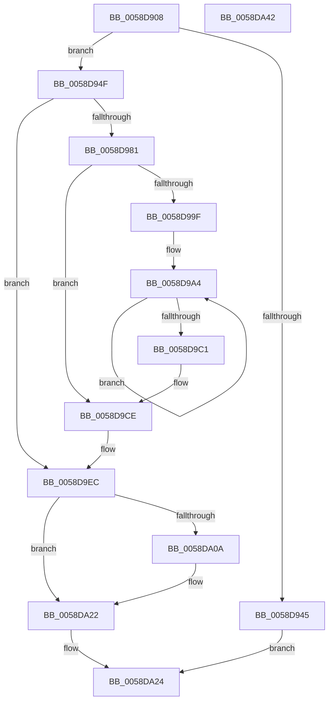

# HvlpStartSecurePageListIteration

- RVA: `0x0058D908`–`0x0058DA43` (길이 `315` bytes)
- VA: `0x000000014058D908`
- 실행 섹션: `.text`
- PDB 이름 있음: `예`; PDB Function 태그: `아니요`
- unwind 정보 RVA: `0x000C6A34`
- 디코드: `91`개 명령, `315/315` bytes 표시
- 미해석 바이트: `0` (있으면 어셈블리에 `.byte`로 보존)

> 이 문서는 커널 이미지의 기계어와 PDB 기호를 분석해 생성했습니다. 4번과 5번은 함수 원형과 자료형을 바이너리 사용 방식에서 추정한 C 해석이며 원본 소스 복구 결과는 아닙니다.

## 1. Dependencies

- 직접 호출 지점: **5**; 고유 호출 대상: **4**
- 직접 호출자로 확인된 함수: **4**
- RIP 상대 이미지 참조: **0**

### Outgoing calls
- `0x0058D935` → [HvlpSetupPageListIteration](HvlpSetupPageListIteration_function_0058D85C.md) (function, `0x0058D85C`)
- `0x0058D9A7` → [MmGetPhysicalAddress](../23/MmGetPhysicalAddress_function_0023A500.md) (function, `0x0023A500`)
- `0x0058D9D6` → [MmGetPhysicalAddress](../23/MmGetPhysicalAddress_function_0023A500.md) (function, `0x0023A500`)
- `0x0058D9FF` → [VslStartSecurePageIteration](VslStartSecurePageIteration_function_0058F5DC.md) (function, `0x0058F5DC`)
- `0x0058DA0C` → [HvlpGetPageListIterator](HvlpGetPageListIterator_function_0058D790.md) (function, `0x0058D790`)

### Direct callers
- [HvlDiscardSecurePagesFromHibernation](HvlDiscardSecurePagesFromHibernation_function_0058A444.md) at `0x0058A479`
- [HvlIterateSecurePagesForHibernation](HvlIterateSecurePagesForHibernation_function_0058A520.md) at `0x0058A57B`
- [HvlAddSecurePagesCallbackRoutine](HvlAddSecurePagesCallbackRoutine_function_0058B0C8.md) at `0x0058B158`
- [HvlpGetEncryptedDataFromSecureKernel](HvlpGetEncryptedDataFromSecureKernel_function_0058BB98.md) at `0x0058BC3E`

### Static image references
- 디코드된 RIP-relative 메모리 참조가 없습니다.

## 2. Other-region calls and transfers

- 다른 실행 섹션으로 향하는 call: **0**
- 별도 외부 분기/꼬리 이동을 확인하지 못했습니다.

## 3. Assembly (complete function range)

```asm
0058D908  48 8B C4                        mov rax, rsp
0058D90B  48 89 58 08                     mov qword ptr [rax + 8], rbx
0058D90F  48 89 68 10                     mov qword ptr [rax + 0x10], rbp
0058D913  48 89 70 18                     mov qword ptr [rax + 0x18], rsi
0058D917  4C 89 48 20                     mov qword ptr [rax + 0x20], r9
0058D91B  57                              push rdi
0058D91C  41 54                           push r12
0058D91E  41 55                           push r13
0058D920  41 56                           push r14
0058D922  41 57                           push r15
0058D924  48 83 EC 40                     sub rsp, 0x40
0058D928  44 8B EA                        mov r13d, edx
0058D92B  49 8B F0                        mov rsi, r8
0058D92E  BA 01 00 00 00                  mov edx, 1
0058D933  8B F9                           mov edi, ecx
0058D935  E8 22 FF FF FF                  call 0x14058d85c
0058D93A  45 33 FF                        xor r15d, r15d
0058D93D  48 8B C8                        mov rcx, rax
0058D940  48 85 C0                        test rax, rax
0058D943  75 0A                           jne 0x14058d94f
0058D945  B8 01 00 00 C0                  mov eax, 0xc0000001
0058D94A  E9 D5 00 00 00                  jmp 0x14058da24
0058D94F  48 8B 40 10                     mov rax, qword ptr [rax + 0x10]
0058D953  41 B8 00 10 00 00               mov r8d, 0x1000
0058D959  4C 8B A4 24 98 00 00 00         mov r12, qword ptr [rsp + 0x98]
0058D961  48 99                           cqo
0058D963  4C 8B 71 08                     mov r14, qword ptr [rcx + 8]
0058D967  41 8B DF                        mov ebx, r15d
0058D96A  49 F7 F8                        idiv r8
0058D96D  4D 89 34 24                     mov qword ptr [r12], r14
0058D971  48 89 44 24 30                  mov qword ptr [rsp + 0x30], rax
0058D976  48 8B E8                        mov rbp, rax
0058D979  49 8B C7                        mov rax, r15
0058D97C  48 85 F6                        test rsi, rsi
0058D97F  74 6B                           je 0x14058d9ec
0058D981  BB 00 00 20 00                  mov ebx, 0x200000
0058D986  4C 8B FE                        mov r15, rsi
0058D989  39 9C 24 90 00 00 00            cmp dword ptr [rsp + 0x90], ebx
0058D990  0F 46 9C 24 90 00 00 00         cmovbe ebx, dword ptr [rsp + 0x90]
0058D998  C1 EB 0C                        shr ebx, 0xc
0058D99B  85 DB                           test ebx, ebx
0058D99D  74 2F                           je 0x14058d9ce
0058D99F  8B EB                           mov ebp, ebx
0058D9A1  45 8B E0                        mov r12d, r8d
0058D9A4  49 8B CF                        mov rcx, r15
0058D9A7  E8 54 CB CA FF                  call 0x14023a500
0058D9AC  48 99                           cqo
0058D9AE  4D 03 FC                        add r15, r12
0058D9B1  49 F7 FC                        idiv r12
0058D9B4  49 89 06                        mov qword ptr [r14], rax
0058D9B7  4D 8D 76 08                     lea r14, [r14 + 8]
0058D9BB  48 83 ED 01                     sub rbp, 1
0058D9BF  75 E3                           jne 0x14058d9a4
0058D9C1  4C 8B A4 24 98 00 00 00         mov r12, qword ptr [rsp + 0x98]
0058D9C9  48 8B 6C 24 30                  mov rbp, qword ptr [rsp + 0x30]
0058D9CE  48 8B 8C 24 88 00 00 00         mov rcx, qword ptr [rsp + 0x88]
0058D9D6  E8 25 CB CA FF                  call 0x14023a500
0058D9DB  48 99                           cqo
0058D9DD  49 89 34 24                     mov qword ptr [r12], rsi
0058D9E1  B9 00 10 00 00                  mov ecx, 0x1000
0058D9E6  48 F7 F9                        idiv rcx
0058D9E9  45 33 FF                        xor r15d, r15d
0058D9EC  85 FF                           test edi, edi
0058D9EE  44 89 6C 24 20                  mov dword ptr [rsp + 0x20], r13d
0058D9F3  44 8B CB                        mov r9d, ebx
0058D9F6  4C 8B C0                        mov r8, rax
0058D9F9  0F 94 C1                        sete cl
0058D9FC  48 8B D5                        mov rdx, rbp
0058D9FF  E8 D8 1B 00 00                  call 0x14058f5dc
0058DA04  8B D0                           mov edx, eax
0058DA06  85 C0                           test eax, eax
0058DA08  79 18                           jns 0x14058da22
0058DA0A  8B CF                           mov ecx, edi
0058DA0C  E8 7F FD FF FF                  call 0x14058d790
0058DA11  66 83 60 03 00                  and word ptr [rax + 3], 0
0058DA16  4C 89 78 08                     mov qword ptr [rax + 8], r15
0058DA1A  66 44 89 38                     mov word ptr [rax], r15w
0058DA1E  44 88 78 02                     mov byte ptr [rax + 2], r15b
0058DA22  8B C2                           mov eax, edx
0058DA24  4C 8D 5C 24 40                  lea r11, [rsp + 0x40]
0058DA29  49 8B 5B 30                     mov rbx, qword ptr [r11 + 0x30]
0058DA2D  49 8B 6B 38                     mov rbp, qword ptr [r11 + 0x38]
0058DA31  49 8B 73 40                     mov rsi, qword ptr [r11 + 0x40]
0058DA35  49 8B E3                        mov rsp, r11
0058DA38  41 5F                           pop r15
0058DA3A  41 5E                           pop r14
0058DA3C  41 5D                           pop r13
0058DA3E  41 5C                           pop r12
0058DA40  5F                              pop rdi
0058DA41  C3                              ret
0058DA42  CC                              int3
```

## 4. C-style interpretation (structured pseudocode)

```c
__int64 __fastcall HvlpStartSecurePageListIteration(int a1, int a2, __int64 a3, __int64 a4, unsigned int a5, __int64 a6)
{
    __int64 result;
    __int64 v_r15;
    __int64 v_rbp;
    __int64 v_rbx;
    __int64 v_rsp;
    unsigned __int64 v_stack_m28;
    unsigned __int64 v_stack_m38;
    unsigned int v_stack_m48;
    unsigned __int64 v_stack_p20;

    *(unsigned __int64 *)(v_rsp + 8) = v_rbx;
    *(unsigned __int64 *)(v_rsp + 16) = v_rbp;
    *(unsigned __int64 *)(v_rsp + 24) = v_rsi;
    *(unsigned __int64 *)(v_rsp + 32) = a4;
    v_rsp = (v_rsp) - (64);
    result = HvlpSetupPageListIteration(a1, 1, a3, a4);
    v_r15 = 0;
    if (result != 0) goto loc_0058D94F;
    goto loc_0058DA24;
loc_0058D94F:
    *(unsigned __int64 *)(a6) = *(unsigned __int64 *)(result + 8);
    v_stack_m38 = *(unsigned __int64 *)((unsigned int)(0xC0000001ULL) + 16);
    if (a3 == 0) goto loc_0058D9EC;
    v_rbx = (unsigned int)(0x200000ULL);
    if (a5 <= ((unsigned int)((unsigned int)(0x200000ULL)))) { v_rbx = a5; }
    v_rbx = (unsigned int)((v_rbx) >> (12));
    if ((unsigned int)(v_rbx) == 0) goto loc_0058D9CE;
loc_0058D9A4:
    result = MmGetPhysicalAddress(a3, 1, (unsigned int)(0x1000ULL), a4);
    v_r15 = (a3) + ((unsigned int)((unsigned int)((unsigned int)(0x1000ULL))));
    *(unsigned __int64 *)(*(unsigned __int64 *)(result + 8)) = result;
    v_rbp = ((unsigned int)((unsigned int)(v_rbx))) - (1);
    if (condition_is_not_equal) goto loc_0058D9A4;
loc_0058D9CE:
    result = MmGetPhysicalAddress(v_stack_p20, 1, (unsigned int)(0x1000ULL), a4);
    *(unsigned __int64 *)(a6) = a3;
    v_r15 = 0;
loc_0058D9EC:
    v_stack_m48 = (unsigned int)((unsigned int)(a2));
    a1 = ((unsigned int)((unsigned int)(a1)) == 0) ? 1 : 0;
    result = VslStartSecurePageIteration(a1, v_stack_m38, result, (unsigned int)((unsigned int)(v_rbx)));
    if (sign_flag) {
        a1 = (unsigned int)((unsigned int)(a1));
        result = HvlpGetPageListIterator(a1, (unsigned int)((unsigned int)(result)), result, (unsigned int)((unsigned int)(v_rbx)));
        *(unsigned __int64 *)(result + 8) = 0;
        *(unsigned __int16 *)(result) = 0;
        *(unsigned __int8 *)(result + 2) = 0;
    }
loc_0058DA24:
    return (unsigned int)((unsigned int)((unsigned int)((unsigned int)(result))));
}
```

## 5. (Beta) C Style

```c
int64_t HvlpStartSecurePageListIteration(int32_t Arg1, int32_t Arg2, int64_t Arg3, int64_t Arg4, uint32_t Arg5, void *Arg6)
{
    uint8_t *arg6 = (uint8_t *)Arg6;

    int64_t result;
    int64_t local_r15;
    int64_t local_rbp;
    int64_t local_rbx;
    int64_t local_rsp;
    uint64_t v_stack_m28;
    uint64_t v_stack_m38;
    uint32_t v_stack_m48;
    uint64_t v_stack_p20;

    *(uint64_t *)(local_rsp + 0x8) = local_rbx;
    *(uint64_t *)(local_rsp + 0x10) = local_rbp;
    *(uint64_t *)(local_rsp + 0x18) = local_rsi;
    *(uint64_t *)(local_rsp + 0x20) = Arg4;
    local_rsp = (local_rsp) - (64);
    result = HvlpSetupPageListIteration(Arg1, 1, Arg3, Arg4);
    local_r15 = 0;
    if (result != 0) goto loc_0058D94F;
    goto loc_0058DA24;
loc_0058D94F:
    *(uint64_t *)(arg6) = *(uint64_t *)(result + 0x8);
    v_stack_m38 = *(uint64_t *)((uint32_t)(0xC0000001ULL) + 0x10);
    if (Arg3 == 0) goto loc_0058D9EC;
    local_rbx = (uint32_t)(0x200000ULL);
    if (Arg5 <= ((uint32_t)((uint32_t)(0x200000ULL)))) { local_rbx = Arg5; }
    local_rbx = (uint32_t)((local_rbx) >> (12));
    if ((uint32_t)(local_rbx) == 0) goto loc_0058D9CE;
loc_0058D9A4:
    result = MmGetPhysicalAddress(Arg3, 1, (uint32_t)(0x1000ULL), Arg4);
    local_r15 = (Arg3) + ((uint32_t)((uint32_t)((uint32_t)(0x1000ULL))));
    *(uint64_t *)(*(uint64_t *)(result + 0x8)) = result;
    local_rbp = ((uint32_t)((uint32_t)(local_rbx))) - (1);
    if (condition_is_not_equal) goto loc_0058D9A4;
loc_0058D9CE:
    result = MmGetPhysicalAddress(v_stack_p20, 1, (uint32_t)(0x1000ULL), Arg4);
    *(uint64_t *)(arg6) = Arg3;
    local_r15 = 0;
loc_0058D9EC:
    v_stack_m48 = (uint32_t)((uint32_t)(Arg2));
    Arg1 = ((uint32_t)((uint32_t)(Arg1)) == 0) ? 1 : 0;
    result = VslStartSecurePageIteration(Arg1, v_stack_m38, result, (uint32_t)((uint32_t)(local_rbx)));
    if (sign_flag) {
        Arg1 = (uint32_t)((uint32_t)(Arg1));
        result = HvlpGetPageListIterator(Arg1, (uint32_t)((uint32_t)(result)), result, (uint32_t)((uint32_t)(local_rbx)));
        *(uint64_t *)(result + 0x8) = 0;
        *(uint16_t *)(result) = 0;
        *(uint8_t *)(result + 0x2) = 0;
    }
loc_0058DA24:
    return (uint32_t)((uint32_t)((uint32_t)((uint32_t)(result))));
}
```

### 관측된 메모리 오프셋

구조체 형식이 확인되지 않은 접근은 인자 기준의 오프셋으로만 기록했습니다.

| 기준 인자 | 오프셋 표현 | 폭 (bit) | 접근 |
|---|---:|---:|---|
| `Arg6` | `+ 0x0` | `64` | `W` |

## 6. Execution-region graph

[열기: 2D/3D 그래프와 함수 탐색 컨트롤 패널](../../../control-panel.html?section=text&rva=0x0058D908&view=graph)

- 2D 그래프는 위에서 아래로 흐르고, 3D 그래프는 빈 공간을 드래그해 회전합니다. Shift+드래그는 이동, 휠은 확대·축소, 함수 노드 선택은 대상 보고서 이동입니다.

### Static fallback


