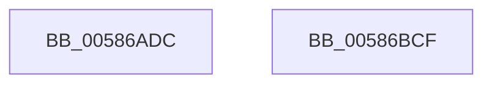

# HvlpStartVirtualProcessor

- RVA: `0x00586ADC`–`0x00586BD0` (길이 `244` bytes)
- VA: `0x0000000140586ADC`
- 실행 섹션: `.text`
- PDB 이름 있음: `예`; PDB Function 태그: `아니요`
- unwind 정보 RVA: `0x00065960`
- 디코드: `66`개 명령, `244/244` bytes 표시
- 미해석 바이트: `0` (있으면 어셈블리에 `.byte`로 보존)

> 이 문서는 커널 이미지의 기계어와 PDB 기호를 분석해 생성했습니다. 4번과 5번은 함수 원형과 자료형을 바이너리 사용 방식에서 추정한 C 해석이며 원본 소스 복구 결과는 아닙니다.

## 1. Dependencies

- 직접 호출 지점: **3**; 고유 호출 대상: **3**
- 직접 호출자로 확인된 함수: **1**
- RIP 상대 이미지 참조: **0**

### Outgoing calls
- `0x00586B0F` → [HvlpAcquireHypercallPage](../47/HvlpAcquireHypercallPage_function_00471410.md) (function, `0x00471410`)
- `0x00586BA8` → [HvcallInitiateHypercall](../31/HvcallInitiateHypercall_function_00313630.md) (function, `0x00313630`)
- `0x00586BBD` → [HvlpReleaseHypercallPage](../31/HvlpReleaseHypercallPage_function_00313480.md) (function, `0x00313480`)

### Direct callers
- [HvlHalStartVirtualProcessor](HvlHalStartVirtualProcessor_function_00588710.md) at `0x00588724`

### Static image references
- 디코드된 RIP-relative 메모리 참조가 없습니다.

## 2. Other-region calls and transfers

- 다른 실행 섹션으로 향하는 call: **0**
- 별도 외부 분기/꼬리 이동을 확인하지 못했습니다.

## 3. Assembly (complete function range)

```asm
00586ADC  48 89 5C 24 08                  mov qword ptr [rsp + 8], rbx
00586AE1  57                              push rdi
00586AE2  48 83 EC 40                     sub rsp, 0x40
00586AE6  33 C0                           xor eax, eax
00586AE8  48 8B FA                        mov rdi, rdx
00586AEB  8B D9                           mov ebx, ecx
00586AED  48 89 44 24 30                  mov qword ptr [rsp + 0x30], rax
00586AF2  0F 57 C0                        xorps xmm0, xmm0
00586AF5  89 44 24 38                     mov dword ptr [rsp + 0x38], eax
00586AF9  41 B9 F0 00 00 00               mov r9d, 0xf0
00586AFF  48 8D 4C 24 20                  lea rcx, [rsp + 0x20]
00586B04  8D 50 01                        lea edx, [rax + 1]
00586B07  45 33 C0                        xor r8d, r8d
00586B0A  0F 11 44 24 20                  movups xmmword ptr [rsp + 0x20], xmm0
00586B0F  E8 FC A8 EE FF                  call 0x140471410
00586B14  48 8B 54 24 38                  mov rdx, qword ptr [rsp + 0x38]
00586B19  33 C9                           xor ecx, ecx
00586B1B  45 33 C0                        xor r8d, r8d
00586B1E  48 83 08 FF                     or qword ptr [rax], 0xffffffffffffffff
00586B22  89 48 0C                        mov dword ptr [rax + 0xc], ecx
00586B25  B9 80 00 00 00                  mov ecx, 0x80
00586B2A  89 58 08                        mov dword ptr [rax + 8], ebx
00586B2D  48 83 C0 10                     add rax, 0x10
00586B31  0F 10 07                        movups xmm0, xmmword ptr [rdi]
00586B34  0F 11 00                        movups xmmword ptr [rax], xmm0
00586B37  0F 10 4F 10                     movups xmm1, xmmword ptr [rdi + 0x10]
00586B3B  0F 11 48 10                     movups xmmword ptr [rax + 0x10], xmm1
00586B3F  0F 10 47 20                     movups xmm0, xmmword ptr [rdi + 0x20]
00586B43  0F 11 40 20                     movups xmmword ptr [rax + 0x20], xmm0
00586B47  0F 10 4F 30                     movups xmm1, xmmword ptr [rdi + 0x30]
00586B4B  0F 11 48 30                     movups xmmword ptr [rax + 0x30], xmm1
00586B4F  0F 10 47 40                     movups xmm0, xmmword ptr [rdi + 0x40]
00586B53  0F 11 40 40                     movups xmmword ptr [rax + 0x40], xmm0
00586B57  0F 10 4F 50                     movups xmm1, xmmword ptr [rdi + 0x50]
00586B5B  0F 11 48 50                     movups xmmword ptr [rax + 0x50], xmm1
00586B5F  0F 10 47 60                     movups xmm0, xmmword ptr [rdi + 0x60]
00586B63  0F 11 40 60                     movups xmmword ptr [rax + 0x60], xmm0
00586B67  48 03 C1                        add rax, rcx
00586B6A  0F 10 47 70                     movups xmm0, xmmword ptr [rdi + 0x70]
00586B6E  48 03 F9                        add rdi, rcx
00586B71  B9 99 00 00 00                  mov ecx, 0x99
00586B76  0F 11 40 F0                     movups xmmword ptr [rax - 0x10], xmm0
00586B7A  0F 10 0F                        movups xmm1, xmmword ptr [rdi]
00586B7D  0F 11 08                        movups xmmword ptr [rax], xmm1
00586B80  0F 10 47 10                     movups xmm0, xmmword ptr [rdi + 0x10]
00586B84  0F 11 40 10                     movups xmmword ptr [rax + 0x10], xmm0
00586B88  0F 10 4F 20                     movups xmm1, xmmword ptr [rdi + 0x20]
00586B8C  0F 11 48 20                     movups xmmword ptr [rax + 0x20], xmm1
00586B90  0F 10 47 30                     movups xmm0, xmmword ptr [rdi + 0x30]
00586B94  0F 11 40 30                     movups xmmword ptr [rax + 0x30], xmm0
00586B98  0F 10 4F 40                     movups xmm1, xmmword ptr [rdi + 0x40]
00586B9C  0F 11 48 40                     movups xmmword ptr [rax + 0x40], xmm1
00586BA0  0F 10 47 50                     movups xmm0, xmmword ptr [rdi + 0x50]
00586BA4  0F 11 40 50                     movups xmmword ptr [rax + 0x50], xmm0
00586BA8  E8 83 CA D8 FF                  call 0x140313630
00586BAD  66 F7 D8                        neg ax
00586BB0  48 8D 4C 24 20                  lea rcx, [rsp + 0x20]
00586BB5  1B DB                           sbb ebx, ebx
00586BB7  81 E3 01 00 00 C0               and ebx, 0xc0000001
00586BBD  E8 BE C8 D8 FF                  call 0x140313480
00586BC2  8B C3                           mov eax, ebx
00586BC4  48 8B 5C 24 50                  mov rbx, qword ptr [rsp + 0x50]
00586BC9  48 83 C4 40                     add rsp, 0x40
00586BCD  5F                              pop rdi
00586BCE  C3                              ret
00586BCF  CC                              int3
```

## 4. C-style interpretation (structured pseudocode)

```c
__int64 __fastcall HvlpStartVirtualProcessor(int a1, __int64 a2, int a3)
{
    __int64 result;
    __int64 v_rbx;
    __int64 v_rdi;
    __int64 v_rsp;
    unsigned int v_stack_m10;
    unsigned __int64 v_stack_m18;
    unsigned __int64 v_stack_m28;
    unsigned __int64 v_stack_p8;

    v_stack_p8 = v_rbx;
    v_rsp = (v_rsp) - (64);
    result = 0;
    v_stack_m18 = 0;
    v_stack_m10 = 0;
    a3 = 0;
    v_stack_m28 = v_xmm0;
    result = HvlpAcquireHypercallPage(v_stack_m28, result + 1, a3, 240);
    a1 = 0;
    a3 = 0;
    *(unsigned int *)(result + 12) = 0;
    *(unsigned int *)(result + 8) = (unsigned int)((unsigned int)(a1));
    result = (result) + (16);
    *(unsigned __int64 *)(result) = v_xmm0;
    *(unsigned __int64 *)(result + 16) = v_xmm1;
    *(unsigned __int64 *)(result + 32) = v_xmm0;
    *(unsigned __int64 *)(result + 48) = v_xmm1;
    *(unsigned __int64 *)(result + 64) = v_xmm0;
    *(unsigned __int64 *)(result + 80) = v_xmm1;
    *(unsigned __int64 *)(result + 96) = v_xmm0;
    result = (result) + (128);
    v_rdi = (a2) + (128);
    *(unsigned __int64 *)(result - 16) = v_xmm0;
    *(unsigned __int64 *)(result) = v_xmm1;
    *(unsigned __int64 *)(result + 16) = v_xmm0;
    *(unsigned __int64 *)(result + 32) = v_xmm1;
    *(unsigned __int64 *)(result + 48) = v_xmm0;
    *(unsigned __int64 *)(result + 64) = v_xmm1;
    *(unsigned __int64 *)(result + 80) = v_xmm0;
    result = HvcallInitiateHypercall(153, v_stack_m10, a3, 240);
    result = (unsigned __int16)(-(result));
    v_rbx = (unsigned int)(((unsigned int)(a1)) & (0xC0000001ULL));
    result = HvlpReleaseHypercallPage(v_stack_m28, v_stack_m10, a3, 240);
    v_rsp = (v_rsp) + (64);
    return (unsigned int)((unsigned int)(v_rbx));
}
```

## 5. (Beta) C Style

```c
int64_t HvlpStartVirtualProcessor(int32_t Arg1, void *Arg2, int32_t Arg3)
{
    uint8_t *arg2 = (uint8_t *)Arg2;

    int64_t result;
    int64_t local_rbx;
    int64_t local_rdi;
    int64_t local_rsp;
    uint32_t v_stack_m10;
    uint64_t v_stack_m18;
    uint64_t v_stack_m28;
    uint64_t v_stack_p8;

    v_stack_p8 = local_rbx;
    local_rsp = (local_rsp) - (64);
    result = 0;
    v_stack_m18 = 0;
    v_stack_m10 = 0;
    Arg3 = 0;
    v_stack_m28 = v_xmm0;
    result = HvlpAcquireHypercallPage(v_stack_m28, result + 1, Arg3, 240);
    Arg1 = 0;
    Arg3 = 0;
    *(uint32_t *)(result + 0xC) = 0;
    *(uint32_t *)(result + 0x8) = (uint32_t)((uint32_t)(Arg1));
    result = (result) + (16);
    *(uint64_t *)(result) = v_xmm0;
    *(uint64_t *)(result + 0x10) = v_xmm1;
    *(uint64_t *)(result + 0x20) = v_xmm0;
    *(uint64_t *)(result + 0x30) = v_xmm1;
    *(uint64_t *)(result + 0x40) = v_xmm0;
    *(uint64_t *)(result + 0x50) = v_xmm1;
    *(uint64_t *)(result + 0x60) = v_xmm0;
    result = (result) + (128);
    local_rdi = (Arg2) + (128);
    *(uint64_t *)(result - 0x10) = v_xmm0;
    *(uint64_t *)(result) = v_xmm1;
    *(uint64_t *)(result + 0x10) = v_xmm0;
    *(uint64_t *)(result + 0x20) = v_xmm1;
    *(uint64_t *)(result + 0x30) = v_xmm0;
    *(uint64_t *)(result + 0x40) = v_xmm1;
    *(uint64_t *)(result + 0x50) = v_xmm0;
    result = HvcallInitiateHypercall(153, v_stack_m10, Arg3, 240);
    result = (uint16_t)(-(result));
    local_rbx = (uint32_t)(((uint32_t)(Arg1)) & (0xC0000001ULL));
    result = HvlpReleaseHypercallPage(v_stack_m28, v_stack_m10, Arg3, 240);
    local_rsp = (local_rsp) + (64);
    return (uint32_t)((uint32_t)(local_rbx));
}
```

### 관측된 메모리 오프셋

구조체 형식이 확인되지 않은 접근은 인자 기준의 오프셋으로만 기록했습니다.

| 기준 인자 | 오프셋 표현 | 폭 (bit) | 접근 |
|---|---:|---:|---|
| `Arg2` | `+ 0x0` | `128` | `R` |
| `Arg2` | `+ 0x10` | `128` | `R` |
| `Arg2` | `+ 0x20` | `128` | `R` |
| `Arg2` | `+ 0x30` | `128` | `R` |
| `Arg2` | `+ 0x40` | `128` | `R` |
| `Arg2` | `+ 0x50` | `128` | `R` |
| `Arg2` | `+ 0x60` | `128` | `R` |
| `Arg2` | `+ 0x70` | `128` | `R` |

## 6. Execution-region graph

[열기: 2D/3D 그래프와 함수 탐색 컨트롤 패널](../../../control-panel.html?section=text&rva=0x00586ADC&view=graph)

- 2D 그래프는 위에서 아래로 흐르고, 3D 그래프는 빈 공간을 드래그해 회전합니다. Shift+드래그는 이동, 휠은 확대·축소, 함수 노드 선택은 대상 보고서 이동입니다.

### Static fallback


