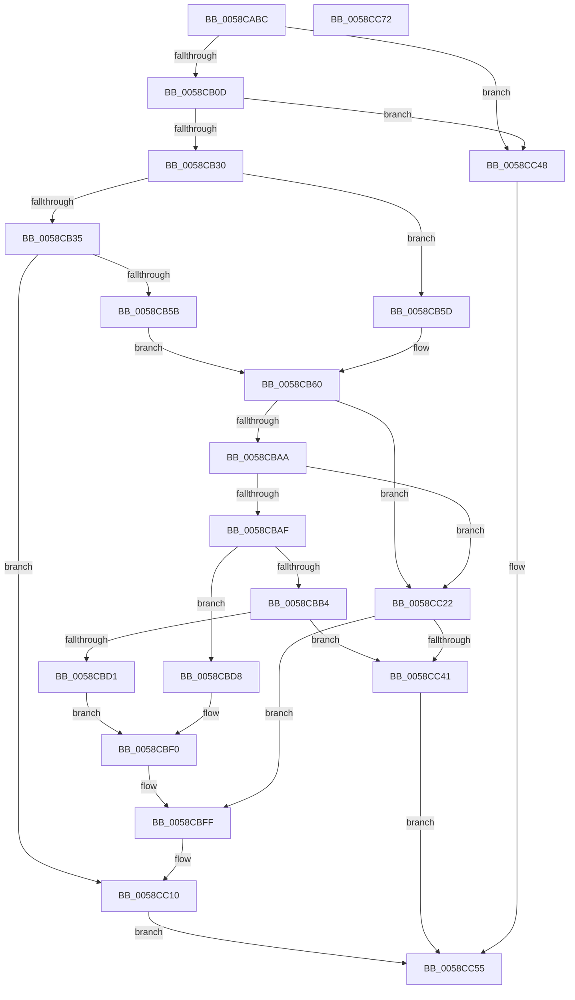

# HvlpTryConfigureInterface

- RVA: `0x0058CABC`–`0x0058CC73` (길이 `439` bytes)
- VA: `0x000000014058CABC`
- 실행 섹션: `.text`
- PDB 이름 있음: `예`; PDB Function 태그: `아니요`
- unwind 정보 RVA: `0x000C69A8`
- 디코드: `107`개 명령, `439/439` bytes 표시
- 미해석 바이트: `0` (있으면 어셈블리에 `.byte`로 보존)

> 이 문서는 커널 이미지의 기계어와 PDB 기호를 분석해 생성했습니다. 4번과 5번은 함수 원형과 자료형을 바이너리 사용 방식에서 추정한 C 해석이며 원본 소스 복구 결과는 아닙니다.

## 1. Dependencies

- 직접 호출 지점: **7**; 고유 호출 대상: **6**
- 직접 호출자로 확인된 함수: **3**
- RIP 상대 이미지 참조: **6**

### Outgoing calls
- `0x0058CAEF` → [HviGetHypervisorFeatures](../66/HviGetHypervisorFeatures_function_00666630.md) (function, `0x00666630`)
- `0x0058CB00` → [HviIsHypervisorMicrosoftCompatible](../66/HviIsHypervisorMicrosoftCompatible_function_006668C8.md) (function, `0x006668C8`)
- `0x0058CB1A` → [HviGetHypervisorFeatures](../66/HviGetHypervisorFeatures_function_00666630.md) (function, `0x00666630`)
- `0x0058CBC4` → [HvlpAllocateEarlyPages](HvlpAllocateEarlyPages_function_0058D3DC.md) (function, `0x0058D3DC`)
- `0x0058CBDF` → [MmGetPhysicalAddress](../23/MmGetPhysicalAddress_function_0023A500.md) (function, `0x0023A500`)
- `0x0058CC34` → [HvlpMapEarlyPages](HvlpMapEarlyPages_function_0058D504.md) (function, `0x0058D504`)
- `0x0058CC5D` → [_security_check_cookie](../6A/_security_check_cookie_function_006AC640.md) (function, `0x006AC640`)

### Direct callers
- [HvlRestoreEnlightenment](HvlRestoreEnlightenment_function_005843CC.md) at `0x005843F6`
- [HvlPhase0Initialize](../../page/71/HvlPhase0Initialize_function_00717AC8.md) at `0x00717B06`
- [HvlEnableVsmCalls](../../init/C2/HvlEnableVsmCalls_function_00C29AB0.md) at `0x00C29AC7`

### Static image references
- `0x0058CACC` → RVA `0x00E0A740` (`.data`; read)
- `0x0058CB60` → RVA `0x00FC41C1` (`.data`; read)
- `0x0058CB79` → RVA `0x00E0A74C` (`.data`; read)
- `0x0058CBD8` → RVA `0x01201850` (`CFGRO`; read)
- `0x0058CC10` → RVA `0x01201858` (`CFGRO`; write)
- `0x0058CC19` → RVA `0x01201850` (`CFGRO`; read/write)

## 2. Other-region calls and transfers

- 다른 실행 섹션으로 향하는 call: **0**
- 별도 외부 분기/꼬리 이동을 확인하지 못했습니다.

## 3. Assembly (complete function range)

```asm
0058CABC  4C 8B DC                        mov r11, rsp
0058CABF  49 89 5B 10                     mov qword ptr [r11 + 0x10], rbx
0058CAC3  49 89 73 18                     mov qword ptr [r11 + 0x18], rsi
0058CAC7  57                              push rdi
0058CAC8  48 83 EC 50                     sub rsp, 0x50
0058CACC  48 8B 05 6D DC 87 00            mov rax, qword ptr [rip + 0x87dc6d]
0058CAD3  48 33 C4                        xor rax, rsp
0058CAD6  48 89 44 24 48                  mov qword ptr [rsp + 0x48], rax
0058CADB  49 83 63 C8 00                  and qword ptr [r11 - 0x38], 0
0058CAE0  48 8B F9                        mov rdi, rcx
0058CAE3  0F 57 C0                        xorps xmm0, xmm0
0058CAE6  49 8D 4B D0                     lea rcx, [r11 - 0x30]
0058CAEA  0F 11 44 24 28                  movups xmmword ptr [rsp + 0x28], xmm0
0058CAEF  E8 3C 9B 0D 00                  call 0x140666630
0058CAF4  48 8B 74 24 28                  mov rsi, qword ptr [rsp + 0x28]
0058CAF9  48 C1 EE 2C                     shr rsi, 0x2c
0058CAFD  83 E6 01                        and esi, 1
0058CB00  E8 C3 9D 0D 00                  call 0x1406668c8
0058CB05  84 C0                           test al, al
0058CB07  0F 84 3B 01 00 00               je 0x14058cc48
0058CB0D  0F 57 C0                        xorps xmm0, xmm0
0058CB10  48 8D 4C 24 38                  lea rcx, [rsp + 0x38]
0058CB15  0F 11 44 24 38                  movups xmmword ptr [rsp + 0x38], xmm0
0058CB1A  E8 11 9B 0D 00                  call 0x140666630
0058CB1F  41 BA 20 00 00 00               mov r10d, 0x20
0058CB25  44 84 54 24 38                  test byte ptr [rsp + 0x38], r10b
0058CB2A  0F 84 18 01 00 00               je 0x14058cc48
0058CB30  48 85 FF                        test rdi, rdi
0058CB33  74 28                           je 0x14058cb5d
0058CB35  48 8B 87 F0 00 00 00            mov rax, qword ptr [rdi + 0xf0]
0058CB3C  44 8B 88 84 00 00 00            mov r9d, dword ptr [rax + 0x84]
0058CB43  4C 8B 80 88 0B 00 00            mov r8, qword ptr [rax + 0xb88]
0058CB4A  41 C1 E9 09                     shr r9d, 9
0058CB4E  41 80 E1 01                     and r9b, 1
0058CB52  4D 85 C0                        test r8, r8
0058CB55  0F 85 B5 00 00 00               jne 0x14058cc10
0058CB5B  EB 03                           jmp 0x14058cb60
0058CB5D  45 32 C9                        xor r9b, r9b
0058CB60  0F B6 15 5A 76 A3 00            movzx edx, byte ptr [rip + 0xa3765a]
0058CB67  48 B8 00 00 0A 04 01 00 00 00   movabs rax, 0x1040a0000
0058CB71  48 0B D0                        or rdx, rax
0058CB74  B9 00 00 00 40                  mov ecx, 0x40000000
0058CB79  0F B7 05 CC DB 87 00            movzx eax, word ptr [rip + 0x87dbcc]
0058CB80  48 C1 E2 10                     shl rdx, 0x10
0058CB84  48 0B D0                        or rdx, rax
0058CB87  48 8B C2                        mov rax, rdx
0058CB8A  48 C1 EA 20                     shr rdx, 0x20
0058CB8E  0F 30                           wrmsr
0058CB90  B9 01 00 00 40                  mov ecx, 0x40000001
0058CB95  0F 32                           rdmsr
0058CB97  48 C1 E2 20                     shl rdx, 0x20
0058CB9B  48 0B C2                        or rax, rdx
0058CB9E  48 8B D8                        mov rbx, rax
0058CBA1  48 83 CB 01                     or rbx, 1
0058CBA5  40 84 F6                        test sil, sil
0058CBA8  75 78                           jne 0x14058cc22
0058CBAA  45 84 C9                        test r9b, r9b
0058CBAD  75 73                           jne 0x14058cc22
0058CBAF  48 85 FF                        test rdi, rdi
0058CBB2  74 24                           je 0x14058cbd8
0058CBB4  45 8B CA                        mov r9d, r10d
0058CBB7  4C 8D 44 24 20                  lea r8, [rsp + 0x20]
0058CBBC  BA 01 00 00 00                  mov edx, 1
0058CBC1  48 8B CF                        mov rcx, rdi
0058CBC4  E8 13 08 00 00                  call 0x14058d3dc
0058CBC9  4C 8B C0                        mov r8, rax
0058CBCC  48 85 C0                        test rax, rax
0058CBCF  74 70                           je 0x14058cc41
0058CBD1  48 8B 44 24 20                  mov rax, qword ptr [rsp + 0x20]
0058CBD6  EB 18                           jmp 0x14058cbf0
0058CBD8  48 8B 0D 71 4C C7 00            mov rcx, qword ptr [rip + 0xc74c71]
0058CBDF  E8 1C D9 CA FF                  call 0x14023a500
0058CBE4  4C 8B 05 65 4C C7 00            mov r8, qword ptr [rip + 0xc74c65]
0058CBEB  48 89 44 24 20                  mov qword ptr [rsp + 0x20], rax
0058CBF0  81 E3 FF 0F 00 00               and ebx, 0xfff
0058CBF6  48 25 00 F0 FF FF               and rax, 0xfffffffffffff000
0058CBFC  48 0B D8                        or rbx, rax
0058CBFF  48 8B D3                        mov rdx, rbx
0058CC02  48 8B C3                        mov rax, rbx
0058CC05  48 C1 EA 20                     shr rdx, 0x20
0058CC09  B9 01 00 00 40                  mov ecx, 0x40000001
0058CC0E  0F 30                           wrmsr
0058CC10  4C 89 05 41 4C C7 00            mov qword ptr [rip + 0xc74c41], r8
0058CC17  33 C0                           xor eax, eax
0058CC19  4C 87 05 30 4C C7 00            xchg qword ptr [rip + 0xc74c30], r8
0058CC20  EB 33                           jmp 0x14058cc55
0058CC22  48 8B CB                        mov rcx, rbx
0058CC25  45 8B C2                        mov r8d, r10d
0058CC28  48 81 E1 00 F0 FF FF            and rcx, 0xfffffffffffff000
0058CC2F  48 89 4C 24 20                  mov qword ptr [rsp + 0x20], rcx
0058CC34  E8 CB 08 00 00                  call 0x14058d504
0058CC39  4C 8B C0                        mov r8, rax
0058CC3C  48 85 C0                        test rax, rax
0058CC3F  75 BE                           jne 0x14058cbff
0058CC41  B8 9A 00 00 C0                  mov eax, 0xc000009a
0058CC46  EB 0D                           jmp 0x14058cc55
0058CC48  48 83 25 00 4C C7 00 00         and qword ptr [rip + 0xc74c00], 0
0058CC50  B8 00 10 35 C0                  mov eax, 0xc0351000
0058CC55  48 8B 4C 24 48                  mov rcx, qword ptr [rsp + 0x48]
0058CC5A  48 33 CC                        xor rcx, rsp
0058CC5D  E8 DE F9 11 00                  call 0x1406ac640
0058CC62  48 8B 5C 24 68                  mov rbx, qword ptr [rsp + 0x68]
0058CC67  48 8B 74 24 70                  mov rsi, qword ptr [rsp + 0x70]
0058CC6C  48 83 C4 50                     add rsp, 0x50
0058CC70  5F                              pop rdi
0058CC71  C3                              ret
0058CC72  CC                              int3
```

## 4. C-style interpretation (structured pseudocode)

```c
__int64 __fastcall HvlpTryConfigureInterface(__int64 a1)
{
    __int64 result;
    __int64 v_rbx;
    __int64 v_rsi;
    __int64 v_rsp;
    unsigned __int64 v_stack_m10;
    unsigned __int64 v_stack_m20;
    unsigned __int64 v_stack_m30;
    unsigned __int64 v_stack_m38;
    unsigned __int64 v_stack_p10;
    unsigned __int64 v_stack_p18;

    *(unsigned __int64 *)(v_rsp + 16) = v_rbx;
    *(unsigned __int64 *)(v_rsp + 24) = v_rsi;
    v_rsp = (v_rsp) - (80);
    result = (*(unsigned __int64 *)(v_rip + 8903789)) ^ (v_rsp);
    v_stack_m10 = result;
    v_stack_m30 = v_xmm0;
    result = HviGetHypervisorFeatures(v_rsp - 48, a2, a3, a4);
    v_rsi = (v_stack_m30) >> (44);
    v_rsi = (unsigned int)((v_rsi) & (1));
    result = HviIsHypervisorMicrosoftCompatible(v_rsp - 48, a2, a3, a4);
    if ((unsigned __int8)(result) == 0) goto loc_0058CC48;
    v_stack_m20 = v_xmm0;
    result = HviGetHypervisorFeatures(v_stack_m20, a2, a3, a4);
    if (((v_stack_m20) & (32)) == 0) goto loc_0058CC48;
    if (a1 == 0) goto loc_0058CB5D;
    a4 = (unsigned int)(((unsigned int)(*(unsigned int *)(*(unsigned __int64 *)(a1 + 240) + 132))) >> (9));
    a4 = (unsigned __int8)((a4) & (1));
    if (*(unsigned __int64 *)(*(unsigned __int64 *)(a1 + 240) + 2952) != 0) goto loc_0058CC10;
    goto loc_0058CB60;
loc_0058CB5D:
    a4 = 0;
loc_0058CB60:
    a2 = (*(unsigned __int8 *)(v_rip + 10712666)) | (*(unsigned __int64 *)(a1 + 240));
    a2 = (a2) << (16);
    a2 = (a2) | (*(unsigned __int16 *)(v_rip + 8903628));
    a2 = (a2) >> (32);
    a2 = (a2) << (32);
    result = (a2) | (a2);
    v_rbx = (result) | (1);
    if ((unsigned __int8)(v_rsi) != 0) goto loc_0058CC22;
    if (0 != 0) goto loc_0058CC22;
    if (a1 == 0) goto loc_0058CBD8;
    result = HvlpAllocateEarlyPages(a1, 1, v_stack_m38, 32);
    if (result == 0) goto loc_0058CC41;
    goto loc_0058CBF0;
loc_0058CBD8:
    result = MmGetPhysicalAddress(*(unsigned __int64 *)(v_rip + 13061233), 1, result, 32);
    v_stack_m38 = result;
loc_0058CBF0:
    v_rbx = (unsigned int)((v_rbx) & (0xFFFULL));
    result = (result) & (0xFFFFFFFFFFFFF000ULL);
    v_rbx = (v_rbx) | (result);
loc_0058CBFF:
    a2 = (v_rbx) >> (32);
loc_0058CC10:
    *(unsigned __int64 *)(v_rip + 13061185) = *(unsigned __int64 *)(v_rip + 13061221);
    result = 0;
    goto loc_0058CC55;
loc_0058CC22:
    a1 = (v_rbx) & (0xFFFFFFFFFFFFF000ULL);
    v_stack_m38 = a1;
    result = HvlpMapEarlyPages(a1, a2, 32, 32);
    if (result != 0) goto loc_0058CBFF;
loc_0058CC41:
    goto loc_0058CC55;
loc_0058CC48:
loc_0058CC55:
    a1 = (v_stack_m10) ^ (v_rsp);
    result = _security_check_cookie(a1, a2, result, 32);
    v_rsp = (v_rsp) + (80);
    return result;
}
```

## 5. (Beta) C Style

```c
int64_t HvlpTryConfigureInterface(int64_t Arg1)
{
    int64_t result;
    int64_t local_rbx;
    int64_t local_rsi;
    int64_t local_rsp;
    uint64_t v_stack_m10;
    uint64_t v_stack_m20;
    uint64_t v_stack_m30;
    uint64_t v_stack_m38;
    uint64_t v_stack_p10;
    uint64_t v_stack_p18;

    *(uint64_t *)(local_rsp + 0x10) = local_rbx;
    *(uint64_t *)(local_rsp + 0x18) = local_rsi;
    local_rsp = (local_rsp) - (80);
    result = (*(uint64_t *)(v_rip + 0x87DC6D)) ^ (local_rsp);
    v_stack_m10 = result;
    v_stack_m30 = v_xmm0;
    result = HviGetHypervisorFeatures(local_rsp - 48, a2, a3, a4);
    local_rsi = (v_stack_m30) >> (44);
    local_rsi = (uint32_t)((local_rsi) & (1));
    result = HviIsHypervisorMicrosoftCompatible(local_rsp - 48, a2, a3, a4);
    if ((uint8_t)(result) == 0) goto loc_0058CC48;
    v_stack_m20 = v_xmm0;
    result = HviGetHypervisorFeatures(v_stack_m20, a2, a3, a4);
    if (((v_stack_m20) & (32)) == 0) goto loc_0058CC48;
    if (Arg1 == 0) goto loc_0058CB5D;
    a4 = (uint32_t)(((uint32_t)(*(uint32_t *)(*(uint64_t *)(Arg1 + 0xF0) + 0x84))) >> (9));
    a4 = (uint8_t)((a4) & (1));
    if (*(uint64_t *)(*(uint64_t *)(Arg1 + 0xF0) + 0xB88) != 0) goto loc_0058CC10;
    goto loc_0058CB60;
loc_0058CB5D:
    a4 = 0;
loc_0058CB60:
    a2 = (*(uint8_t *)(v_rip + 0xA3765A)) | (*(uint64_t *)(Arg1 + 0xF0));
    a2 = (a2) << (16);
    a2 = (a2) | (*(uint16_t *)(v_rip + 0x87DBCC));
    a2 = (a2) >> (32);
    a2 = (a2) << (32);
    result = (a2) | (a2);
    local_rbx = (result) | (1);
    if ((uint8_t)(local_rsi) != 0) goto loc_0058CC22;
    if (0 != 0) goto loc_0058CC22;
    if (Arg1 == 0) goto loc_0058CBD8;
    result = HvlpAllocateEarlyPages(Arg1, 1, v_stack_m38, 32);
    if (result == 0) goto loc_0058CC41;
    goto loc_0058CBF0;
loc_0058CBD8:
    result = MmGetPhysicalAddress(*(uint64_t *)(v_rip + 0xC74C71), 1, result, 32);
    v_stack_m38 = result;
loc_0058CBF0:
    local_rbx = (uint32_t)((local_rbx) & (0xFFFULL));
    result = (result) & (0xFFFFFFFFFFFFF000ULL);
    local_rbx = (local_rbx) | (result);
loc_0058CBFF:
    a2 = (local_rbx) >> (32);
loc_0058CC10:
    *(uint64_t *)(v_rip + 0xC74C41) = *(uint64_t *)(v_rip + 0xC74C65);
    result = 0;
    goto loc_0058CC55;
loc_0058CC22:
    Arg1 = (local_rbx) & (0xFFFFFFFFFFFFF000ULL);
    v_stack_m38 = Arg1;
    result = HvlpMapEarlyPages(Arg1, a2, 32, 32);
    if (result != 0) goto loc_0058CBFF;
loc_0058CC41:
    goto loc_0058CC55;
loc_0058CC48:
loc_0058CC55:
    Arg1 = (v_stack_m10) ^ (local_rsp);
    result = _security_check_cookie(Arg1, a2, result, 32);
    local_rsp = (local_rsp) + (80);
    return result;
}
```

## 6. Execution-region graph

[열기: 2D/3D 그래프와 함수 탐색 컨트롤 패널](../../../control-panel.html?section=text&rva=0x0058CABC&view=graph)

- 2D 그래프는 위에서 아래로 흐르고, 3D 그래프는 빈 공간을 드래그해 회전합니다. Shift+드래그는 이동, 휠은 확대·축소, 함수 노드 선택은 대상 보고서 이동입니다.

### Static fallback


