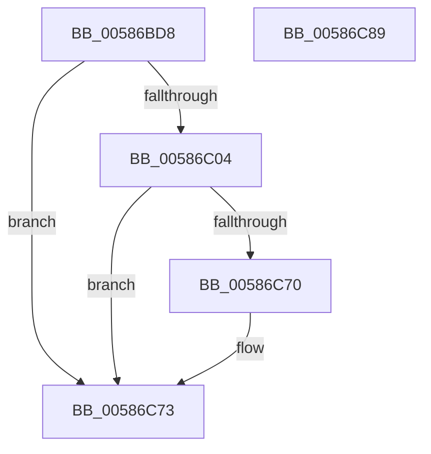

# HvlpUpdateLpcbIndex

- RVA: `0x00586BD8`–`0x00586C8A` (길이 `178` bytes)
- VA: `0x0000000140586BD8`
- 실행 섹션: `.text`
- PDB 이름 있음: `예`; PDB Function 태그: `아니요`
- unwind 정보 RVA: `0x000BE9D0`
- 디코드: `52`개 명령, `178/178` bytes 표시
- 미해석 바이트: `0` (있으면 어셈블리에 `.byte`로 보존)

> 이 문서는 커널 이미지의 기계어와 PDB 기호를 분석해 생성했습니다. 4번과 5번은 함수 원형과 자료형을 바이너리 사용 방식에서 추정한 C 해석이며 원본 소스 복구 결과는 아닙니다.

## 1. Dependencies

- 직접 호출 지점: **3**; 고유 호출 대상: **3**
- 직접 호출자로 확인된 함수: **1**
- RIP 상대 이미지 참조: **0**

### Outgoing calls
- `0x00586C23` → [HvlpAcquireHypercallPage](../47/HvlpAcquireHypercallPage_function_00471410.md) (function, `0x00471410`)
- `0x00586C4C` → [HvcallInitiateHypercall](../31/HvcallInitiateHypercall_function_00313630.md) (function, `0x00313630`)
- `0x00586C59` → [HvlpReleaseHypercallPage](../31/HvlpReleaseHypercallPage_function_00313480.md) (function, `0x00313480`)

### Direct callers
- [HvlStartBootLogicalProcessors](HvlStartBootLogicalProcessors_function_00584E18.md) at `0x0058511B`

### Static image references
- 디코드된 RIP-relative 메모리 참조가 없습니다.

## 2. Other-region calls and transfers

- 다른 실행 섹션으로 향하는 call: **0**
- 별도 외부 분기/꼬리 이동을 확인하지 못했습니다.

## 3. Assembly (complete function range)

```asm
00586BD8  4C 8B DC                        mov r11, rsp
00586BDB  49 89 5B 08                     mov qword ptr [r11 + 8], rbx
00586BDF  49 89 6B 10                     mov qword ptr [r11 + 0x10], rbp
00586BE3  49 89 73 18                     mov qword ptr [r11 + 0x18], rsi
00586BE7  57                              push rdi
00586BE8  48 83 EC 60                     sub rsp, 0x60
00586BEC  8B 59 04                        mov ebx, dword ptr [rcx + 4]
00586BEF  33 ED                           xor ebp, ebp
00586BF1  0F 57 C0                        xorps xmm0, xmm0
00586BF4  8B FA                           mov edi, edx
00586BF6  48 8B F1                        mov rsi, rcx
00586BF9  8B C5                           mov eax, ebp
00586BFB  0F 11 44 24 40                  movups xmmword ptr [rsp + 0x40], xmm0
00586C00  3B DA                           cmp ebx, edx
00586C02  74 6F                           je 0x140586c73
00586C04  89 54 24 40                     mov dword ptr [rsp + 0x40], edx
00586C08  44 8D 4D 28                     lea r9d, [rbp + 0x28]
00586C0C  0F 11 44 24 20                  movups xmmword ptr [rsp + 0x20], xmm0
00586C11  49 89 43 C8                     mov qword ptr [r11 - 0x38], rax
00586C15  8D 55 01                        lea edx, [rbp + 1]
00586C18  45 33 C0                        xor r8d, r8d
00586C1B  89 44 24 38                     mov dword ptr [rsp + 0x38], eax
00586C1F  49 8D 4B B8                     lea rcx, [r11 - 0x48]
00586C23  E8 E8 A7 EE FF                  call 0x140471410
00586C28  0F 10 44 24 40                  movups xmm0, xmmword ptr [rsp + 0x40]
00586C2D  48 8B 54 24 38                  mov rdx, qword ptr [rsp + 0x38]
00586C32  8D 4D 79                        lea ecx, [rbp + 0x79]
00586C35  0F 57 C9                        xorps xmm1, xmm1
00586C38  45 33 C0                        xor r8d, r8d
00586C3B  0F 11 40 08                     movups xmmword ptr [rax + 8], xmm0
00586C3F  89 18                           mov dword ptr [rax], ebx
00586C41  0F 11 48 18                     movups xmmword ptr [rax + 0x18], xmm1
00586C45  C7 40 04 02 00 00 00            mov dword ptr [rax + 4], 2
00586C4C  E8 DF C9 D8 FF                  call 0x140313630
00586C51  48 8D 4C 24 20                  lea rcx, [rsp + 0x20]
00586C56  48 8B D8                        mov rbx, rax
00586C59  E8 22 C8 D8 FF                  call 0x140313480
00586C5E  0F B7 C3                        movzx eax, bx
00586C61  66 F7 D8                        neg ax
00586C64  1B C0                           sbb eax, eax
00586C66  25 01 00 00 C0                  and eax, 0xc0000001
00586C6B  66 85 DB                        test bx, bx
00586C6E  75 03                           jne 0x140586c73
00586C70  89 7E 04                        mov dword ptr [rsi + 4], edi
00586C73  4C 8D 5C 24 60                  lea r11, [rsp + 0x60]
00586C78  49 8B 5B 10                     mov rbx, qword ptr [r11 + 0x10]
00586C7C  49 8B 6B 18                     mov rbp, qword ptr [r11 + 0x18]
00586C80  49 8B 73 20                     mov rsi, qword ptr [r11 + 0x20]
00586C84  49 8B E3                        mov rsp, r11
00586C87  5F                              pop rdi
00586C88  C3                              ret
00586C89  CC                              int3
```

## 4. C-style interpretation (structured pseudocode)

```c
__int64 __fastcall HvlpUpdateLpcbIndex(__int64 a1, int a2, int a3)
{
    __int64 result;
    __int64 v_rbp;
    __int64 v_rsp;
    unsigned __int64 v_stack_m28;
    unsigned int v_stack_m30;
    unsigned __int64 v_stack_m48;
    unsigned __int64 v_stack_m8;

    *(unsigned __int64 *)(v_rsp + 8) = v_rbx;
    *(unsigned __int64 *)(v_rsp + 16) = v_rbp;
    *(unsigned __int64 *)(v_rsp + 24) = v_rsi;
    v_rsp = (v_rsp) - (96);
    v_rbp = 0;
    v_stack_m28 = v_xmm0;
    if (((unsigned int)((unsigned int)(*(unsigned int *)(a1 + 4)))) == a2) goto loc_00586C73;
    v_stack_m28 = a2;
    v_stack_m48 = v_xmm0;
    *(unsigned __int64 *)(v_rsp - 56) = 0;
    a3 = 0;
    v_stack_m30 = 0;
    result = HvlpAcquireHypercallPage(v_rsp - 72, v_rbp + 1, a3, v_rbp + 40);
    a3 = 0;
    *(unsigned __int64 *)(result + 8) = v_xmm0;
    *(unsigned int *)(result) = (unsigned int)((unsigned int)(*(unsigned int *)(a1 + 4)));
    *(unsigned __int64 *)(result + 24) = v_xmm1;
    *(unsigned int *)(result + 4) = 2;
    result = HvcallInitiateHypercall(v_rbp + 121, v_stack_m30, a3, v_rbp + 40);
    result = HvlpReleaseHypercallPage(v_stack_m48, v_stack_m30, a3, v_rbp + 40);
    result = (unsigned __int16)(-((unsigned __int16)(result)));
    result = (unsigned int)((result) & (0xC0000001ULL));
    if ((unsigned __int16)(result) == 0) {
        *(unsigned int *)(a1 + 4) = (unsigned int)((unsigned int)(a2));
    }
    return result;
}
```

## 5. (Beta) C Style

```c
int64_t HvlpUpdateLpcbIndex(void *Arg1, int32_t Arg2, int32_t Arg3)
{
    uint8_t *arg1 = (uint8_t *)Arg1;

    int64_t result;
    int64_t local_rbp;
    int64_t local_rsp;
    uint64_t v_stack_m28;
    uint32_t v_stack_m30;
    uint64_t v_stack_m48;
    uint64_t v_stack_m8;

    *(uint64_t *)(local_rsp + 0x8) = local_rbx;
    *(uint64_t *)(local_rsp + 0x10) = local_rbp;
    *(uint64_t *)(local_rsp + 0x18) = local_rsi;
    local_rsp = (local_rsp) - (96);
    local_rbp = 0;
    v_stack_m28 = v_xmm0;
    if (((uint32_t)((uint32_t)(*(uint32_t *)(arg1 + 0x4)))) == Arg2) goto loc_00586C73;
    v_stack_m28 = Arg2;
    v_stack_m48 = v_xmm0;
    *(uint64_t *)(local_rsp - 0x38) = 0;
    Arg3 = 0;
    v_stack_m30 = 0;
    result = HvlpAcquireHypercallPage(local_rsp - 72, local_rbp + 1, Arg3, local_rbp + 40);
    Arg3 = 0;
    *(uint64_t *)(result + 0x8) = v_xmm0;
    *(uint32_t *)(result) = (uint32_t)((uint32_t)(*(uint32_t *)(arg1 + 0x4)));
    *(uint64_t *)(result + 0x18) = v_xmm1;
    *(uint32_t *)(result + 0x4) = 2;
    result = HvcallInitiateHypercall(local_rbp + 121, v_stack_m30, Arg3, local_rbp + 40);
    result = HvlpReleaseHypercallPage(v_stack_m48, v_stack_m30, Arg3, local_rbp + 40);
    result = (uint16_t)(-((uint16_t)(result)));
    result = (uint32_t)((result) & (0xC0000001ULL));
    if ((uint16_t)(result) == 0) {
        *(uint32_t *)(arg1 + 0x4) = (uint32_t)((uint32_t)(Arg2));
    }
    return result;
}
```

### 관측된 메모리 오프셋

구조체 형식이 확인되지 않은 접근은 인자 기준의 오프셋으로만 기록했습니다.

| 기준 인자 | 오프셋 표현 | 폭 (bit) | 접근 |
|---|---:|---:|---|
| `Arg1` | `+ 0x4` | `32` | `R` |
| `Arg1` | `+ 0x4` | `32` | `W` |

## 6. Execution-region graph

[열기: 2D/3D 그래프와 함수 탐색 컨트롤 패널](../../../control-panel.html?section=text&rva=0x00586BD8&view=graph)

- 2D 그래프는 위에서 아래로 흐르고, 3D 그래프는 빈 공간을 드래그해 회전합니다. Shift+드래그는 이동, 휠은 확대·축소, 함수 노드 선택은 대상 보고서 이동입니다.

### Static fallback


