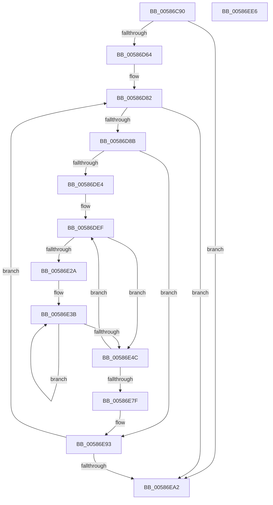

# HvlpWithdrawPages

- RVA: `0x00586C90`–`0x00586EE7` (길이 `599` bytes)
- VA: `0x0000000140586C90`
- 실행 섹션: `.text`
- PDB 이름 있음: `예`; PDB Function 태그: `아니요`
- unwind 정보 RVA: `0x000C6570`
- 디코드: `159`개 명령, `599/599` bytes 표시
- 미해석 바이트: `0` (있으면 어셈블리에 `.byte`로 보존)

> 이 문서는 커널 이미지의 기계어와 PDB 기호를 분석해 생성했습니다. 4번과 5번은 함수 원형과 자료형을 바이너리 사용 방식에서 추정한 C 해석이며 원본 소스 복구 결과는 아닙니다.

## 1. Dependencies

- 직접 호출 지점: **9**; 고유 호출 대상: **6**
- 직접 호출자로 확인된 함수: **1**
- RIP 상대 이미지 참조: **1**

### Outgoing calls
- `0x00586CF2` → [memset](../6C/memset_function_006C6C40.md) (function, `0x006C6C40`)
- `0x00586D06` → [HvlpAcquireHypercallPage](../47/HvlpAcquireHypercallPage_function_00471410.md) (function, `0x00471410`)
- `0x00586D1D` → [HvlpAcquireHypercallPage](../47/HvlpAcquireHypercallPage_function_00471410.md) (function, `0x00471410`)
- `0x00586D56` → [HvcallInitiateHypercall](../31/HvcallInitiateHypercall_function_00313630.md) (function, `0x00313630`)
- `0x00586DBC` → [HvcallInitiateHypercall](../31/HvcallInitiateHypercall_function_00313630.md) (function, `0x00313630`)
- `0x00586E58` → [MiFreePagesFromMdl](../3F/MiFreePagesFromMdl_function_003F8300.md) (function, `0x003F8300`)
- `0x00586EA7` → [HvlpReleaseHypercallPage](../31/HvlpReleaseHypercallPage_function_00313480.md) (function, `0x00313480`)
- `0x00586EB1` → [HvlpReleaseHypercallPage](../31/HvlpReleaseHypercallPage_function_00313480.md) (function, `0x00313480`)
- `0x00586EC0` → [_security_check_cookie](../6A/_security_check_cookie_function_006AC640.md) (function, `0x006AC640`)

### Direct callers
- [HvlpAddRemovePhysicalMemory](../6A/HvlpAddRemovePhysicalMemory_function_006A7A98.md) at `0x006A7C0A`

### Static image references
- `0x00586CB6` → RVA `0x00E0A740` (`.data`; read)

## 2. Other-region calls and transfers

- 다른 실행 섹션으로 향하는 call: **0**
- 별도 외부 분기/꼬리 이동을 확인하지 못했습니다.

## 3. Assembly (complete function range)

```asm
00586C90  48 8B C4                        mov rax, rsp
00586C93  48 89 58 08                     mov qword ptr [rax + 8], rbx
00586C97  48 89 70 10                     mov qword ptr [rax + 0x10], rsi
00586C9B  48 89 78 18                     mov qword ptr [rax + 0x18], rdi
00586C9F  55                              push rbp
00586CA0  41 54                           push r12
00586CA2  41 55                           push r13
00586CA4  41 56                           push r14
00586CA6  41 57                           push r15
00586CA8  48 8D A8 08 FE FF FF            lea rbp, [rax - 0x1f8]
00586CAF  48 81 EC D0 02 00 00            sub rsp, 0x2d0
00586CB6  48 8B 05 83 3A 88 00            mov rax, qword ptr [rip + 0x883a83]
00586CBD  48 33 C4                        xor rax, rsp
00586CC0  48 89 85 C0 01 00 00            mov qword ptr [rbp + 0x1c0], rax
00586CC7  33 C0                           xor eax, eax
00586CC9  48 8D 4D 90                     lea rcx, [rbp - 0x70]
00586CCD  0F 57 C0                        xorps xmm0, xmm0
00586CD0  48 89 45 80                     mov qword ptr [rbp - 0x80], rax
00586CD4  33 D2                           xor edx, edx
00586CD6  89 45 88                        mov dword ptr [rbp - 0x78], eax
00586CD9  41 B8 30 02 00 00               mov r8d, 0x230
00586CDF  48 89 44 24 60                  mov qword ptr [rsp + 0x60], rax
00586CE4  0F 11 44 24 70                  movups xmmword ptr [rsp + 0x70], xmm0
00586CE9  89 44 24 68                     mov dword ptr [rsp + 0x68], eax
00586CED  0F 11 44 24 50                  movups xmmword ptr [rsp + 0x50], xmm0
00586CF2  E8 49 FF 13 00                  call 0x1406c6c40
00586CF7  45 33 C9                        xor r9d, r9d
00586CFA  48 8D 4C 24 70                  lea rcx, [rsp + 0x70]
00586CFF  45 33 C0                        xor r8d, r8d
00586D02  41 8D 51 01                     lea edx, [r9 + 1]
00586D06  E8 05 A7 EE FF                  call 0x140471410
00586D0B  45 33 C9                        xor r9d, r9d
00586D0E  48 8D 4C 24 50                  lea rcx, [rsp + 0x50]
00586D13  45 33 C0                        xor r8d, r8d
00586D16  48 8B D8                        mov rbx, rax
00586D19  41 8D 51 02                     lea edx, [r9 + 2]
00586D1D  E8 EE A6 EE FF                  call 0x140471410
00586D22  45 33 E4                        xor r12d, r12d
00586D25  48 89 44 24 38                  mov qword ptr [rsp + 0x38], rax
00586D2A  4C 89 63 08                     mov qword ptr [rbx + 8], r12
00586D2E  49 83 CF FF                     or r15, 0xffffffffffffffff
00586D32  48 8B 7C 24 68                  mov rdi, qword ptr [rsp + 0x68]
00586D37  4C 8B E8                        mov r13, rax
00586D3A  48 8B 75 88                     mov rsi, qword ptr [rbp - 0x78]
00586D3E  4C 8B C7                        mov r8, rdi
00586D41  48 8B D6                        mov rdx, rsi
00586D44  4C 89 3B                        mov qword ptr [rbx], r15
00586D47  41 8D 4C 24 4A                  lea ecx, [r12 + 0x4a]
00586D4C  48 89 7C 24 40                  mov qword ptr [rsp + 0x40], rdi
00586D51  48 89 74 24 48                  mov qword ptr [rsp + 0x48], rsi
00586D56  E8 D5 C8 D8 FF                  call 0x140313630
00586D5B  66 85 C0                        test ax, ax
00586D5E  0F 85 3E 01 00 00               jne 0x140586ea2
00586D64  4D 8B 75 00                     mov r14, qword ptr [r13]
00586D68  BA FF 0F 00 00                  mov edx, 0xfff
00586D6D  4C 89 63 08                     mov qword ptr [rbx + 8], r12
00586D71  48 C7 44 24 28 49 00 00 00      mov qword ptr [rsp + 0x28], 0x49
00586D7A  4C 89 3B                        mov qword ptr [rbx], r15
00586D7D  44 8B 7C 24 2C                  mov r15d, dword ptr [rsp + 0x2c]
00586D82  4D 85 F6                        test r14, r14
00586D85  0F 84 17 01 00 00               je 0x140586ea2
00586D8B  41 8B C7                        mov eax, r15d
00586D8E  B9 00 02 00 00                  mov ecx, 0x200
00586D93  4C 3B F1                        cmp r14, rcx
00586D96  4C 8B C7                        mov r8, rdi
00586D99  49 0F 42 CE                     cmovb rcx, r14
00586D9D  25 00 F0 FF FF                  and eax, 0xfffff000
00586DA2  23 CA                           and ecx, edx
00586DA4  48 8B D6                        mov rdx, rsi
00586DA7  44 8B F9                        mov r15d, ecx
00586DAA  44 0B F8                        or r15d, eax
00586DAD  44 89 7C 24 2C                  mov dword ptr [rsp + 0x2c], r15d
00586DB2  48 8B 4C 24 28                  mov rcx, qword ptr [rsp + 0x28]
00586DB7  44 89 7C 24 20                  mov dword ptr [rsp + 0x20], r15d
00586DBC  E8 6F C8 D8 FF                  call 0x140313630
00586DC1  48 89 44 24 30                  mov qword ptr [rsp + 0x30], rax
00586DC6  BA FF 0F 00 00                  mov edx, 0xfff
00586DCB  48 C1 E8 20                     shr rax, 0x20
00586DCF  4D 8B E5                        mov r12, r13
00586DD2  8B C8                           mov ecx, eax
00586DD4  8B C1                           mov eax, ecx
00586DD6  48 23 C2                        and rax, rdx
00586DD9  4C 2B F0                        sub r14, rax
00586DDC  85 CA                           test edx, ecx
00586DDE  0F 86 AF 00 00 00               jbe 0x140586e93
00586DE4  8B 7C 24 34                     mov edi, dword ptr [rsp + 0x34]
00586DE8  45 33 ED                        xor r13d, r13d
00586DEB  45 8D 7D 40                     lea r15d, [r13 + 0x40]
00586DEF  8B DF                           mov ebx, edi
00586DF1  4C 89 6D 90                     mov qword ptr [rbp - 0x70], r13
00586DF5  23 DA                           and ebx, edx
00586DF7  66 44 89 6D 9A                  mov word ptr [rbp - 0x66], r13w
00586DFC  41 3B DF                        cmp ebx, r15d
00586DFF  4C 89 6D B0                     mov qword ptr [rbp - 0x50], r13
00586E03  44 89 6D BC                     mov dword ptr [rbp - 0x44], r13d
00586E07  41 0F 47 DF                     cmova ebx, r15d
00586E0B  8B CB                           mov ecx, ebx
00586E0D  8B F3                           mov esi, ebx
00586E0F  C1 E1 0C                        shl ecx, 0xc
00586E12  8B C1                           mov eax, ecx
00586E14  89 4D B8                        mov dword ptr [rbp - 0x48], ecx
00586E17  C1 E8 0C                        shr eax, 0xc
00586E1A  66 83 C0 06                     add ax, 6
00586E1E  66 C1 E0 03                     shl ax, 3
00586E22  66 89 45 98                     mov word ptr [rbp - 0x68], ax
00586E26  85 DB                           test ebx, ebx
00586E28  74 22                           je 0x140586e4c
00586E2A  48 8D 45 C0                     lea rax, [rbp - 0x40]
00586E2E  49 8B D4                        mov rdx, r12
00586E31  48 2B D0                        sub rdx, rax
00586E34  48 8D 4D C0                     lea rcx, [rbp - 0x40]
00586E38  44 8B C6                        mov r8d, esi
00586E3B  48 8B 04 0A                     mov rax, qword ptr [rdx + rcx]
00586E3F  48 89 01                        mov qword ptr [rcx], rax
00586E42  48 8D 49 08                     lea rcx, [rcx + 8]
00586E46  49 83 E8 01                     sub r8, 1
00586E4A  75 EF                           jne 0x140586e3b
00586E4C  45 33 C9                        xor r9d, r9d
00586E4F  48 8D 4D 90                     lea rcx, [rbp - 0x70]
00586E53  45 33 C0                        xor r8d, r8d
00586E56  33 D2                           xor edx, edx
00586E58  E8 A3 14 E7 FF                  call 0x1403f8300
00586E5D  8B CF                           mov ecx, edi
00586E5F  4D 8D 24 DC                     lea r12, [r12 + rbx*8]
00586E63  8B C7                           mov eax, edi
00586E65  2B CB                           sub ecx, ebx
00586E67  BA FF 0F 00 00                  mov edx, 0xfff
00586E6C  25 00 F0 FF FF                  and eax, 0xfffff000
00586E71  23 CA                           and ecx, edx
00586E73  8B F9                           mov edi, ecx
00586E75  0B F8                           or edi, eax
00586E77  85 FA                           test edx, edi
00586E79  0F 87 70 FF FF FF               ja 0x140586def
00586E7F  44 8B 7C 24 20                  mov r15d, dword ptr [rsp + 0x20]
00586E84  4C 8B 6C 24 38                  mov r13, qword ptr [rsp + 0x38]
00586E89  48 8B 7C 24 40                  mov rdi, qword ptr [rsp + 0x40]
00586E8E  48 8B 74 24 48                  mov rsi, qword ptr [rsp + 0x48]
00586E93  45 33 E4                        xor r12d, r12d
00586E96  66 44 39 64 24 30               cmp word ptr [rsp + 0x30], r12w
00586E9C  0F 84 E0 FE FF FF               je 0x140586d82
00586EA2  48 8D 4C 24 50                  lea rcx, [rsp + 0x50]
00586EA7  E8 D4 C5 D8 FF                  call 0x140313480
00586EAC  48 8D 4C 24 70                  lea rcx, [rsp + 0x70]
00586EB1  E8 CA C5 D8 FF                  call 0x140313480
00586EB6  48 8B 8D C0 01 00 00            mov rcx, qword ptr [rbp + 0x1c0]
00586EBD  48 33 CC                        xor rcx, rsp
00586EC0  E8 7B 57 12 00                  call 0x1406ac640
00586EC5  4C 8D 9C 24 D0 02 00 00         lea r11, [rsp + 0x2d0]
00586ECD  49 8B 5B 30                     mov rbx, qword ptr [r11 + 0x30]
00586ED1  49 8B 73 38                     mov rsi, qword ptr [r11 + 0x38]
00586ED5  49 8B 7B 40                     mov rdi, qword ptr [r11 + 0x40]
00586ED9  49 8B E3                        mov rsp, r11
00586EDC  41 5F                           pop r15
00586EDE  41 5E                           pop r14
00586EE0  41 5D                           pop r13
00586EE2  41 5C                           pop r12
00586EE4  5D                              pop rbp
00586EE5  C3                              ret
00586EE6  CC                              int3
```

## 4. C-style interpretation (structured pseudocode)

```c
__int64 __fastcall HvlpWithdrawPages(__int64 a1, int a2, __int64 a3, int a4)
{
    __int64 result;
    __int64 v_r12;
    __int64 v_r13;
    __int64 v_r14;
    __int64 v_r15;
    __int64 v_rbx;
    __int64 v_rdi;
    __int64 v_rsp;
    unsigned __int64 v_stack_m28;
    unsigned __int64 v_stack_m288;
    unsigned int v_stack_m290;
    unsigned __int64 v_stack_m298;
    unsigned __int64 v_stack_m2A8;
    unsigned __int64 v_stack_m2B0;
    unsigned __int64 v_stack_m2B8;
    unsigned __int64 v_stack_m2C0;
    unsigned int v_stack_m2C4;
    unsigned __int64 v_stack_m2C8;
    unsigned int v_stack_m2CC;
    unsigned __int64 v_stack_m2D0;
    unsigned int v_stack_m2D8;

    *(unsigned __int64 *)(v_rsp + 8) = v_rbx;
    *(unsigned __int64 *)(v_rsp + 16) = v_rsi;
    *(unsigned __int64 *)(v_rsp + 24) = v_rdi;
    v_rsp = (v_rsp) - (720);
    result = (*(unsigned __int64 *)(v_rip + 8927875)) ^ (v_rsp);
    *(unsigned __int64 *)(v_rsp - 504 + 448) = result;
    result = 0;
    *(unsigned __int64 *)(v_rsp - 504 - 128) = 0;
    a2 = 0;
    *(unsigned int *)(v_rsp - 504 - 120) = 0;
    v_stack_m298 = 0;
    v_stack_m288 = v_xmm0;
    v_stack_m290 = 0;
    v_stack_m2A8 = v_xmm0;
    result = memset(v_rsp - 504 - 112, a2, 560, a4);
    a4 = 0;
    a3 = 0;
    result = HvlpAcquireHypercallPage(v_stack_m288, a4 + 1, a3, a4);
    a4 = 0;
    a3 = 0;
    result = HvlpAcquireHypercallPage(v_stack_m2A8, a4 + 2, a3, a4);
    v_r12 = 0;
    v_stack_m2C0 = result;
    *(unsigned __int64 *)(result + 8) = 0;
    v_r15 = (v_r15) | (-1);
    *(unsigned __int64 *)(result) = v_r15;
    v_stack_m2B8 = v_stack_m290;
    v_stack_m2B0 = *(unsigned __int64 *)(v_rsp - 504 - 120);
    result = HvcallInitiateHypercall(v_r12 + 74, *(unsigned __int64 *)(v_rsp - 504 - 120), v_stack_m290, a4);
    if ((unsigned __int16)(result) != 0) goto loc_00586EA2;
    *(unsigned __int64 *)(result + 8) = 0;
    v_stack_m2D0 = 73;
    *(unsigned __int64 *)(result) = v_r15;
loc_00586D82:
    if (*(unsigned __int64 *)(result) == 0) goto loc_00586EA2;
    a1 = 512;
    if ((*(unsigned __int64 *)(result)) < 512) { a1 = *(unsigned __int64 *)(result); }
    result = (unsigned int)(((unsigned int)((unsigned int)((unsigned int)(v_stack_m2CC)))) & (0xFFFFF000ULL));
    a1 = (unsigned int)((a1) & ((unsigned int)((unsigned int)(0xFFFULL))));
    v_r15 = (unsigned int)(((unsigned int)((unsigned int)(a1))) | ((unsigned int)(result)));
    v_stack_m2CC = (unsigned int)(v_r15);
    v_stack_m2D8 = (unsigned int)(v_r15);
    result = HvcallInitiateHypercall(v_stack_m2D0, *(unsigned __int64 *)(v_rsp - 504 - 120), v_stack_m290, a4);
    v_stack_m2C8 = result;
    result = (result) >> (32);
    result = ((unsigned int)((unsigned int)((unsigned int)((unsigned int)(result))))) & ((unsigned int)(0xFFFULL));
    v_r14 = (*(unsigned __int64 *)(result)) - (result);
    if (condition_is_below_or_equal) goto loc_00586E93;
    v_r13 = 0;
loc_00586DEF:
    *(unsigned __int64 *)(v_rsp - 504 - 112) = 0;
    v_rbx = (unsigned int)(((unsigned int)((unsigned int)((unsigned int)(v_stack_m2C4)))) & ((unsigned int)((unsigned int)(0xFFFULL))));
    *(unsigned __int16 *)(v_rsp - 504 - 102) = 0;
    *(unsigned __int64 *)(v_rsp - 504 - 80) = 0;
    *(unsigned int *)(v_rsp - 504 - 68) = 0;
    if (((unsigned int)(v_rbx)) > ((unsigned int)(v_r13 + 64))) { v_rbx = (unsigned int)(v_r13 + 64); }
    a1 = (unsigned int)(((unsigned int)((unsigned int)(v_rbx))) << (12));
    *(unsigned int *)(v_rsp - 504 - 72) = (unsigned int)(a1);
    result = (unsigned int)(((unsigned int)((unsigned int)(a1))) >> (12));
    result = (unsigned __int16)((result) + (6));
    result = (unsigned __int16)((result) << (3));
    *(unsigned __int16 *)(v_rsp - 504 - 104) = (unsigned __int16)(result);
    if ((unsigned int)(v_rbx) == 0) goto loc_00586E4C;
    a2 = (result) - (v_rsp - 504 - 64);
loc_00586E3B:
    *(unsigned __int64 *)(v_rsp - 504 - 64) = *(unsigned __int64 *)(a2 + v_rsp - 504 - 64 * 1);
    a3 = ((unsigned int)((unsigned int)((unsigned int)((unsigned int)(v_rbx))))) - (1);
    if (condition_is_not_equal) goto loc_00586E3B;
loc_00586E4C:
    a4 = 0;
    a3 = 0;
    a2 = 0;
    result = MiFreePagesFromMdl(v_rsp - 504 - 112, a2, a3, a4);
    a1 = (unsigned int)(((unsigned int)((unsigned int)((unsigned int)(v_stack_m2C4)))) - ((unsigned int)(v_rbx)));
    result = (unsigned int)(((unsigned int)((unsigned int)((unsigned int)(v_stack_m2C4)))) & (0xFFFFF000ULL));
    a1 = (unsigned int)((a1) & ((unsigned int)((unsigned int)(0xFFFULL))));
    v_rdi = (unsigned int)(((unsigned int)((unsigned int)(a1))) | ((unsigned int)(result)));
    if (condition_is_above) goto loc_00586DEF;
loc_00586E93:
    v_r12 = 0;
    if (v_stack_m2C8 == 0) goto loc_00586D82;
loc_00586EA2:
    result = HvlpReleaseHypercallPage(v_stack_m2A8, (unsigned int)(0xFFFULL), a3, a4);
    result = HvlpReleaseHypercallPage(v_stack_m288, (unsigned int)(0xFFFULL), a3, a4);
    a1 = (*(unsigned __int64 *)(v_rsp - 504 + 448)) ^ (v_rsp);
    result = _security_check_cookie(a1, (unsigned int)(0xFFFULL), a3, a4);
    return result;
}
```

## 5. (Beta) C Style

```c
int64_t HvlpWithdrawPages(int64_t Arg1, int32_t Arg2, int64_t Arg3, int32_t Arg4)
{
    int64_t result;
    int64_t local_r12;
    int64_t local_r13;
    int64_t local_r14;
    int64_t local_r15;
    int64_t local_rbx;
    int64_t local_rdi;
    int64_t local_rsp;
    uint64_t v_stack_m28;
    uint64_t v_stack_m288;
    uint32_t v_stack_m290;
    uint64_t v_stack_m298;
    uint64_t v_stack_m2A8;
    uint64_t v_stack_m2B0;
    uint64_t v_stack_m2B8;
    uint64_t v_stack_m2C0;
    uint32_t v_stack_m2C4;
    uint64_t v_stack_m2C8;
    uint32_t v_stack_m2CC;
    uint64_t v_stack_m2D0;
    uint32_t v_stack_m2D8;

    *(uint64_t *)(local_rsp + 0x8) = local_rbx;
    *(uint64_t *)(local_rsp + 0x10) = local_rsi;
    *(uint64_t *)(local_rsp + 0x18) = local_rdi;
    local_rsp = (local_rsp) - (720);
    result = (*(uint64_t *)(v_rip + 0x883A83)) ^ (local_rsp);
    *(uint64_t *)(local_rsp - 0x1F8 + 0x1C0) = result;
    result = 0;
    *(uint64_t *)(local_rsp - 0x1F8 - 0x80) = 0;
    Arg2 = 0;
    *(uint32_t *)(local_rsp - 0x1F8 - 0x78) = 0;
    v_stack_m298 = 0;
    v_stack_m288 = v_xmm0;
    v_stack_m290 = 0;
    v_stack_m2A8 = v_xmm0;
    result = memset(local_rsp - 504 - 112, Arg2, 560, Arg4);
    Arg4 = 0;
    Arg3 = 0;
    result = HvlpAcquireHypercallPage(v_stack_m288, Arg4 + 1, Arg3, Arg4);
    Arg4 = 0;
    Arg3 = 0;
    result = HvlpAcquireHypercallPage(v_stack_m2A8, Arg4 + 2, Arg3, Arg4);
    local_r12 = 0;
    v_stack_m2C0 = result;
    *(uint64_t *)(result + 0x8) = 0;
    local_r15 = (local_r15) | (-1);
    *(uint64_t *)(result) = local_r15;
    v_stack_m2B8 = v_stack_m290;
    v_stack_m2B0 = *(uint64_t *)(local_rsp - 0x1F8 - 0x78);
    result = HvcallInitiateHypercall(local_r12 + 74, *(uint64_t *)(local_rsp - 0x1F8 - 0x78), v_stack_m290, Arg4);
    if ((uint16_t)(result) != 0) goto loc_00586EA2;
    *(uint64_t *)(result + 0x8) = 0;
    v_stack_m2D0 = 73;
    *(uint64_t *)(result) = local_r15;
loc_00586D82:
    if (*(uint64_t *)(result) == 0) goto loc_00586EA2;
    Arg1 = 512;
    if ((*(uint64_t *)(result)) < 512) { Arg1 = *(uint64_t *)(result); }
    result = (uint32_t)(((uint32_t)((uint32_t)((uint32_t)(v_stack_m2CC)))) & (0xFFFFF000ULL));
    Arg1 = (uint32_t)((Arg1) & ((uint32_t)((uint32_t)(0xFFFULL))));
    local_r15 = (uint32_t)(((uint32_t)((uint32_t)(Arg1))) | ((uint32_t)(result)));
    v_stack_m2CC = (uint32_t)(local_r15);
    v_stack_m2D8 = (uint32_t)(local_r15);
    result = HvcallInitiateHypercall(v_stack_m2D0, *(uint64_t *)(local_rsp - 0x1F8 - 0x78), v_stack_m290, Arg4);
    v_stack_m2C8 = result;
    result = (result) >> (32);
    result = ((uint32_t)((uint32_t)((uint32_t)((uint32_t)(result))))) & ((uint32_t)(0xFFFULL));
    local_r14 = (*(uint64_t *)(result)) - (result);
    if (condition_is_below_or_equal) goto loc_00586E93;
    local_r13 = 0;
loc_00586DEF:
    *(uint64_t *)(local_rsp - 0x1F8 - 0x70) = 0;
    local_rbx = (uint32_t)(((uint32_t)((uint32_t)((uint32_t)(v_stack_m2C4)))) & ((uint32_t)((uint32_t)(0xFFFULL))));
    *(uint16_t *)(local_rsp - 0x1F8 - 0x66) = 0;
    *(uint64_t *)(local_rsp - 0x1F8 - 0x50) = 0;
    *(uint32_t *)(local_rsp - 0x1F8 - 0x44) = 0;
    if (((uint32_t)(local_rbx)) > ((uint32_t)(local_r13 + 64))) { local_rbx = (uint32_t)(local_r13 + 64); }
    Arg1 = (uint32_t)(((uint32_t)((uint32_t)(local_rbx))) << (12));
    *(uint32_t *)(local_rsp - 0x1F8 - 0x48) = (uint32_t)(Arg1);
    result = (uint32_t)(((uint32_t)((uint32_t)(Arg1))) >> (12));
    result = (uint16_t)((result) + (6));
    result = (uint16_t)((result) << (3));
    *(uint16_t *)(local_rsp - 0x1F8 - 0x68) = (uint16_t)(result);
    if ((uint32_t)(local_rbx) == 0) goto loc_00586E4C;
    Arg2 = (result) - (local_rsp - 504 - 64);
loc_00586E3B:
    *(uint64_t *)(local_rsp - 0x1F8 - 0x40) = *(uint64_t *)(Arg2 + local_rsp - 0x1F8 - 0x40 * 1);
    Arg3 = ((uint32_t)((uint32_t)((uint32_t)((uint32_t)(local_rbx))))) - (1);
    if (condition_is_not_equal) goto loc_00586E3B;
loc_00586E4C:
    Arg4 = 0;
    Arg3 = 0;
    Arg2 = 0;
    result = MiFreePagesFromMdl(local_rsp - 504 - 112, Arg2, Arg3, Arg4);
    Arg1 = (uint32_t)(((uint32_t)((uint32_t)((uint32_t)(v_stack_m2C4)))) - ((uint32_t)(local_rbx)));
    result = (uint32_t)(((uint32_t)((uint32_t)((uint32_t)(v_stack_m2C4)))) & (0xFFFFF000ULL));
    Arg1 = (uint32_t)((Arg1) & ((uint32_t)((uint32_t)(0xFFFULL))));
    local_rdi = (uint32_t)(((uint32_t)((uint32_t)(Arg1))) | ((uint32_t)(result)));
    if (condition_is_above) goto loc_00586DEF;
loc_00586E93:
    local_r12 = 0;
    if (v_stack_m2C8 == 0) goto loc_00586D82;
loc_00586EA2:
    result = HvlpReleaseHypercallPage(v_stack_m2A8, (uint32_t)(0xFFFULL), Arg3, Arg4);
    result = HvlpReleaseHypercallPage(v_stack_m288, (uint32_t)(0xFFFULL), Arg3, Arg4);
    Arg1 = (*(uint64_t *)(local_rsp - 0x1F8 + 0x1C0)) ^ (local_rsp);
    result = _security_check_cookie(Arg1, (uint32_t)(0xFFFULL), Arg3, Arg4);
    return result;
}
```

## 6. Execution-region graph

[열기: 2D/3D 그래프와 함수 탐색 컨트롤 패널](../../../control-panel.html?section=text&rva=0x00586C90&view=graph)

- 2D 그래프는 위에서 아래로 흐르고, 3D 그래프는 빈 공간을 드래그해 회전합니다. Shift+드래그는 이동, 휠은 확대·축소, 함수 노드 선택은 대상 보고서 이동입니다.

### Static fallback


