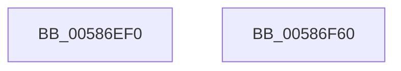

# HvlpWritePerfRegister

- RVA: `0x00586EF0`–`0x00586F61` (길이 `113` bytes)
- VA: `0x0000000140586EF0`
- 실행 섹션: `.text`
- PDB 이름 있음: `예`; PDB Function 태그: `예`
- unwind 정보 RVA: `0x000AF370`
- 디코드: `26`개 명령, `113/113` bytes 표시
- 미해석 바이트: `0` (있으면 어셈블리에 `.byte`로 보존)

> 이 문서는 커널 이미지의 기계어와 PDB 기호를 분석해 생성했습니다. 4번과 5번은 함수 원형과 자료형을 바이너리 사용 방식에서 추정한 C 해석이며 원본 소스 복구 결과는 아닙니다.

## 1. Dependencies

- 직접 호출 지점: **3**; 고유 호출 대상: **3**
- 직접 호출자로 확인된 함수: **2**
- RIP 상대 이미지 참조: **1**

### Outgoing calls
- `0x00586F41` → [HvcallFastExtended](../31/HvcallFastExtended_function_003130E0.md) (function, `0x003130E0`)
- `0x00586F49` → [HvlpHvToNtStatus](../30/HvlpHvToNtStatus_function_00307BD8.md) (function, `0x00307BD8`)
- `0x00586F56` → [_security_check_cookie](../6A/_security_check_cookie_function_006AC640.md) (function, `0x006AC640`)

### Direct callers
- [HvlWritePerfIoPort](HvlWritePerfIoPort_function_00585210.md) at `0x00585264`
- [HvlWritePerfMsr](HvlWritePerfMsr_function_00585280.md) at `0x0058529C`

### Static image references
- `0x00586EF7` → RVA `0x00E0A740` (`.data`; read)

## 2. Other-region calls and transfers

- 다른 실행 섹션으로 향하는 call: **0**
- 별도 외부 분기/꼬리 이동을 확인하지 못했습니다.

## 3. Assembly (complete function range)

```asm
00586EF0  4C 8B DC                        mov r11, rsp
00586EF3  48 83 EC 78                     sub rsp, 0x78
00586EF7  48 8B 05 42 38 88 00            mov rax, qword ptr [rip + 0x883842]
00586EFE  48 33 C4                        xor rax, rsp
00586F01  48 89 44 24 60                  mov qword ptr [rsp + 0x60], rax
00586F06  83 64 24 44 00                  and dword ptr [rsp + 0x44], 0
00586F0B  83 64 24 20 00                  and dword ptr [rsp + 0x20], 0
00586F10  89 4C 24 40                     mov dword ptr [rsp + 0x40], ecx
00586F14  4D 89 4B E0                     mov qword ptr [r11 - 0x20], r9
00586F18  45 33 C9                        xor r9d, r9d
00586F1B  48 C7 44 24 30 1B 00 00 00      mov qword ptr [rsp + 0x30], 0x1b
00586F24  49 89 53 D0                     mov qword ptr [r11 - 0x30], rdx
00586F28  49 8D 53 C8                     lea rdx, [r11 - 0x38]
00586F2C  4D 89 43 D8                     mov qword ptr [r11 - 0x28], r8
00586F30  C7 44 24 30 1B 00 01 00         mov dword ptr [rsp + 0x30], 0x1001b
00586F38  45 8D 41 20                     lea r8d, [r9 + 0x20]
00586F3C  48 8B 4C 24 30                  mov rcx, qword ptr [rsp + 0x30]
00586F41  E8 9A C1 D8 FF                  call 0x1403130e0
00586F46  48 8B C8                        mov rcx, rax
00586F49  E8 8A 0C D8 FF                  call 0x140307bd8
00586F4E  48 8B 4C 24 60                  mov rcx, qword ptr [rsp + 0x60]
00586F53  48 33 CC                        xor rcx, rsp
00586F56  E8 E5 56 12 00                  call 0x1406ac640
00586F5B  48 83 C4 78                     add rsp, 0x78
00586F5F  C3                              ret
00586F60  CC                              int3
```

## 4. C-style interpretation (structured pseudocode)

```c
__int64 __fastcall HvlpWritePerfRegister(int a1, __int64 a2, __int64 a3, __int64 a4)
{
    __int64 result;
    __int64 v_rsp;
    unsigned __int64 v_stack_m18;
    unsigned int v_stack_m34;
    unsigned int v_stack_m38;
    unsigned __int64 v_stack_m48;
    unsigned int v_stack_m58;

    v_rsp = (v_rsp) - (120);
    result = (*(unsigned __int64 *)(v_rip + 8927298)) ^ (v_rsp);
    v_stack_m18 = result;
    v_stack_m38 = a1;
    *(unsigned __int64 *)(v_rsp - 32) = a4;
    a4 = 0;
    v_stack_m48 = 27;
    *(unsigned __int64 *)(v_rsp - 48) = a2;
    *(unsigned __int64 *)(v_rsp - 40) = a3;
    v_stack_m48 = 0x1001BULL;
    result = HvcallFastExtended(v_stack_m48, v_rsp - 56, a4 + 32, a4);
    result = HvlpHvToNtStatus(result, v_rsp - 56, a4 + 32, a4);
    a1 = (v_stack_m18) ^ (v_rsp);
    result = _security_check_cookie(a1, v_rsp - 56, a4 + 32, a4);
    v_rsp = (v_rsp) + (120);
    return result;
}
```

## 5. (Beta) C Style

```c
int64_t HvlpWritePerfRegister(int32_t Arg1, int64_t Arg2, int64_t Arg3, int64_t Arg4)
{
    int64_t result;
    int64_t local_rsp;
    uint64_t v_stack_m18;
    uint32_t v_stack_m34;
    uint32_t v_stack_m38;
    uint64_t v_stack_m48;
    uint32_t v_stack_m58;

    local_rsp = (local_rsp) - (120);
    result = (*(uint64_t *)(v_rip + 0x883842)) ^ (local_rsp);
    v_stack_m18 = result;
    v_stack_m38 = Arg1;
    *(uint64_t *)(local_rsp - 0x20) = Arg4;
    Arg4 = 0;
    v_stack_m48 = 27;
    *(uint64_t *)(local_rsp - 0x30) = Arg2;
    *(uint64_t *)(local_rsp - 0x28) = Arg3;
    v_stack_m48 = 0x1001BULL;
    result = HvcallFastExtended(v_stack_m48, local_rsp - 56, Arg4 + 32, Arg4);
    result = HvlpHvToNtStatus(result, local_rsp - 56, Arg4 + 32, Arg4);
    Arg1 = (v_stack_m18) ^ (local_rsp);
    result = _security_check_cookie(Arg1, local_rsp - 56, Arg4 + 32, Arg4);
    local_rsp = (local_rsp) + (120);
    return result;
}
```

## 6. Execution-region graph

[열기: 2D/3D 그래프와 함수 탐색 컨트롤 패널](../../../control-panel.html?section=text&rva=0x00586EF0&view=graph)

- 2D 그래프는 위에서 아래로 흐르고, 3D 그래프는 빈 공간을 드래그해 회전합니다. Shift+드래그는 이동, 휠은 확대·축소, 함수 노드 선택은 대상 보고서 이동입니다.

### Static fallback


