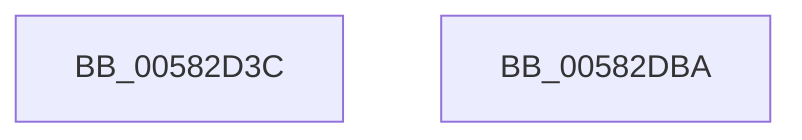

# McTemplateK0jjq_EtwWriteTransfer

- RVA: `0x00582D3C`–`0x00582DBB` (길이 `127` bytes)
- VA: `0x0000000140582D3C`
- 실행 섹션: `.text`
- PDB 이름 있음: `예`; PDB Function 태그: `아니요`
- unwind 정보 RVA: `0x000C618C`
- 디코드: `26`개 명령, `127/127` bytes 표시
- 미해석 바이트: `0` (있으면 어셈블리에 `.byte`로 보존)

> 이 문서는 커널 이미지의 기계어와 PDB 기호를 분석해 생성했습니다. 4번과 5번은 함수 원형과 자료형을 바이너리 사용 방식에서 추정한 C 해석이며 원본 소스 복구 결과는 아닙니다.

## 1. Dependencies

- 직접 호출 지점: **2**; 고유 호출 대상: **2**
- 직접 호출자로 확인된 함수: **1**
- RIP 상대 이미지 참조: **3**

### Outgoing calls
- `0x00582DA0` → [McGenEventWrite_EtwWriteTransfer](../42/McGenEventWrite_EtwWriteTransfer_function_00424FC8.md) (function, `0x00424FC8`)
- `0x00582DAD` → [_security_check_cookie](../6A/_security_check_cookie_function_006AC640.md) (function, `0x006AC640`)

### Direct callers
- [FsRtlDedupChangeUninit](../../page/71/FsRtlDedupChangeUninit_function_00715D40.md) at `0x00715DDA`

### Static image references
- `0x00582D46` → RVA `0x00E0A740` (`.data`; read)
- `0x00582D5D` → RVA `0x000263E0` (`.rdata`; read)
- `0x00582D68` → RVA `0x00E06C90` (`.data`; read)

## 2. Other-region calls and transfers

- 다른 실행 섹션으로 향하는 call: **0**
- 별도 외부 분기/꼬리 이동을 확인하지 못했습니다.

## 3. Assembly (complete function range)

```asm
00582D3C  4C 8B DC                        mov r11, rsp
00582D3F  48 81 EC 88 00 00 00            sub rsp, 0x88
00582D46  48 8B 05 F3 79 88 00            mov rax, qword ptr [rip + 0x8879f3]
00582D4D  48 33 C4                        xor rax, rsp
00582D50  48 89 44 24 70                  mov qword ptr [rsp + 0x70], rax
00582D55  48 8B 84 24 B0 00 00 00         mov rax, qword ptr [rsp + 0xb0]
00582D5D  48 8D 15 7C 36 AA FF            lea rdx, [rip - 0x55c984]
00582D64  49 89 43 C8                     mov qword ptr [r11 - 0x38], rax
00582D68  48 8D 0D 21 3F 88 00            lea rcx, [rip + 0x883f21]
00582D6F  49 8D 43 30                     lea rax, [r11 + 0x30]
00582D73  4D 89 4B B8                     mov qword ptr [r11 - 0x48], r9
00582D77  49 89 43 D8                     mov qword ptr [r11 - 0x28], rax
00582D7B  41 B9 04 00 00 00               mov r9d, 4
00582D81  49 8D 43 A8                     lea rax, [r11 - 0x58]
00582D85  49 C7 43 C0 10 00 00 00         mov qword ptr [r11 - 0x40], 0x10
00582D8D  45 33 C0                        xor r8d, r8d
00582D90  49 89 43 98                     mov qword ptr [r11 - 0x68], rax
00582D94  49 C7 43 D0 10 00 00 00         mov qword ptr [r11 - 0x30], 0x10
00582D9C  4D 89 4B E0                     mov qword ptr [r11 - 0x20], r9
00582DA0  E8 23 22 EA FF                  call 0x140424fc8
00582DA5  48 8B 4C 24 70                  mov rcx, qword ptr [rsp + 0x70]
00582DAA  48 33 CC                        xor rcx, rsp
00582DAD  E8 8E 98 12 00                  call 0x1406ac640
00582DB2  48 81 C4 88 00 00 00            add rsp, 0x88
00582DB9  C3                              ret
00582DBA  CC                              int3
```

## 4. C-style interpretation (structured pseudocode)

```c
__int64 __fastcall McTemplateK0jjq_EtwWriteTransfer(__int64 a1, __int64 a2, int a3, __int64 a4, __int64 a5)
{
    __int64 result;
    __int64 v_rsp;
    unsigned __int64 v_stack_m18;

    v_rsp = (v_rsp) - (136);
    result = (*(unsigned __int64 *)(v_rip + 8944115)) ^ (v_rsp);
    v_stack_m18 = result;
    *(unsigned __int64 *)(v_rsp - 56) = a5;
    *(unsigned __int64 *)(v_rsp - 72) = a4;
    *(unsigned __int64 *)(v_rsp - 40) = v_rsp + 48;
    *(unsigned __int64 *)(v_rsp - 64) = 16;
    a3 = 0;
    *(unsigned __int64 *)(v_rsp - 104) = v_rsp - 88;
    *(unsigned __int64 *)(v_rsp - 48) = 16;
    *(unsigned __int64 *)(v_rsp - 32) = 4;
    result = McGenEventWrite_EtwWriteTransfer(v_rip + 8929057, v_rip - 5622148, a3, 4);
    a1 = (v_stack_m18) ^ (v_rsp);
    result = _security_check_cookie(a1, v_rip - 5622148, a3, 4);
    v_rsp = (v_rsp) + (136);
    return result;
}
```

## 5. (Beta) C Style

```c
int64_t McTemplateK0jjq_EtwWriteTransfer(int64_t Arg1, int64_t Arg2, int32_t Arg3, int64_t Arg4, int64_t Arg5)
{
    int64_t result;
    int64_t local_rsp;
    uint64_t v_stack_m18;

    local_rsp = (local_rsp) - (136);
    result = (*(uint64_t *)(v_rip + 0x8879F3)) ^ (local_rsp);
    v_stack_m18 = result;
    *(uint64_t *)(local_rsp - 0x38) = Arg5;
    *(uint64_t *)(local_rsp - 0x48) = Arg4;
    *(uint64_t *)(local_rsp - 0x28) = local_rsp + 48;
    *(uint64_t *)(local_rsp - 0x40) = 16;
    Arg3 = 0;
    *(uint64_t *)(local_rsp - 0x68) = local_rsp - 88;
    *(uint64_t *)(local_rsp - 0x30) = 16;
    *(uint64_t *)(local_rsp - 0x20) = 4;
    result = McGenEventWrite_EtwWriteTransfer(v_rip + 8929057, v_rip - 5622148, Arg3, 4);
    Arg1 = (v_stack_m18) ^ (local_rsp);
    result = _security_check_cookie(Arg1, v_rip - 5622148, Arg3, 4);
    local_rsp = (local_rsp) + (136);
    return result;
}
```

## 6. Execution-region graph

[열기: 2D/3D 그래프와 함수 탐색 컨트롤 패널](../../../control-panel.html?section=text&rva=0x00582D3C&view=graph)

- 2D 그래프는 위에서 아래로 흐르고, 3D 그래프는 빈 공간을 드래그해 회전합니다. Shift+드래그는 이동, 휠은 확대·축소, 함수 노드 선택은 대상 보고서 이동입니다.

### Static fallback


