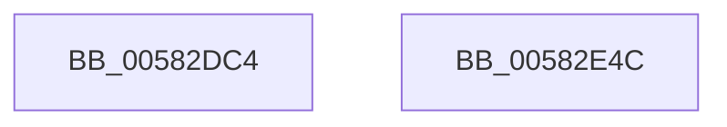

# McTemplateK0jjtq_EtwWriteTransfer

- RVA: `0x00582DC4`–`0x00582E4D` (길이 `137` bytes)
- VA: `0x0000000140582DC4`
- 실행 섹션: `.text`
- PDB 이름 있음: `예`; PDB Function 태그: `아니요`
- unwind 정보 RVA: `0x000BD7A0`
- 디코드: `29`개 명령, `137/137` bytes 표시
- 미해석 바이트: `0` (있으면 어셈블리에 `.byte`로 보존)

> 이 문서는 커널 이미지의 기계어와 PDB 기호를 분석해 생성했습니다. 4번과 5번은 함수 원형과 자료형을 바이너리 사용 방식에서 추정한 C 해석이며 원본 소스 복구 결과는 아닙니다.

## 1. Dependencies

- 직접 호출 지점: **2**; 고유 호출 대상: **2**
- 직접 호출자로 확인된 함수: **2**
- RIP 상대 이미지 참조: **2**

### Outgoing calls
- `0x00582E32` → [McGenEventWrite_EtwWriteTransfer](../42/McGenEventWrite_EtwWriteTransfer_function_00424FC8.md) (function, `0x00424FC8`)
- `0x00582E3E` → [_security_check_cookie](../6A/_security_check_cookie_function_006AC640.md) (function, `0x006AC640`)

### Direct callers
- [FsRtlpDedupChangeEventsControlCallbackV2](FsRtlpDedupChangeEventsControlCallbackV2_function_00582C00.md) at `0x00582D0E`
- [FsRtlpDedupChangeRegisterVolume](../../page/71/FsRtlpDedupChangeRegisterVolume_function_00715F70.md) at `0x007160EC`

### Static image references
- `0x00582DD2` → RVA `0x00E0A740` (`.data`; read)
- `0x00582DE4` → RVA `0x000263F0` (`.rdata`; read)

## 2. Other-region calls and transfers

- 다른 실행 섹션으로 향하는 call: **0**
- 별도 외부 분기/꼬리 이동을 확인하지 못했습니다.

## 3. Assembly (complete function range)

```asm
00582DC4  40 55                           push rbp
00582DC6  48 8D 6C 24 C1                  lea rbp, [rsp - 0x3f]
00582DCB  48 81 EC 90 00 00 00            sub rsp, 0x90
00582DD2  48 8B 05 67 79 88 00            mov rax, qword ptr [rip + 0x887967]
00582DD9  48 33 C4                        xor rax, rsp
00582DDC  48 89 45 2F                     mov qword ptr [rbp + 0x2f], rax
00582DE0  48 8B 45 6F                     mov rax, qword ptr [rbp + 0x6f]
00582DE4  48 8D 15 05 36 AA FF            lea rdx, [rip - 0x55c9fb]
00582DEB  48 89 45 FF                     mov qword ptr [rbp - 1], rax
00582DEF  48 8D 45 77                     lea rax, [rbp + 0x77]
00582DF3  48 89 45 0F                     mov qword ptr [rbp + 0xf], rax
00582DF7  48 8D 45 7F                     lea rax, [rbp + 0x7f]
00582DFB  48 89 45 1F                     mov qword ptr [rbp + 0x1f], rax
00582DFF  48 8D 45 DF                     lea rax, [rbp - 0x21]
00582E03  4C 89 4D EF                     mov qword ptr [rbp - 0x11], r9
00582E07  41 B9 05 00 00 00               mov r9d, 5
00582E0D  48 89 44 24 20                  mov qword ptr [rsp + 0x20], rax
00582E12  48 C7 45 F7 10 00 00 00         mov qword ptr [rbp - 9], 0x10
00582E1A  48 C7 45 07 10 00 00 00         mov qword ptr [rbp + 7], 0x10
00582E22  48 C7 45 17 04 00 00 00         mov qword ptr [rbp + 0x17], 4
00582E2A  48 C7 45 27 04 00 00 00         mov qword ptr [rbp + 0x27], 4
00582E32  E8 91 21 EA FF                  call 0x140424fc8
00582E37  48 8B 4D 2F                     mov rcx, qword ptr [rbp + 0x2f]
00582E3B  48 33 CC                        xor rcx, rsp
00582E3E  E8 FD 97 12 00                  call 0x1406ac640
00582E43  48 81 C4 90 00 00 00            add rsp, 0x90
00582E4A  5D                              pop rbp
00582E4B  C3                              ret
00582E4C  CC                              int3
```

## 4. C-style interpretation (structured pseudocode)

```c
__int64 __fastcall McTemplateK0jjtq_EtwWriteTransfer(__int64 a1, __int64 a2, __int64 a3, __int64 a4, __int64 a5, __int64 a6, __int64 a7)
{
    __int64 result;
    __int64 v_rsp;
    unsigned __int64 v_stack_m18;
    unsigned __int64 v_stack_m20;
    unsigned __int64 v_stack_m28;
    unsigned __int64 v_stack_m30;
    unsigned __int64 v_stack_m38;
    unsigned __int64 v_stack_m40;
    unsigned __int64 v_stack_m47;
    unsigned __int64 v_stack_m48;
    unsigned __int64 v_stack_m50;
    unsigned __int64 v_stack_m58;
    unsigned __int64 v_stack_m68;
    unsigned __int64 v_stack_m78;

    v_rsp = (v_rsp) - (144);
    result = (*(unsigned __int64 *)(v_rip + 8943975)) ^ (v_rsp);
    v_stack_m18 = result;
    v_stack_m48 = a5;
    v_stack_m38 = a6;
    v_stack_m28 = a7;
    v_stack_m58 = a4;
    v_stack_m78 = v_stack_m68;
    v_stack_m50 = 16;
    v_stack_m40 = 16;
    v_stack_m30 = 4;
    v_stack_m20 = 4;
    result = McGenEventWrite_EtwWriteTransfer(a1, v_rip - 5622267, a3, 5);
    a1 = (v_stack_m18) ^ (v_rsp);
    result = _security_check_cookie(a1, v_rip - 5622267, a3, 5);
    v_rsp = (v_rsp) + (144);
    return result;
}
```

## 5. (Beta) C Style

```c
int64_t McTemplateK0jjtq_EtwWriteTransfer(int64_t Arg1, int64_t Arg2, int64_t Arg3, int64_t Arg4, int64_t Arg5, int64_t Arg6, int64_t Arg7)
{
    int64_t result;
    int64_t local_rsp;
    uint64_t v_stack_m18;
    uint64_t v_stack_m20;
    uint64_t v_stack_m28;
    uint64_t v_stack_m30;
    uint64_t v_stack_m38;
    uint64_t v_stack_m40;
    uint64_t v_stack_m47;
    uint64_t v_stack_m48;
    uint64_t v_stack_m50;
    uint64_t v_stack_m58;
    uint64_t v_stack_m68;
    uint64_t v_stack_m78;

    local_rsp = (local_rsp) - (144);
    result = (*(uint64_t *)(v_rip + 0x887967)) ^ (local_rsp);
    v_stack_m18 = result;
    v_stack_m48 = Arg5;
    v_stack_m38 = Arg6;
    v_stack_m28 = Arg7;
    v_stack_m58 = Arg4;
    v_stack_m78 = v_stack_m68;
    v_stack_m50 = 16;
    v_stack_m40 = 16;
    v_stack_m30 = 4;
    v_stack_m20 = 4;
    result = McGenEventWrite_EtwWriteTransfer(Arg1, v_rip - 5622267, Arg3, 5);
    Arg1 = (v_stack_m18) ^ (local_rsp);
    result = _security_check_cookie(Arg1, v_rip - 5622267, Arg3, 5);
    local_rsp = (local_rsp) + (144);
    return result;
}
```

## 6. Execution-region graph

[열기: 2D/3D 그래프와 함수 탐색 컨트롤 패널](../../../control-panel.html?section=text&rva=0x00582DC4&view=graph)

- 2D 그래프는 위에서 아래로 흐르고, 3D 그래프는 빈 공간을 드래그해 회전합니다. Shift+드래그는 이동, 휠은 확대·축소, 함수 노드 선택은 대상 보고서 이동입니다.

### Static fallback


