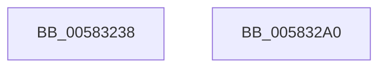

# McTemplateK0jq_EtwWriteTransfer

- RVA: `0x00583238`–`0x005832A1` (길이 `105` bytes)
- VA: `0x0000000140583238`
- 실행 섹션: `.text`
- PDB 이름 있음: `예`; PDB Function 태그: `아니요`
- unwind 정보 RVA: `0x000AF370`
- 디코드: `23`개 명령, `105/105` bytes 표시
- 미해석 바이트: `0` (있으면 어셈블리에 `.byte`로 보존)

> 이 문서는 커널 이미지의 기계어와 PDB 기호를 분석해 생성했습니다. 4번과 5번은 함수 원형과 자료형을 바이너리 사용 방식에서 추정한 C 해석이며 원본 소스 복구 결과는 아닙니다.

## 1. Dependencies

- 직접 호출 지점: **2**; 고유 호출 대상: **2**
- 직접 호출자로 확인된 함수: **2**
- RIP 상대 이미지 참조: **2**

### Outgoing calls
- `0x00583289` → [McGenEventWrite_EtwWriteTransfer](../42/McGenEventWrite_EtwWriteTransfer_function_00424FC8.md) (function, `0x00424FC8`)
- `0x00583296` → [_security_check_cookie](../6A/_security_check_cookie_function_006AC640.md) (function, `0x006AC640`)

### Direct callers
- [FsRtlpTieringHeatEventsControlCallbackV2](FsRtlpTieringHeatEventsControlCallbackV2_function_00583110.md) at `0x0058320A`
- [FsRtlpHeatRegisterVolume](../../page/71/FsRtlpHeatRegisterVolume_function_0071696C.md) at `0x00716AC9`

### Static image references
- `0x0058323F` → RVA `0x00E0A740` (`.data`; read)
- `0x0058325B` → RVA `0x000263F0` (`.rdata`; read)

## 2. Other-region calls and transfers

- 다른 실행 섹션으로 향하는 call: **0**
- 별도 외부 분기/꼬리 이동을 확인하지 못했습니다.

## 3. Assembly (complete function range)

```asm
00583238  4C 8B DC                        mov r11, rsp
0058323B  48 83 EC 78                     sub rsp, 0x78
0058323F  48 8B 05 FA 74 88 00            mov rax, qword ptr [rip + 0x8874fa]
00583246  48 33 C4                        xor rax, rsp
00583249  48 89 44 24 60                  mov qword ptr [rsp + 0x60], rax
0058324E  4D 89 4B C8                     mov qword ptr [r11 - 0x38], r9
00583252  49 8D 43 28                     lea rax, [r11 + 0x28]
00583256  83 64 24 4C 00                  and dword ptr [rsp + 0x4c], 0
0058325B  48 8D 15 8E 31 AA FF            lea rdx, [rip - 0x55ce72]
00583262  C7 44 24 48 10 00 00 00         mov dword ptr [rsp + 0x48], 0x10
0058326A  41 B9 03 00 00 00               mov r9d, 3
00583270  49 89 43 D8                     mov qword ptr [r11 - 0x28], rax
00583274  49 8D 43 B8                     lea rax, [r11 - 0x48]
00583278  83 64 24 5C 00                  and dword ptr [rsp + 0x5c], 0
0058327D  49 89 43 A8                     mov qword ptr [r11 - 0x58], rax
00583281  C7 44 24 58 04 00 00 00         mov dword ptr [rsp + 0x58], 4
00583289  E8 3A 1D EA FF                  call 0x140424fc8
0058328E  48 8B 4C 24 60                  mov rcx, qword ptr [rsp + 0x60]
00583293  48 33 CC                        xor rcx, rsp
00583296  E8 A5 93 12 00                  call 0x1406ac640
0058329B  48 83 C4 78                     add rsp, 0x78
0058329F  C3                              ret
005832A0  CC                              int3
```

## 4. C-style interpretation (structured pseudocode)

```c
__int64 __fastcall McTemplateK0jq_EtwWriteTransfer(__int64 a1, __int64 a2, __int64 a3, __int64 a4)
{
    __int64 result;
    __int64 v_rsp;
    unsigned __int64 v_stack_m18;
    unsigned int v_stack_m1C;
    unsigned int v_stack_m20;
    unsigned int v_stack_m2C;
    unsigned int v_stack_m30;

    v_rsp = (v_rsp) - (120);
    result = (*(unsigned __int64 *)(v_rip + 8942842)) ^ (v_rsp);
    v_stack_m18 = result;
    *(unsigned __int64 *)(v_rsp - 56) = a4;
    v_stack_m30 = 16;
    *(unsigned __int64 *)(v_rsp - 40) = v_rsp + 40;
    *(unsigned __int64 *)(v_rsp - 88) = v_rsp - 72;
    v_stack_m20 = 4;
    result = McGenEventWrite_EtwWriteTransfer(a1, v_rip - 5623410, a3, 3);
    a1 = (v_stack_m18) ^ (v_rsp);
    result = _security_check_cookie(a1, v_rip - 5623410, a3, 3);
    v_rsp = (v_rsp) + (120);
    return result;
}
```

## 5. (Beta) C Style

```c
int64_t McTemplateK0jq_EtwWriteTransfer(int64_t Arg1, int64_t Arg2, int64_t Arg3, int64_t Arg4)
{
    int64_t result;
    int64_t local_rsp;
    uint64_t v_stack_m18;
    uint32_t v_stack_m1C;
    uint32_t v_stack_m20;
    uint32_t v_stack_m2C;
    uint32_t v_stack_m30;

    local_rsp = (local_rsp) - (120);
    result = (*(uint64_t *)(v_rip + 0x8874FA)) ^ (local_rsp);
    v_stack_m18 = result;
    *(uint64_t *)(local_rsp - 0x38) = Arg4;
    v_stack_m30 = 16;
    *(uint64_t *)(local_rsp - 0x28) = local_rsp + 40;
    *(uint64_t *)(local_rsp - 0x58) = local_rsp - 72;
    v_stack_m20 = 4;
    result = McGenEventWrite_EtwWriteTransfer(Arg1, v_rip - 5623410, Arg3, 3);
    Arg1 = (v_stack_m18) ^ (local_rsp);
    result = _security_check_cookie(Arg1, v_rip - 5623410, Arg3, 3);
    local_rsp = (local_rsp) + (120);
    return result;
}
```

## 6. Execution-region graph

[열기: 2D/3D 그래프와 함수 탐색 컨트롤 패널](../../../control-panel.html?section=text&rva=0x00583238&view=graph)

- 2D 그래프는 위에서 아래로 흐르고, 3D 그래프는 빈 공간을 드래그해 회전합니다. Shift+드래그는 이동, 휠은 확대·축소, 함수 노드 선택은 대상 보고서 이동입니다.

### Static fallback


