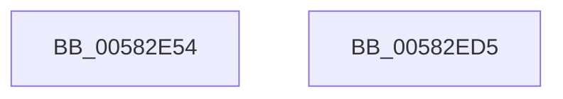

# McTemplateK0xxq_EtwWriteTransfer

- RVA: `0x00582E54`–`0x00582ED6` (길이 `130` bytes)
- VA: `0x0000000140582E54`
- 실행 섹션: `.text`
- PDB 이름 있음: `예`; PDB Function 태그: `아니요`
- unwind 정보 RVA: `0x000C6178`
- 디코드: `29`개 명령, `130/130` bytes 표시
- 미해석 바이트: `0` (있으면 어셈블리에 `.byte`로 보존)

> 이 문서는 커널 이미지의 기계어와 PDB 기호를 분석해 생성했습니다. 4번과 5번은 함수 원형과 자료형을 바이너리 사용 방식에서 추정한 C 해석이며 원본 소스 복구 결과는 아닙니다.

## 1. Dependencies

- 직접 호출 지점: **2**; 고유 호출 대상: **2**
- 직접 호출자로 확인된 함수: **1**
- RIP 상대 이미지 참조: **3**

### Outgoing calls
- `0x00582EBB` → [McGenEventWrite_EtwWriteTransfer](../42/McGenEventWrite_EtwWriteTransfer_function_00424FC8.md) (function, `0x00424FC8`)
- `0x00582EC7` → [_security_check_cookie](../6A/_security_check_cookie_function_006AC640.md) (function, `0x006AC640`)

### Direct callers
- [FsRtlDedupChangeLogOverwriteOrFree](../../page/71/FsRtlDedupChangeLogOverwriteOrFree_function_00715C90.md) at `0x00715CB1`

### Static image references
- `0x00582E64` → RVA `0x00E0A740` (`.data`; read)
- `0x00582E82` → RVA `0x000263D0` (`.rdata`; read)
- `0x00582E99` → RVA `0x00E06C90` (`.data`; read)

## 2. Other-region calls and transfers

- 다른 실행 섹션으로 향하는 call: **0**
- 별도 외부 분기/꼬리 이동을 확인하지 못했습니다.

## 3. Assembly (complete function range)

```asm
00582E54  4C 89 4C 24 20                  mov qword ptr [rsp + 0x20], r9
00582E59  55                              push rbp
00582E5A  48 8B EC                        mov rbp, rsp
00582E5D  48 81 EC 80 00 00 00            sub rsp, 0x80
00582E64  48 8B 05 D5 78 88 00            mov rax, qword ptr [rip + 0x8878d5]
00582E6B  48 33 C4                        xor rax, rsp
00582E6E  48 89 45 F0                     mov qword ptr [rbp - 0x10], rax
00582E72  48 8D 45 28                     lea rax, [rbp + 0x28]
00582E76  48 C7 45 C8 08 00 00 00         mov qword ptr [rbp - 0x38], 8
00582E7E  48 89 45 C0                     mov qword ptr [rbp - 0x40], rax
00582E82  48 8D 15 47 35 AA FF            lea rdx, [rip - 0x55cab9]
00582E89  48 8D 45 30                     lea rax, [rbp + 0x30]
00582E8D  48 C7 45 D8 08 00 00 00         mov qword ptr [rbp - 0x28], 8
00582E95  48 89 45 D0                     mov qword ptr [rbp - 0x30], rax
00582E99  48 8D 0D F0 3D 88 00            lea rcx, [rip + 0x883df0]
00582EA0  48 8D 45 38                     lea rax, [rbp + 0x38]
00582EA4  41 B9 04 00 00 00               mov r9d, 4
00582EAA  48 89 45 E0                     mov qword ptr [rbp - 0x20], rax
00582EAE  48 8D 45 B0                     lea rax, [rbp - 0x50]
00582EB2  48 89 44 24 20                  mov qword ptr [rsp + 0x20], rax
00582EB7  4C 89 4D E8                     mov qword ptr [rbp - 0x18], r9
00582EBB  E8 08 21 EA FF                  call 0x140424fc8
00582EC0  48 8B 4D F0                     mov rcx, qword ptr [rbp - 0x10]
00582EC4  48 33 CC                        xor rcx, rsp
00582EC7  E8 74 97 12 00                  call 0x1406ac640
00582ECC  48 81 C4 80 00 00 00            add rsp, 0x80
00582ED3  5D                              pop rbp
00582ED4  C3                              ret
00582ED5  CC                              int3
```

## 4. C-style interpretation (structured pseudocode)

```c
__int64 __fastcall McTemplateK0xxq_EtwWriteTransfer(__int64 a1, __int64 a2, __int64 a3, __int64 a4, __int64 a5, __int64 a6)
{
    __int64 result;
    __int64 v_rsp;
    unsigned __int64 v_stack_m18;
    unsigned __int64 v_stack_m20;
    unsigned __int64 v_stack_m28;
    unsigned __int64 v_stack_m30;
    unsigned __int64 v_stack_m38;
    unsigned __int64 v_stack_m40;
    unsigned __int64 v_stack_m48;
    unsigned __int64 v_stack_m58;
    unsigned __int64 v_stack_m68;
    unsigned __int64 v_stack_p20;

    v_stack_p20 = a4;
    v_rsp = (v_rsp) - (128);
    result = (*(unsigned __int64 *)(v_rip + 8943829)) ^ (v_rsp);
    v_stack_m18 = result;
    v_stack_m40 = 8;
    v_stack_m48 = v_stack_p20;
    v_stack_m30 = 8;
    v_stack_m38 = a5;
    v_stack_m28 = a6;
    v_stack_m68 = v_stack_m58;
    v_stack_m20 = 4;
    result = McGenEventWrite_EtwWriteTransfer(v_rip + 8928752, v_rip - 5622457, a3, 4);
    a1 = (v_stack_m18) ^ (v_rsp);
    result = _security_check_cookie(a1, v_rip - 5622457, a3, 4);
    v_rsp = (v_rsp) + (128);
    return result;
}
```

## 5. (Beta) C Style

```c
int64_t McTemplateK0xxq_EtwWriteTransfer(int64_t Arg1, int64_t Arg2, int64_t Arg3, int64_t Arg4, int64_t Arg5, int64_t Arg6)
{
    int64_t result;
    int64_t local_rsp;
    uint64_t v_stack_m18;
    uint64_t v_stack_m20;
    uint64_t v_stack_m28;
    uint64_t v_stack_m30;
    uint64_t v_stack_m38;
    uint64_t v_stack_m40;
    uint64_t v_stack_m48;
    uint64_t v_stack_m58;
    uint64_t v_stack_m68;
    uint64_t v_stack_p20;

    v_stack_p20 = Arg4;
    local_rsp = (local_rsp) - (128);
    result = (*(uint64_t *)(v_rip + 0x8878D5)) ^ (local_rsp);
    v_stack_m18 = result;
    v_stack_m40 = 8;
    v_stack_m48 = v_stack_p20;
    v_stack_m30 = 8;
    v_stack_m38 = Arg5;
    v_stack_m28 = Arg6;
    v_stack_m68 = v_stack_m58;
    v_stack_m20 = 4;
    result = McGenEventWrite_EtwWriteTransfer(v_rip + 8928752, v_rip - 5622457, Arg3, 4);
    Arg1 = (v_stack_m18) ^ (local_rsp);
    result = _security_check_cookie(Arg1, v_rip - 5622457, Arg3, 4);
    local_rsp = (local_rsp) + (128);
    return result;
}
```

## 6. Execution-region graph

[열기: 2D/3D 그래프와 함수 탐색 컨트롤 패널](../../../control-panel.html?section=text&rva=0x00582E54&view=graph)

- 2D 그래프는 위에서 아래로 흐르고, 3D 그래프는 빈 공간을 드래그해 회전합니다. Shift+드래그는 이동, 휠은 확대·축소, 함수 노드 선택은 대상 보고서 이동입니다.

### Static fallback


