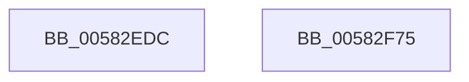

# McTemplateK0xxxqq_EtwWriteTransfer

- RVA: `0x00582EDC`–`0x00582F76` (길이 `154` bytes)
- VA: `0x0000000140582EDC`
- 실행 섹션: `.text`
- PDB 이름 있음: `예`; PDB Function 태그: `아니요`
- unwind 정보 RVA: `0x000C6160`
- 디코드: `33`개 명령, `154/154` bytes 표시
- 미해석 바이트: `0` (있으면 어셈블리에 `.byte`로 보존)

> 이 문서는 커널 이미지의 기계어와 PDB 기호를 분석해 생성했습니다. 4번과 5번은 함수 원형과 자료형을 바이너리 사용 방식에서 추정한 C 해석이며 원본 소스 복구 결과는 아닙니다.

## 1. Dependencies

- 직접 호출 지점: **2**; 고유 호출 대상: **2**
- 직접 호출자로 확인된 함수: **2**
- RIP 상대 이미지 참조: **1**

### Outgoing calls
- `0x00582F5B` → [McGenEventWrite_EtwWriteTransfer](../42/McGenEventWrite_EtwWriteTransfer_function_00424FC8.md) (function, `0x00424FC8`)
- `0x00582F67` → [_security_check_cookie](../6A/_security_check_cookie_function_006AC640.md) (function, `0x006AC640`)

### Direct callers
- [FsRtlDedupChangeLogWrite](../../page/71/FsRtlDedupChangeLogWrite_function_00715CD0.md) at `0x00715D27`
- [FsRtlHeatLogIo](../../page/71/FsRtlHeatLogIo_function_007167E0.md) at `0x007168AB`

### Static image references
- `0x00582EEE` → RVA `0x00E0A740` (`.data`; read)

## 2. Other-region calls and transfers

- 다른 실행 섹션으로 향하는 call: **0**
- 별도 외부 분기/꼬리 이동을 확인하지 못했습니다.

## 3. Assembly (complete function range)

```asm
00582EDC  4C 89 4C 24 20                  mov qword ptr [rsp + 0x20], r9
00582EE1  55                              push rbp
00582EE2  48 8D 6C 24 C9                  lea rbp, [rsp - 0x37]
00582EE7  48 81 EC A0 00 00 00            sub rsp, 0xa0
00582EEE  48 8B 05 4B 78 88 00            mov rax, qword ptr [rip + 0x88784b]
00582EF5  48 33 C4                        xor rax, rsp
00582EF8  48 89 45 27                     mov qword ptr [rbp + 0x27], rax
00582EFC  48 8D 45 5F                     lea rax, [rbp + 0x5f]
00582F00  48 C7 45 DF 08 00 00 00         mov qword ptr [rbp - 0x21], 8
00582F08  48 89 45 D7                     mov qword ptr [rbp - 0x29], rax
00582F0C  41 B9 06 00 00 00               mov r9d, 6
00582F12  48 8D 45 67                     lea rax, [rbp + 0x67]
00582F16  48 C7 45 EF 08 00 00 00         mov qword ptr [rbp - 0x11], 8
00582F1E  48 89 45 E7                     mov qword ptr [rbp - 0x19], rax
00582F22  48 8D 45 6F                     lea rax, [rbp + 0x6f]
00582F26  48 89 45 F7                     mov qword ptr [rbp - 9], rax
00582F2A  48 8D 45 77                     lea rax, [rbp + 0x77]
00582F2E  48 89 45 07                     mov qword ptr [rbp + 7], rax
00582F32  48 8D 45 7F                     lea rax, [rbp + 0x7f]
00582F36  48 89 45 17                     mov qword ptr [rbp + 0x17], rax
00582F3A  48 8D 45 C7                     lea rax, [rbp - 0x39]
00582F3E  48 89 44 24 20                  mov qword ptr [rsp + 0x20], rax
00582F43  48 C7 45 FF 08 00 00 00         mov qword ptr [rbp - 1], 8
00582F4B  48 C7 45 0F 04 00 00 00         mov qword ptr [rbp + 0xf], 4
00582F53  48 C7 45 1F 04 00 00 00         mov qword ptr [rbp + 0x1f], 4
00582F5B  E8 68 20 EA FF                  call 0x140424fc8
00582F60  48 8B 4D 27                     mov rcx, qword ptr [rbp + 0x27]
00582F64  48 33 CC                        xor rcx, rsp
00582F67  E8 D4 96 12 00                  call 0x1406ac640
00582F6C  48 81 C4 A0 00 00 00            add rsp, 0xa0
00582F73  5D                              pop rbp
00582F74  C3                              ret
00582F75  CC                              int3
```

## 4. C-style interpretation (structured pseudocode)

```c
__int64 __fastcall McTemplateK0xxxqq_EtwWriteTransfer(__int64 a1, __int64 a2, __int64 a3, __int64 a4, __int64 a5, __int64 a6, __int64 a7, __int64 a8)
{
    __int64 result;
    __int64 v_rsp;
    unsigned __int64 v_stack_m18;
    unsigned __int64 v_stack_m20;
    unsigned __int64 v_stack_m28;
    unsigned __int64 v_stack_m30;
    unsigned __int64 v_stack_m38;
    unsigned __int64 v_stack_m3F;
    unsigned __int64 v_stack_m40;
    unsigned __int64 v_stack_m48;
    unsigned __int64 v_stack_m50;
    unsigned __int64 v_stack_m58;
    unsigned __int64 v_stack_m60;
    unsigned __int64 v_stack_m68;
    unsigned __int64 v_stack_m78;
    unsigned __int64 v_stack_m88;
    unsigned __int64 v_stack_p20;

    v_stack_p20 = a4;
    v_rsp = (v_rsp) - (160);
    result = (*(unsigned __int64 *)(v_rip + 8943691)) ^ (v_rsp);
    v_stack_m18 = result;
    v_stack_m60 = 8;
    v_stack_m68 = v_stack_p20;
    v_stack_m50 = 8;
    v_stack_m58 = a5;
    v_stack_m48 = a6;
    v_stack_m38 = a7;
    v_stack_m28 = a8;
    v_stack_m88 = v_stack_m78;
    v_stack_m40 = 8;
    v_stack_m30 = 4;
    v_stack_m20 = 4;
    result = McGenEventWrite_EtwWriteTransfer(a1, a2, a3, 6);
    a1 = (v_stack_m18) ^ (v_rsp);
    result = _security_check_cookie(a1, a2, a3, 6);
    v_rsp = (v_rsp) + (160);
    return result;
}
```

## 5. (Beta) C Style

```c
int64_t McTemplateK0xxxqq_EtwWriteTransfer(int64_t Arg1, int64_t Arg2, int64_t Arg3, int64_t Arg4, int64_t Arg5, int64_t Arg6, int64_t Arg7, int64_t Arg8)
{
    int64_t result;
    int64_t local_rsp;
    uint64_t v_stack_m18;
    uint64_t v_stack_m20;
    uint64_t v_stack_m28;
    uint64_t v_stack_m30;
    uint64_t v_stack_m38;
    uint64_t v_stack_m3F;
    uint64_t v_stack_m40;
    uint64_t v_stack_m48;
    uint64_t v_stack_m50;
    uint64_t v_stack_m58;
    uint64_t v_stack_m60;
    uint64_t v_stack_m68;
    uint64_t v_stack_m78;
    uint64_t v_stack_m88;
    uint64_t v_stack_p20;

    v_stack_p20 = Arg4;
    local_rsp = (local_rsp) - (160);
    result = (*(uint64_t *)(v_rip + 0x88784B)) ^ (local_rsp);
    v_stack_m18 = result;
    v_stack_m60 = 8;
    v_stack_m68 = v_stack_p20;
    v_stack_m50 = 8;
    v_stack_m58 = Arg5;
    v_stack_m48 = Arg6;
    v_stack_m38 = Arg7;
    v_stack_m28 = Arg8;
    v_stack_m88 = v_stack_m78;
    v_stack_m40 = 8;
    v_stack_m30 = 4;
    v_stack_m20 = 4;
    result = McGenEventWrite_EtwWriteTransfer(Arg1, Arg2, Arg3, 6);
    Arg1 = (v_stack_m18) ^ (local_rsp);
    result = _security_check_cookie(Arg1, Arg2, Arg3, 6);
    local_rsp = (local_rsp) + (160);
    return result;
}
```

## 6. Execution-region graph

[열기: 2D/3D 그래프와 함수 탐색 컨트롤 패널](../../../control-panel.html?section=text&rva=0x00582EDC&view=graph)

- 2D 그래프는 위에서 아래로 흐르고, 3D 그래프는 빈 공간을 드래그해 회전합니다. Shift+드래그는 이동, 휠은 확대·축소, 함수 노드 선택은 대상 보고서 이동입니다.

### Static fallback


