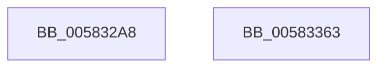

# McTemplateK0xxxqqqq_EtwWriteTransfer

- RVA: `0x005832A8`–`0x00583364` (길이 `188` bytes)
- VA: `0x00000001405832A8`
- 실행 섹션: `.text`
- PDB 이름 있음: `예`; PDB Function 태그: `아니요`
- unwind 정보 RVA: `0x0006CFB4`
- 디코드: `41`개 명령, `188/188` bytes 표시
- 미해석 바이트: `0` (있으면 어셈블리에 `.byte`로 보존)

> 이 문서는 커널 이미지의 기계어와 PDB 기호를 분석해 생성했습니다. 4번과 5번은 함수 원형과 자료형을 바이너리 사용 방식에서 추정한 C 해석이며 원본 소스 복구 결과는 아닙니다.

## 1. Dependencies

- 직접 호출 지점: **2**; 고유 호출 대상: **2**
- 직접 호출자로 확인된 함수: **1**
- RIP 상대 이미지 참조: **3**

### Outgoing calls
- `0x00583349` → [McGenEventWrite_EtwWriteTransfer](../42/McGenEventWrite_EtwWriteTransfer_function_00424FC8.md) (function, `0x00424FC8`)
- `0x00583355` → [_security_check_cookie](../6A/_security_check_cookie_function_006AC640.md) (function, `0x006AC640`)

### Direct callers
- [FsRtlHeatLogTierMove](../../page/71/FsRtlHeatLogTierMove_function_007168C0.md) at `0x00716907`

### Static image references
- `0x005832BA` → RVA `0x00E0A740` (`.data`; read)
- `0x005832E2` → RVA `0x00026848` (`.rdata`; read)
- `0x005832F5` → RVA `0x00E06CE0` (`.data`; read)

## 2. Other-region calls and transfers

- 다른 실행 섹션으로 향하는 call: **0**
- 별도 외부 분기/꼬리 이동을 확인하지 못했습니다.

## 3. Assembly (complete function range)

```asm
005832A8  4C 89 4C 24 20                  mov qword ptr [rsp + 0x20], r9
005832AD  55                              push rbp
005832AE  48 8D 6C 24 D9                  lea rbp, [rsp - 0x27]
005832B3  48 81 EC C0 00 00 00            sub rsp, 0xc0
005832BA  48 8B 05 7F 74 88 00            mov rax, qword ptr [rip + 0x88747f]
005832C1  48 33 C4                        xor rax, rsp
005832C4  48 89 45 17                     mov qword ptr [rbp + 0x17], rax
005832C8  41 B9 08 00 00 00               mov r9d, 8
005832CE  48 C7 45 DF 04 00 00 00         mov qword ptr [rbp - 0x21], 4
005832D6  48 8D 45 4F                     lea rax, [rbp + 0x4f]
005832DA  4C 89 4D AF                     mov qword ptr [rbp - 0x51], r9
005832DE  48 89 45 A7                     mov qword ptr [rbp - 0x59], rax
005832E2  48 8D 15 5F 35 AA FF            lea rdx, [rip - 0x55caa1]
005832E9  48 8D 45 57                     lea rax, [rbp + 0x57]
005832ED  4C 89 4D BF                     mov qword ptr [rbp - 0x41], r9
005832F1  48 89 45 B7                     mov qword ptr [rbp - 0x49], rax
005832F5  48 8D 0D E4 39 88 00            lea rcx, [rip + 0x8839e4]
005832FC  48 8D 45 5F                     lea rax, [rbp + 0x5f]
00583300  4C 89 4D CF                     mov qword ptr [rbp - 0x31], r9
00583304  48 89 45 C7                     mov qword ptr [rbp - 0x39], rax
00583308  48 8D 45 67                     lea rax, [rbp + 0x67]
0058330C  48 89 45 D7                     mov qword ptr [rbp - 0x29], rax
00583310  48 8D 45 6F                     lea rax, [rbp + 0x6f]
00583314  48 89 45 E7                     mov qword ptr [rbp - 0x19], rax
00583318  48 8D 45 77                     lea rax, [rbp + 0x77]
0058331C  48 89 45 F7                     mov qword ptr [rbp - 9], rax
00583320  48 8D 45 7F                     lea rax, [rbp + 0x7f]
00583324  48 89 45 07                     mov qword ptr [rbp + 7], rax
00583328  48 8D 45 97                     lea rax, [rbp - 0x69]
0058332C  48 89 44 24 20                  mov qword ptr [rsp + 0x20], rax
00583331  48 C7 45 EF 04 00 00 00         mov qword ptr [rbp - 0x11], 4
00583339  48 C7 45 FF 04 00 00 00         mov qword ptr [rbp - 1], 4
00583341  48 C7 45 0F 04 00 00 00         mov qword ptr [rbp + 0xf], 4
00583349  E8 7A 1C EA FF                  call 0x140424fc8
0058334E  48 8B 4D 17                     mov rcx, qword ptr [rbp + 0x17]
00583352  48 33 CC                        xor rcx, rsp
00583355  E8 E6 92 12 00                  call 0x1406ac640
0058335A  48 81 C4 C0 00 00 00            add rsp, 0xc0
00583361  5D                              pop rbp
00583362  C3                              ret
00583363  CC                              int3
```

## 4. C-style interpretation (structured pseudocode)

```c
__int64 __fastcall McTemplateK0xxxqqqq_EtwWriteTransfer(__int64 a1, __int64 a2, __int64 a3, __int64 a4, __int64 a5, __int64 a6, __int64 a7, __int64 a8, __int64 a9, __int64 a10)
{
    __int64 result;
    __int64 v_rsp;
    unsigned __int64 v_stack_m18;
    unsigned __int64 v_stack_m20;
    unsigned __int64 v_stack_m28;
    unsigned __int64 v_stack_m2F;
    unsigned __int64 v_stack_m30;
    unsigned __int64 v_stack_m38;
    unsigned __int64 v_stack_m40;
    unsigned __int64 v_stack_m48;
    unsigned __int64 v_stack_m50;
    unsigned __int64 v_stack_m58;
    unsigned __int64 v_stack_m60;
    unsigned __int64 v_stack_m68;
    unsigned __int64 v_stack_m70;
    unsigned __int64 v_stack_m78;
    unsigned __int64 v_stack_m80;
    unsigned __int64 v_stack_m88;
    unsigned __int64 v_stack_m98;
    unsigned __int64 v_stack_mA8;
    unsigned __int64 v_stack_p20;

    v_stack_p20 = a4;
    v_rsp = (v_rsp) - (192);
    result = (*(unsigned __int64 *)(v_rip + 8942719)) ^ (v_rsp);
    v_stack_m18 = result;
    v_stack_m50 = 4;
    v_stack_m80 = 8;
    v_stack_m88 = v_stack_p20;
    v_stack_m70 = 8;
    v_stack_m78 = a5;
    v_stack_m60 = 8;
    v_stack_m68 = a6;
    v_stack_m58 = a7;
    v_stack_m48 = a8;
    v_stack_m38 = a9;
    v_stack_m28 = a10;
    v_stack_mA8 = v_stack_m98;
    v_stack_m40 = 4;
    v_stack_m30 = 4;
    v_stack_m20 = 4;
    result = McGenEventWrite_EtwWriteTransfer(v_rip + 8927716, v_rip - 5622433, a3, 8);
    a1 = (v_stack_m18) ^ (v_rsp);
    result = _security_check_cookie(a1, v_rip - 5622433, a3, 8);
    v_rsp = (v_rsp) + (192);
    return result;
}
```

## 5. (Beta) C Style

```c
int64_t McTemplateK0xxxqqqq_EtwWriteTransfer(int64_t Arg1, int64_t Arg2, int64_t Arg3, int64_t Arg4, int64_t Arg5, int64_t Arg6, int64_t Arg7, int64_t Arg8, int64_t Arg9, int64_t Arg10)
{
    int64_t result;
    int64_t local_rsp;
    uint64_t v_stack_m18;
    uint64_t v_stack_m20;
    uint64_t v_stack_m28;
    uint64_t v_stack_m2F;
    uint64_t v_stack_m30;
    uint64_t v_stack_m38;
    uint64_t v_stack_m40;
    uint64_t v_stack_m48;
    uint64_t v_stack_m50;
    uint64_t v_stack_m58;
    uint64_t v_stack_m60;
    uint64_t v_stack_m68;
    uint64_t v_stack_m70;
    uint64_t v_stack_m78;
    uint64_t v_stack_m80;
    uint64_t v_stack_m88;
    uint64_t v_stack_m98;
    uint64_t v_stack_mA8;
    uint64_t v_stack_p20;

    v_stack_p20 = Arg4;
    local_rsp = (local_rsp) - (192);
    result = (*(uint64_t *)(v_rip + 0x88747F)) ^ (local_rsp);
    v_stack_m18 = result;
    v_stack_m50 = 4;
    v_stack_m80 = 8;
    v_stack_m88 = v_stack_p20;
    v_stack_m70 = 8;
    v_stack_m78 = Arg5;
    v_stack_m60 = 8;
    v_stack_m68 = Arg6;
    v_stack_m58 = Arg7;
    v_stack_m48 = Arg8;
    v_stack_m38 = Arg9;
    v_stack_m28 = Arg10;
    v_stack_mA8 = v_stack_m98;
    v_stack_m40 = 4;
    v_stack_m30 = 4;
    v_stack_m20 = 4;
    result = McGenEventWrite_EtwWriteTransfer(v_rip + 8927716, v_rip - 5622433, Arg3, 8);
    Arg1 = (v_stack_m18) ^ (local_rsp);
    result = _security_check_cookie(Arg1, v_rip - 5622433, Arg3, 8);
    local_rsp = (local_rsp) + (192);
    return result;
}
```

## 6. Execution-region graph

[열기: 2D/3D 그래프와 함수 탐색 컨트롤 패널](../../../control-panel.html?section=text&rva=0x005832A8&view=graph)

- 2D 그래프는 위에서 아래로 흐르고, 3D 그래프는 빈 공간을 드래그해 회전합니다. Shift+드래그는 이동, 휠은 확대·축소, 함수 노드 선택은 대상 보고서 이동입니다.

### Static fallback


