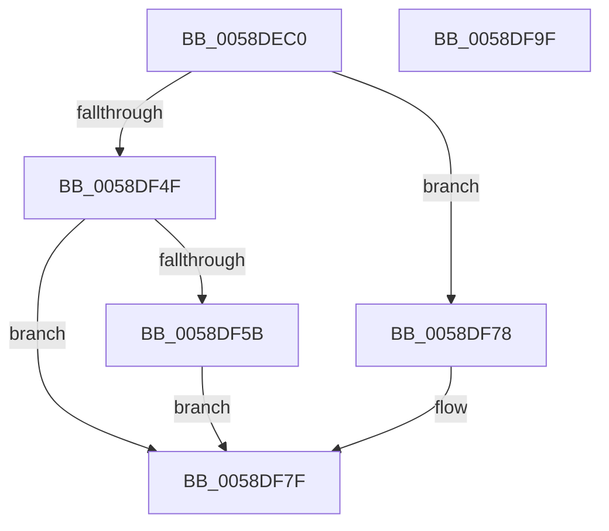

# VslApplyHotPatch

- RVA: `0x0058DEC0`–`0x0058DFA0` (길이 `224` bytes)
- VA: `0x000000014058DEC0`
- 실행 섹션: `.text`
- PDB 이름 있음: `예`; PDB Function 태그: `아니요`
- unwind 정보 RVA: `0x00099754`
- 디코드: `65`개 명령, `224/224` bytes 표시
- 미해석 바이트: `0` (있으면 어셈블리에 `.byte`로 보존)

> 이 문서는 커널 이미지의 기계어와 PDB 기호를 분석해 생성했습니다. 4번과 5번은 함수 원형과 자료형을 바이너리 사용 방식에서 추정한 C 해석이며 원본 소스 복구 결과는 아닙니다.

## 1. Dependencies

- 직접 호출 지점: **3**; 고유 호출 대상: **3**
- 직접 호출자로 확인된 함수: **2**
- RIP 상대 이미지 참조: **4**

### Outgoing calls
- `0x0058DF0D` → [memset](../6C/memset_function_006C6C40.md) (function, `0x006C6C40`)
- `0x0058DF46` → [VslpEnterIumSecureMode](../23/VslpEnterIumSecureMode_function_00235E50.md) (function, `0x00235E50`)
- `0x0058DF86` → [_security_check_cookie](../6A/_security_check_cookie_function_006AC640.md) (function, `0x006AC640`)

### Direct callers
- [MiApplyDriverHotPatch](../../page/80/MiApplyDriverHotPatch_function_008018EC.md) at `0x00801C44`
- [MiApplyDriverHotPatch](../../page/80/MiApplyDriverHotPatch_function_008018EC.md) at `0x00801D2F`
- [MiLoadHotPatch](../../page/AB/MiLoadHotPatch_function_00AB521C.md) at `0x00AB54A4`

### Static image references
- `0x0058DED9` → RVA `0x00E0A740` (`.data`; read)
- `0x0058DF12` → RVA `0x00F8EC00` (`.data`; read/write)
- `0x0058DF4F` → RVA `0x00F8EC04` (`.data`; read/write)
- `0x0058DF78` → RVA `0x00F8EC08` (`.data`; read/write)

## 2. Other-region calls and transfers

- 다른 실행 섹션으로 향하는 call: **0**
- 별도 외부 분기/꼬리 이동을 확인하지 못했습니다.

## 3. Assembly (complete function range)

```asm
0058DEC0  40 55                           push rbp
0058DEC2  53                              push rbx
0058DEC3  56                              push rsi
0058DEC4  57                              push rdi
0058DEC5  41 54                           push r12
0058DEC7  41 55                           push r13
0058DEC9  41 56                           push r14
0058DECB  41 57                           push r15
0058DECD  48 8D 6C 24 F9                  lea rbp, [rsp - 7]
0058DED2  48 81 EC A8 00 00 00            sub rsp, 0xa8
0058DED9  48 8B 05 60 C8 87 00            mov rax, qword ptr [rip + 0x87c860]
0058DEE0  48 33 C4                        xor rax, rsp
0058DEE3  48 89 45 EF                     mov qword ptr [rbp - 0x11], rax
0058DEE7  48 8B 5D 6F                     mov rbx, qword ptr [rbp + 0x6f]
0058DEEB  4C 8B F2                        mov r14, rdx
0058DEEE  48 8B 7D 77                     mov rdi, qword ptr [rbp + 0x77]
0058DEF2  33 D2                           xor edx, edx
0058DEF4  4C 8B AD 87 00 00 00            mov r13, qword ptr [rbp + 0x87]
0058DEFB  4D 8B F8                        mov r15, r8
0058DEFE  48 8B F1                        mov rsi, rcx
0058DF01  4D 8B E1                        mov r12, r9
0058DF04  48 8D 4C 24 20                  lea rcx, [rsp + 0x20]
0058DF09  44 8D 42 68                     lea r8d, [rdx + 0x68]
0058DF0D  E8 2E 8D 13 00                  call 0x1406c6c40
0058DF12  F0 FF 05 E7 0C A0 00            lock inc dword ptr [rip + 0xa00ce7]
0058DF19  8B 45 7F                        mov eax, dword ptr [rbp + 0x7f]
0058DF1C  4C 8D 4C 24 20                  lea r9, [rsp + 0x20]
0058DF21  BA 4D 00 00 00                  mov edx, 0x4d
0058DF26  89 45 B7                        mov dword ptr [rbp - 0x49], eax
0058DF29  45 33 C0                        xor r8d, r8d
0058DF2C  48 89 75 87                     mov qword ptr [rbp - 0x79], rsi
0058DF30  B1 02                           mov cl, 2
0058DF32  4C 89 75 8F                     mov qword ptr [rbp - 0x71], r14
0058DF36  4C 89 7D 97                     mov qword ptr [rbp - 0x69], r15
0058DF3A  4C 89 65 9F                     mov qword ptr [rbp - 0x61], r12
0058DF3E  48 89 5D A7                     mov qword ptr [rbp - 0x59], rbx
0058DF42  48 89 7D AF                     mov qword ptr [rbp - 0x51], rdi
0058DF46  E8 05 7F CA FF                  call 0x140235e50
0058DF4B  85 C0                           test eax, eax
0058DF4D  78 29                           js 0x14058df78
0058DF4F  F0 FF 05 AE 0C A0 00            lock inc dword ptr [rip + 0xa00cae]
0058DF56  4D 85 ED                        test r13, r13
0058DF59  74 24                           je 0x14058df7f
0058DF5B  0F 28 45 8F                     movaps xmm0, xmmword ptr [rbp - 0x71]
0058DF5F  F2 0F 10 4D 9F                  movsd xmm1, qword ptr [rbp - 0x61]
0058DF64  8B 4D A7                        mov ecx, dword ptr [rbp - 0x59]
0058DF67  41 0F 11 45 00                  movups xmmword ptr [r13], xmm0
0058DF6C  F2 41 0F 11 4D 10               movsd qword ptr [r13 + 0x10], xmm1
0058DF72  41 89 4D 18                     mov dword ptr [r13 + 0x18], ecx
0058DF76  EB 07                           jmp 0x14058df7f
0058DF78  F0 FF 05 89 0C A0 00            lock inc dword ptr [rip + 0xa00c89]
0058DF7F  48 8B 4D EF                     mov rcx, qword ptr [rbp - 0x11]
0058DF83  48 33 CC                        xor rcx, rsp
0058DF86  E8 B5 E6 11 00                  call 0x1406ac640
0058DF8B  48 81 C4 A8 00 00 00            add rsp, 0xa8
0058DF92  41 5F                           pop r15
0058DF94  41 5E                           pop r14
0058DF96  41 5D                           pop r13
0058DF98  41 5C                           pop r12
0058DF9A  5F                              pop rdi
0058DF9B  5E                              pop rsi
0058DF9C  5B                              pop rbx
0058DF9D  5D                              pop rbp
0058DF9E  C3                              ret
0058DF9F  CC                              int3
```

## 4. C-style interpretation (structured pseudocode)

```c
__int64 __fastcall VslApplyHotPatch(__int64 a1, __int64 a2, __int64 a3, __int64 a4, __int64 a5, __int64 a6, unsigned int a7, __int64 a8)
{
    __int64 result;
    __int64 v_rsp;
    unsigned __int64 v_stack_m47;
    unsigned __int64 v_stack_m58;
    unsigned int v_stack_m90;
    unsigned __int64 v_stack_m98;
    unsigned __int64 v_stack_mA0;
    unsigned __int64 v_stack_mA8;
    unsigned __int64 v_stack_mB0;
    unsigned __int64 v_stack_mB8;
    unsigned __int64 v_stack_mC0;
    unsigned __int64 v_stack_mC8;

    v_rsp = (v_rsp) - (168);
    result = (*(unsigned __int64 *)(v_rip + 8898656)) ^ (v_rsp);
    v_stack_m58 = result;
    a2 = 0;
    result = memset(v_stack_mC8, a2, a2 + 104, a4);
    v_stack_m90 = (unsigned int)((unsigned int)(a7));
    a3 = 0;
    v_stack_mC0 = a1;
    v_stack_mB8 = 0;
    v_stack_mB0 = 0;
    v_stack_mA8 = a4;
    v_stack_mA0 = a5;
    v_stack_m98 = a6;
    result = VslpEnterIumSecureMode(2, 77, a3, v_stack_mC8);
    if (sign_flag) goto loc_0058DF78;
    if (a8 == 0) goto loc_0058DF7F;
    *(unsigned __int64 *)(a8) = v_xmm0;
    *(unsigned __int64 *)(a8 + 16) = v_xmm1;
    *(unsigned int *)(a8 + 24) = (unsigned int)((unsigned int)(v_stack_mA0));
    goto loc_0058DF7F;
loc_0058DF78:
loc_0058DF7F:
    a1 = (v_stack_m58) ^ (v_rsp);
    result = _security_check_cookie(a1, 77, a3, v_stack_mC8);
    v_rsp = (v_rsp) + (168);
    return result;
}
```

## 5. (Beta) C Style

```c
int64_t VslApplyHotPatch(int64_t Arg1, int64_t Arg2, int64_t Arg3, int64_t Arg4, int64_t Arg5, int64_t Arg6, uint32_t Arg7, int64_t Arg8)
{
    int64_t result;
    int64_t local_rsp;
    uint64_t v_stack_m47;
    uint64_t v_stack_m58;
    uint32_t v_stack_m90;
    uint64_t v_stack_m98;
    uint64_t v_stack_mA0;
    uint64_t v_stack_mA8;
    uint64_t v_stack_mB0;
    uint64_t v_stack_mB8;
    uint64_t v_stack_mC0;
    uint64_t v_stack_mC8;

    local_rsp = (local_rsp) - (168);
    result = (*(uint64_t *)(v_rip + 0x87C860)) ^ (local_rsp);
    v_stack_m58 = result;
    Arg2 = 0;
    result = memset(v_stack_mC8, Arg2, Arg2 + 104, Arg4);
    v_stack_m90 = (uint32_t)((uint32_t)(Arg7));
    Arg3 = 0;
    v_stack_mC0 = Arg1;
    v_stack_mB8 = 0;
    v_stack_mB0 = 0;
    v_stack_mA8 = Arg4;
    v_stack_mA0 = Arg5;
    v_stack_m98 = Arg6;
    result = VslpEnterIumSecureMode(2, 77, Arg3, v_stack_mC8);
    if (sign_flag) goto loc_0058DF78;
    if (Arg8 == 0) goto loc_0058DF7F;
    *(uint64_t *)(Arg8) = v_xmm0;
    *(uint64_t *)(Arg8 + 0x10) = v_xmm1;
    *(uint32_t *)(Arg8 + 0x18) = (uint32_t)((uint32_t)(v_stack_mA0));
    goto loc_0058DF7F;
loc_0058DF78:
loc_0058DF7F:
    Arg1 = (v_stack_m58) ^ (local_rsp);
    result = _security_check_cookie(Arg1, 77, Arg3, v_stack_mC8);
    local_rsp = (local_rsp) + (168);
    return result;
}
```

## 6. Execution-region graph

[열기: 2D/3D 그래프와 함수 탐색 컨트롤 패널](../../../control-panel.html?section=text&rva=0x0058DEC0&view=graph)

- 2D 그래프는 위에서 아래로 흐르고, 3D 그래프는 빈 공간을 드래그해 회전합니다. Shift+드래그는 이동, 휠은 확대·축소, 함수 노드 선택은 대상 보고서 이동입니다.

### Static fallback


