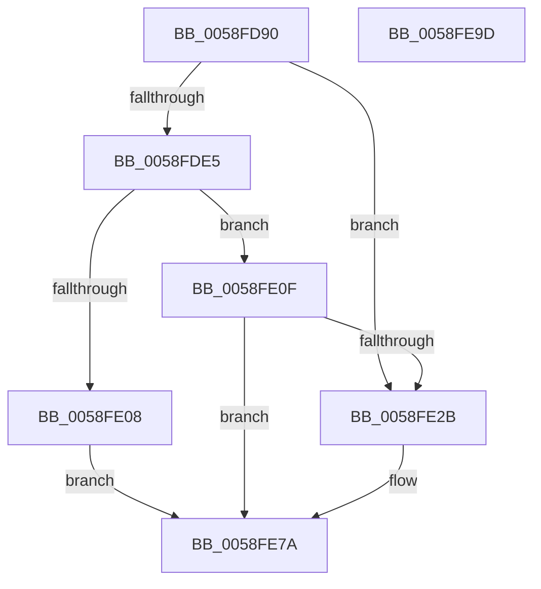

# VslCaptureImageHotPatchMetadata

- RVA: `0x0058FD90`–`0x0058FE9E` (길이 `270` bytes)
- VA: `0x000000014058FD90`
- 실행 섹션: `.text`
- PDB 이름 있음: `예`; PDB Function 태그: `아니요`
- unwind 정보 RVA: `0x000C6E8C`
- 디코드: `64`개 명령, `270/270` bytes 표시
- 미해석 바이트: `0` (있으면 어셈블리에 `.byte`로 보존)

> 이 문서는 커널 이미지의 기계어와 PDB 기호를 분석해 생성했습니다. 4번과 5번은 함수 원형과 자료형을 바이너리 사용 방식에서 추정한 C 해석이며 원본 소스 복구 결과는 아닙니다.

## 1. Dependencies

- 직접 호출 지점: **6**; 고유 호출 대상: **5**
- 직접 호출자로 확인된 함수: **0**
- RIP 상대 이미지 참조: **1**

### Outgoing calls
- `0x0058FDCB` → [memset](../6C/memset_function_006C6C40.md) (function, `0x006C6C40`)
- `0x0058FDDB` → [memset](../6C/memset_function_006C6C40.md) (function, `0x006C6C40`)
- `0x0058FE22` → [VslpLockPagesForTransfer](../29/VslpLockPagesForTransfer_function_0029E0FC.md) (function, `0x0029E0FC`)
- `0x0058FE67` → [VslpEnterIumSecureMode](../23/VslpEnterIumSecureMode_function_00235E50.md) (function, `0x00235E50`)
- `0x0058FE73` → [VslpUnlockPagesForTransfer](../29/VslpUnlockPagesForTransfer_function_0029EE4C.md) (function, `0x0029EE4C`)
- `0x0058FE85` → [_security_check_cookie](../6A/_security_check_cookie_function_006AC640.md) (function, `0x006AC640`)

### Direct callers
- 이 함수 시작 RVA로 연결되는 직접 call은 확인되지 않았습니다. 간접 호출은 완전히 역산할 수 없습니다.

### Static image references
- `0x0058FD9F` → RVA `0x00E0A740` (`.data`; read)

## 2. Other-region calls and transfers

- 다른 실행 섹션으로 향하는 call: **0**
- 별도 외부 분기/꼬리 이동을 확인하지 못했습니다.

## 3. Assembly (complete function range)

```asm
0058FD90  48 89 5C 24 08                  mov qword ptr [rsp + 8], rbx
0058FD95  55                              push rbp
0058FD96  56                              push rsi
0058FD97  57                              push rdi
0058FD98  48 81 EC 00 01 00 00            sub rsp, 0x100
0058FD9F  48 8B 05 9A A9 87 00            mov rax, qword ptr [rip + 0x87a99a]
0058FDA6  48 33 C4                        xor rax, rsp
0058FDA9  48 89 84 24 F0 00 00 00         mov qword ptr [rsp + 0xf0], rax
0058FDB1  48 8B F2                        mov rsi, rdx
0058FDB4  49 8B D8                        mov rbx, r8
0058FDB7  33 D2                           xor edx, edx
0058FDB9  48 8B E9                        mov rbp, rcx
0058FDBC  48 8D 8C 24 80 00 00 00         lea rcx, [rsp + 0x80]
0058FDC4  49 8B F9                        mov rdi, r9
0058FDC7  44 8D 42 68                     lea r8d, [rdx + 0x68]
0058FDCB  E8 70 6E 13 00                  call 0x1406c6c40
0058FDD0  33 D2                           xor edx, edx
0058FDD2  48 8D 4C 24 30                  lea rcx, [rsp + 0x30]
0058FDD7  44 8D 42 48                     lea r8d, [rdx + 0x48]
0058FDDB  E8 60 6E 13 00                  call 0x1406c6c40
0058FDE0  48 85 DB                        test rbx, rbx
0058FDE3  74 46                           je 0x14058fe2b
0058FDE5  48 8B CB                        mov rcx, rbx
0058FDE8  81 E1 FF 0F 00 00               and ecx, 0xfff
0058FDEE  48 81 C1 FF 0F 00 00            add rcx, 0xfff
0058FDF5  48 03 CF                        add rcx, rdi
0058FDF8  48 81 E1 00 F0 FF FF            and rcx, 0xfffffffffffff000
0058FDFF  48 81 F9 00 A0 1F 00            cmp rcx, 0x1fa000
0058FE06  76 07                           jbe 0x14058fe0f
0058FE08  B8 0D 00 00 C0                  mov eax, 0xc000000d
0058FE0D  EB 6B                           jmp 0x14058fe7a
0058FE0F  83 64 24 20 00                  and dword ptr [rsp + 0x20], 0
0058FE14  48 8D 4C 24 30                  lea rcx, [rsp + 0x30]
0058FE19  45 33 C9                        xor r9d, r9d
0058FE1C  44 8B C7                        mov r8d, edi
0058FE1F  48 8B D3                        mov rdx, rbx
0058FE22  E8 D5 E2 D0 FF                  call 0x14029e0fc
0058FE27  85 C0                           test eax, eax
0058FE29  78 4F                           js 0x14058fe7a
0058FE2B  48 8B 44 24 30                  mov rax, qword ptr [rsp + 0x30]
0058FE30  4C 8D 8C 24 80 00 00 00         lea r9, [rsp + 0x80]
0058FE38  48 89 84 24 98 00 00 00         mov qword ptr [rsp + 0x98], rax
0058FE40  BA 1C 00 00 00                  mov edx, 0x1c
0058FE45  48 8B 44 24 68                  mov rax, qword ptr [rsp + 0x68]
0058FE4A  45 33 C0                        xor r8d, r8d
0058FE4D  B1 02                           mov cl, 2
0058FE4F  48 89 84 24 A0 00 00 00         mov qword ptr [rsp + 0xa0], rax
0058FE57  48 89 AC 24 88 00 00 00         mov qword ptr [rsp + 0x88], rbp
0058FE5F  48 89 B4 24 90 00 00 00         mov qword ptr [rsp + 0x90], rsi
0058FE67  E8 E4 5F CA FF                  call 0x140235e50
0058FE6C  48 8D 4C 24 30                  lea rcx, [rsp + 0x30]
0058FE71  8B D8                           mov ebx, eax
0058FE73  E8 D4 EF D0 FF                  call 0x14029ee4c
0058FE78  8B C3                           mov eax, ebx
0058FE7A  48 8B 8C 24 F0 00 00 00         mov rcx, qword ptr [rsp + 0xf0]
0058FE82  48 33 CC                        xor rcx, rsp
0058FE85  E8 B6 C7 11 00                  call 0x1406ac640
0058FE8A  48 8B 9C 24 20 01 00 00         mov rbx, qword ptr [rsp + 0x120]
0058FE92  48 81 C4 00 01 00 00            add rsp, 0x100
0058FE99  5F                              pop rdi
0058FE9A  5E                              pop rsi
0058FE9B  5D                              pop rbp
0058FE9C  C3                              ret
0058FE9D  CC                              int3
```

## 4. C-style interpretation (structured pseudocode)

```c
__int64 __fastcall VslCaptureImageHotPatchMetadata(__int64 a1, __int64 a2, __int64 a3, __int64 a4)
{
    __int64 result;
    __int64 v_rbx;
    __int64 v_rsp;
    unsigned __int64 v_stack_m28;
    unsigned __int64 v_stack_m78;
    unsigned __int64 v_stack_m80;
    unsigned __int64 v_stack_m88;
    unsigned __int64 v_stack_m90;
    unsigned __int64 v_stack_m98;
    unsigned __int64 v_stack_mB0;
    unsigned __int64 v_stack_mE8;
    unsigned int v_stack_mF8;
    unsigned __int64 v_stack_p8;

    v_stack_p8 = v_rbx;
    v_rsp = (v_rsp) - (256);
    result = (*(unsigned __int64 *)(v_rip + 8890778)) ^ (v_rsp);
    v_stack_m28 = result;
    a2 = 0;
    result = memset(v_stack_m98, a2, a2 + 104, a4);
    a2 = 0;
    result = memset(v_stack_mE8, a2, a2 + 72, a4);
    if (a3 == 0) goto loc_0058FE2B;
    a1 = (unsigned int)((a3) & (0xFFFULL));
    a1 = (a1) + (0xFFFULL);
    a1 = (a1) + (a4);
    a1 = (a1) & (0xFFFFFFFFFFFFF000ULL);
    if (a1 <= 0x1FA000ULL) goto loc_0058FE0F;
    goto loc_0058FE7A;
loc_0058FE0F:
    a4 = 0;
    result = VslpLockPagesForTransfer(v_stack_mE8, a3, 0, a4);
    v_rbx = a3;
    if (!(sign_flag)) {
        result = v_stack_mE8;
        a4 = v_stack_m98;
        v_stack_m80 = result;
        a2 = 28;
        result = v_stack_mB0;
        a3 = 0;
        a1 = 2;
        v_stack_m78 = result;
        v_stack_m90 = a1;
        v_stack_m88 = a2;
        result = VslpEnterIumSecureMode(a1, a2, a3, a4);
        a1 = v_stack_mE8;
        v_rbx = (unsigned int)(result);
        result = VslpUnlockPagesForTransfer(a1, a2, a3, a4);
        result = (unsigned int)(v_rbx);
    }
    a1 = (v_stack_m28) ^ (v_rsp);
    result = _security_check_cookie(a1, a2, a3, a4);
    v_rsp = (v_rsp) + (256);
    return result;
}
```

## 5. (Beta) C Style

```c
int64_t VslCaptureImageHotPatchMetadata(int64_t Arg1, int64_t Arg2, int64_t Arg3, int64_t Arg4)
{
    int64_t result;
    int64_t local_rbx;
    int64_t local_rsp;
    uint64_t v_stack_m28;
    uint64_t v_stack_m78;
    uint64_t v_stack_m80;
    uint64_t v_stack_m88;
    uint64_t v_stack_m90;
    uint64_t v_stack_m98;
    uint64_t v_stack_mB0;
    uint64_t v_stack_mE8;
    uint32_t v_stack_mF8;
    uint64_t v_stack_p8;

    v_stack_p8 = local_rbx;
    local_rsp = (local_rsp) - (256);
    result = (*(uint64_t *)(v_rip + 0x87A99A)) ^ (local_rsp);
    v_stack_m28 = result;
    Arg2 = 0;
    result = memset(v_stack_m98, Arg2, Arg2 + 104, Arg4);
    Arg2 = 0;
    result = memset(v_stack_mE8, Arg2, Arg2 + 72, Arg4);
    if (Arg3 == 0) goto loc_0058FE2B;
    Arg1 = (uint32_t)((Arg3) & (0xFFFULL));
    Arg1 = (Arg1) + (0xFFFULL);
    Arg1 = (Arg1) + (Arg4);
    Arg1 = (Arg1) & (0xFFFFFFFFFFFFF000ULL);
    if (Arg1 <= 0x1FA000ULL) goto loc_0058FE0F;
    goto loc_0058FE7A;
loc_0058FE0F:
    Arg4 = 0;
    result = VslpLockPagesForTransfer(v_stack_mE8, Arg3, 0, Arg4);
    local_rbx = Arg3;
    if (!(sign_flag)) {
        result = v_stack_mE8;
        Arg4 = v_stack_m98;
        v_stack_m80 = result;
        Arg2 = 28;
        result = v_stack_mB0;
        Arg3 = 0;
        Arg1 = 2;
        v_stack_m78 = result;
        v_stack_m90 = Arg1;
        v_stack_m88 = Arg2;
        result = VslpEnterIumSecureMode(Arg1, Arg2, Arg3, Arg4);
        Arg1 = v_stack_mE8;
        local_rbx = (uint32_t)(result);
        result = VslpUnlockPagesForTransfer(Arg1, Arg2, Arg3, Arg4);
        result = (uint32_t)(local_rbx);
    }
    Arg1 = (v_stack_m28) ^ (local_rsp);
    result = _security_check_cookie(Arg1, Arg2, Arg3, Arg4);
    local_rsp = (local_rsp) + (256);
    return result;
}
```

## 6. Execution-region graph

[열기: 2D/3D 그래프와 함수 탐색 컨트롤 패널](../../../control-panel.html?section=text&rva=0x0058FD90&view=graph)

- 2D 그래프는 위에서 아래로 흐르고, 3D 그래프는 빈 공간을 드래그해 회전합니다. Shift+드래그는 이동, 휠은 확대·축소, 함수 노드 선택은 대상 보고서 이동입니다.

### Static fallback


