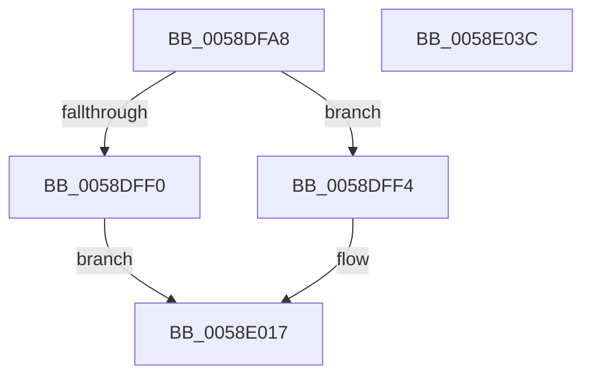

# VslConfigureDynamicMemory

- RVA: `0x0058DFA8`–`0x0058E03D` (길이 `149` bytes)
- VA: `0x000000014058DFA8`
- 실행 섹션: `.text`
- PDB 이름 있음: `예`; PDB Function 태그: `아니요`
- unwind 정보 RVA: `0x000AFF04`
- 디코드: `38`개 명령, `149/149` bytes 표시
- 미해석 바이트: `0` (있으면 어셈블리에 `.byte`로 보존)

> 이 문서는 커널 이미지의 기계어와 PDB 기호를 분석해 생성했습니다. 4번과 5번은 함수 원형과 자료형을 바이너리 사용 방식에서 추정한 C 해석이며 원본 소스 복구 결과는 아닙니다.

## 1. Dependencies

- 직접 호출 지점: **4**; 고유 호출 대상: **4**
- 직접 호출자로 확인된 함수: **1**
- RIP 상대 이미지 참조: **1**

### Outgoing calls
- `0x0058DFE0` → [memset](../6C/memset_function_006C6C40.md) (function, `0x006C6C40`)
- `0x0058DFE7` → [HvlQueryVsmConnection](../45/HvlQueryVsmConnection_function_0045D180.md) (function, `0x0045D180`)
- `0x0058E012` → [VslpEnterIumSecureMode](../23/VslpEnterIumSecureMode_function_00235E50.md) (function, `0x00235E50`)
- `0x0058E022` → [_security_check_cookie](../6A/_security_check_cookie_function_006AC640.md) (function, `0x006AC640`)

### Direct callers
- [KeConfigureDynamicMemory](../5B/KeConfigureDynamicMemory_function_005B8C9C.md) at `0x005B8CD8`
- [KeConfigureDynamicMemory](../5B/KeConfigureDynamicMemory_function_005B8C9C.md) at `0x005B8D12`
- [KeConfigureDynamicMemory](../5B/KeConfigureDynamicMemory_function_005B8C9C.md) at `0x005B8D41`
- [KeConfigureDynamicMemory](../5B/KeConfigureDynamicMemory_function_005B8C9C.md) at `0x005B8D71`

### Static image references
- `0x0058DFBA` → RVA `0x00E0A740` (`.data`; read)

## 2. Other-region calls and transfers

- 다른 실행 섹션으로 향하는 call: **0**
- 별도 외부 분기/꼬리 이동을 확인하지 못했습니다.

## 3. Assembly (complete function range)

```asm
0058DFA8  48 89 5C 24 08                  mov qword ptr [rsp + 8], rbx
0058DFAD  48 89 74 24 10                  mov qword ptr [rsp + 0x10], rsi
0058DFB2  57                              push rdi
0058DFB3  48 81 EC A0 00 00 00            sub rsp, 0xa0
0058DFBA  48 8B 05 7F C7 87 00            mov rax, qword ptr [rip + 0x87c77f]
0058DFC1  48 33 C4                        xor rax, rsp
0058DFC4  48 89 84 24 90 00 00 00         mov qword ptr [rsp + 0x90], rax
0058DFCC  48 8B FA                        mov rdi, rdx
0058DFCF  41 8B D8                        mov ebx, r8d
0058DFD2  33 D2                           xor edx, edx
0058DFD4  48 8B F1                        mov rsi, rcx
0058DFD7  48 8D 4C 24 20                  lea rcx, [rsp + 0x20]
0058DFDC  44 8D 42 68                     lea r8d, [rdx + 0x68]
0058DFE0  E8 5B 8C 13 00                  call 0x1406c6c40
0058DFE5  33 C9                           xor ecx, ecx
0058DFE7  E8 94 F1 EC FF                  call 0x14045d180
0058DFEC  84 C0                           test al, al
0058DFEE  75 04                           jne 0x14058dff4
0058DFF0  33 C0                           xor eax, eax
0058DFF2  EB 23                           jmp 0x14058e017
0058DFF4  BA 27 00 00 00                  mov edx, 0x27
0058DFF9  48 89 74 24 28                  mov qword ptr [rsp + 0x28], rsi
0058DFFE  4C 8D 4C 24 20                  lea r9, [rsp + 0x20]
0058E003  48 89 7C 24 30                  mov qword ptr [rsp + 0x30], rdi
0058E008  45 33 C0                        xor r8d, r8d
0058E00B  48 89 5C 24 38                  mov qword ptr [rsp + 0x38], rbx
0058E010  B1 02                           mov cl, 2
0058E012  E8 39 7E CA FF                  call 0x140235e50
0058E017  48 8B 8C 24 90 00 00 00         mov rcx, qword ptr [rsp + 0x90]
0058E01F  48 33 CC                        xor rcx, rsp
0058E022  E8 19 E6 11 00                  call 0x1406ac640
0058E027  4C 8D 9C 24 A0 00 00 00         lea r11, [rsp + 0xa0]
0058E02F  49 8B 5B 10                     mov rbx, qword ptr [r11 + 0x10]
0058E033  49 8B 73 18                     mov rsi, qword ptr [r11 + 0x18]
0058E037  49 8B E3                        mov rsp, r11
0058E03A  5F                              pop rdi
0058E03B  C3                              ret
0058E03C  CC                              int3
```

## 4. C-style interpretation (structured pseudocode)

```c
__int64 __fastcall VslConfigureDynamicMemory(__int64 a1, __int64 a2, int a3)
{
    __int64 result;
    __int64 v_rsp;
    unsigned __int64 v_stack_m18;
    unsigned __int64 v_stack_m70;
    unsigned __int64 v_stack_m78;
    unsigned __int64 v_stack_m8;
    unsigned __int64 v_stack_m80;
    unsigned __int64 v_stack_m88;
    unsigned __int64 v_stack_p10;
    unsigned __int64 v_stack_p8;

    v_stack_p8 = v_rbx;
    v_stack_p10 = v_rsi;
    v_rsp = (v_rsp) - (160);
    result = (*(unsigned __int64 *)(v_rip + 8898431)) ^ (v_rsp);
    v_stack_m18 = result;
    a2 = 0;
    result = memset(v_stack_m88, a2, a2 + 104, a4);
    a1 = 0;
    result = HvlQueryVsmConnection(a1, a2, a2 + 104, a4);
    if ((unsigned __int8)(result) != 0) goto loc_0058DFF4;
    result = 0;
    goto loc_0058E017;
loc_0058DFF4:
    v_stack_m80 = 0;
    v_stack_m78 = 0;
    a3 = 0;
    v_stack_m70 = (unsigned int)(a3);
    result = VslpEnterIumSecureMode(2, 39, a3, v_stack_m88);
loc_0058E017:
    a1 = (v_stack_m18) ^ (v_rsp);
    result = _security_check_cookie(a1, 39, a3, v_stack_m88);
    return result;
}
```

## 5. (Beta) C Style

```c
int64_t VslConfigureDynamicMemory(int64_t Arg1, int64_t Arg2, int32_t Arg3)
{
    int64_t result;
    int64_t local_rsp;
    uint64_t v_stack_m18;
    uint64_t v_stack_m70;
    uint64_t v_stack_m78;
    uint64_t v_stack_m8;
    uint64_t v_stack_m80;
    uint64_t v_stack_m88;
    uint64_t v_stack_p10;
    uint64_t v_stack_p8;

    v_stack_p8 = local_rbx;
    v_stack_p10 = local_rsi;
    local_rsp = (local_rsp) - (160);
    result = (*(uint64_t *)(v_rip + 0x87C77F)) ^ (local_rsp);
    v_stack_m18 = result;
    Arg2 = 0;
    result = memset(v_stack_m88, Arg2, Arg2 + 104, a4);
    Arg1 = 0;
    result = HvlQueryVsmConnection(Arg1, Arg2, Arg2 + 104, a4);
    if ((uint8_t)(result) != 0) goto loc_0058DFF4;
    result = 0;
    goto loc_0058E017;
loc_0058DFF4:
    v_stack_m80 = 0;
    v_stack_m78 = 0;
    Arg3 = 0;
    v_stack_m70 = (uint32_t)(Arg3);
    result = VslpEnterIumSecureMode(2, 39, Arg3, v_stack_m88);
loc_0058E017:
    Arg1 = (v_stack_m18) ^ (local_rsp);
    result = _security_check_cookie(Arg1, 39, Arg3, v_stack_m88);
    return result;
}
```

## 6. Execution-region graph

[열기: 2D/3D 그래프와 함수 탐색 컨트롤 패널](../../../control-panel.html?section=text&rva=0x0058DFA8&view=graph)

- 2D 그래프는 위에서 아래로 흐르고, 3D 그래프는 빈 공간을 드래그해 회전합니다. Shift+드래그는 이동, 휠은 확대·축소, 함수 노드 선택은 대상 보고서 이동입니다.

### Static fallback


