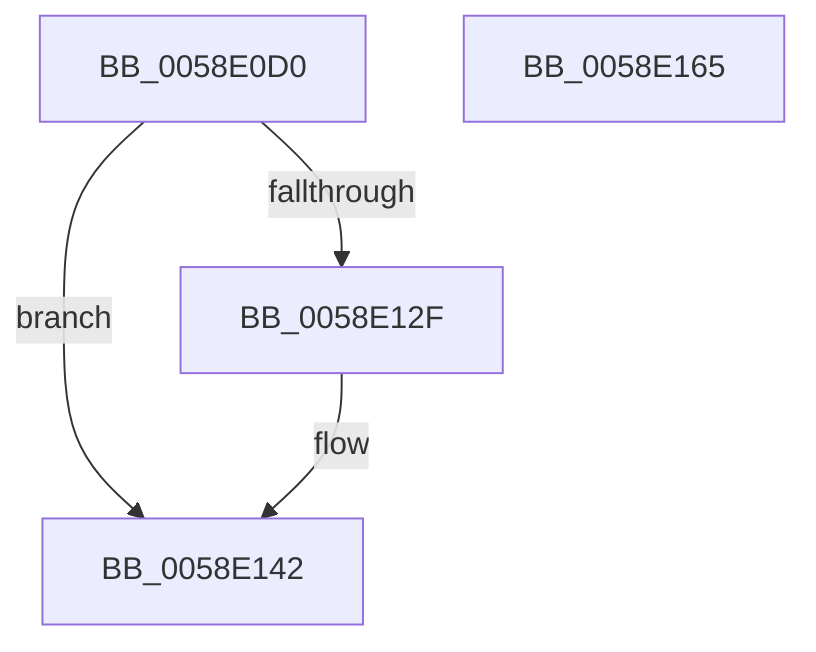

# VslExchangeEntropy

- RVA: `0x0058E0D0`–`0x0058E166` (길이 `150` bytes)
- VA: `0x000000014058E0D0`
- 실행 섹션: `.text`
- PDB 이름 있음: `예`; PDB Function 태그: `아니요`
- unwind 정보 RVA: `0x000C6C70`
- 디코드: `36`개 명령, `150/150` bytes 표시
- 미해석 바이트: `0` (있으면 어셈블리에 `.byte`로 보존)

> 이 문서는 커널 이미지의 기계어와 PDB 기호를 분석해 생성했습니다. 4번과 5번은 함수 원형과 자료형을 바이너리 사용 방식에서 추정한 C 해석이며 원본 소스 복구 결과는 아닙니다.

## 1. Dependencies

- 직접 호출 지점: **5**; 고유 호출 대상: **4**
- 직접 호출자로 확인된 함수: **0**
- RIP 상대 이미지 참조: **1**

### Outgoing calls
- `0x0058E0FD` → [memset](../6C/memset_function_006C6C40.md) (function, `0x006C6C40`)
- `0x0058E110` → [memcpy](../6C/memcpy_function_006C6840.md) (function, `0x006C6840`)
- `0x0058E124` → [VslpEnterIumSecureMode](../23/VslpEnterIumSecureMode_function_00235E50.md) (function, `0x00235E50`)
- `0x0058E13D` → [memcpy](../6C/memcpy_function_006C6840.md) (function, `0x006C6840`)
- `0x0058E14F` → [_security_check_cookie](../6A/_security_check_cookie_function_006AC640.md) (function, `0x006AC640`)

### Direct callers
- 이 함수 시작 RVA로 연결되는 직접 call은 확인되지 않았습니다. 간접 호출은 완전히 역산할 수 없습니다.

### Static image references
- `0x0058E0DD` → RVA `0x00E0A740` (`.data`; read)

## 2. Other-region calls and transfers

- 다른 실행 섹션으로 향하는 call: **0**
- 별도 외부 분기/꼬리 이동을 확인하지 못했습니다.

## 3. Assembly (complete function range)

```asm
0058E0D0  48 89 5C 24 10                  mov qword ptr [rsp + 0x10], rbx
0058E0D5  57                              push rdi
0058E0D6  48 81 EC A0 00 00 00            sub rsp, 0xa0
0058E0DD  48 8B 05 5C C6 87 00            mov rax, qword ptr [rip + 0x87c65c]
0058E0E4  48 33 C4                        xor rax, rsp
0058E0E7  48 89 84 24 90 00 00 00         mov qword ptr [rsp + 0x90], rax
0058E0EF  33 D2                           xor edx, edx
0058E0F1  48 8B F9                        mov rdi, rcx
0058E0F4  48 8D 4C 24 20                  lea rcx, [rsp + 0x20]
0058E0F9  44 8D 42 68                     lea r8d, [rdx + 0x68]
0058E0FD  E8 3E 8B 13 00                  call 0x1406c6c40
0058E102  41 B8 40 00 00 00               mov r8d, 0x40
0058E108  48 8D 4C 24 30                  lea rcx, [rsp + 0x30]
0058E10D  48 8B D7                        mov rdx, rdi
0058E110  E8 2B 87 13 00                  call 0x1406c6840
0058E115  BA 23 00 00 00                  mov edx, 0x23
0058E11A  4C 8D 4C 24 20                  lea r9, [rsp + 0x20]
0058E11F  45 33 C0                        xor r8d, r8d
0058E122  B1 02                           mov cl, 2
0058E124  E8 27 7D CA FF                  call 0x140235e50
0058E129  8B D8                           mov ebx, eax
0058E12B  85 C0                           test eax, eax
0058E12D  78 13                           js 0x14058e142
0058E12F  41 B8 40 00 00 00               mov r8d, 0x40
0058E135  48 8D 54 24 30                  lea rdx, [rsp + 0x30]
0058E13A  48 8B CF                        mov rcx, rdi
0058E13D  E8 FE 86 13 00                  call 0x1406c6840
0058E142  8B C3                           mov eax, ebx
0058E144  48 8B 8C 24 90 00 00 00         mov rcx, qword ptr [rsp + 0x90]
0058E14C  48 33 CC                        xor rcx, rsp
0058E14F  E8 EC E4 11 00                  call 0x1406ac640
0058E154  48 8B 9C 24 B8 00 00 00         mov rbx, qword ptr [rsp + 0xb8]
0058E15C  48 81 C4 A0 00 00 00            add rsp, 0xa0
0058E163  5F                              pop rdi
0058E164  C3                              ret
0058E165  CC                              int3
```

## 4. C-style interpretation (structured pseudocode)

```c
__int64 __fastcall VslExchangeEntropy(__int64 a1, int a2)
{
    __int64 result;
    __int64 v_rsp;
    unsigned __int64 v_stack_m18;
    unsigned __int64 v_stack_m78;
    unsigned __int64 v_stack_m88;
    unsigned __int64 v_stack_p10;

    v_stack_p10 = v_rbx;
    v_rsp = (v_rsp) - (160);
    result = (*(unsigned __int64 *)(v_rip + 8898140)) ^ (v_rsp);
    v_stack_m18 = result;
    a2 = 0;
    result = memset(v_stack_m88, a2, a2 + 104, a4);
    result = memcpy(v_stack_m78, a1, 64, a4);
    a3 = 0;
    result = VslpEnterIumSecureMode(2, 35, a3, v_stack_m88);
    if (!(sign_flag)) {
        a3 = 64;
        a2 = v_stack_m78;
        a1 = a1;
        result = memcpy(a1, a2, a3, v_stack_m88);
    }
    a1 = (v_stack_m18) ^ (v_rsp);
    result = _security_check_cookie(a1, a2, a3, v_stack_m88);
    v_rsp = (v_rsp) + (160);
    return result;
}
```

## 5. (Beta) C Style

```c
int64_t VslExchangeEntropy(int64_t Arg1, int32_t Arg2)
{
    int64_t result;
    int64_t local_rsp;
    uint64_t v_stack_m18;
    uint64_t v_stack_m78;
    uint64_t v_stack_m88;
    uint64_t v_stack_p10;

    v_stack_p10 = local_rbx;
    local_rsp = (local_rsp) - (160);
    result = (*(uint64_t *)(v_rip + 0x87C65C)) ^ (local_rsp);
    v_stack_m18 = result;
    Arg2 = 0;
    result = memset(v_stack_m88, Arg2, Arg2 + 104, a4);
    result = memcpy(v_stack_m78, Arg1, 64, a4);
    a3 = 0;
    result = VslpEnterIumSecureMode(2, 35, a3, v_stack_m88);
    if (!(sign_flag)) {
        a3 = 64;
        Arg2 = v_stack_m78;
        Arg1 = Arg1;
        result = memcpy(Arg1, Arg2, a3, v_stack_m88);
    }
    Arg1 = (v_stack_m18) ^ (local_rsp);
    result = _security_check_cookie(Arg1, Arg2, a3, v_stack_m88);
    local_rsp = (local_rsp) + (160);
    return result;
}
```

## 6. Execution-region graph

[열기: 2D/3D 그래프와 함수 탐색 컨트롤 패널](../../../control-panel.html?section=text&rva=0x0058E0D0&view=graph)

- 2D 그래프는 위에서 아래로 흐르고, 3D 그래프는 빈 공간을 드래그해 회전합니다. Shift+드래그는 이동, 휠은 확대·축소, 함수 노드 선택은 대상 보고서 이동입니다.

### Static fallback


