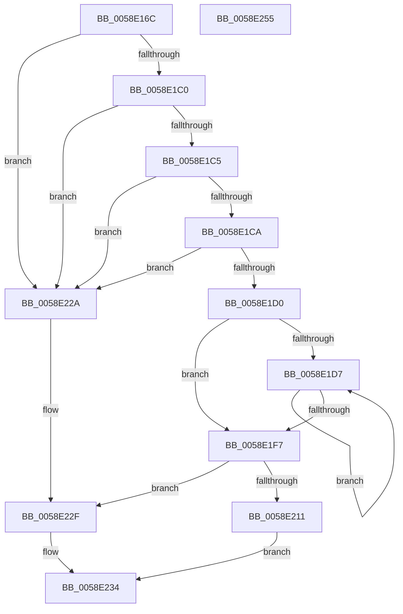

# VslFinalizeLiveDumpInSk

- RVA: `0x0058E16C`–`0x0058E256` (길이 `234` bytes)
- VA: `0x000000014058E16C`
- 실행 섹션: `.text`
- PDB 이름 있음: `예`; PDB Function 태그: `아니요`
- unwind 정보 RVA: `0x000C6BE4`
- 디코드: `69`개 명령, `234/234` bytes 표시
- 미해석 바이트: `0` (있으면 어셈블리에 `.byte`로 보존)

> 이 문서는 커널 이미지의 기계어와 PDB 기호를 분석해 생성했습니다. 4번과 5번은 함수 원형과 자료형을 바이너리 사용 방식에서 추정한 C 해석이며 원본 소스 복구 결과는 아닙니다.

## 1. Dependencies

- 직접 호출 지점: **5**; 고유 호출 대상: **5**
- 직접 호출자로 확인된 함수: **1**
- RIP 상대 이미지 참조: **1**

### Outgoing calls
- `0x0058E1A1` → [memset](../6C/memset_function_006C6C40.md) (function, `0x006C6C40`)
- `0x0058E1DA` → [MmGetPhysicalAddress](../23/MmGetPhysicalAddress_function_0023A500.md) (function, `0x0023A500`)
- `0x0058E206` → [VslpEnterIumSecureMode](../23/VslpEnterIumSecureMode_function_00235E50.md) (function, `0x00235E50`)
- `0x0058E22F` → [VslAbortLiveDump](VslAbortLiveDump_function_0058DE64.md) (function, `0x0058DE64`)
- `0x0058E241` → [_security_check_cookie](../6A/_security_check_cookie_function_006AC640.md) (function, `0x006AC640`)

### Direct callers
- [IopLiveDumpCaptureMemoryPages](../59/IopLiveDumpCaptureMemoryPages_function_0059B0A0.md) at `0x0059B134`

### Static image references
- `0x0058E17B` → RVA `0x00E0A740` (`.data`; read)

## 2. Other-region calls and transfers

- 다른 실행 섹션으로 향하는 call: **0**
- 별도 외부 분기/꼬리 이동을 확인하지 못했습니다.

## 3. Assembly (complete function range)

```asm
0058E16C  40 53                           push rbx
0058E16E  56                              push rsi
0058E16F  57                              push rdi
0058E170  41 56                           push r14
0058E172  41 57                           push r15
0058E174  48 81 EC A0 00 00 00            sub rsp, 0xa0
0058E17B  48 8B 05 BE C5 87 00            mov rax, qword ptr [rip + 0x87c5be]
0058E182  48 33 C4                        xor rax, rsp
0058E185  48 89 84 24 90 00 00 00         mov qword ptr [rsp + 0x90], rax
0058E18D  4C 8B FA                        mov r15, rdx
0058E190  49 8B F0                        mov rsi, r8
0058E193  33 D2                           xor edx, edx
0058E195  4C 8B F1                        mov r14, rcx
0058E198  48 8D 4C 24 20                  lea rcx, [rsp + 0x20]
0058E19D  44 8D 42 68                     lea r8d, [rdx + 0x68]
0058E1A1  E8 9A 8A 13 00                  call 0x1406c6c40
0058E1A6  44 8B 46 08                     mov r8d, dword ptr [rsi + 8]
0058E1AA  B9 FF 0F 00 00                  mov ecx, 0xfff
0058E1AF  48 8B 7E 20                     mov rdi, qword ptr [rsi + 0x20]
0058E1B3  41 C1 E8 0C                     shr r8d, 0xc
0058E1B7  44 89 44 24 28                  mov dword ptr [rsp + 0x28], r8d
0058E1BC  85 F9                           test ecx, edi
0058E1BE  75 6A                           jne 0x14058e22a
0058E1C0  48 3B 3E                        cmp rdi, qword ptr [rsi]
0058E1C3  75 65                           jne 0x14058e22a
0058E1C5  85 4E 28                        test dword ptr [rsi + 0x28], ecx
0058E1C8  75 60                           jne 0x14058e22a
0058E1CA  41 83 F8 0B                     cmp r8d, 0xb
0058E1CE  77 5A                           ja 0x14058e22a
0058E1D0  33 DB                           xor ebx, ebx
0058E1D2  45 85 C0                        test r8d, r8d
0058E1D5  74 20                           je 0x14058e1f7
0058E1D7  48 8B CF                        mov rcx, rdi
0058E1DA  E8 21 C3 CA FF                  call 0x14023a500
0058E1DF  48 C1 E8 0C                     shr rax, 0xc
0058E1E3  48 81 C7 00 10 00 00            add rdi, 0x1000
0058E1EA  48 89 44 DC 30                  mov qword ptr [rsp + rbx*8 + 0x30], rax
0058E1EF  FF C3                           inc ebx
0058E1F1  3B 5C 24 28                     cmp ebx, dword ptr [rsp + 0x28]
0058E1F5  72 E0                           jb 0x14058e1d7
0058E1F7  BA 3E 00 00 00                  mov edx, 0x3e
0058E1FC  4C 8D 4C 24 20                  lea r9, [rsp + 0x20]
0058E201  45 33 C0                        xor r8d, r8d
0058E204  B1 02                           mov cl, 2
0058E206  E8 45 7C CA FF                  call 0x140235e50
0058E20B  8B D8                           mov ebx, eax
0058E20D  85 C0                           test eax, eax
0058E20F  78 1E                           js 0x14058e22f
0058E211  48 8B 4C 24 30                  mov rcx, qword ptr [rsp + 0x30]
0058E216  49 89 0E                        mov qword ptr [r14], rcx
0058E219  48 8B 4C 24 38                  mov rcx, qword ptr [rsp + 0x38]
0058E21E  49 89 0F                        mov qword ptr [r15], rcx
0058E221  8B 4C 24 40                     mov ecx, dword ptr [rsp + 0x40]
0058E225  89 4E 28                        mov dword ptr [rsi + 0x28], ecx
0058E228  EB 0A                           jmp 0x14058e234
0058E22A  BB 0D 00 00 C0                  mov ebx, 0xc000000d
0058E22F  E8 30 FC FF FF                  call 0x14058de64
0058E234  8B C3                           mov eax, ebx
0058E236  48 8B 8C 24 90 00 00 00         mov rcx, qword ptr [rsp + 0x90]
0058E23E  48 33 CC                        xor rcx, rsp
0058E241  E8 FA E3 11 00                  call 0x1406ac640
0058E246  48 81 C4 A0 00 00 00            add rsp, 0xa0
0058E24D  41 5F                           pop r15
0058E24F  41 5E                           pop r14
0058E251  5F                              pop rdi
0058E252  5E                              pop rsi
0058E253  5B                              pop rbx
0058E254  C3                              ret
0058E255  CC                              int3
```

## 4. C-style interpretation (structured pseudocode)

```c
__int64 __fastcall VslFinalizeLiveDumpInSk(__int64 a1, __int64 a2, __int64 a3)
{
    __int64 result;
    __int64 v_rbx;
    __int64 v_rdi;
    __int64 v_rsp;
    unsigned __int64 v_stack_m38;
    unsigned int v_stack_m88;
    unsigned __int64 v_stack_m90;
    unsigned __int64 v_stack_m98;
    unsigned int v_stack_mA0;
    unsigned __int64 v_stack_mA8;

    v_rsp = (v_rsp) - (160);
    result = (*(unsigned __int64 *)(v_rip + 8897982)) ^ (v_rsp);
    v_stack_m38 = result;
    a2 = 0;
    result = memset(v_stack_mA8, a2, a2 + 104, a4);
    a3 = (unsigned int)(((unsigned int)(*(unsigned int *)(a3 + 8))) >> (12));
    v_stack_mA0 = (unsigned int)(a3);
    if ((((unsigned int)((unsigned int)(0xFFFULL))) & ((unsigned int)(*(unsigned __int64 *)(a3 + 32)))) != 0) goto loc_0058E22A;
    if ((*(unsigned __int64 *)(a3 + 32)) != (*(unsigned __int64 *)(a3))) goto loc_0058E22A;
    if (((*(unsigned int *)(a3 + 40)) & ((unsigned int)((unsigned int)(0xFFFULL)))) != 0) goto loc_0058E22A;
    if (((unsigned int)(a3)) > 11) goto loc_0058E22A;
    v_rbx = 0;
    if ((unsigned int)(a3) == 0) goto loc_0058E1F7;
loc_0058E1D7:
    result = MmGetPhysicalAddress(*(unsigned __int64 *)(a3 + 32), a2, a3, a4);
    result = (result) >> (12);
    v_rdi = (*(unsigned __int64 *)(a3 + 32)) + (0x1000ULL);
    *(unsigned __int64 *)(v_rsp + v_rbx * 8 + 48) = result;
    v_rbx = (unsigned int)((v_rbx) + 1);
    if (((unsigned int)(v_rbx)) < v_stack_mA0) goto loc_0058E1D7;
loc_0058E1F7:
    a3 = 0;
    result = VslpEnterIumSecureMode(2, 62, a3, v_stack_mA8);
    if (sign_flag) goto loc_0058E22F;
    *(unsigned __int64 *)(a1) = v_stack_m98;
    *(unsigned __int64 *)(a2) = v_stack_m90;
    *(unsigned int *)(a3 + 40) = (unsigned int)((unsigned int)(v_stack_m88));
    goto loc_0058E234;
loc_0058E22A:
loc_0058E22F:
    result = VslAbortLiveDump((unsigned int)(v_stack_m88), 62, a3, v_stack_mA8);
loc_0058E234:
    a1 = (v_stack_m38) ^ (v_rsp);
    result = _security_check_cookie(a1, 62, a3, v_stack_mA8);
    v_rsp = (v_rsp) + (160);
    return result;
}
```

## 5. (Beta) C Style

```c
int64_t VslFinalizeLiveDumpInSk(void *Arg1, void *Arg2, void *Arg3)
{
    uint8_t *arg1 = (uint8_t *)Arg1;
    uint8_t *arg2 = (uint8_t *)Arg2;
    uint8_t *arg3 = (uint8_t *)Arg3;

    int64_t result;
    int64_t local_rbx;
    int64_t local_rdi;
    int64_t local_rsp;
    uint64_t v_stack_m38;
    uint32_t v_stack_m88;
    uint64_t v_stack_m90;
    uint64_t v_stack_m98;
    uint32_t v_stack_mA0;
    uint64_t v_stack_mA8;

    local_rsp = (local_rsp) - (160);
    result = (*(uint64_t *)(v_rip + 0x87C5BE)) ^ (local_rsp);
    v_stack_m38 = result;
    Arg2 = 0;
    result = memset(v_stack_mA8, Arg2, Arg2 + 104, a4);
    Arg3 = (uint32_t)(((uint32_t)(*(uint32_t *)(arg3 + 0x8))) >> (12));
    v_stack_mA0 = (uint32_t)(Arg3);
    if ((((uint32_t)((uint32_t)(0xFFFULL))) & ((uint32_t)(*(uint64_t *)(arg3 + 0x20)))) != 0) goto loc_0058E22A;
    if ((*(uint64_t *)(arg3 + 0x20)) != (*(uint64_t *)(arg3))) goto loc_0058E22A;
    if (((*(uint32_t *)(arg3 + 0x28)) & ((uint32_t)((uint32_t)(0xFFFULL)))) != 0) goto loc_0058E22A;
    if (((uint32_t)(Arg3)) > 11) goto loc_0058E22A;
    local_rbx = 0;
    if ((uint32_t)(Arg3) == 0) goto loc_0058E1F7;
loc_0058E1D7:
    result = MmGetPhysicalAddress(*(uint64_t *)(arg3 + 0x20), Arg2, Arg3, a4);
    result = (result) >> (12);
    local_rdi = (*(uint64_t *)(arg3 + 0x20)) + (0x1000ULL);
    *(uint64_t *)(local_rsp + local_rbx * 8 + 0x30) = result;
    local_rbx = (uint32_t)((local_rbx) + 1);
    if (((uint32_t)(local_rbx)) < v_stack_mA0) goto loc_0058E1D7;
loc_0058E1F7:
    Arg3 = 0;
    result = VslpEnterIumSecureMode(2, 62, Arg3, v_stack_mA8);
    if (sign_flag) goto loc_0058E22F;
    *(uint64_t *)(arg1) = v_stack_m98;
    *(uint64_t *)(arg2) = v_stack_m90;
    *(uint32_t *)(arg3 + 0x28) = (uint32_t)((uint32_t)(v_stack_m88));
    goto loc_0058E234;
loc_0058E22A:
loc_0058E22F:
    result = VslAbortLiveDump((uint32_t)(v_stack_m88), 62, Arg3, v_stack_mA8);
loc_0058E234:
    Arg1 = (v_stack_m38) ^ (local_rsp);
    result = _security_check_cookie(Arg1, 62, Arg3, v_stack_mA8);
    local_rsp = (local_rsp) + (160);
    return result;
}
```

### 관측된 메모리 오프셋

구조체 형식이 확인되지 않은 접근은 인자 기준의 오프셋으로만 기록했습니다.

| 기준 인자 | 오프셋 표현 | 폭 (bit) | 접근 |
|---|---:|---:|---|
| `Arg1` | `+ 0x0` | `64` | `W` |
| `Arg2` | `+ 0x0` | `64` | `W` |
| `Arg3` | `+ 0x0` | `64` | `R` |
| `Arg3` | `+ 0x8` | `32` | `R` |
| `Arg3` | `+ 0x20` | `64` | `R` |
| `Arg3` | `+ 0x28` | `32` | `R` |
| `Arg3` | `+ 0x28` | `32` | `W` |

## 6. Execution-region graph

[열기: 2D/3D 그래프와 함수 탐색 컨트롤 패널](../../../control-panel.html?section=text&rva=0x0058E16C&view=graph)

- 2D 그래프는 위에서 아래로 흐르고, 3D 그래프는 빈 공간을 드래그해 회전합니다. Shift+드래그는 이동, 휠은 확대·축소, 함수 노드 선택은 대상 보고서 이동입니다.

### Static fallback


