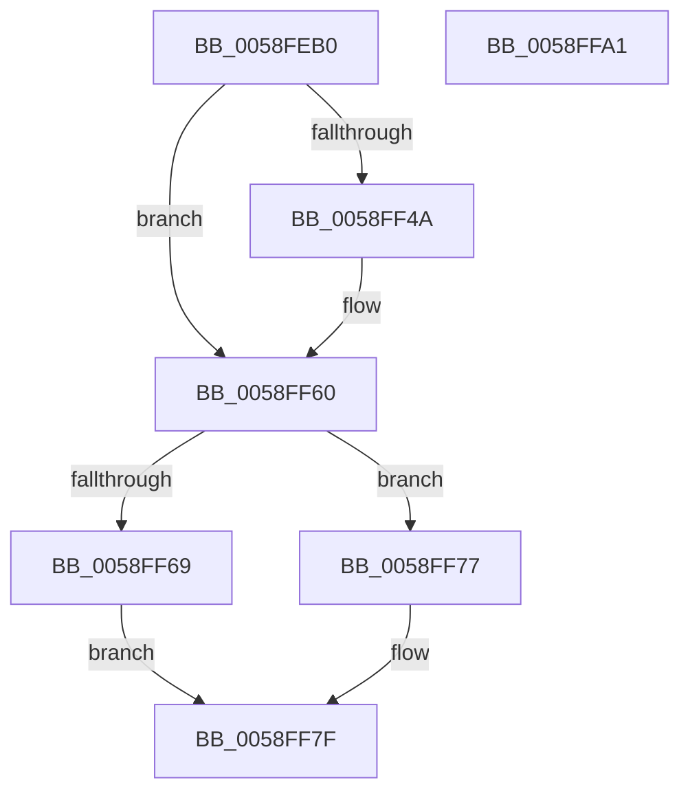

# VslFinishSecureImageValidation

- RVA: `0x0058FEB0`–`0x0058FFA2` (길이 `242` bytes)
- VA: `0x000000014058FEB0`
- 실행 섹션: `.text`
- PDB 이름 있음: `예`; PDB Function 태그: `아니요`
- unwind 정보 RVA: `0x000C6EAC`
- 디코드: `74`개 명령, `242/242` bytes 표시
- 미해석 바이트: `0` (있으면 어셈블리에 `.byte`로 보존)

> 이 문서는 커널 이미지의 기계어와 PDB 기호를 분석해 생성했습니다. 4번과 5번은 함수 원형과 자료형을 바이너리 사용 방식에서 추정한 C 해석이며 원본 소스 복구 결과는 아닙니다.

## 1. Dependencies

- 직접 호출 지점: **4**; 고유 호출 대상: **4**
- 직접 호출자로 확인된 함수: **0**
- RIP 상대 이미지 참조: **1**

### Outgoing calls
- `0x0058FF12` → [memset](../6C/memset_function_006C6C40.md) (function, `0x006C6C40`)
- `0x0058FF3A` → [VslpEnterIumSecureMode](../23/VslpEnterIumSecureMode_function_00235E50.md) (function, `0x00235E50`)
- `0x0058FF6C` → [VslFreePoolTransferObject](../4C/VslFreePoolTransferObject_function_004C4290.md) (function, `0x004C4290`)
- `0x0058FF88` → [_security_check_cookie](../6A/_security_check_cookie_function_006AC640.md) (function, `0x006AC640`)

### Direct callers
- 이 함수 시작 RVA로 연결되는 직접 call은 확인되지 않았습니다. 간접 호출은 완전히 역산할 수 없습니다.

### Static image references
- `0x0058FEC9` → RVA `0x00E0A740` (`.data`; read)

## 2. Other-region calls and transfers

- 다른 실행 섹션으로 향하는 call: **0**
- 별도 외부 분기/꼬리 이동을 확인하지 못했습니다.

## 3. Assembly (complete function range)

```asm
0058FEB0  40 55                           push rbp
0058FEB2  53                              push rbx
0058FEB3  56                              push rsi
0058FEB4  57                              push rdi
0058FEB5  41 54                           push r12
0058FEB7  41 55                           push r13
0058FEB9  41 56                           push r14
0058FEBB  41 57                           push r15
0058FEBD  48 8D 6C 24 F9                  lea rbp, [rsp - 7]
0058FEC2  48 81 EC B8 00 00 00            sub rsp, 0xb8
0058FEC9  48 8B 05 70 A8 87 00            mov rax, qword ptr [rip + 0x87a870]
0058FED0  48 33 C4                        xor rax, rsp
0058FED3  48 89 45 EF                     mov qword ptr [rbp - 0x11], rax
0058FED7  48 8B 45 6F                     mov rax, qword ptr [rbp + 0x6f]
0058FEDB  48 8B F2                        mov rsi, rdx
0058FEDE  4C 8B 65 77                     mov r12, qword ptr [rbp + 0x77]
0058FEE2  33 D2                           xor edx, edx
0058FEE4  4C 8B 6D 7F                     mov r13, qword ptr [rbp + 0x7f]
0058FEE8  45 8B F0                        mov r14d, r8d
0058FEEB  48 8B BD 8F 00 00 00            mov rdi, qword ptr [rbp + 0x8f]
0058FEF2  48 8B D9                        mov rbx, rcx
0058FEF5  48 89 44 24 20                  mov qword ptr [rsp + 0x20], rax
0058FEFA  48 8D 4C 24 30                  lea rcx, [rsp + 0x30]
0058FEFF  48 8B 85 87 00 00 00            mov rax, qword ptr [rbp + 0x87]
0058FF06  44 8D 42 68                     lea r8d, [rdx + 0x68]
0058FF0A  45 8A F9                        mov r15b, r9b
0058FF0D  48 89 44 24 28                  mov qword ptr [rsp + 0x28], rax
0058FF12  E8 29 6D 13 00                  call 0x1406c6c40
0058FF17  48 89 75 8F                     mov qword ptr [rbp - 0x71], rsi
0058FF1B  4C 8D 4C 24 30                  lea r9, [rsp + 0x30]
0058FF20  33 F6                           xor esi, esi
0058FF22  48 89 5D 87                     mov qword ptr [rbp - 0x79], rbx
0058FF26  45 33 C0                        xor r8d, r8d
0058FF29  44 89 75 97                     mov dword ptr [rbp - 0x69], r14d
0058FF2D  B1 02                           mov cl, 2
0058FF2F  44 88 7D 9B                     mov byte ptr [rbp - 0x65], r15b
0058FF33  48 89 75 9F                     mov qword ptr [rbp - 0x61], rsi
0058FF37  8D 56 1B                        lea edx, [rsi + 0x1b]
0058FF3A  E8 11 5F CA FF                  call 0x140235e50
0058FF3F  8B 4D AF                        mov ecx, dword ptr [rbp - 0x51]
0058FF42  8B D8                           mov ebx, eax
0058FF44  89 0F                           mov dword ptr [rdi], ecx
0058FF46  85 C0                           test eax, eax
0058FF48  78 16                           js 0x14058ff60
0058FF4A  48 8B 44 24 20                  mov rax, qword ptr [rsp + 0x20]
0058FF4F  8A 4D 9C                        mov cl, byte ptr [rbp - 0x64]
0058FF52  88 08                           mov byte ptr [rax], cl
0058FF54  48 8B 44 24 28                  mov rax, qword ptr [rsp + 0x28]
0058FF59  48 8B 4D A7                     mov rcx, qword ptr [rbp - 0x59]
0058FF5D  48 89 08                        mov qword ptr [rax], rcx
0058FF60  48 8B 4D 9F                     mov rcx, qword ptr [rbp - 0x61]
0058FF64  48 85 C9                        test rcx, rcx
0058FF67  74 0E                           je 0x14058ff77
0058FF69  49 8B D5                        mov rdx, r13
0058FF6C  E8 1F 43 F3 FF                  call 0x1404c4290
0058FF71  49 89 04 24                     mov qword ptr [r12], rax
0058FF75  EB 08                           jmp 0x14058ff7f
0058FF77  49 89 34 24                     mov qword ptr [r12], rsi
0058FF7B  49 89 75 00                     mov qword ptr [r13], rsi
0058FF7F  8B C3                           mov eax, ebx
0058FF81  48 8B 4D EF                     mov rcx, qword ptr [rbp - 0x11]
0058FF85  48 33 CC                        xor rcx, rsp
0058FF88  E8 B3 C6 11 00                  call 0x1406ac640
0058FF8D  48 81 C4 B8 00 00 00            add rsp, 0xb8
0058FF94  41 5F                           pop r15
0058FF96  41 5E                           pop r14
0058FF98  41 5D                           pop r13
0058FF9A  41 5C                           pop r12
0058FF9C  5F                              pop rdi
0058FF9D  5E                              pop rsi
0058FF9E  5B                              pop rbx
0058FF9F  5D                              pop rbp
0058FFA0  C3                              ret
0058FFA1  CC                              int3
```

## 4. C-style interpretation (structured pseudocode)

```c
__int64 __fastcall VslFinishSecureImageValidation(__int64 a1, __int64 a2, int a3, unsigned __int8 a4, __int64 a5, __int64 a6, __int64 a7, __int64 a8, __int64 a9)
{
    __int64 result;
    __int64 v_rsi;
    __int64 v_rsp;
    unsigned __int64 v_stack_m47;
    unsigned __int64 v_stack_m58;
    unsigned int v_stack_m98;
    unsigned __int64 v_stack_mA0;
    unsigned __int64 v_stack_mA8;
    unsigned __int8 v_stack_mAB;
    unsigned __int8 v_stack_mAC;
    unsigned int v_stack_mB0;
    unsigned __int64 v_stack_mB8;
    unsigned __int64 v_stack_mC0;
    unsigned __int64 v_stack_mC8;
    unsigned __int64 v_stack_mD0;
    unsigned __int64 v_stack_mD8;

    v_rsp = (v_rsp) - (184);
    result = (*(unsigned __int64 *)(v_rip + 8890480)) ^ (v_rsp);
    v_stack_m58 = result;
    a2 = 0;
    v_stack_mD8 = a5;
    v_stack_mD0 = a8;
    result = memset(v_stack_mC8, a2, a2 + 104, a4);
    v_stack_mB8 = 0;
    v_rsi = 0;
    v_stack_mC0 = a1;
    a3 = 0;
    v_stack_mB0 = (unsigned int)((unsigned int)(a3));
    v_stack_mAC = a4;
    v_stack_mA8 = 0;
    result = VslpEnterIumSecureMode(2, v_rsi + 27, a3, v_stack_mC8);
    *(unsigned int *)(a9) = (unsigned int)((unsigned int)(v_stack_m98));
    if (!(sign_flag)) {
        result = v_stack_mD8;
        a1 = v_stack_mAB;
        *(unsigned __int8 *)(result) = (unsigned __int8)(a1);
        result = v_stack_mD0;
        a1 = v_stack_mA0;
        *(unsigned __int64 *)(result) = a1;
    }
    if (v_stack_mA8 == 0) goto loc_0058FF77;
    result = VslFreePoolTransferObject(v_stack_mA8, a7, a3, v_stack_mC8);
    *(unsigned __int64 *)(a6) = result;
    goto loc_0058FF7F;
loc_0058FF77:
    *(unsigned __int64 *)(a6) = 0;
    *(unsigned __int64 *)(a7) = 0;
loc_0058FF7F:
    a1 = (v_stack_m58) ^ (v_rsp);
    result = _security_check_cookie(a1, a7, a3, v_stack_mC8);
    v_rsp = (v_rsp) + (184);
    return result;
}
```

## 5. (Beta) C Style

```c
int64_t VslFinishSecureImageValidation(int64_t Arg1, int64_t Arg2, int32_t Arg3, uint8_t Arg4, int64_t Arg5, void *Arg6, void *Arg7, int64_t Arg8, void *Arg9)
{
    uint8_t *arg6 = (uint8_t *)Arg6;
    uint8_t *arg7 = (uint8_t *)Arg7;
    uint8_t *arg9 = (uint8_t *)Arg9;

    int64_t result;
    int64_t local_rsi;
    int64_t local_rsp;
    uint64_t v_stack_m47;
    uint64_t v_stack_m58;
    uint32_t v_stack_m98;
    uint64_t v_stack_mA0;
    uint64_t v_stack_mA8;
    uint8_t v_stack_mAB;
    uint8_t v_stack_mAC;
    uint32_t v_stack_mB0;
    uint64_t v_stack_mB8;
    uint64_t v_stack_mC0;
    uint64_t v_stack_mC8;
    uint64_t v_stack_mD0;
    uint64_t v_stack_mD8;

    local_rsp = (local_rsp) - (184);
    result = (*(uint64_t *)(v_rip + 0x87A870)) ^ (local_rsp);
    v_stack_m58 = result;
    Arg2 = 0;
    v_stack_mD8 = Arg5;
    v_stack_mD0 = Arg8;
    result = memset(v_stack_mC8, Arg2, Arg2 + 104, Arg4);
    v_stack_mB8 = 0;
    local_rsi = 0;
    v_stack_mC0 = Arg1;
    Arg3 = 0;
    v_stack_mB0 = (uint32_t)((uint32_t)(Arg3));
    v_stack_mAC = Arg4;
    v_stack_mA8 = 0;
    result = VslpEnterIumSecureMode(2, local_rsi + 27, Arg3, v_stack_mC8);
    *(uint32_t *)(arg9) = (uint32_t)((uint32_t)(v_stack_m98));
    if (!(sign_flag)) {
        result = v_stack_mD8;
        Arg1 = v_stack_mAB;
        *(uint8_t *)(result) = (uint8_t)(Arg1);
        result = v_stack_mD0;
        Arg1 = v_stack_mA0;
        *(uint64_t *)(result) = Arg1;
    }
    if (v_stack_mA8 == 0) goto loc_0058FF77;
    result = VslFreePoolTransferObject(v_stack_mA8, Arg7, Arg3, v_stack_mC8);
    *(uint64_t *)(arg6) = result;
    goto loc_0058FF7F;
loc_0058FF77:
    *(uint64_t *)(arg6) = 0;
    *(uint64_t *)(arg7) = 0;
loc_0058FF7F:
    Arg1 = (v_stack_m58) ^ (local_rsp);
    result = _security_check_cookie(Arg1, Arg7, Arg3, v_stack_mC8);
    local_rsp = (local_rsp) + (184);
    return result;
}
```

### 관측된 메모리 오프셋

구조체 형식이 확인되지 않은 접근은 인자 기준의 오프셋으로만 기록했습니다.

| 기준 인자 | 오프셋 표현 | 폭 (bit) | 접근 |
|---|---:|---:|---|
| `Arg6` | `+ 0x0` | `64` | `W` |
| `Arg7` | `+ 0x0` | `64` | `W` |
| `Arg9` | `+ 0x0` | `32` | `W` |

## 6. Execution-region graph

[열기: 2D/3D 그래프와 함수 탐색 컨트롤 패널](../../../control-panel.html?section=text&rva=0x0058FEB0&view=graph)

- 2D 그래프는 위에서 아래로 흐르고, 3D 그래프는 빈 공간을 드래그해 회전합니다. Shift+드래그는 이동, 휠은 확대·축소, 함수 노드 선택은 대상 보고서 이동입니다.

### Static fallback


