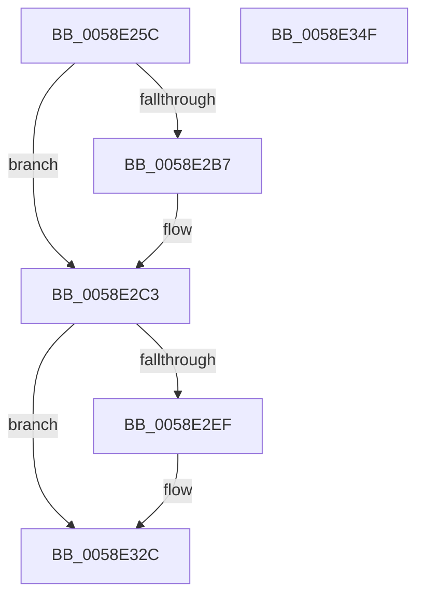

# VslFinishStartSecureProcessor

- RVA: `0x0058E25C`–`0x0058E350` (길이 `244` bytes)
- VA: `0x000000014058E25C`
- 실행 섹션: `.text`
- PDB 이름 있음: `예`; PDB Function 태그: `아니요`
- unwind 정보 RVA: `0x0008FF24`
- 디코드: `54`개 명령, `244/244` bytes 표시
- 미해석 바이트: `0` (있으면 어셈블리에 `.byte`로 보존)

> 이 문서는 커널 이미지의 기계어와 PDB 기호를 분석해 생성했습니다. 4번과 5번은 함수 원형과 자료형을 바이너리 사용 방식에서 추정한 C 해석이며 원본 소스 복구 결과는 아닙니다.

## 1. Dependencies

- 직접 호출 지점: **7**; 고유 호출 대상: **6**
- 직접 호출자로 확인된 함수: **1**
- RIP 상대 이미지 참조: **1**

### Outgoing calls
- `0x0058E28F` → [memset](../6C/memset_function_006C6C40.md) (function, `0x006C6C40`)
- `0x0058E29F` → [memset](../6C/memset_function_006C6C40.md) (function, `0x006C6C40`)
- `0x0058E2BE` → [MmGetPhysicalAddress](../23/MmGetPhysicalAddress_function_0023A500.md) (function, `0x0023A500`)
- `0x0058E2E4` → [VslpLockPagesForTransfer](../29/VslpLockPagesForTransfer_function_0029E0FC.md) (function, `0x0029E0FC`)
- `0x0058E31B` → [VslpEnterIumSecureMode](../23/VslpEnterIumSecureMode_function_00235E50.md) (function, `0x00235E50`)
- `0x0058E327` → [VslpUnlockPagesForTransfer](../29/VslpUnlockPagesForTransfer_function_0029EE4C.md) (function, `0x0029EE4C`)
- `0x0058E339` → [_security_check_cookie](../6A/_security_check_cookie_function_006AC640.md) (function, `0x006AC640`)

### Direct callers
- [KeWriteProtectProcessorState](../../pagelk/B6/KeWriteProtectProcessorState_function_00B66BB0.md) at `0x00B66C71`

### Static image references
- `0x0058E269` → RVA `0x00E0A740` (`.data`; read)

## 2. Other-region calls and transfers

- 다른 실행 섹션으로 향하는 call: **0**
- 별도 외부 분기/꼬리 이동을 확인하지 못했습니다.

## 3. Assembly (complete function range)

```asm
0058E25C  48 89 5C 24 18                  mov qword ptr [rsp + 0x18], rbx
0058E261  57                              push rdi
0058E262  48 81 EC 00 01 00 00            sub rsp, 0x100
0058E269  48 8B 05 D0 C4 87 00            mov rax, qword ptr [rip + 0x87c4d0]
0058E270  48 33 C4                        xor rax, rsp
0058E273  48 89 84 24 F0 00 00 00         mov qword ptr [rsp + 0xf0], rax
0058E27B  48 8B FA                        mov rdi, rdx
0058E27E  48 8B D9                        mov rbx, rcx
0058E281  33 D2                           xor edx, edx
0058E283  48 8D 8C 24 80 00 00 00         lea rcx, [rsp + 0x80]
0058E28B  44 8D 42 68                     lea r8d, [rdx + 0x68]
0058E28F  E8 AC 89 13 00                  call 0x1406c6c40
0058E294  33 D2                           xor edx, edx
0058E296  48 8D 4C 24 30                  lea rcx, [rsp + 0x30]
0058E29B  44 8D 42 48                     lea r8d, [rdx + 0x48]
0058E29F  E8 9C 89 13 00                  call 0x1406c6c40
0058E2A4  44 8B 43 24                     mov r8d, dword ptr [rbx + 0x24]
0058E2A8  33 C0                           xor eax, eax
0058E2AA  44 89 84 24 88 00 00 00         mov dword ptr [rsp + 0x88], r8d
0058E2B2  45 85 C0                        test r8d, r8d
0058E2B5  74 0C                           je 0x14058e2c3
0058E2B7  48 8B 8B B8 FE FF FF            mov rcx, qword ptr [rbx - 0x148]
0058E2BE  E8 3D C2 CA FF                  call 0x14023a500
0058E2C3  83 64 24 20 00                  and dword ptr [rsp + 0x20], 0
0058E2C8  48 8D 4C 24 30                  lea rcx, [rsp + 0x30]
0058E2CD  41 B9 01 00 00 00               mov r9d, 1
0058E2D3  48 89 84 24 90 00 00 00         mov qword ptr [rsp + 0x90], rax
0058E2DB  41 B8 D0 04 00 00               mov r8d, 0x4d0
0058E2E1  48 8B D7                        mov rdx, rdi
0058E2E4  E8 13 FE D0 FF                  call 0x14029e0fc
0058E2E9  8B D8                           mov ebx, eax
0058E2EB  85 C0                           test eax, eax
0058E2ED  78 3D                           js 0x14058e32c
0058E2EF  48 8B 44 24 30                  mov rax, qword ptr [rsp + 0x30]
0058E2F4  4C 8D 8C 24 80 00 00 00         lea r9, [rsp + 0x80]
0058E2FC  48 89 84 24 98 00 00 00         mov qword ptr [rsp + 0x98], rax
0058E304  BA 03 00 00 00                  mov edx, 3
0058E309  48 8B 44 24 68                  mov rax, qword ptr [rsp + 0x68]
0058E30E  45 33 C0                        xor r8d, r8d
0058E311  B1 02                           mov cl, 2
0058E313  48 89 84 24 A0 00 00 00         mov qword ptr [rsp + 0xa0], rax
0058E31B  E8 30 7B CA FF                  call 0x140235e50
0058E320  48 8D 4C 24 30                  lea rcx, [rsp + 0x30]
0058E325  8B D8                           mov ebx, eax
0058E327  E8 20 0B D1 FF                  call 0x14029ee4c
0058E32C  8B C3                           mov eax, ebx
0058E32E  48 8B 8C 24 F0 00 00 00         mov rcx, qword ptr [rsp + 0xf0]
0058E336  48 33 CC                        xor rcx, rsp
0058E339  E8 02 E3 11 00                  call 0x1406ac640
0058E33E  48 8B 9C 24 20 01 00 00         mov rbx, qword ptr [rsp + 0x120]
0058E346  48 81 C4 00 01 00 00            add rsp, 0x100
0058E34D  5F                              pop rdi
0058E34E  C3                              ret
0058E34F  CC                              int3
```

## 4. C-style interpretation (structured pseudocode)

```c
__int64 __fastcall VslFinishStartSecureProcessor(__int64 a1, __int64 a2)
{
    __int64 result;
    __int64 v_rbx;
    __int64 v_rsp;
    unsigned __int64 v_stack_m18;
    unsigned __int64 v_stack_m68;
    unsigned __int64 v_stack_m70;
    unsigned __int64 v_stack_m78;
    unsigned int v_stack_m80;
    unsigned __int64 v_stack_m88;
    unsigned __int64 v_stack_mA0;
    unsigned __int64 v_stack_mD8;
    unsigned int v_stack_mE8;
    unsigned __int64 v_stack_p18;

    v_stack_p18 = v_rbx;
    v_rsp = (v_rsp) - (256);
    result = (*(unsigned __int64 *)(v_rip + 8897744)) ^ (v_rsp);
    v_stack_m18 = result;
    a2 = 0;
    result = memset(v_stack_m88, a2, a2 + 104, a4);
    a2 = 0;
    result = memset(v_stack_mD8, a2, a2 + 72, a4);
    result = 0;
    v_stack_m80 = (unsigned int)((unsigned int)(*(unsigned int *)(a1 + 36)));
    if ((unsigned int)((unsigned int)(*(unsigned int *)(a1 + 36))) != 0) {
        a1 = *(unsigned __int64 *)(a1 - 328);
        result = MmGetPhysicalAddress(a1, a2, (unsigned int)(*(unsigned int *)(a1 + 36)), a4);
    }
    v_stack_m78 = result;
    result = VslpLockPagesForTransfer(v_stack_mD8, 0, (unsigned int)(0x4D0ULL), 1);
    v_rbx = (unsigned int)((unsigned int)(result));
    if (!(sign_flag)) {
        result = v_stack_mD8;
        a4 = v_stack_m88;
        v_stack_m70 = result;
        a2 = 3;
        result = v_stack_mA0;
        a3 = 0;
        a1 = 2;
        v_stack_m68 = result;
        result = VslpEnterIumSecureMode(a1, a2, a3, a4);
        a1 = v_stack_mD8;
        v_rbx = (unsigned int)(result);
        result = VslpUnlockPagesForTransfer(a1, a2, a3, a4);
    }
    a1 = (v_stack_m18) ^ (v_rsp);
    result = _security_check_cookie(a1, a2, a3, a4);
    v_rsp = (v_rsp) + (256);
    return result;
}
```

## 5. (Beta) C Style

```c
int64_t VslFinishStartSecureProcessor(void *Arg1, int64_t Arg2)
{
    uint8_t *arg1 = (uint8_t *)Arg1;

    int64_t result;
    int64_t local_rbx;
    int64_t local_rsp;
    uint64_t v_stack_m18;
    uint64_t v_stack_m68;
    uint64_t v_stack_m70;
    uint64_t v_stack_m78;
    uint32_t v_stack_m80;
    uint64_t v_stack_m88;
    uint64_t v_stack_mA0;
    uint64_t v_stack_mD8;
    uint32_t v_stack_mE8;
    uint64_t v_stack_p18;

    v_stack_p18 = local_rbx;
    local_rsp = (local_rsp) - (256);
    result = (*(uint64_t *)(v_rip + 0x87C4D0)) ^ (local_rsp);
    v_stack_m18 = result;
    Arg2 = 0;
    result = memset(v_stack_m88, Arg2, Arg2 + 104, a4);
    Arg2 = 0;
    result = memset(v_stack_mD8, Arg2, Arg2 + 72, a4);
    result = 0;
    v_stack_m80 = (uint32_t)((uint32_t)(*(uint32_t *)(arg1 + 0x24)));
    if ((uint32_t)((uint32_t)(*(uint32_t *)(arg1 + 0x24))) != 0) {
        Arg1 = *(uint64_t *)(arg1 - 0x148);
        result = MmGetPhysicalAddress(Arg1, Arg2, (uint32_t)(*(uint32_t *)(arg1 + 0x24)), a4);
    }
    v_stack_m78 = result;
    result = VslpLockPagesForTransfer(v_stack_mD8, 0, (uint32_t)(0x4D0ULL), 1);
    local_rbx = (uint32_t)((uint32_t)(result));
    if (!(sign_flag)) {
        result = v_stack_mD8;
        a4 = v_stack_m88;
        v_stack_m70 = result;
        Arg2 = 3;
        result = v_stack_mA0;
        a3 = 0;
        Arg1 = 2;
        v_stack_m68 = result;
        result = VslpEnterIumSecureMode(Arg1, Arg2, a3, a4);
        Arg1 = v_stack_mD8;
        local_rbx = (uint32_t)(result);
        result = VslpUnlockPagesForTransfer(Arg1, Arg2, a3, a4);
    }
    Arg1 = (v_stack_m18) ^ (local_rsp);
    result = _security_check_cookie(Arg1, Arg2, a3, a4);
    local_rsp = (local_rsp) + (256);
    return result;
}
```

### 관측된 메모리 오프셋

구조체 형식이 확인되지 않은 접근은 인자 기준의 오프셋으로만 기록했습니다.

| 기준 인자 | 오프셋 표현 | 폭 (bit) | 접근 |
|---|---:|---:|---|
| `Arg1` | `- 0x148` | `64` | `R` |
| `Arg1` | `+ 0x24` | `32` | `R` |

## 6. Execution-region graph

[열기: 2D/3D 그래프와 함수 탐색 컨트롤 패널](../../../control-panel.html?section=text&rva=0x0058E25C&view=graph)

- 2D 그래프는 위에서 아래로 흐르고, 3D 그래프는 빈 공간을 드래그해 회전합니다. Shift+드래그는 이동, 휠은 확대·축소, 함수 노드 선택은 대상 보고서 이동입니다.

### Static fallback


