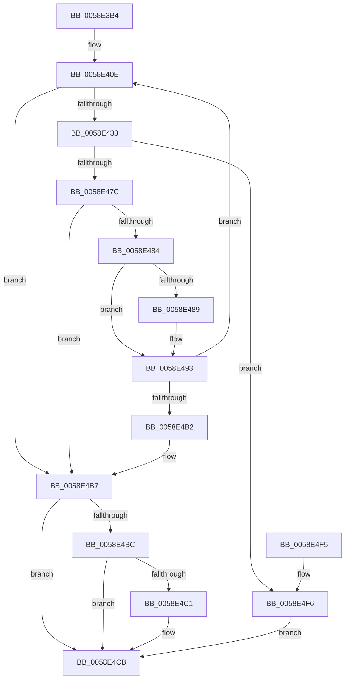

# VslGetEtwDebugId

- RVA: `0x0058E3B4`–`0x0058E4FB` (길이 `327` bytes)
- VA: `0x000000014058E3B4`
- 실행 섹션: `.text`
- PDB 이름 있음: `예`; PDB Function 태그: `아니요`
- unwind 정보 RVA: `0x000C6AAC`
- 디코드: `92`개 명령, `327/327` bytes 표시
- 미해석 바이트: `0` (있으면 어셈블리에 `.byte`로 보존)

> 이 문서는 커널 이미지의 기계어와 PDB 기호를 분석해 생성했습니다. 4번과 5번은 함수 원형과 자료형을 바이너리 사용 방식에서 추정한 C 해석이며 원본 소스 복구 결과는 아닙니다.

## 1. Dependencies

- 직접 호출 지점: **9**; 고유 호출 대상: **7**
- 직접 호출자로 확인된 함수: **1**
- RIP 상대 이미지 참조: **1**

### Outgoing calls
- `0x0058E3F6` → [memset](../6C/memset_function_006C6C40.md) (function, `0x006C6C40`)
- `0x0058E406` → [memset](../6C/memset_function_006C6C40.md) (function, `0x006C6C40`)
- `0x0058E424` → [VslpLockPagesForTransfer](../29/VslpLockPagesForTransfer_function_0029E0FC.md) (function, `0x0029E0FC`)
- `0x0058E461` → [VslpEnterIumSecureMode](../23/VslpEnterIumSecureMode_function_00235E50.md) (function, `0x00235E50`)
- `0x0058E46D` → [VslpUnlockPagesForTransfer](../29/VslpUnlockPagesForTransfer_function_0029EE4C.md) (function, `0x0029EE4C`)
- `0x0058E48E` → [ExFreePoolWithTag](../../poolcode/B8/ExFreePoolWithTag_function_00B82870.md) (function, `0x00B82870`)
- `0x0058E4A1` → [ExAllocatePool2](../../poolcode/B8/ExAllocatePool2_function_00B820F0.md) (function, `0x00B820F0`)
- `0x0058E4C6` → [ExFreePoolWithTag](../../poolcode/B8/ExFreePoolWithTag_function_00B82870.md) (function, `0x00B82870`)
- `0x0058E4D4` → [_security_check_cookie](../6A/_security_check_cookie_function_006AC640.md) (function, `0x006AC640`)

### Direct callers
- [EtwpLocateDbgIdForRegEntry](../../page/8D/EtwpLocateDbgIdForRegEntry_function_008D99A4.md) at `0x008D9AE9`

### Static image references
- `0x0058E3D2` → RVA `0x00E0A740` (`.data`; read)

## 2. Other-region calls and transfers

- 다른 실행 섹션으로 향하는 call: **3**
  - `0x0058E48E` → [ExFreePoolWithTag](../../poolcode/B8/ExFreePoolWithTag_function_00B82870.md) (`.text` → `POOLCODE`)
  - `0x0058E4A1` → [ExAllocatePool2](../../poolcode/B8/ExAllocatePool2_function_00B820F0.md) (`.text` → `POOLCODE`)
  - `0x0058E4C6` → [ExFreePoolWithTag](../../poolcode/B8/ExFreePoolWithTag_function_00B82870.md) (`.text` → `POOLCODE`)
- 별도 외부 분기/꼬리 이동을 확인하지 못했습니다.

## 3. Assembly (complete function range)

```asm
0058E3B4  48 89 5C 24 08                  mov qword ptr [rsp + 8], rbx
0058E3B9  48 89 74 24 10                  mov qword ptr [rsp + 0x10], rsi
0058E3BE  55                              push rbp
0058E3BF  57                              push rdi
0058E3C0  41 55                           push r13
0058E3C2  41 56                           push r14
0058E3C4  41 57                           push r15
0058E3C6  48 8D 6C 24 C9                  lea rbp, [rsp - 0x37]
0058E3CB  48 81 EC 00 01 00 00            sub rsp, 0x100
0058E3D2  48 8B 05 67 C3 87 00            mov rax, qword ptr [rip + 0x87c367]
0058E3D9  48 33 C4                        xor rax, rsp
0058E3DC  48 89 45 27                     mov qword ptr [rbp + 0x27], rax
0058E3E0  4C 8B FA                        mov r15, rdx
0058E3E3  49 8B F0                        mov rsi, r8
0058E3E6  33 D2                           xor edx, edx
0058E3E8  4C 8B E9                        mov r13, rcx
0058E3EB  48 8D 4D B7                     lea rcx, [rbp - 0x49]
0058E3EF  4D 8B F1                        mov r14, r9
0058E3F2  44 8D 42 68                     lea r8d, [rdx + 0x68]
0058E3F6  E8 45 88 13 00                  call 0x1406c6c40
0058E3FB  33 D2                           xor edx, edx
0058E3FD  48 8D 4C 24 30                  lea rcx, [rsp + 0x30]
0058E402  44 8D 42 48                     lea r8d, [rdx + 0x48]
0058E406  E8 35 88 13 00                  call 0x1406c6c40
0058E40B  48 8B 1E                        mov rbx, qword ptr [rsi]
0058E40E  45 8B 06                        mov r8d, dword ptr [r14]
0058E411  48 8D 4C 24 30                  lea rcx, [rsp + 0x30]
0058E416  83 64 24 20 00                  and dword ptr [rsp + 0x20], 0
0058E41B  41 B9 02 00 00 00               mov r9d, 2
0058E421  48 8B D3                        mov rdx, rbx
0058E424  E8 D3 FC D0 FF                  call 0x14029e0fc
0058E429  8B F8                           mov edi, eax
0058E42B  85 C0                           test eax, eax
0058E42D  0F 88 84 00 00 00               js 0x14058e4b7
0058E433  49 8B 85 70 01 00 00            mov rax, qword ptr [r13 + 0x170]
0058E43A  4C 8D 4D B7                     lea r9, [rbp - 0x49]
0058E43E  48 89 45 BF                     mov qword ptr [rbp - 0x41], rax
0058E442  BA 11 00 00 00                  mov edx, 0x11
0058E447  48 8B 45 9F                     mov rax, qword ptr [rbp - 0x61]
0058E44B  45 33 C0                        xor r8d, r8d
0058E44E  48 89 45 D7                     mov qword ptr [rbp - 0x29], rax
0058E452  B1 02                           mov cl, 2
0058E454  48 8B 44 24 30                  mov rax, qword ptr [rsp + 0x30]
0058E459  48 89 45 CF                     mov qword ptr [rbp - 0x31], rax
0058E45D  4C 89 7D C7                     mov qword ptr [rbp - 0x39], r15
0058E461  E8 EA 79 CA FF                  call 0x140235e50
0058E466  48 8D 4C 24 30                  lea rcx, [rsp + 0x30]
0058E46B  8B F8                           mov edi, eax
0058E46D  E8 DA 09 D1 FF                  call 0x14029ee4c
0058E472  8B 45 DF                        mov eax, dword ptr [rbp - 0x21]
0058E475  41 89 06                        mov dword ptr [r14], eax
0058E478  85 FF                           test edi, edi
0058E47A  79 7A                           jns 0x14058e4f6
0058E47C  81 FF 23 00 00 C0               cmp edi, 0xc0000023
0058E482  75 33                           jne 0x14058e4b7
0058E484  48 3B 1E                        cmp rbx, qword ptr [rsi]
0058E487  74 0A                           je 0x14058e493
0058E489  33 D2                           xor edx, edx
0058E48B  48 8B CB                        mov rcx, rbx
0058E48E  E8 DD 43 5F 00                  call 0x140b82870
0058E493  41 8B 16                        mov edx, dword ptr [r14]
0058E496  B9 00 01 00 00                  mov ecx, 0x100
0058E49B  41 B8 56 6D 73 54               mov r8d, 0x54736d56
0058E4A1  E8 4A 3C 5F 00                  call 0x140b820f0
0058E4A6  48 8B D8                        mov rbx, rax
0058E4A9  48 85 C0                        test rax, rax
0058E4AC  0F 85 5C FF FF FF               jne 0x14058e40e
0058E4B2  BF 9A 00 00 C0                  mov edi, 0xc000009a
0058E4B7  48 3B 1E                        cmp rbx, qword ptr [rsi]
0058E4BA  74 0F                           je 0x14058e4cb
0058E4BC  48 85 DB                        test rbx, rbx
0058E4BF  74 0A                           je 0x14058e4cb
0058E4C1  33 D2                           xor edx, edx
0058E4C3  48 8B CB                        mov rcx, rbx
0058E4C6  E8 A5 43 5F 00                  call 0x140b82870
0058E4CB  8B C7                           mov eax, edi
0058E4CD  48 8B 4D 27                     mov rcx, qword ptr [rbp + 0x27]
0058E4D1  48 33 CC                        xor rcx, rsp
0058E4D4  E8 67 E1 11 00                  call 0x1406ac640
0058E4D9  4C 8D 9C 24 00 01 00 00         lea r11, [rsp + 0x100]
0058E4E1  49 8B 5B 30                     mov rbx, qword ptr [r11 + 0x30]
0058E4E5  49 8B 73 38                     mov rsi, qword ptr [r11 + 0x38]
0058E4E9  49 8B E3                        mov rsp, r11
0058E4EC  41 5F                           pop r15
0058E4EE  41 5E                           pop r14
0058E4F0  41 5D                           pop r13
0058E4F2  5F                              pop rdi
0058E4F3  5D                              pop rbp
0058E4F4  C3                              ret
0058E4F5  CC                              int3
0058E4F6  48 89 1E                        mov qword ptr [rsi], rbx
0058E4F9  EB D0                           jmp 0x14058e4cb
```

## 4. C-style interpretation (structured pseudocode)

```c
__int64 __fastcall VslGetEtwDebugId(__int64 a1, __int64 a2, __int64 a3, __int64 a4)
{
    __int64 result;
    __int64 v_rsp;
    unsigned int v_stack_m108;
    unsigned __int64 v_stack_m28;
    unsigned __int64 v_stack_m38;
    unsigned __int64 v_stack_m5F;
    unsigned int v_stack_m80;
    unsigned __int64 v_stack_m88;
    unsigned __int64 v_stack_m90;
    unsigned __int64 v_stack_m98;
    unsigned __int64 v_stack_mA0;
    unsigned __int64 v_stack_mA8;
    unsigned __int64 v_stack_mC0;
    unsigned __int64 v_stack_mF8;
    unsigned __int64 v_stack_p10;
    unsigned __int64 v_stack_p8;

    v_stack_p8 = v_rbx;
    v_stack_p10 = v_rsi;
    v_rsp = (v_rsp) - (256);
    result = (*(unsigned __int64 *)(v_rip + 8897383)) ^ (v_rsp);
    v_stack_m38 = result;
    a2 = 0;
    result = memset(v_stack_mA8, a2, a2 + 104, a4);
    a2 = 0;
    result = memset(v_stack_mF8, a2, a2 + 72, a4);
loc_0058E40E:
    result = VslpLockPagesForTransfer(v_stack_mF8, *(unsigned __int64 *)(a3), (unsigned int)(*(unsigned int *)(a4)), 2);
    if (sign_flag) goto loc_0058E4B7;
    v_stack_mA0 = *(unsigned __int64 *)(a1 + 368);
    a3 = 0;
    v_stack_m88 = v_stack_mC0;
    v_stack_m90 = v_stack_mF8;
    v_stack_m98 = 0;
    result = VslpEnterIumSecureMode(2, 17, a3, v_stack_mA8);
    result = VslpUnlockPagesForTransfer(v_stack_mF8, 17, a3, v_stack_mA8);
    *(unsigned int *)(a4) = (unsigned int)((unsigned int)(v_stack_m80));
    if (!sign_flag) goto loc_0058E4F6;
    if (((unsigned int)((unsigned int)((unsigned int)(result)))) != 0xC0000023ULL) goto loc_0058E4B7;
    result = (unsigned int)(v_stack_m80);
    if ((*(unsigned __int64 *)(a3)) != (*(unsigned __int64 *)(a3))) {
        a2 = 0;
        a1 = *(unsigned __int64 *)(a3);
        result = ExFreePoolWithTag(a1, a2, a3, v_stack_mA8);
    }
    result = ExAllocatePool2(256, (unsigned int)(*(unsigned int *)(a4)), (unsigned int)(0x54736D56ULL), v_stack_mA8);
    if (result != 0) goto loc_0058E40E;
loc_0058E4B7:
    if (result == (*(unsigned __int64 *)(a3))) goto loc_0058E4CB;
    if (result != 0) {
        a2 = 0;
        a1 = result;
        result = ExFreePoolWithTag(a1, a2, (unsigned int)(0x54736D56ULL), v_stack_mA8);
    }
    a1 = (v_stack_m38) ^ (v_rsp);
    result = _security_check_cookie(a1, a2, (unsigned int)(0x54736D56ULL), v_stack_mA8);
    return result;
loc_0058E4F6:
    *(unsigned __int64 *)(*(unsigned __int64 *)(v_stack_m28 + 56)) = *(unsigned __int64 *)(v_stack_m28 + 48);
    goto loc_0058E4CB;
}
```

## 5. (Beta) C Style

```c
int64_t VslGetEtwDebugId(void *Arg1, int64_t Arg2, void *Arg3, void *Arg4)
{
    uint8_t *arg1 = (uint8_t *)Arg1;
    uint8_t *arg3 = (uint8_t *)Arg3;
    uint8_t *arg4 = (uint8_t *)Arg4;

    int64_t result;
    int64_t local_rsp;
    uint32_t v_stack_m108;
    uint64_t v_stack_m28;
    uint64_t v_stack_m38;
    uint64_t v_stack_m5F;
    uint32_t v_stack_m80;
    uint64_t v_stack_m88;
    uint64_t v_stack_m90;
    uint64_t v_stack_m98;
    uint64_t v_stack_mA0;
    uint64_t v_stack_mA8;
    uint64_t v_stack_mC0;
    uint64_t v_stack_mF8;
    uint64_t v_stack_p10;
    uint64_t v_stack_p8;

    v_stack_p8 = local_rbx;
    v_stack_p10 = local_rsi;
    local_rsp = (local_rsp) - (256);
    result = (*(uint64_t *)(v_rip + 0x87C367)) ^ (local_rsp);
    v_stack_m38 = result;
    Arg2 = 0;
    result = memset(v_stack_mA8, Arg2, Arg2 + 104, Arg4);
    Arg2 = 0;
    result = memset(v_stack_mF8, Arg2, Arg2 + 72, Arg4);
loc_0058E40E:
    result = VslpLockPagesForTransfer(v_stack_mF8, *(uint64_t *)(arg3), (uint32_t)(*(uint32_t *)(arg4)), 2);
    if (sign_flag) goto loc_0058E4B7;
    v_stack_mA0 = *(uint64_t *)(arg1 + 0x170);
    Arg3 = 0;
    v_stack_m88 = v_stack_mC0;
    v_stack_m90 = v_stack_mF8;
    v_stack_m98 = 0;
    result = VslpEnterIumSecureMode(2, 17, Arg3, v_stack_mA8);
    result = VslpUnlockPagesForTransfer(v_stack_mF8, 17, Arg3, v_stack_mA8);
    *(uint32_t *)(arg4) = (uint32_t)((uint32_t)(v_stack_m80));
    if (!sign_flag) goto loc_0058E4F6;
    if (((uint32_t)((uint32_t)((uint32_t)(result)))) != 0xC0000023ULL) goto loc_0058E4B7;
    result = (uint32_t)(v_stack_m80);
    if ((*(uint64_t *)(arg3)) != (*(uint64_t *)(arg3))) {
        Arg2 = 0;
        Arg1 = *(uint64_t *)(arg3);
        result = ExFreePoolWithTag(Arg1, Arg2, Arg3, v_stack_mA8);
    }
    result = ExAllocatePool2(256, (uint32_t)(*(uint32_t *)(arg4)), (uint32_t)(0x54736D56ULL), v_stack_mA8);
    if (result != 0) goto loc_0058E40E;
loc_0058E4B7:
    if (result == (*(uint64_t *)(arg3))) goto loc_0058E4CB;
    if (result != 0) {
        Arg2 = 0;
        Arg1 = result;
        result = ExFreePoolWithTag(Arg1, Arg2, (uint32_t)(0x54736D56ULL), v_stack_mA8);
    }
    Arg1 = (v_stack_m38) ^ (local_rsp);
    result = _security_check_cookie(Arg1, Arg2, (uint32_t)(0x54736D56ULL), v_stack_mA8);
    return result;
loc_0058E4F6:
    *(uint64_t *)(*(uint64_t *)(v_stack_m28 + 0x38)) = *(uint64_t *)(v_stack_m28 + 0x30);
    goto loc_0058E4CB;
}
```

### 관측된 메모리 오프셋

구조체 형식이 확인되지 않은 접근은 인자 기준의 오프셋으로만 기록했습니다.

| 기준 인자 | 오프셋 표현 | 폭 (bit) | 접근 |
|---|---:|---:|---|
| `Arg1` | `+ 0x170` | `64` | `R` |
| `Arg3` | `+ 0x0` | `64` | `R` |
| `Arg3` | `+ 0x0` | `64` | `W` |
| `Arg4` | `+ 0x0` | `32` | `R` |
| `Arg4` | `+ 0x0` | `32` | `W` |

## 6. Execution-region graph

[열기: 2D/3D 그래프와 함수 탐색 컨트롤 패널](../../../control-panel.html?section=text&rva=0x0058E3B4&view=graph)

- 2D 그래프는 위에서 아래로 흐르고, 3D 그래프는 빈 공간을 드래그해 회전합니다. Shift+드래그는 이동, 휠은 확대·축소, 함수 노드 선택은 대상 보고서 이동입니다.

### Static fallback


