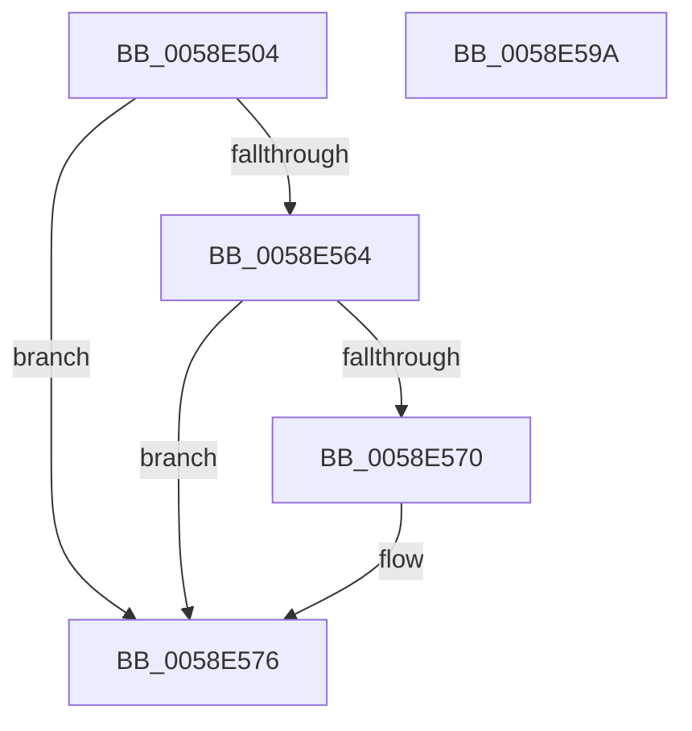

# VslGetSecurePageList

- RVA: `0x0058E504`–`0x0058E59B` (길이 `151` bytes)
- VA: `0x000000014058E504`
- 실행 섹션: `.text`
- PDB 이름 있음: `예`; PDB Function 태그: `아니요`
- unwind 정보 RVA: `0x000C6DF8`
- 디코드: `41`개 명령, `151/151` bytes 표시
- 미해석 바이트: `0` (있으면 어셈블리에 `.byte`로 보존)

> 이 문서는 커널 이미지의 기계어와 PDB 기호를 분석해 생성했습니다. 4번과 5번은 함수 원형과 자료형을 바이너리 사용 방식에서 추정한 C 해석이며 원본 소스 복구 결과는 아닙니다.

## 1. Dependencies

- 직접 호출 지점: **3**; 고유 호출 대상: **3**
- 직접 호출자로 확인된 함수: **4**
- RIP 상대 이미지 참조: **1**

### Outgoing calls
- `0x0058E53D` → [memset](../6C/memset_function_006C6C40.md) (function, `0x006C6C40`)
- `0x0058E55B` → [VslpEnterIumSecureMode](../23/VslpEnterIumSecureMode_function_00235E50.md) (function, `0x00235E50`)
- `0x0058E581` → [_security_check_cookie](../6A/_security_check_cookie_function_006AC640.md) (function, `0x006AC640`)

### Direct callers
- [HvlDiscardSecurePagesFromHibernation](HvlDiscardSecurePagesFromHibernation_function_0058A444.md) at `0x0058A49C`
- [HvlIterateSecurePagesForHibernation](HvlIterateSecurePagesForHibernation_function_0058A520.md) at `0x0058A596`
- [HvlAddSecurePagesCallbackRoutine](HvlAddSecurePagesCallbackRoutine_function_0058B0C8.md) at `0x0058B21F`
- [HvlpGetEncryptedDataFromSecureKernel](HvlpGetEncryptedDataFromSecureKernel_function_0058BB98.md) at `0x0058BC7A`

### Static image references
- `0x0058E514` → RVA `0x00E0A740` (`.data`; read)

## 2. Other-region calls and transfers

- 다른 실행 섹션으로 향하는 call: **0**
- 별도 외부 분기/꼬리 이동을 확인하지 못했습니다.

## 3. Assembly (complete function range)

```asm
0058E504  48 89 5C 24 08                  mov qword ptr [rsp + 8], rbx
0058E509  56                              push rsi
0058E50A  57                              push rdi
0058E50B  41 56                           push r14
0058E50D  48 81 EC A0 00 00 00            sub rsp, 0xa0
0058E514  48 8B 05 25 C2 87 00            mov rax, qword ptr [rip + 0x87c225]
0058E51B  48 33 C4                        xor rax, rsp
0058E51E  48 89 84 24 90 00 00 00         mov qword ptr [rsp + 0x90], rax
0058E526  48 8B FA                        mov rdi, rdx
0058E529  0F B6 D9                        movzx ebx, cl
0058E52C  33 D2                           xor edx, edx
0058E52E  48 8D 4C 24 20                  lea rcx, [rsp + 0x20]
0058E533  49 8B F0                        mov rsi, r8
0058E536  4D 8B F1                        mov r14, r9
0058E539  44 8D 42 68                     lea r8d, [rdx + 0x68]
0058E53D  E8 FE 86 13 00                  call 0x1406c6c40
0058E542  BA 02 08 00 00                  mov edx, 0x802
0058E547  48 89 5C 24 28                  mov qword ptr [rsp + 0x28], rbx
0058E54C  4C 8D 4C 24 20                  lea r9, [rsp + 0x20]
0058E551  48 89 7C 24 30                  mov qword ptr [rsp + 0x30], rdi
0058E556  45 33 C0                        xor r8d, r8d
0058E559  B1 02                           mov cl, 2
0058E55B  E8 F0 78 CA FF                  call 0x140235e50
0058E560  85 C0                           test eax, eax
0058E562  78 12                           js 0x14058e576
0058E564  8A 4C 24 30                     mov cl, byte ptr [rsp + 0x30]
0058E568  41 88 0E                        mov byte ptr [r14], cl
0058E56B  48 85 F6                        test rsi, rsi
0058E56E  74 06                           je 0x14058e576
0058E570  8B 4C 24 38                     mov ecx, dword ptr [rsp + 0x38]
0058E574  89 0E                           mov dword ptr [rsi], ecx
0058E576  48 8B 8C 24 90 00 00 00         mov rcx, qword ptr [rsp + 0x90]
0058E57E  48 33 CC                        xor rcx, rsp
0058E581  E8 BA E0 11 00                  call 0x1406ac640
0058E586  48 8B 9C 24 C0 00 00 00         mov rbx, qword ptr [rsp + 0xc0]
0058E58E  48 81 C4 A0 00 00 00            add rsp, 0xa0
0058E595  41 5E                           pop r14
0058E597  5F                              pop rdi
0058E598  5E                              pop rsi
0058E599  C3                              ret
0058E59A  CC                              int3
```

## 4. C-style interpretation (structured pseudocode)

```c
__int64 __fastcall VslGetSecurePageList(unsigned __int8 a1, __int64 a2, __int64 a3, __int64 a4)
{
    __int64 result;
    __int64 v_rsp;
    unsigned __int64 v_stack_m28;
    unsigned int v_stack_m80;
    unsigned __int64 v_stack_m88;
    unsigned __int64 v_stack_m90;
    unsigned __int64 v_stack_m98;
    unsigned __int64 v_stack_p8;

    v_stack_p8 = v_rbx;
    v_rsp = (v_rsp) - (160);
    result = (*(unsigned __int64 *)(v_rip + 8897061)) ^ (v_rsp);
    v_stack_m28 = result;
    a2 = 0;
    result = memset(v_stack_m98, a2, a2 + 104, a4);
    v_stack_m90 = a1;
    v_stack_m88 = 0;
    a3 = 0;
    result = VslpEnterIumSecureMode(2, (unsigned int)(0x802ULL), a3, v_stack_m98);
    if (sign_flag) goto loc_0058E576;
    *(unsigned __int8 *)(a4) = (unsigned __int8)(v_stack_m88);
    if (0 != 0) {
        a1 = v_stack_m80;
        *(unsigned int *)(a3) = a1;
    }
    a1 = (v_stack_m28) ^ (v_rsp);
    result = _security_check_cookie(a1, (unsigned int)(0x802ULL), a3, v_stack_m98);
    v_rsp = (v_rsp) + (160);
    return result;
}
```

## 5. (Beta) C Style

```c
int64_t VslGetSecurePageList(uint8_t Arg1, int64_t Arg2, int64_t Arg3, void *Arg4)
{
    uint8_t *arg4 = (uint8_t *)Arg4;

    int64_t result;
    int64_t local_rsp;
    uint64_t v_stack_m28;
    uint32_t v_stack_m80;
    uint64_t v_stack_m88;
    uint64_t v_stack_m90;
    uint64_t v_stack_m98;
    uint64_t v_stack_p8;

    v_stack_p8 = local_rbx;
    local_rsp = (local_rsp) - (160);
    result = (*(uint64_t *)(v_rip + 0x87C225)) ^ (local_rsp);
    v_stack_m28 = result;
    Arg2 = 0;
    result = memset(v_stack_m98, Arg2, Arg2 + 104, Arg4);
    v_stack_m90 = Arg1;
    v_stack_m88 = 0;
    Arg3 = 0;
    result = VslpEnterIumSecureMode(2, (uint32_t)(0x802ULL), Arg3, v_stack_m98);
    if (sign_flag) goto loc_0058E576;
    *(uint8_t *)(arg4) = (uint8_t)(v_stack_m88);
    if (0 != 0) {
        Arg1 = v_stack_m80;
        *(uint32_t *)(Arg3) = Arg1;
    }
    Arg1 = (v_stack_m28) ^ (local_rsp);
    result = _security_check_cookie(Arg1, (uint32_t)(0x802ULL), Arg3, v_stack_m98);
    local_rsp = (local_rsp) + (160);
    return result;
}
```

### 관측된 메모리 오프셋

구조체 형식이 확인되지 않은 접근은 인자 기준의 오프셋으로만 기록했습니다.

| 기준 인자 | 오프셋 표현 | 폭 (bit) | 접근 |
|---|---:|---:|---|
| `Arg4` | `+ 0x0` | `8` | `W` |

## 6. Execution-region graph

[열기: 2D/3D 그래프와 함수 탐색 컨트롤 패널](../../../control-panel.html?section=text&rva=0x0058E504&view=graph)

- 2D 그래프는 위에서 아래로 흐르고, 3D 그래프는 빈 공간을 드래그해 회전합니다. Shift+드래그는 이동, 휠은 확대·축소, 함수 노드 선택은 대상 보고서 이동입니다.

### Static fallback


