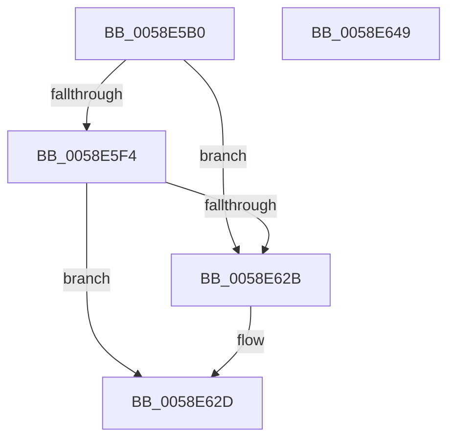

# VslGetSecurePciDeviceAlternateFunctionNumberForVtl0Dma

- RVA: `0x0058E5B0`–`0x0058E64A` (길이 `154` bytes)
- VA: `0x000000014058E5B0`
- 실행 섹션: `.text`
- PDB 이름 있음: `예`; PDB Function 태그: `아니요`
- unwind 정보 RVA: `0x0009A9C4`
- 디코드: `44`개 명령, `154/154` bytes 표시
- 미해석 바이트: `0` (있으면 어셈블리에 `.byte`로 보존)

> 이 문서는 커널 이미지의 기계어와 PDB 기호를 분석해 생성했습니다. 4번과 5번은 함수 원형과 자료형을 바이너리 사용 방식에서 추정한 C 해석이며 원본 소스 복구 결과는 아닙니다.

## 1. Dependencies

- 직접 호출 지점: **4**; 고유 호출 대상: **4**
- 직접 호출자로 확인된 함수: **0**
- RIP 상대 이미지 참조: **1**

### Outgoing calls
- `0x0058E5E4` → [memset](../6C/memset_function_006C6C40.md) (function, `0x006C6C40`)
- `0x0058E5EB` → [HvlQueryVsmConnection](../45/HvlQueryVsmConnection_function_0045D180.md) (function, `0x0045D180`)
- `0x0058E61E` → [VslpEnterIumSecureMode](../23/VslpEnterIumSecureMode_function_00235E50.md) (function, `0x00235E50`)
- `0x0058E638` → [_security_check_cookie](../6A/_security_check_cookie_function_006AC640.md) (function, `0x006AC640`)

### Direct callers
- 이 함수 시작 RVA로 연결되는 직접 call은 확인되지 않았습니다. 간접 호출은 완전히 역산할 수 없습니다.

### Static image references
- `0x0058E5BC` → RVA `0x00E0A740` (`.data`; read)

## 2. Other-region calls and transfers

- 다른 실행 섹션으로 향하는 call: **0**
- 별도 외부 분기/꼬리 이동을 확인하지 못했습니다.

## 3. Assembly (complete function range)

```asm
0058E5B0  40 53                           push rbx
0058E5B2  55                              push rbp
0058E5B3  56                              push rsi
0058E5B4  57                              push rdi
0058E5B5  48 81 EC A8 00 00 00            sub rsp, 0xa8
0058E5BC  48 8B 05 7D C1 87 00            mov rax, qword ptr [rip + 0x87c17d]
0058E5C3  48 33 C4                        xor rax, rsp
0058E5C6  48 89 84 24 90 00 00 00         mov qword ptr [rsp + 0x90], rax
0058E5CE  40 8A FA                        mov dil, dl
0058E5D1  41 8A F0                        mov sil, r8b
0058E5D4  33 D2                           xor edx, edx
0058E5D6  8B D9                           mov ebx, ecx
0058E5D8  48 8D 4C 24 20                  lea rcx, [rsp + 0x20]
0058E5DD  41 8A E9                        mov bpl, r9b
0058E5E0  44 8D 42 68                     lea r8d, [rdx + 0x68]
0058E5E4  E8 57 86 13 00                  call 0x1406c6c40
0058E5E9  33 C9                           xor ecx, ecx
0058E5EB  E8 90 EB EC FF                  call 0x14045d180
0058E5F0  84 C0                           test al, al
0058E5F2  74 37                           je 0x14058e62b
0058E5F4  BA 0C 01 00 00                  mov edx, 0x10c
0058E5F9  89 5C 24 28                     mov dword ptr [rsp + 0x28], ebx
0058E5FD  4C 8D 4C 24 20                  lea r9, [rsp + 0x20]
0058E602  40 88 7C 24 2C                  mov byte ptr [rsp + 0x2c], dil
0058E607  45 33 C0                        xor r8d, r8d
0058E60A  40 88 74 24 2D                  mov byte ptr [rsp + 0x2d], sil
0058E60F  B1 02                           mov cl, 2
0058E611  40 88 6C 24 2E                  mov byte ptr [rsp + 0x2e], bpl
0058E616  C7 44 24 30 02 00 00 00         mov dword ptr [rsp + 0x30], 2
0058E61E  E8 2D 78 CA FF                  call 0x140235e50
0058E623  85 C0                           test eax, eax
0058E625  8A 44 24 30                     mov al, byte ptr [rsp + 0x30]
0058E629  79 02                           jns 0x14058e62d
0058E62B  B0 FF                           mov al, 0xff
0058E62D  48 8B 8C 24 90 00 00 00         mov rcx, qword ptr [rsp + 0x90]
0058E635  48 33 CC                        xor rcx, rsp
0058E638  E8 03 E0 11 00                  call 0x1406ac640
0058E63D  48 81 C4 A8 00 00 00            add rsp, 0xa8
0058E644  5F                              pop rdi
0058E645  5E                              pop rsi
0058E646  5D                              pop rbp
0058E647  5B                              pop rbx
0058E648  C3                              ret
0058E649  CC                              int3
```

## 4. C-style interpretation (structured pseudocode)

```c
__int64 __fastcall VslGetSecurePciDeviceAlternateFunctionNumberForVtl0Dma(int a1, int a2, unsigned __int8 a3, unsigned __int8 a4)
{
    __int64 result;
    __int64 v_rsp;
    unsigned __int64 v_stack_m38;
    unsigned int v_stack_m98;
    unsigned __int8 v_stack_m9A;
    unsigned __int8 v_stack_m9B;
    unsigned __int8 v_stack_m9C;
    unsigned int v_stack_mA0;
    unsigned __int64 v_stack_mA8;

    v_rsp = (v_rsp) - (168);
    result = (*(unsigned __int64 *)(v_rip + 8896893)) ^ (v_rsp);
    v_stack_m38 = result;
    a2 = 0;
    result = memset(v_stack_mA8, a2, a2 + 104, a4);
    a1 = 0;
    result = HvlQueryVsmConnection(a1, a2, a2 + 104, a4);
    if ((unsigned __int8)(result) == 0) goto loc_0058E62B;
    v_stack_mA0 = (unsigned int)((unsigned int)(a1));
    v_stack_m9C = (unsigned __int8)((unsigned __int8)(a2));
    a3 = 0;
    v_stack_m9B = 0;
    v_stack_m9A = a4;
    v_stack_m98 = 2;
    result = VslpEnterIumSecureMode(2, 268, a3, v_stack_mA8);
    result = v_stack_m98;
    if (sign_flag) {
        result = 255;
    }
    a1 = (v_stack_m38) ^ (v_rsp);
    result = _security_check_cookie(a1, 268, a3, v_stack_mA8);
    v_rsp = (v_rsp) + (168);
    return result;
}
```

## 5. (Beta) C Style

```c
int64_t VslGetSecurePciDeviceAlternateFunctionNumberForVtl0Dma(int32_t Arg1, int32_t Arg2, uint8_t Arg3, uint8_t Arg4)
{
    int64_t result;
    int64_t local_rsp;
    uint64_t v_stack_m38;
    uint32_t v_stack_m98;
    uint8_t v_stack_m9A;
    uint8_t v_stack_m9B;
    uint8_t v_stack_m9C;
    uint32_t v_stack_mA0;
    uint64_t v_stack_mA8;

    local_rsp = (local_rsp) - (168);
    result = (*(uint64_t *)(v_rip + 0x87C17D)) ^ (local_rsp);
    v_stack_m38 = result;
    Arg2 = 0;
    result = memset(v_stack_mA8, Arg2, Arg2 + 104, Arg4);
    Arg1 = 0;
    result = HvlQueryVsmConnection(Arg1, Arg2, Arg2 + 104, Arg4);
    if ((uint8_t)(result) == 0) goto loc_0058E62B;
    v_stack_mA0 = (uint32_t)((uint32_t)(Arg1));
    v_stack_m9C = (uint8_t)((uint8_t)(Arg2));
    Arg3 = 0;
    v_stack_m9B = 0;
    v_stack_m9A = Arg4;
    v_stack_m98 = 2;
    result = VslpEnterIumSecureMode(2, 268, Arg3, v_stack_mA8);
    result = v_stack_m98;
    if (sign_flag) {
        result = 255;
    }
    Arg1 = (v_stack_m38) ^ (local_rsp);
    result = _security_check_cookie(Arg1, 268, Arg3, v_stack_mA8);
    local_rsp = (local_rsp) + (168);
    return result;
}
```

## 6. Execution-region graph

[열기: 2D/3D 그래프와 함수 탐색 컨트롤 패널](../../../control-panel.html?section=text&rva=0x0058E5B0&view=graph)

- 2D 그래프는 위에서 아래로 흐르고, 3D 그래프는 빈 공간을 드래그해 회전합니다. Shift+드래그는 이동, 휠은 확대·축소, 함수 노드 선택은 대상 보고서 이동입니다.

### Static fallback


