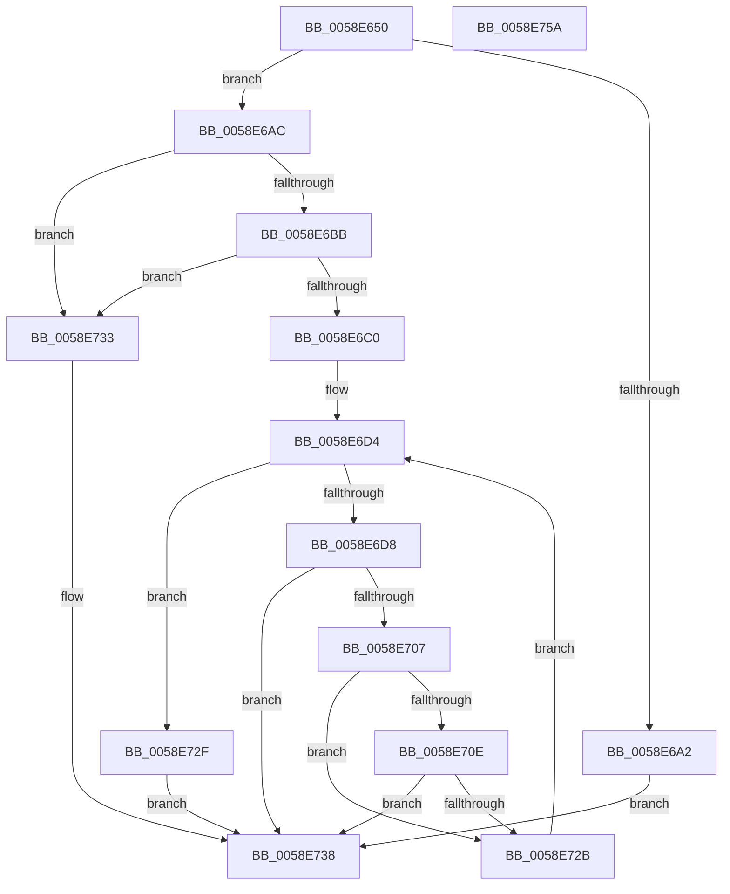

# VslGetSecurePciDeviceBootConfiguration

- RVA: `0x0058E650`–`0x0058E75B` (길이 `267` bytes)
- VA: `0x000000014058E650`
- 실행 섹션: `.text`
- PDB 이름 있음: `예`; PDB Function 태그: `아니요`
- unwind 정보 RVA: `0x000C6C4C`
- 디코드: `80`개 명령, `267/267` bytes 표시
- 미해석 바이트: `0` (있으면 어셈블리에 `.byte`로 보존)

> 이 문서는 커널 이미지의 기계어와 PDB 기호를 분석해 생성했습니다. 4번과 5번은 함수 원형과 자료형을 바이너리 사용 방식에서 추정한 C 해석이며 원본 소스 복구 결과는 아닙니다.

## 1. Dependencies

- 직접 호출 지점: **6**; 고유 호출 대상: **5**
- 직접 호출자로 확인된 함수: **0**
- RIP 상대 이미지 참조: **1**

### Outgoing calls
- `0x0058E692` → [memset](../6C/memset_function_006C6C40.md) (function, `0x006C6C40`)
- `0x0058E699` → [HvlQueryVsmConnection](../45/HvlQueryVsmConnection_function_0045D180.md) (function, `0x0045D180`)
- `0x0058E6CD` → [memset](../6C/memset_function_006C6C40.md) (function, `0x006C6C40`)
- `0x0058E6FE` → [VslpEnterIumSecureMode](../23/VslpEnterIumSecureMode_function_00235E50.md) (function, `0x00235E50`)
- `0x0058E722` → [RtlCmEncodeMemIoResource](../5E/RtlCmEncodeMemIoResource_function_005E7BF0.md) (function, `0x005E7BF0`)
- `0x0058E743` → [_security_check_cookie](../6A/_security_check_cookie_function_006AC640.md) (function, `0x006AC640`)

### Direct callers
- 이 함수 시작 RVA로 연결되는 직접 call은 확인되지 않았습니다. 간접 호출은 완전히 역산할 수 없습니다.

### Static image references
- `0x0058E662` → RVA `0x00E0A740` (`.data`; read)

## 2. Other-region calls and transfers

- 다른 실행 섹션으로 향하는 call: **0**
- 별도 외부 분기/꼬리 이동을 확인하지 못했습니다.

## 3. Assembly (complete function range)

```asm
0058E650  40 53                           push rbx
0058E652  55                              push rbp
0058E653  56                              push rsi
0058E654  57                              push rdi
0058E655  41 54                           push r12
0058E657  41 56                           push r14
0058E659  41 57                           push r15
0058E65B  48 81 EC A0 00 00 00            sub rsp, 0xa0
0058E662  48 8B 05 D7 C0 87 00            mov rax, qword ptr [rip + 0x87c0d7]
0058E669  48 33 C4                        xor rax, rsp
0058E66C  48 89 84 24 90 00 00 00         mov qword ptr [rsp + 0x90], rax
0058E674  48 8B B4 24 08 01 00 00         mov rsi, qword ptr [rsp + 0x108]
0058E67C  44 8A F2                        mov r14b, dl
0058E67F  33 D2                           xor edx, edx
0058E681  45 8A F8                        mov r15b, r8b
0058E684  8B E9                           mov ebp, ecx
0058E686  45 8A E1                        mov r12b, r9b
0058E689  48 8D 4C 24 20                  lea rcx, [rsp + 0x20]
0058E68E  44 8D 42 68                     lea r8d, [rdx + 0x68]
0058E692  E8 A9 85 13 00                  call 0x1406c6c40
0058E697  33 C9                           xor ecx, ecx
0058E699  E8 E2 EA EC FF                  call 0x14045d180
0058E69E  84 C0                           test al, al
0058E6A0  75 0A                           jne 0x14058e6ac
0058E6A2  B8 BB 00 00 C0                  mov eax, 0xc00000bb
0058E6A7  E9 8C 00 00 00                  jmp 0x14058e738
0058E6AC  8B BC 24 00 01 00 00            mov edi, dword ptr [rsp + 0x100]
0058E6B3  8D 47 FF                        lea eax, [rdi - 1]
0058E6B6  83 F8 05                        cmp eax, 5
0058E6B9  77 78                           ja 0x14058e733
0058E6BB  48 85 F6                        test rsi, rsi
0058E6BE  74 73                           je 0x14058e733
0058E6C0  4C 8D 04 BF                     lea r8, [rdi + rdi*4]
0058E6C4  33 D2                           xor edx, edx
0058E6C6  49 C1 E0 02                     shl r8, 2
0058E6CA  48 8B CE                        mov rcx, rsi
0058E6CD  E8 6E 85 13 00                  call 0x1406c6c40
0058E6D2  33 DB                           xor ebx, ebx
0058E6D4  3B DF                           cmp ebx, edi
0058E6D6  73 57                           jae 0x14058e72f
0058E6D8  BA 0E 01 00 00                  mov edx, 0x10e
0058E6DD  89 6C 24 28                     mov dword ptr [rsp + 0x28], ebp
0058E6E1  4C 8D 4C 24 20                  lea r9, [rsp + 0x20]
0058E6E6  44 88 74 24 2C                  mov byte ptr [rsp + 0x2c], r14b
0058E6EB  45 33 C0                        xor r8d, r8d
0058E6EE  44 88 7C 24 2D                  mov byte ptr [rsp + 0x2d], r15b
0058E6F3  B1 02                           mov cl, 2
0058E6F5  44 88 64 24 2E                  mov byte ptr [rsp + 0x2e], r12b
0058E6FA  89 5C 24 30                     mov dword ptr [rsp + 0x30], ebx
0058E6FE  E8 4D 77 CA FF                  call 0x140235e50
0058E703  85 C0                           test eax, eax
0058E705  78 31                           js 0x14058e738
0058E707  80 7C 24 34 00                  cmp byte ptr [rsp + 0x34], 0
0058E70C  74 1D                           je 0x14058e72b
0058E70E  4C 8B 4C 24 38                  mov r9, qword ptr [rsp + 0x38]
0058E713  48 8D 0C 9B                     lea rcx, [rbx + rbx*4]
0058E717  4C 8B 44 24 40                  mov r8, qword ptr [rsp + 0x40]
0058E71C  48 8D 0C 8E                     lea rcx, [rsi + rcx*4]
0058E720  B2 03                           mov dl, 3
0058E722  E8 C9 94 05 00                  call 0x1405e7bf0
0058E727  85 C0                           test eax, eax
0058E729  78 0D                           js 0x14058e738
0058E72B  FF C3                           inc ebx
0058E72D  EB A5                           jmp 0x14058e6d4
0058E72F  33 C0                           xor eax, eax
0058E731  EB 05                           jmp 0x14058e738
0058E733  B8 0D 00 00 C0                  mov eax, 0xc000000d
0058E738  48 8B 8C 24 90 00 00 00         mov rcx, qword ptr [rsp + 0x90]
0058E740  48 33 CC                        xor rcx, rsp
0058E743  E8 F8 DE 11 00                  call 0x1406ac640
0058E748  48 81 C4 A0 00 00 00            add rsp, 0xa0
0058E74F  41 5F                           pop r15
0058E751  41 5E                           pop r14
0058E753  41 5C                           pop r12
0058E755  5F                              pop rdi
0058E756  5E                              pop rsi
0058E757  5D                              pop rbp
0058E758  5B                              pop rbx
0058E759  C3                              ret
0058E75A  CC                              int3
```

## 4. C-style interpretation (structured pseudocode)

```c
__int64 __fastcall VslGetSecurePciDeviceBootConfiguration(int a1, int a2, unsigned __int8 a3, unsigned __int8 a4, unsigned int a5, __int64 a6)
{
    __int64 result;
    __int64 v_rbx;
    __int64 v_rsp;
    unsigned __int64 v_stack_m48;
    unsigned __int64 v_stack_m98;
    unsigned __int64 v_stack_mA0;
    unsigned __int8 v_stack_mA4;
    unsigned int v_stack_mA8;
    unsigned __int8 v_stack_mAA;
    unsigned __int8 v_stack_mAB;
    unsigned __int8 v_stack_mAC;
    unsigned int v_stack_mB0;
    unsigned __int64 v_stack_mB8;

    v_rsp = (v_rsp) - (160);
    result = (*(unsigned __int64 *)(v_rip + 8896727)) ^ (v_rsp);
    v_stack_m48 = result;
    a2 = 0;
    result = memset(v_stack_mB8, a2, a2 + 104, a4);
    a1 = 0;
    result = HvlQueryVsmConnection(a1, a2, a2 + 104, a4);
    if ((unsigned __int8)(result) != 0) goto loc_0058E6AC;
    goto loc_0058E738;
loc_0058E6AC:
    if (((unsigned int)((unsigned int)(a5) - 1)) > 5) goto loc_0058E733;
    if (a6 == 0) goto loc_0058E733;
    a2 = 0;
    a3 = ((unsigned int)(a5) + (unsigned int)(a5) * 4) << (2);
    result = memset(a6, a2, a3, a4);
    v_rbx = 0;
loc_0058E6D4:
    if (0 >= ((unsigned int)((unsigned int)(a5)))) goto loc_0058E72F;
    v_stack_mB0 = (unsigned int)((unsigned int)(a1));
    v_stack_mAC = (unsigned __int8)((unsigned __int8)(a2));
    a3 = 0;
    v_stack_mAB = 0;
    v_stack_mAA = a4;
    v_stack_mA8 = 0;
    result = VslpEnterIumSecureMode(2, 270, a3, v_stack_mB8);
    if (sign_flag) goto loc_0058E738;
    if (v_stack_mA4 == 0) goto loc_0058E72B;
    result = RtlCmEncodeMemIoResource(a6 + v_rbx + v_rbx * 4 * 4, 3, v_stack_m98, v_stack_mA0);
    if (sign_flag) goto loc_0058E738;
loc_0058E72B:
    v_rbx = (unsigned int)((v_rbx) + 1);
    goto loc_0058E6D4;
loc_0058E72F:
    result = 0;
    goto loc_0058E738;
loc_0058E733:
loc_0058E738:
    a1 = (v_stack_m48) ^ (v_rsp);
    result = _security_check_cookie(a1, 3, v_stack_m98, v_stack_mA0);
    v_rsp = (v_rsp) + (160);
    return result;
}
```

## 5. (Beta) C Style

```c
int64_t VslGetSecurePciDeviceBootConfiguration(int32_t Arg1, int32_t Arg2, uint8_t Arg3, uint8_t Arg4, void *Arg5, int64_t Arg6)
{
    uint8_t *arg5 = (uint8_t *)Arg5;

    int64_t result;
    int64_t local_rbx;
    int64_t local_rsp;
    uint64_t v_stack_m48;
    uint64_t v_stack_m98;
    uint64_t v_stack_mA0;
    uint8_t v_stack_mA4;
    uint32_t v_stack_mA8;
    uint8_t v_stack_mAA;
    uint8_t v_stack_mAB;
    uint8_t v_stack_mAC;
    uint32_t v_stack_mB0;
    uint64_t v_stack_mB8;

    local_rsp = (local_rsp) - (160);
    result = (*(uint64_t *)(v_rip + 0x87C0D7)) ^ (local_rsp);
    v_stack_m48 = result;
    Arg2 = 0;
    result = memset(v_stack_mB8, Arg2, Arg2 + 104, Arg4);
    Arg1 = 0;
    result = HvlQueryVsmConnection(Arg1, Arg2, Arg2 + 104, Arg4);
    if ((uint8_t)(result) != 0) goto loc_0058E6AC;
    goto loc_0058E738;
loc_0058E6AC:
    if (((uint32_t)((uint32_t)(Arg5) - 1)) > 5) goto loc_0058E733;
    if (Arg6 == 0) goto loc_0058E733;
    Arg2 = 0;
    Arg3 = ((uint32_t)(Arg5) + (uint32_t)(Arg5) * 4) << (2);
    result = memset(Arg6, Arg2, Arg3, Arg4);
    local_rbx = 0;
loc_0058E6D4:
    if (0 >= ((uint32_t)((uint32_t)(Arg5)))) goto loc_0058E72F;
    v_stack_mB0 = (uint32_t)((uint32_t)(Arg1));
    v_stack_mAC = (uint8_t)((uint8_t)(Arg2));
    Arg3 = 0;
    v_stack_mAB = 0;
    v_stack_mAA = Arg4;
    v_stack_mA8 = 0;
    result = VslpEnterIumSecureMode(2, 270, Arg3, v_stack_mB8);
    if (sign_flag) goto loc_0058E738;
    if (v_stack_mA4 == 0) goto loc_0058E72B;
    result = RtlCmEncodeMemIoResource(Arg6 + local_rbx + local_rbx * 4 * 4, 3, v_stack_m98, v_stack_mA0);
    if (sign_flag) goto loc_0058E738;
loc_0058E72B:
    local_rbx = (uint32_t)((local_rbx) + 1);
    goto loc_0058E6D4;
loc_0058E72F:
    result = 0;
    goto loc_0058E738;
loc_0058E733:
loc_0058E738:
    Arg1 = (v_stack_m48) ^ (local_rsp);
    result = _security_check_cookie(Arg1, 3, v_stack_m98, v_stack_mA0);
    local_rsp = (local_rsp) + (160);
    return result;
}
```

### 관측된 메모리 오프셋

구조체 형식이 확인되지 않은 접근은 인자 기준의 오프셋으로만 기록했습니다.

| 기준 인자 | 오프셋 표현 | 폭 (bit) | 접근 |
|---|---:|---:|---|
| `Arg5` | `- 0x1` | `32` | `R` |
| `Arg5` | `+ 0x0 + rdi*4` | `64` | `R` |

## 6. Execution-region graph

[열기: 2D/3D 그래프와 함수 탐색 컨트롤 패널](../../../control-panel.html?section=text&rva=0x0058E650&view=graph)

- 2D 그래프는 위에서 아래로 흐르고, 3D 그래프는 빈 공간을 드래그해 회전합니다. Shift+드래그는 이동, 휠은 확대·축소, 함수 노드 선택은 대상 보고서 이동입니다.

### Static fallback


