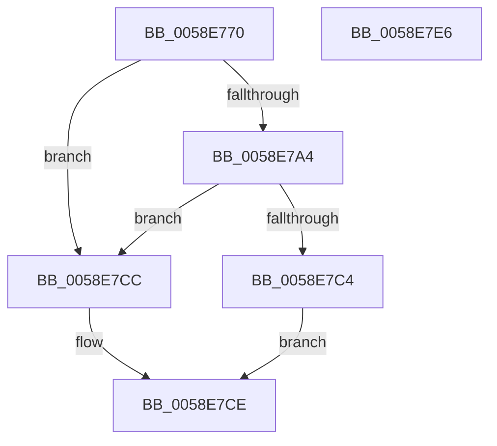

# VslGetSecurePciEnabled

- RVA: `0x0058E770`–`0x0058E7E7` (길이 `119` bytes)
- VA: `0x000000014058E770`
- 실행 섹션: `.text`
- PDB 이름 있음: `예`; PDB Function 태그: `아니요`
- unwind 정보 RVA: `0x000AA6F8`
- 디코드: `30`개 명령, `119/119` bytes 표시
- 미해석 바이트: `0` (있으면 어셈블리에 `.byte`로 보존)

> 이 문서는 커널 이미지의 기계어와 PDB 기호를 분석해 생성했습니다. 4번과 5번은 함수 원형과 자료형을 바이너리 사용 방식에서 추정한 C 해석이며 원본 소스 복구 결과는 아닙니다.

## 1. Dependencies

- 직접 호출 지점: **4**; 고유 호출 대상: **4**
- 직접 호출자로 확인된 함수: **1**
- RIP 상대 이미지 참조: **1**

### Outgoing calls
- `0x0058E794` → [memset](../6C/memset_function_006C6C40.md) (function, `0x006C6C40`)
- `0x0058E79B` → [HvlQueryVsmConnection](../45/HvlQueryVsmConnection_function_0045D180.md) (function, `0x0045D180`)
- `0x0058E7BB` → [VslpEnterIumSecureMode](../23/VslpEnterIumSecureMode_function_00235E50.md) (function, `0x00235E50`)
- `0x0058E7D9` → [_security_check_cookie](../6A/_security_check_cookie_function_006AC640.md) (function, `0x006AC640`)

### Direct callers
- [HvlGetEnlightenmentInfo](HvlGetEnlightenmentInfo_function_00588020.md) at `0x005884AE`

### Static image references
- `0x0058E777` → RVA `0x00E0A740` (`.data`; read)

## 2. Other-region calls and transfers

- 다른 실행 섹션으로 향하는 call: **0**
- 별도 외부 분기/꼬리 이동을 확인하지 못했습니다.

## 3. Assembly (complete function range)

```asm
0058E770  48 81 EC A8 00 00 00            sub rsp, 0xa8
0058E777  48 8B 05 C2 BF 87 00            mov rax, qword ptr [rip + 0x87bfc2]
0058E77E  48 33 C4                        xor rax, rsp
0058E781  48 89 84 24 90 00 00 00         mov qword ptr [rsp + 0x90], rax
0058E789  33 D2                           xor edx, edx
0058E78B  48 8D 4C 24 20                  lea rcx, [rsp + 0x20]
0058E790  44 8D 42 68                     lea r8d, [rdx + 0x68]
0058E794  E8 A7 84 13 00                  call 0x1406c6c40
0058E799  33 C9                           xor ecx, ecx
0058E79B  E8 E0 E9 EC FF                  call 0x14045d180
0058E7A0  84 C0                           test al, al
0058E7A2  74 28                           je 0x14058e7cc
0058E7A4  BA 0C 01 00 00                  mov edx, 0x10c
0058E7A9  C7 44 24 30 01 00 00 00         mov dword ptr [rsp + 0x30], 1
0058E7B1  4C 8D 4C 24 20                  lea r9, [rsp + 0x20]
0058E7B6  45 33 C0                        xor r8d, r8d
0058E7B9  B1 02                           mov cl, 2
0058E7BB  E8 90 76 CA FF                  call 0x140235e50
0058E7C0  85 C0                           test eax, eax
0058E7C2  78 08                           js 0x14058e7cc
0058E7C4  8A 44 24 30                     mov al, byte ptr [rsp + 0x30]
0058E7C8  24 01                           and al, 1
0058E7CA  EB 02                           jmp 0x14058e7ce
0058E7CC  32 C0                           xor al, al
0058E7CE  48 8B 8C 24 90 00 00 00         mov rcx, qword ptr [rsp + 0x90]
0058E7D6  48 33 CC                        xor rcx, rsp
0058E7D9  E8 62 DE 11 00                  call 0x1406ac640
0058E7DE  48 81 C4 A8 00 00 00            add rsp, 0xa8
0058E7E5  C3                              ret
0058E7E6  CC                              int3
```

## 4. C-style interpretation (structured pseudocode)

```c
__int64 __fastcall VslGetSecurePciEnabled(__int64 a1, int a2)
{
    __int64 result;
    __int64 v_rsp;
    unsigned __int64 v_stack_m18;
    unsigned int v_stack_m78;
    unsigned __int64 v_stack_m88;

    v_rsp = (v_rsp) - (168);
    result = (*(unsigned __int64 *)(v_rip + 8896450)) ^ (v_rsp);
    v_stack_m18 = result;
    a2 = 0;
    result = memset(v_stack_m88, a2, a2 + 104, a4);
    a1 = 0;
    result = HvlQueryVsmConnection(a1, a2, a2 + 104, a4);
    if ((unsigned __int8)(result) == 0) goto loc_0058E7CC;
    v_stack_m78 = 1;
    a3 = 0;
    result = VslpEnterIumSecureMode(2, 268, a3, v_stack_m88);
    if (sign_flag) goto loc_0058E7CC;
    result = (unsigned __int8)((v_stack_m78) & (1));
    goto loc_0058E7CE;
loc_0058E7CC:
    result = 0;
loc_0058E7CE:
    a1 = (v_stack_m18) ^ (v_rsp);
    result = _security_check_cookie(a1, 268, a3, v_stack_m88);
    v_rsp = (v_rsp) + (168);
    return result;
}
```

## 5. (Beta) C Style

```c
int64_t VslGetSecurePciEnabled(int64_t Arg1, int32_t Arg2)
{
    int64_t result;
    int64_t local_rsp;
    uint64_t v_stack_m18;
    uint32_t v_stack_m78;
    uint64_t v_stack_m88;

    local_rsp = (local_rsp) - (168);
    result = (*(uint64_t *)(v_rip + 0x87BFC2)) ^ (local_rsp);
    v_stack_m18 = result;
    Arg2 = 0;
    result = memset(v_stack_m88, Arg2, Arg2 + 104, a4);
    Arg1 = 0;
    result = HvlQueryVsmConnection(Arg1, Arg2, Arg2 + 104, a4);
    if ((uint8_t)(result) == 0) goto loc_0058E7CC;
    v_stack_m78 = 1;
    a3 = 0;
    result = VslpEnterIumSecureMode(2, 268, a3, v_stack_m88);
    if (sign_flag) goto loc_0058E7CC;
    result = (uint8_t)((v_stack_m78) & (1));
    goto loc_0058E7CE;
loc_0058E7CC:
    result = 0;
loc_0058E7CE:
    Arg1 = (v_stack_m18) ^ (local_rsp);
    result = _security_check_cookie(Arg1, 268, a3, v_stack_m88);
    local_rsp = (local_rsp) + (168);
    return result;
}
```

## 6. Execution-region graph

[열기: 2D/3D 그래프와 함수 탐색 컨트롤 패널](../../../control-panel.html?section=text&rva=0x0058E770&view=graph)

- 2D 그래프는 위에서 아래로 흐르고, 3D 그래프는 빈 공간을 드래그해 회전합니다. Shift+드래그는 이동, 휠은 확대·축소, 함수 노드 선택은 대상 보고서 이동입니다.

### Static fallback


