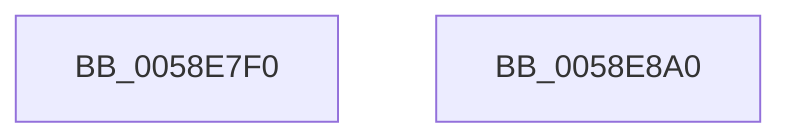

# VslHandleKsrCall

- RVA: `0x0058E7F0`–`0x0058E8A1` (길이 `177` bytes)
- VA: `0x000000014058E7F0`
- 실행 섹션: `.text`
- PDB 이름 있음: `예`; PDB Function 태그: `아니요`
- unwind 정보 RVA: `0x000BF008`
- 디코드: `43`개 명령, `177/177` bytes 표시
- 미해석 바이트: `0` (있으면 어셈블리에 `.byte`로 보존)

> 이 문서는 커널 이미지의 기계어와 PDB 기호를 분석해 생성했습니다. 4번과 5번은 함수 원형과 자료형을 바이너리 사용 방식에서 추정한 C 해석이며 원본 소스 복구 결과는 아닙니다.

## 1. Dependencies

- 직접 호출 지점: **2**; 고유 호출 대상: **2**
- 직접 호출자로 확인된 함수: **1**
- RIP 상대 이미지 참조: **2**

### Outgoing calls
- `0x0058E84E` → [guard_dispatch_icall](../6B/guard_dispatch_icall_function_006BAAD0.md) (function, `0x006BAAD0`)
- `0x0058E88A` → [_security_check_cookie](../6A/_security_check_cookie_function_006AC640.md) (function, `0x006AC640`)

### Direct callers
- [sub_006F88AE](../6F/Unknown_function_006F88AE.md) at `0x006F8BC9`

### Static image references
- `0x0058E802` → RVA `0x00E0A740` (`.data`; read)
- `0x0058E814` → RVA `0x00FC7328` (`ALMOSTRO`; read)

## 2. Other-region calls and transfers

- 다른 실행 섹션으로 향하는 call: **0**
- 별도 외부 분기/꼬리 이동을 확인하지 못했습니다.

## 3. Assembly (complete function range)

```asm
0058E7F0  48 89 5C 24 10                  mov qword ptr [rsp + 0x10], rbx
0058E7F5  55                              push rbp
0058E7F6  48 8D 6C 24 A9                  lea rbp, [rsp - 0x57]
0058E7FB  48 81 EC 90 00 00 00            sub rsp, 0x90
0058E802  48 8B 05 37 BF 87 00            mov rax, qword ptr [rip + 0x87bf37]
0058E809  48 33 C4                        xor rax, rsp
0058E80C  48 89 45 47                     mov qword ptr [rbp + 0x47], rax
0058E810  0F 10 41 08                     movups xmm0, xmmword ptr [rcx + 8]
0058E814  48 8B 05 0D 8B A3 00            mov rax, qword ptr [rip + 0xa38b0d]
0058E81B  48 8B D9                        mov rbx, rcx
0058E81E  0F 10 49 18                     movups xmm1, xmmword ptr [rcx + 0x18]
0058E822  0F 29 45 E7                     movaps xmmword ptr [rbp - 0x19], xmm0
0058E826  0F 10 41 28                     movups xmm0, xmmword ptr [rcx + 0x28]
0058E82A  0F 29 4D F7                     movaps xmmword ptr [rbp - 9], xmm1
0058E82E  0F 10 49 38                     movups xmm1, xmmword ptr [rcx + 0x38]
0058E832  0F 29 45 07                     movaps xmmword ptr [rbp + 7], xmm0
0058E836  0F 10 41 48                     movups xmm0, xmmword ptr [rcx + 0x48]
0058E83A  0F 29 4D 17                     movaps xmmword ptr [rbp + 0x17], xmm1
0058E83E  0F 10 49 58                     movups xmm1, xmmword ptr [rcx + 0x58]
0058E842  48 8D 4D E7                     lea rcx, [rbp - 0x19]
0058E846  0F 29 45 27                     movaps xmmword ptr [rbp + 0x27], xmm0
0058E84A  0F 29 4D 37                     movaps xmmword ptr [rbp + 0x37], xmm1
0058E84E  E8 7D C2 12 00                  call 0x1406baad0
0058E853  0F 28 45 E7                     movaps xmm0, xmmword ptr [rbp - 0x19]
0058E857  0F 28 4D F7                     movaps xmm1, xmmword ptr [rbp - 9]
0058E85B  0F 11 43 08                     movups xmmword ptr [rbx + 8], xmm0
0058E85F  0F 28 45 07                     movaps xmm0, xmmword ptr [rbp + 7]
0058E863  0F 11 4B 18                     movups xmmword ptr [rbx + 0x18], xmm1
0058E867  0F 28 4D 17                     movaps xmm1, xmmword ptr [rbp + 0x17]
0058E86B  0F 11 43 28                     movups xmmword ptr [rbx + 0x28], xmm0
0058E86F  0F 28 45 27                     movaps xmm0, xmmword ptr [rbp + 0x27]
0058E873  0F 11 4B 38                     movups xmmword ptr [rbx + 0x38], xmm1
0058E877  0F 28 4D 37                     movaps xmm1, xmmword ptr [rbp + 0x37]
0058E87B  0F 11 43 48                     movups xmmword ptr [rbx + 0x48], xmm0
0058E87F  0F 11 4B 58                     movups xmmword ptr [rbx + 0x58], xmm1
0058E883  48 8B 4D 47                     mov rcx, qword ptr [rbp + 0x47]
0058E887  48 33 CC                        xor rcx, rsp
0058E88A  E8 B1 DD 11 00                  call 0x1406ac640
0058E88F  48 8B 9C 24 A8 00 00 00         mov rbx, qword ptr [rsp + 0xa8]
0058E897  48 81 C4 90 00 00 00            add rsp, 0x90
0058E89E  5D                              pop rbp
0058E89F  C3                              ret
0058E8A0  CC                              int3
```

## 4. C-style interpretation (structured pseudocode)

```c
__int64 __fastcall VslHandleKsrCall(__int64 a1)
{
    __int64 result;
    __int64 v_rsp;
    unsigned __int64 v_stack_m18;
    unsigned __int64 v_stack_m28;
    unsigned __int64 v_stack_m38;
    unsigned __int64 v_stack_m48;
    unsigned __int64 v_stack_m58;
    unsigned __int64 v_stack_m5F;
    unsigned __int64 v_stack_m68;
    unsigned __int64 v_stack_m78;
    unsigned __int64 v_stack_p10;

    v_stack_p10 = v_rbx;
    v_rsp = (v_rsp) - (144);
    result = (*(unsigned __int64 *)(v_rip + 8896311)) ^ (v_rsp);
    v_stack_m18 = result;
    v_stack_m78 = v_xmm0;
    v_stack_m68 = v_xmm1;
    v_stack_m58 = v_xmm0;
    v_stack_m48 = v_xmm1;
    v_stack_m38 = v_xmm0;
    v_stack_m28 = v_xmm1;
    result = guard_dispatch_icall(v_stack_m78, a2, a3, a4);
    *(unsigned __int64 *)(a1 + 8) = v_xmm0;
    *(unsigned __int64 *)(a1 + 24) = v_xmm1;
    *(unsigned __int64 *)(a1 + 40) = v_xmm0;
    *(unsigned __int64 *)(a1 + 56) = v_xmm1;
    *(unsigned __int64 *)(a1 + 72) = v_xmm0;
    *(unsigned __int64 *)(a1 + 88) = v_xmm1;
    a1 = (v_stack_m18) ^ (v_rsp);
    result = _security_check_cookie(a1, a2, a3, a4);
    v_rsp = (v_rsp) + (144);
    return result;
}
```

## 5. (Beta) C Style

```c
int64_t VslHandleKsrCall(void *Arg1)
{
    uint8_t *arg1 = (uint8_t *)Arg1;

    int64_t result;
    int64_t local_rsp;
    uint64_t v_stack_m18;
    uint64_t v_stack_m28;
    uint64_t v_stack_m38;
    uint64_t v_stack_m48;
    uint64_t v_stack_m58;
    uint64_t v_stack_m5F;
    uint64_t v_stack_m68;
    uint64_t v_stack_m78;
    uint64_t v_stack_p10;

    v_stack_p10 = local_rbx;
    local_rsp = (local_rsp) - (144);
    result = (*(uint64_t *)(v_rip + 0x87BF37)) ^ (local_rsp);
    v_stack_m18 = result;
    v_stack_m78 = v_xmm0;
    v_stack_m68 = v_xmm1;
    v_stack_m58 = v_xmm0;
    v_stack_m48 = v_xmm1;
    v_stack_m38 = v_xmm0;
    v_stack_m28 = v_xmm1;
    result = guard_dispatch_icall(v_stack_m78, a2, a3, a4);
    *(uint64_t *)(arg1 + 0x8) = v_xmm0;
    *(uint64_t *)(arg1 + 0x18) = v_xmm1;
    *(uint64_t *)(arg1 + 0x28) = v_xmm0;
    *(uint64_t *)(arg1 + 0x38) = v_xmm1;
    *(uint64_t *)(arg1 + 0x48) = v_xmm0;
    *(uint64_t *)(arg1 + 0x58) = v_xmm1;
    Arg1 = (v_stack_m18) ^ (local_rsp);
    result = _security_check_cookie(Arg1, a2, a3, a4);
    local_rsp = (local_rsp) + (144);
    return result;
}
```

### 관측된 메모리 오프셋

구조체 형식이 확인되지 않은 접근은 인자 기준의 오프셋으로만 기록했습니다.

| 기준 인자 | 오프셋 표현 | 폭 (bit) | 접근 |
|---|---:|---:|---|
| `Arg1` | `+ 0x8` | `128` | `R` |
| `Arg1` | `+ 0x18` | `128` | `R` |
| `Arg1` | `+ 0x28` | `128` | `R` |
| `Arg1` | `+ 0x38` | `128` | `R` |
| `Arg1` | `+ 0x48` | `128` | `R` |
| `Arg1` | `+ 0x58` | `128` | `R` |

## 6. Execution-region graph

[열기: 2D/3D 그래프와 함수 탐색 컨트롤 패널](../../../control-panel.html?section=text&rva=0x0058E7F0&view=graph)

- 2D 그래프는 위에서 아래로 흐르고, 3D 그래프는 빈 공간을 드래그해 회전합니다. Shift+드래그는 이동, 휠은 확대·축소, 함수 노드 선택은 대상 보고서 이동입니다.

### Static fallback


