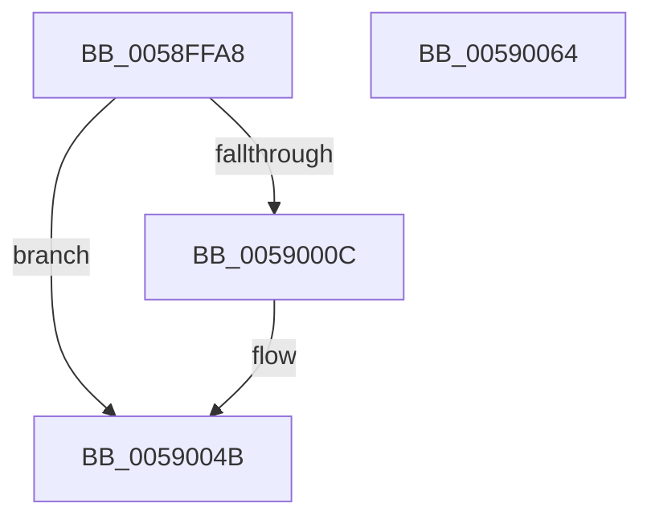

# VslInitFunctionOverrideCapabilities

- RVA: `0x0058FFA8`–`0x00590065` (길이 `189` bytes)
- VA: `0x000000014058FFA8`
- 실행 섹션: `.text`
- PDB 이름 있음: `예`; PDB Function 태그: `아니요`
- unwind 정보 RVA: `0x000C6E74`
- 디코드: `42`개 명령, `189/189` bytes 표시
- 미해석 바이트: `0` (있으면 어셈블리에 `.byte`로 보존)

> 이 문서는 커널 이미지의 기계어와 PDB 기호를 분석해 생성했습니다. 4번과 5번은 함수 원형과 자료형을 바이너리 사용 방식에서 추정한 C 해석이며 원본 소스 복구 결과는 아닙니다.

## 1. Dependencies

- 직접 호출 지점: **6**; 고유 호출 대상: **5**
- 직접 호출자로 확인된 함수: **1**
- RIP 상대 이미지 참조: **1**

### Outgoing calls
- `0x0058FFD4` → [memset](../6C/memset_function_006C6C40.md) (function, `0x006C6C40`)
- `0x0058FFE4` → [memset](../6C/memset_function_006C6C40.md) (function, `0x006C6C40`)
- `0x00590003` → [VslpLockPagesForTransfer](../29/VslpLockPagesForTransfer_function_0029E0FC.md) (function, `0x0029E0FC`)
- `0x00590038` → [VslpEnterIumSecureMode](../23/VslpEnterIumSecureMode_function_00235E50.md) (function, `0x00235E50`)
- `0x00590044` → [VslpUnlockPagesForTransfer](../29/VslpUnlockPagesForTransfer_function_0029EE4C.md) (function, `0x0029EE4C`)
- `0x00590056` → [_security_check_cookie](../6A/_security_check_cookie_function_006AC640.md) (function, `0x006AC640`)

### Direct callers
- [MiInitializeFunctionOverrides](../../init/C6/MiInitializeFunctionOverrides_function_00C60788.md) at `0x00C607E3`

### Static image references
- `0x0058FFB1` → RVA `0x00E0A740` (`.data`; read)

## 2. Other-region calls and transfers

- 다른 실행 섹션으로 향하는 call: **0**
- 별도 외부 분기/꼬리 이동을 확인하지 못했습니다.

## 3. Assembly (complete function range)

```asm
0058FFA8  40 53                           push rbx
0058FFAA  48 81 EC 00 01 00 00            sub rsp, 0x100
0058FFB1  48 8B 05 88 A7 87 00            mov rax, qword ptr [rip + 0x87a788]
0058FFB8  48 33 C4                        xor rax, rsp
0058FFBB  48 89 84 24 F0 00 00 00         mov qword ptr [rsp + 0xf0], rax
0058FFC3  33 D2                           xor edx, edx
0058FFC5  48 8B D9                        mov rbx, rcx
0058FFC8  48 8D 8C 24 80 00 00 00         lea rcx, [rsp + 0x80]
0058FFD0  44 8D 42 68                     lea r8d, [rdx + 0x68]
0058FFD4  E8 67 6C 13 00                  call 0x1406c6c40
0058FFD9  33 D2                           xor edx, edx
0058FFDB  48 8D 4C 24 30                  lea rcx, [rsp + 0x30]
0058FFE0  44 8D 42 48                     lea r8d, [rdx + 0x48]
0058FFE4  E8 57 6C 13 00                  call 0x1406c6c40
0058FFE9  41 B9 01 00 00 00               mov r9d, 1
0058FFEF  C7 44 24 20 06 00 00 00         mov dword ptr [rsp + 0x20], 6
0058FFF7  48 8B D3                        mov rdx, rbx
0058FFFA  48 8D 4C 24 30                  lea rcx, [rsp + 0x30]
0058FFFF  45 8D 41 59                     lea r8d, [r9 + 0x59]
00590003  E8 F4 E0 D0 FF                  call 0x14029e0fc
00590008  85 C0                           test eax, eax
0059000A  78 3F                           js 0x14059004b
0059000C  48 8B 44 24 30                  mov rax, qword ptr [rsp + 0x30]
00590011  4C 8D 8C 24 80 00 00 00         lea r9, [rsp + 0x80]
00590019  48 89 84 24 88 00 00 00         mov qword ptr [rsp + 0x88], rax
00590021  BA E3 00 00 00                  mov edx, 0xe3
00590026  48 8B 44 24 68                  mov rax, qword ptr [rsp + 0x68]
0059002B  45 33 C0                        xor r8d, r8d
0059002E  B1 02                           mov cl, 2
00590030  48 89 84 24 90 00 00 00         mov qword ptr [rsp + 0x90], rax
00590038  E8 13 5E CA FF                  call 0x140235e50
0059003D  48 8D 4C 24 30                  lea rcx, [rsp + 0x30]
00590042  8B D8                           mov ebx, eax
00590044  E8 03 EE D0 FF                  call 0x14029ee4c
00590049  8B C3                           mov eax, ebx
0059004B  48 8B 8C 24 F0 00 00 00         mov rcx, qword ptr [rsp + 0xf0]
00590053  48 33 CC                        xor rcx, rsp
00590056  E8 E5 C5 11 00                  call 0x1406ac640
0059005B  48 81 C4 00 01 00 00            add rsp, 0x100
00590062  5B                              pop rbx
00590063  C3                              ret
00590064  CC                              int3
```

## 4. C-style interpretation (structured pseudocode)

```c
__int64 __fastcall VslInitFunctionOverrideCapabilities(__int64 a1, int a2)
{
    __int64 result;
    __int64 v_rbx;
    __int64 v_rsp;
    unsigned __int64 v_stack_m18;
    unsigned __int64 v_stack_m78;
    unsigned __int64 v_stack_m80;
    unsigned __int64 v_stack_m88;
    unsigned __int64 v_stack_mA0;
    unsigned __int64 v_stack_mD8;
    unsigned int v_stack_mE8;

    v_rsp = (v_rsp) - (256);
    result = (*(unsigned __int64 *)(v_rip + 8890248)) ^ (v_rsp);
    v_stack_m18 = result;
    a2 = 0;
    result = memset(v_stack_m88, a2, a2 + 104, a4);
    a2 = 0;
    result = memset(v_stack_mD8, a2, a2 + 72, a4);
    v_stack_mE8 = 6;
    result = VslpLockPagesForTransfer(v_stack_mD8, a1, 1 + 89, 1);
    v_rbx = a1;
    if (!(sign_flag)) {
        result = v_stack_mD8;
        a4 = v_stack_m88;
        v_stack_m80 = result;
        a2 = 227;
        result = v_stack_mA0;
        a3 = 0;
        a1 = 2;
        v_stack_m78 = result;
        result = VslpEnterIumSecureMode(a1, a2, a3, a4);
        a1 = v_stack_mD8;
        v_rbx = (unsigned int)(result);
        result = VslpUnlockPagesForTransfer(a1, a2, a3, a4);
        result = (unsigned int)(v_rbx);
    }
    a1 = (v_stack_m18) ^ (v_rsp);
    result = _security_check_cookie(a1, a2, a3, a4);
    v_rsp = (v_rsp) + (256);
    return result;
}
```

## 5. (Beta) C Style

```c
int64_t VslInitFunctionOverrideCapabilities(int64_t Arg1, int32_t Arg2)
{
    int64_t result;
    int64_t local_rbx;
    int64_t local_rsp;
    uint64_t v_stack_m18;
    uint64_t v_stack_m78;
    uint64_t v_stack_m80;
    uint64_t v_stack_m88;
    uint64_t v_stack_mA0;
    uint64_t v_stack_mD8;
    uint32_t v_stack_mE8;

    local_rsp = (local_rsp) - (256);
    result = (*(uint64_t *)(v_rip + 0x87A788)) ^ (local_rsp);
    v_stack_m18 = result;
    Arg2 = 0;
    result = memset(v_stack_m88, Arg2, Arg2 + 104, a4);
    Arg2 = 0;
    result = memset(v_stack_mD8, Arg2, Arg2 + 72, a4);
    v_stack_mE8 = 6;
    result = VslpLockPagesForTransfer(v_stack_mD8, Arg1, 1 + 89, 1);
    local_rbx = Arg1;
    if (!(sign_flag)) {
        result = v_stack_mD8;
        a4 = v_stack_m88;
        v_stack_m80 = result;
        Arg2 = 227;
        result = v_stack_mA0;
        a3 = 0;
        Arg1 = 2;
        v_stack_m78 = result;
        result = VslpEnterIumSecureMode(Arg1, Arg2, a3, a4);
        Arg1 = v_stack_mD8;
        local_rbx = (uint32_t)(result);
        result = VslpUnlockPagesForTransfer(Arg1, Arg2, a3, a4);
        result = (uint32_t)(local_rbx);
    }
    Arg1 = (v_stack_m18) ^ (local_rsp);
    result = _security_check_cookie(Arg1, Arg2, a3, a4);
    local_rsp = (local_rsp) + (256);
    return result;
}
```

## 6. Execution-region graph

[열기: 2D/3D 그래프와 함수 탐색 컨트롤 패널](../../../control-panel.html?section=text&rva=0x0058FFA8&view=graph)

- 2D 그래프는 위에서 아래로 흐르고, 3D 그래프는 빈 공간을 드래그해 회전합니다. Shift+드래그는 이동, 휠은 확대·축소, 함수 노드 선택은 대상 보고서 이동입니다.

### Static fallback


