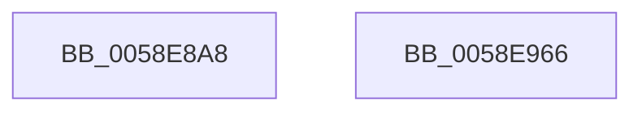

# VslInitializeSecureKernelCfg

- RVA: `0x0058E8A8`–`0x0058E967` (길이 `191` bytes)
- VA: `0x000000014058E8A8`
- 실행 섹션: `.text`
- PDB 이름 있음: `예`; PDB Function 태그: `아니요`
- unwind 정보 RVA: `0x000B3900`
- 디코드: `40`개 명령, `191/191` bytes 표시
- 미해석 바이트: `0` (있으면 어셈블리에 `.byte`로 보존)

> 이 문서는 커널 이미지의 기계어와 PDB 기호를 분석해 생성했습니다. 4번과 5번은 함수 원형과 자료형을 바이너리 사용 방식에서 추정한 C 해석이며 원본 소스 복구 결과는 아닙니다.

## 1. Dependencies

- 직접 호출 지점: **4**; 고유 호출 대상: **4**
- 직접 호출자로 확인된 함수: **1**
- RIP 상대 이미지 참조: **6**

### Outgoing calls
- `0x0058E8D8` → [memset](../6C/memset_function_006C6C40.md) (function, `0x006C6C40`)
- `0x0058E92C` → [qsort](../50/qsort_function_005009F0.md) (function, `0x005009F0`)
- `0x0058E940` → [VslpEnterIumSecureMode](../23/VslpEnterIumSecureMode_function_00235E50.md) (function, `0x00235E50`)
- `0x0058E950` → [_security_check_cookie](../6A/_security_check_cookie_function_006AC640.md) (function, `0x006AC640`)

### Direct callers
- [MiInitializeKernelCfg](../../init/C6/MiInitializeKernelCfg_function_00C6A2FC.md) at `0x00C6A35A`

### Static image references
- `0x0058E8B5` → RVA `0x00E0A740` (`.data`; read)
- `0x0058E8DD` → RVA `0x00E38CB8` (`.data`; read)
- `0x0058E8E4` → RVA `0x00C252C0` (`HalpChannelAscendingSort`; read)
- `0x0058E8F5` → RVA `0x00E38CC0` (`.data`; read)
- `0x0058E906` → RVA `0x00E38C78` (`.data`; read)
- `0x0058E912` → RVA `0x00E38C80` (`.data`; read)

## 2. Other-region calls and transfers

- 다른 실행 섹션으로 향하는 call: **0**
- 별도 외부 분기/꼬리 이동을 확인하지 못했습니다.

## 3. Assembly (complete function range)

```asm
0058E8A8  48 89 5C 24 18                  mov qword ptr [rsp + 0x18], rbx
0058E8AD  57                              push rdi
0058E8AE  48 81 EC A0 00 00 00            sub rsp, 0xa0
0058E8B5  48 8B 05 84 BE 87 00            mov rax, qword ptr [rip + 0x87be84]
0058E8BC  48 33 C4                        xor rax, rsp
0058E8BF  48 89 84 24 90 00 00 00         mov qword ptr [rsp + 0x90], rax
0058E8C7  48 8B FA                        mov rdi, rdx
0058E8CA  48 8B D9                        mov rbx, rcx
0058E8CD  33 D2                           xor edx, edx
0058E8CF  48 8D 4C 24 20                  lea rcx, [rsp + 0x20]
0058E8D4  44 8D 42 68                     lea r8d, [rdx + 0x68]
0058E8D8  E8 63 83 13 00                  call 0x1406c6c40
0058E8DD  48 8B 05 D4 A3 8A 00            mov rax, qword ptr [rip + 0x8aa3d4]
0058E8E4  4C 8D 0D D5 69 69 00            lea r9, [rip + 0x6969d5]
0058E8EB  48 89 44 24 38                  mov qword ptr [rsp + 0x38], rax
0058E8F0  48 8D 4C 24 38                  lea rcx, [rsp + 0x38]
0058E8F5  48 8B 05 C4 A3 8A 00            mov rax, qword ptr [rip + 0x8aa3c4]
0058E8FC  BA 02 00 00 00                  mov edx, 2
0058E901  48 89 44 24 40                  mov qword ptr [rsp + 0x40], rax
0058E906  48 8B 05 6B A3 8A 00            mov rax, qword ptr [rip + 0x8aa36b]
0058E90D  48 89 44 24 48                  mov qword ptr [rsp + 0x48], rax
0058E912  48 8B 05 67 A3 8A 00            mov rax, qword ptr [rip + 0x8aa367]
0058E919  44 8D 42 0E                     lea r8d, [rdx + 0xe]
0058E91D  48 89 44 24 50                  mov qword ptr [rsp + 0x50], rax
0058E922  48 89 5C 24 28                  mov qword ptr [rsp + 0x28], rbx
0058E927  48 89 7C 24 30                  mov qword ptr [rsp + 0x30], rdi
0058E92C  E8 BF 20 F7 FF                  call 0x1405009f0
0058E931  BA D7 00 00 00                  mov edx, 0xd7
0058E936  4C 8D 4C 24 20                  lea r9, [rsp + 0x20]
0058E93B  45 33 C0                        xor r8d, r8d
0058E93E  B1 02                           mov cl, 2
0058E940  E8 0B 75 CA FF                  call 0x140235e50
0058E945  48 8B 8C 24 90 00 00 00         mov rcx, qword ptr [rsp + 0x90]
0058E94D  48 33 CC                        xor rcx, rsp
0058E950  E8 EB DC 11 00                  call 0x1406ac640
0058E955  48 8B 9C 24 C0 00 00 00         mov rbx, qword ptr [rsp + 0xc0]
0058E95D  48 81 C4 A0 00 00 00            add rsp, 0xa0
0058E964  5F                              pop rdi
0058E965  C3                              ret
0058E966  CC                              int3
```

## 4. C-style interpretation (structured pseudocode)

```c
__int64 __fastcall VslInitializeSecureKernelCfg(__int64 a1, __int64 a2)
{
    __int64 result;
    __int64 v_rsp;
    unsigned __int64 v_stack_m18;
    unsigned __int64 v_stack_m58;
    unsigned __int64 v_stack_m60;
    unsigned __int64 v_stack_m68;
    unsigned __int64 v_stack_m70;
    unsigned __int64 v_stack_m78;
    unsigned __int64 v_stack_m80;
    unsigned __int64 v_stack_m88;
    unsigned __int64 v_stack_p18;

    v_stack_p18 = v_rbx;
    v_rsp = (v_rsp) - (160);
    result = (*(unsigned __int64 *)(v_rip + 8896132)) ^ (v_rsp);
    v_stack_m18 = result;
    a2 = 0;
    result = memset(v_stack_m88, a2, a2 + 104, a4);
    v_stack_m70 = *(unsigned __int64 *)(v_rip + 9085908);
    v_stack_m68 = *(unsigned __int64 *)(v_rip + 9085892);
    v_stack_m60 = *(unsigned __int64 *)(v_rip + 9085803);
    v_stack_m58 = *(unsigned __int64 *)(v_rip + 9085799);
    v_stack_m80 = a1;
    v_stack_m78 = 0;
    result = qsort(v_stack_m70, 2, 2 + 14, v_rip + 6908373);
    a3 = 0;
    result = VslpEnterIumSecureMode(2, 215, a3, v_stack_m88);
    a1 = (v_stack_m18) ^ (v_rsp);
    result = _security_check_cookie(a1, 215, a3, v_stack_m88);
    v_rsp = (v_rsp) + (160);
    return result;
}
```

## 5. (Beta) C Style

```c
int64_t VslInitializeSecureKernelCfg(int64_t Arg1, int64_t Arg2)
{
    int64_t result;
    int64_t local_rsp;
    uint64_t v_stack_m18;
    uint64_t v_stack_m58;
    uint64_t v_stack_m60;
    uint64_t v_stack_m68;
    uint64_t v_stack_m70;
    uint64_t v_stack_m78;
    uint64_t v_stack_m80;
    uint64_t v_stack_m88;
    uint64_t v_stack_p18;

    v_stack_p18 = local_rbx;
    local_rsp = (local_rsp) - (160);
    result = (*(uint64_t *)(v_rip + 0x87BE84)) ^ (local_rsp);
    v_stack_m18 = result;
    Arg2 = 0;
    result = memset(v_stack_m88, Arg2, Arg2 + 104, a4);
    v_stack_m70 = *(uint64_t *)(v_rip + 0x8AA3D4);
    v_stack_m68 = *(uint64_t *)(v_rip + 0x8AA3C4);
    v_stack_m60 = *(uint64_t *)(v_rip + 0x8AA36B);
    v_stack_m58 = *(uint64_t *)(v_rip + 0x8AA367);
    v_stack_m80 = Arg1;
    v_stack_m78 = 0;
    result = qsort(v_stack_m70, 2, 2 + 14, v_rip + 6908373);
    a3 = 0;
    result = VslpEnterIumSecureMode(2, 215, a3, v_stack_m88);
    Arg1 = (v_stack_m18) ^ (local_rsp);
    result = _security_check_cookie(Arg1, 215, a3, v_stack_m88);
    local_rsp = (local_rsp) + (160);
    return result;
}
```

## 6. Execution-region graph

[열기: 2D/3D 그래프와 함수 탐색 컨트롤 패널](../../../control-panel.html?section=text&rva=0x0058E8A8&view=graph)

- 2D 그래프는 위에서 아래로 흐르고, 3D 그래프는 빈 공간을 드래그해 회전합니다. Shift+드래그는 이동, 휠은 확대·축소, 함수 노드 선택은 대상 보고서 이동입니다.

### Static fallback


