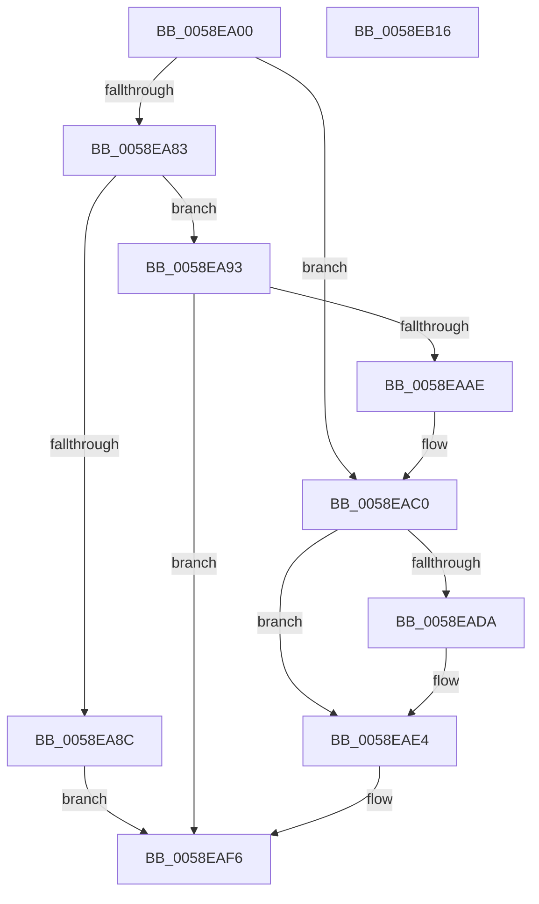

# VslInitializeSecureProcess

- RVA: `0x0058EA00`–`0x0058EB17` (길이 `279` bytes)
- VA: `0x000000014058EA00`
- 실행 섹션: `.text`
- PDB 이름 있음: `예`; PDB Function 태그: `아니요`
- unwind 정보 RVA: `0x000C6DB4`
- 디코드: `83`개 명령, `279/279` bytes 표시
- 미해석 바이트: `0` (있으면 어셈블리에 `.byte`로 보존)

> 이 문서는 커널 이미지의 기계어와 PDB 기호를 분석해 생성했습니다. 4번과 5번은 함수 원형과 자료형을 바이너리 사용 방식에서 추정한 C 해석이며 원본 소스 복구 결과는 아닙니다.

## 1. Dependencies

- 직접 호출 지점: **6**; 고유 호출 대상: **5**
- 직접 호출자로 확인된 함수: **1**
- RIP 상대 이미지 참조: **1**

### Outgoing calls
- `0x0058EA4D` → [memset](../6C/memset_function_006C6C40.md) (function, `0x006C6C40`)
- `0x0058EA5C` → [memset](../6C/memset_function_006C6C40.md) (function, `0x006C6C40`)
- `0x0058EAA5` → [VslpLockPagesForTransfer](../29/VslpLockPagesForTransfer_function_0029E0FC.md) (function, `0x0029E0FC`)
- `0x0058EACE` → [VslpEnterIumSecureMode](../23/VslpEnterIumSecureMode_function_00235E50.md) (function, `0x00235E50`)
- `0x0058EADF` → [VslpUnlockPagesForTransfer](../29/VslpUnlockPagesForTransfer_function_0029EE4C.md) (function, `0x0029EE4C`)
- `0x0058EAFD` → [_security_check_cookie](../6A/_security_check_cookie_function_006AC640.md) (function, `0x006AC640`)

### Direct callers
- [KeSecureProcess](../5B/KeSecureProcess_function_005B988C.md) at `0x005B9919`

### Static image references
- `0x0058EA19` → RVA `0x00E0A740` (`.data`; read)

## 2. Other-region calls and transfers

- 다른 실행 섹션으로 향하는 call: **0**
- 별도 외부 분기/꼬리 이동을 확인하지 못했습니다.

## 3. Assembly (complete function range)

```asm
0058EA00  40 55                           push rbp
0058EA02  53                              push rbx
0058EA03  56                              push rsi
0058EA04  57                              push rdi
0058EA05  41 54                           push r12
0058EA07  41 55                           push r13
0058EA09  41 56                           push r14
0058EA0B  41 57                           push r15
0058EA0D  48 8D 6C 24 F8                  lea rbp, [rsp - 8]
0058EA12  48 81 EC 08 01 00 00            sub rsp, 0x108
0058EA19  48 8B 05 20 BD 87 00            mov rax, qword ptr [rip + 0x87bd20]
0058EA20  48 33 C4                        xor rax, rsp
0058EA23  48 89 45 F0                     mov qword ptr [rbp - 0x10], rax
0058EA27  48 8B 5D 70                     mov rbx, qword ptr [rbp + 0x70]
0058EA2B  48 8B F2                        mov rsi, rdx
0058EA2E  4C 8B 65 78                     mov r12, qword ptr [rbp + 0x78]
0058EA32  33 D2                           xor edx, edx
0058EA34  4C 8B AD 88 00 00 00            mov r13, qword ptr [rbp + 0x88]
0058EA3B  4D 8B F0                        mov r14, r8
0058EA3E  48 8B F9                        mov rdi, rcx
0058EA41  4D 8B F9                        mov r15, r9
0058EA44  48 8D 4C 24 30                  lea rcx, [rsp + 0x30]
0058EA49  44 8D 42 48                     lea r8d, [rdx + 0x48]
0058EA4D  E8 EE 81 13 00                  call 0x1406c6c40
0058EA52  33 D2                           xor edx, edx
0058EA54  48 8D 4D 80                     lea rcx, [rbp - 0x80]
0058EA58  44 8D 42 68                     lea r8d, [rdx + 0x68]
0058EA5C  E8 DF 81 13 00                  call 0x1406c6c40
0058EA61  48 89 7D 88                     mov qword ptr [rbp - 0x78], rdi
0058EA65  48 8B BD 80 00 00 00            mov rdi, qword ptr [rbp + 0x80]
0058EA6C  48 89 5D A8                     mov qword ptr [rbp - 0x58], rbx
0058EA70  33 DB                           xor ebx, ebx
0058EA72  48 89 75 98                     mov qword ptr [rbp - 0x68], rsi
0058EA76  4C 89 75 90                     mov qword ptr [rbp - 0x70], r14
0058EA7A  4C 89 7D A0                     mov qword ptr [rbp - 0x60], r15
0058EA7E  48 85 FF                        test rdi, rdi
0058EA81  74 3D                           je 0x14058eac0
0058EA83  48 81 FF 00 A0 1F 00            cmp rdi, 0x1fa000
0058EA8A  76 07                           jbe 0x14058ea93
0058EA8C  B8 0D 00 00 C0                  mov eax, 0xc000000d
0058EA91  EB 63                           jmp 0x14058eaf6
0058EA93  45 33 C9                        xor r9d, r9d
0058EA96  89 5C 24 20                     mov dword ptr [rsp + 0x20], ebx
0058EA9A  44 8B C7                        mov r8d, edi
0058EA9D  48 8D 4C 24 30                  lea rcx, [rsp + 0x30]
0058EAA2  49 8B D4                        mov rdx, r12
0058EAA5  E8 52 F6 D0 FF                  call 0x14029e0fc
0058EAAA  85 C0                           test eax, eax
0058EAAC  78 48                           js 0x14058eaf6
0058EAAE  48 8B 44 24 30                  mov rax, qword ptr [rsp + 0x30]
0058EAB3  48 89 45 B0                     mov qword ptr [rbp - 0x50], rax
0058EAB7  48 8B 44 24 68                  mov rax, qword ptr [rsp + 0x68]
0058EABC  48 89 45 B8                     mov qword ptr [rbp - 0x48], rax
0058EAC0  BA 07 00 00 00                  mov edx, 7
0058EAC5  4C 8D 4D 80                     lea r9, [rbp - 0x80]
0058EAC9  45 33 C0                        xor r8d, r8d
0058EACC  B1 02                           mov cl, 2
0058EACE  E8 7D 73 CA FF                  call 0x140235e50
0058EAD3  8B F0                           mov esi, eax
0058EAD5  48 85 FF                        test rdi, rdi
0058EAD8  74 0A                           je 0x14058eae4
0058EADA  48 8D 4C 24 30                  lea rcx, [rsp + 0x30]
0058EADF  E8 68 03 D1 FF                  call 0x14029ee4c
0058EAE4  85 F6                           test esi, esi
0058EAE6  8B C6                           mov eax, esi
0058EAE8  48 0F 49 5D 90                  cmovns rbx, qword ptr [rbp - 0x70]
0058EAED  D0 EB                           shr bl, 1
0058EAEF  80 E3 01                        and bl, 1
0058EAF2  41 88 5D 00                     mov byte ptr [r13], bl
0058EAF6  48 8B 4D F0                     mov rcx, qword ptr [rbp - 0x10]
0058EAFA  48 33 CC                        xor rcx, rsp
0058EAFD  E8 3E DB 11 00                  call 0x1406ac640
0058EB02  48 81 C4 08 01 00 00            add rsp, 0x108
0058EB09  41 5F                           pop r15
0058EB0B  41 5E                           pop r14
0058EB0D  41 5D                           pop r13
0058EB0F  41 5C                           pop r12
0058EB11  5F                              pop rdi
0058EB12  5E                              pop rsi
0058EB13  5B                              pop rbx
0058EB14  5D                              pop rbp
0058EB15  C3                              ret
0058EB16  CC                              int3
```

## 4. C-style interpretation (structured pseudocode)

```c
__int64 __fastcall VslInitializeSecureProcess(__int64 a1, __int64 a2, __int64 a3, __int64 a4, __int64 a5, __int64 a6, __int64 a7, __int64 a8)
{
    __int64 result;
    __int64 v_rbx;
    __int64 v_rsp;
    unsigned __int64 v_stack_m118;
    unsigned int v_stack_m128;
    unsigned __int64 v_stack_m48;
    unsigned __int64 v_stack_m58;
    unsigned __int64 v_stack_m90;
    unsigned __int64 v_stack_m98;
    unsigned __int64 v_stack_mA0;
    unsigned __int64 v_stack_mA8;
    unsigned __int64 v_stack_mB0;
    unsigned __int64 v_stack_mB8;
    unsigned __int64 v_stack_mC0;
    unsigned __int64 v_stack_mC8;
    unsigned __int64 v_stack_mE0;

    v_rsp = (v_rsp) - (264);
    result = (*(unsigned __int64 *)(v_rip + 8895776)) ^ (v_rsp);
    v_stack_m58 = result;
    a2 = 0;
    result = memset(v_stack_m118, a2, a2 + 72, a4);
    a2 = 0;
    result = memset(v_stack_mC8, a2, a2 + 104, a4);
    v_stack_mC0 = a1;
    v_stack_mA0 = a5;
    v_rbx = 0;
    v_stack_mB0 = 0;
    v_stack_mB8 = a3;
    v_stack_mA8 = a4;
    if (a7 == 0) goto loc_0058EAC0;
    if (a7 <= 0x1FA000ULL) goto loc_0058EA93;
    goto loc_0058EAF6;
loc_0058EA93:
    a4 = 0;
    v_stack_m128 = 0;
    result = VslpLockPagesForTransfer(v_stack_m118, a6, (unsigned int)((unsigned int)(a7)), a4);
    if (sign_flag) goto loc_0058EAF6;
    v_stack_m98 = v_stack_m118;
    v_stack_m90 = v_stack_mE0;
loc_0058EAC0:
    a3 = 0;
    result = VslpEnterIumSecureMode(2, 7, a3, v_stack_mC8);
    if (a7 != 0) {
        a1 = v_stack_m118;
        result = VslpUnlockPagesForTransfer(a1, 7, a3, v_stack_mC8);
    }
    if (!sign_flag) { v_rbx = v_stack_mB8; }
    v_rbx = (unsigned __int8)((v_rbx) >> (1));
    v_rbx = (unsigned __int8)((v_rbx) & (1));
    *(unsigned __int8 *)(a8) = (unsigned __int8)(v_rbx);
loc_0058EAF6:
    a1 = (v_stack_m58) ^ (v_rsp);
    result = _security_check_cookie(a1, 7, a3, v_stack_mC8);
    v_rsp = (v_rsp) + (264);
    return result;
}
```

## 5. (Beta) C Style

```c
int64_t VslInitializeSecureProcess(int64_t Arg1, int64_t Arg2, int64_t Arg3, int64_t Arg4, int64_t Arg5, int64_t Arg6, int64_t Arg7, void *Arg8)
{
    uint8_t *arg8 = (uint8_t *)Arg8;

    int64_t result;
    int64_t local_rbx;
    int64_t local_rsp;
    uint64_t v_stack_m118;
    uint32_t v_stack_m128;
    uint64_t v_stack_m48;
    uint64_t v_stack_m58;
    uint64_t v_stack_m90;
    uint64_t v_stack_m98;
    uint64_t v_stack_mA0;
    uint64_t v_stack_mA8;
    uint64_t v_stack_mB0;
    uint64_t v_stack_mB8;
    uint64_t v_stack_mC0;
    uint64_t v_stack_mC8;
    uint64_t v_stack_mE0;

    local_rsp = (local_rsp) - (264);
    result = (*(uint64_t *)(v_rip + 0x87BD20)) ^ (local_rsp);
    v_stack_m58 = result;
    Arg2 = 0;
    result = memset(v_stack_m118, Arg2, Arg2 + 72, Arg4);
    Arg2 = 0;
    result = memset(v_stack_mC8, Arg2, Arg2 + 104, Arg4);
    v_stack_mC0 = Arg1;
    v_stack_mA0 = Arg5;
    local_rbx = 0;
    v_stack_mB0 = 0;
    v_stack_mB8 = Arg3;
    v_stack_mA8 = Arg4;
    if (Arg7 == 0) goto loc_0058EAC0;
    if (Arg7 <= 0x1FA000ULL) goto loc_0058EA93;
    goto loc_0058EAF6;
loc_0058EA93:
    Arg4 = 0;
    v_stack_m128 = 0;
    result = VslpLockPagesForTransfer(v_stack_m118, Arg6, (uint32_t)((uint32_t)(Arg7)), Arg4);
    if (sign_flag) goto loc_0058EAF6;
    v_stack_m98 = v_stack_m118;
    v_stack_m90 = v_stack_mE0;
loc_0058EAC0:
    Arg3 = 0;
    result = VslpEnterIumSecureMode(2, 7, Arg3, v_stack_mC8);
    if (Arg7 != 0) {
        Arg1 = v_stack_m118;
        result = VslpUnlockPagesForTransfer(Arg1, 7, Arg3, v_stack_mC8);
    }
    if (!sign_flag) { local_rbx = v_stack_mB8; }
    local_rbx = (uint8_t)((local_rbx) >> (1));
    local_rbx = (uint8_t)((local_rbx) & (1));
    *(uint8_t *)(arg8) = (uint8_t)(local_rbx);
loc_0058EAF6:
    Arg1 = (v_stack_m58) ^ (local_rsp);
    result = _security_check_cookie(Arg1, 7, Arg3, v_stack_mC8);
    local_rsp = (local_rsp) + (264);
    return result;
}
```

### 관측된 메모리 오프셋

구조체 형식이 확인되지 않은 접근은 인자 기준의 오프셋으로만 기록했습니다.

| 기준 인자 | 오프셋 표현 | 폭 (bit) | 접근 |
|---|---:|---:|---|
| `Arg8` | `+ 0x0` | `8` | `W` |

## 6. Execution-region graph

[열기: 2D/3D 그래프와 함수 탐색 컨트롤 패널](../../../control-panel.html?section=text&rva=0x0058EA00&view=graph)

- 2D 그래프는 위에서 아래로 흐르고, 3D 그래프는 빈 공간을 드래그해 회전합니다. Shift+드래그는 이동, 휠은 확대·축소, 함수 노드 선택은 대상 보고서 이동입니다.

### Static fallback


