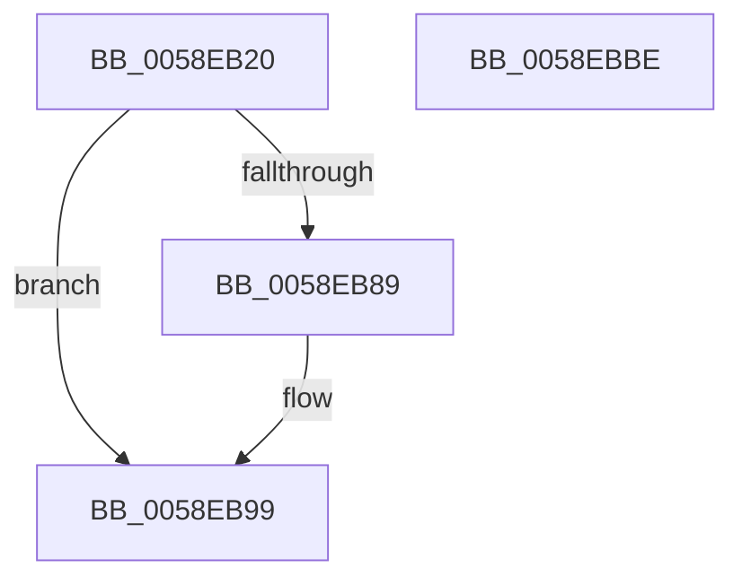

# VslLiveDumpQuerySecondaryDataSize

- RVA: `0x0058EB20`–`0x0058EBBF` (길이 `159` bytes)
- VA: `0x000000014058EB20`
- 실행 섹션: `.text`
- PDB 이름 있음: `예`; PDB Function 태그: `아니요`
- unwind 정보 RVA: `0x000C6E30`
- 디코드: `41`개 명령, `159/159` bytes 표시
- 미해석 바이트: `0` (있으면 어셈블리에 `.byte`로 보존)

> 이 문서는 커널 이미지의 기계어와 PDB 기호를 분석해 생성했습니다. 4번과 5번은 함수 원형과 자료형을 바이너리 사용 방식에서 추정한 C 해석이며 원본 소스 복구 결과는 아닙니다.

## 1. Dependencies

- 직접 호출 지점: **3**; 고유 호출 대상: **3**
- 직접 호출자로 확인된 함수: **1**
- RIP 상대 이미지 참조: **1**

### Outgoing calls
- `0x0058EB58` → [memset](../6C/memset_function_006C6C40.md) (function, `0x006C6C40`)
- `0x0058EB80` → [VslpEnterIumSecureMode](../23/VslpEnterIumSecureMode_function_00235E50.md) (function, `0x00235E50`)
- `0x0058EBA4` → [_security_check_cookie](../6A/_security_check_cookie_function_006AC640.md) (function, `0x006AC640`)

### Direct callers
- [HvlCalculateLivedumpSize](HvlCalculateLivedumpSize_function_0058B380.md) at `0x0058B441`

### Static image references
- `0x0058EB32` → RVA `0x00E0A740` (`.data`; read)

## 2. Other-region calls and transfers

- 다른 실행 섹션으로 향하는 call: **0**
- 별도 외부 분기/꼬리 이동을 확인하지 못했습니다.

## 3. Assembly (complete function range)

```asm
0058EB20  48 89 5C 24 08                  mov qword ptr [rsp + 8], rbx
0058EB25  48 89 74 24 20                  mov qword ptr [rsp + 0x20], rsi
0058EB2A  57                              push rdi
0058EB2B  48 81 EC A0 00 00 00            sub rsp, 0xa0
0058EB32  48 8B 05 07 BC 87 00            mov rax, qword ptr [rip + 0x87bc07]
0058EB39  48 33 C4                        xor rax, rsp
0058EB3C  48 89 84 24 90 00 00 00         mov qword ptr [rsp + 0x90], rax
0058EB44  48 8B FA                        mov rdi, rdx
0058EB47  49 8B F0                        mov rsi, r8
0058EB4A  33 D2                           xor edx, edx
0058EB4C  48 8B D9                        mov rbx, rcx
0058EB4F  48 8D 4C 24 20                  lea rcx, [rsp + 0x20]
0058EB54  44 8D 42 68                     lea r8d, [rdx + 0x68]
0058EB58  E8 E3 80 13 00                  call 0x1406c6c40
0058EB5D  B1 02                           mov cl, 2
0058EB5F  4C 8D 4C 24 20                  lea r9, [rsp + 0x20]
0058EB64  22 D9                           and bl, cl
0058EB66  BA 3A 00 00 00                  mov edx, 0x3a
0058EB6B  F6 DB                           neg bl
0058EB6D  48 1B C0                        sbb rax, rax
0058EB70  45 33 C0                        xor r8d, r8d
0058EB73  48 83 E0 F1                     and rax, 0xfffffffffffffff1
0058EB77  48 83 C0 10                     add rax, 0x10
0058EB7B  48 89 44 24 28                  mov qword ptr [rsp + 0x28], rax
0058EB80  E8 CB 72 CA FF                  call 0x140235e50
0058EB85  85 C0                           test eax, eax
0058EB87  78 10                           js 0x14058eb99
0058EB89  48 8B 4C 24 30                  mov rcx, qword ptr [rsp + 0x30]
0058EB8E  48 89 0F                        mov qword ptr [rdi], rcx
0058EB91  48 8B 4C 24 38                  mov rcx, qword ptr [rsp + 0x38]
0058EB96  48 89 0E                        mov qword ptr [rsi], rcx
0058EB99  48 8B 8C 24 90 00 00 00         mov rcx, qword ptr [rsp + 0x90]
0058EBA1  48 33 CC                        xor rcx, rsp
0058EBA4  E8 97 DA 11 00                  call 0x1406ac640
0058EBA9  4C 8D 9C 24 A0 00 00 00         lea r11, [rsp + 0xa0]
0058EBB1  49 8B 5B 10                     mov rbx, qword ptr [r11 + 0x10]
0058EBB5  49 8B 73 28                     mov rsi, qword ptr [r11 + 0x28]
0058EBB9  49 8B E3                        mov rsp, r11
0058EBBC  5F                              pop rdi
0058EBBD  C3                              ret
0058EBBE  CC                              int3
```

## 4. C-style interpretation (structured pseudocode)

```c
__int64 __fastcall VslLiveDumpQuerySecondaryDataSize(__int64 a1, __int64 a2, __int64 a3)
{
    __int64 result;
    __int64 v_rbx;
    __int64 v_rsp;
    unsigned __int64 v_stack_m18;
    unsigned __int64 v_stack_m70;
    unsigned __int64 v_stack_m78;
    unsigned __int64 v_stack_m8;
    unsigned __int64 v_stack_m80;
    unsigned __int64 v_stack_m88;
    unsigned __int64 v_stack_p20;
    unsigned __int64 v_stack_p8;

    v_stack_p8 = v_rbx;
    v_stack_p20 = v_rsi;
    v_rsp = (v_rsp) - (160);
    result = (*(unsigned __int64 *)(v_rip + 8895495)) ^ (v_rsp);
    v_stack_m18 = result;
    a2 = 0;
    result = memset(v_stack_m88, a2, a2 + 104, a4);
    v_rbx = (unsigned __int8)((a1) & (2));
    v_rbx = (unsigned __int8)(-(v_rbx));
    a3 = 0;
    result = (result) & (-15);
    result = (result) + (16);
    v_stack_m80 = result;
    result = VslpEnterIumSecureMode(2, 58, a3, v_stack_m88);
    if (!(sign_flag)) {
        a1 = v_stack_m78;
        *(unsigned __int64 *)(a2) = a1;
        a1 = v_stack_m70;
        *(unsigned __int64 *)(a3) = a1;
    }
    a1 = (v_stack_m18) ^ (v_rsp);
    result = _security_check_cookie(a1, 58, a3, v_stack_m88);
    return result;
}
```

## 5. (Beta) C Style

```c
int64_t VslLiveDumpQuerySecondaryDataSize(int64_t Arg1, void *Arg2, void *Arg3)
{
    uint8_t *arg2 = (uint8_t *)Arg2;
    uint8_t *arg3 = (uint8_t *)Arg3;

    int64_t result;
    int64_t local_rbx;
    int64_t local_rsp;
    uint64_t v_stack_m18;
    uint64_t v_stack_m70;
    uint64_t v_stack_m78;
    uint64_t v_stack_m8;
    uint64_t v_stack_m80;
    uint64_t v_stack_m88;
    uint64_t v_stack_p20;
    uint64_t v_stack_p8;

    v_stack_p8 = local_rbx;
    v_stack_p20 = local_rsi;
    local_rsp = (local_rsp) - (160);
    result = (*(uint64_t *)(v_rip + 0x87BC07)) ^ (local_rsp);
    v_stack_m18 = result;
    Arg2 = 0;
    result = memset(v_stack_m88, Arg2, Arg2 + 104, a4);
    local_rbx = (uint8_t)((Arg1) & (2));
    local_rbx = (uint8_t)(-(local_rbx));
    Arg3 = 0;
    result = (result) & (-15);
    result = (result) + (16);
    v_stack_m80 = result;
    result = VslpEnterIumSecureMode(2, 58, Arg3, v_stack_m88);
    if (!(sign_flag)) {
        Arg1 = v_stack_m78;
        *(uint64_t *)(arg2) = Arg1;
        Arg1 = v_stack_m70;
        *(uint64_t *)(arg3) = Arg1;
    }
    Arg1 = (v_stack_m18) ^ (local_rsp);
    result = _security_check_cookie(Arg1, 58, Arg3, v_stack_m88);
    return result;
}
```

### 관측된 메모리 오프셋

구조체 형식이 확인되지 않은 접근은 인자 기준의 오프셋으로만 기록했습니다.

| 기준 인자 | 오프셋 표현 | 폭 (bit) | 접근 |
|---|---:|---:|---|
| `Arg2` | `+ 0x0` | `64` | `W` |
| `Arg3` | `+ 0x0` | `64` | `W` |

## 6. Execution-region graph

[열기: 2D/3D 그래프와 함수 탐색 컨트롤 패널](../../../control-panel.html?section=text&rva=0x0058EB20&view=graph)

- 2D 그래프는 위에서 아래로 흐르고, 3D 그래프는 빈 공간을 드래그해 회전합니다. Shift+드래그는 이동, 휠은 확대·축소, 함수 노드 선택은 대상 보고서 이동입니다.

### Static fallback


