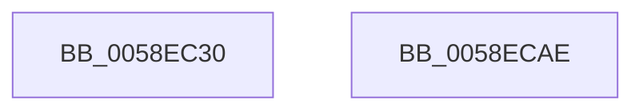

# VslPrepareDriverForPatch

- RVA: `0x0058EC30`–`0x0058ECAF` (길이 `127` bytes)
- VA: `0x000000014058EC30`
- 실행 섹션: `.text`
- PDB 이름 있음: `예`; PDB Function 태그: `아니요`
- unwind 정보 RVA: `0x000AF554`
- 디코드: `29`개 명령, `127/127` bytes 표시
- 미해석 바이트: `0` (있으면 어셈블리에 `.byte`로 보존)

> 이 문서는 커널 이미지의 기계어와 PDB 기호를 분석해 생성했습니다. 4번과 5번은 함수 원형과 자료형을 바이너리 사용 방식에서 추정한 C 해석이며 원본 소스 복구 결과는 아닙니다.

## 1. Dependencies

- 직접 호출 지점: **3**; 고유 호출 대상: **3**
- 직접 호출자로 확인된 함수: **1**
- RIP 상대 이미지 참조: **4**

### Outgoing calls
- `0x0058EC59` → [memset](../6C/memset_function_006C6C40.md) (function, `0x006C6C40`)
- `0x0058EC79` → [VslpEnterIumSecureMode](../23/VslpEnterIumSecureMode_function_00235E50.md) (function, `0x00235E50`)
- `0x0058ECA0` → [_security_check_cookie](../6A/_security_check_cookie_function_006AC640.md) (function, `0x006AC640`)

### Direct callers
- [MiApplyHotPatchToLoadedDriver](../../page/80/MiApplyHotPatchToLoadedDriver_function_00802078.md) at `0x00802291`

### Static image references
- `0x0058EC39` → RVA `0x00E0A740` (`.data`; read)
- `0x0058EC5E` → RVA `0x00F8EC18` (`.data`; read/write)
- `0x0058EC80` → RVA `0x00F8EC20` (`.data`; read)
- `0x0058EC87` → RVA `0x00F8EC1C` (`.data`; read)

## 2. Other-region calls and transfers

- 다른 실행 섹션으로 향하는 call: **0**
- 별도 외부 분기/꼬리 이동을 확인하지 못했습니다.

## 3. Assembly (complete function range)

```asm
0058EC30  40 53                           push rbx
0058EC32  48 81 EC A0 00 00 00            sub rsp, 0xa0
0058EC39  48 8B 05 00 BB 87 00            mov rax, qword ptr [rip + 0x87bb00]
0058EC40  48 33 C4                        xor rax, rsp
0058EC43  48 89 84 24 90 00 00 00         mov qword ptr [rsp + 0x90], rax
0058EC4B  33 D2                           xor edx, edx
0058EC4D  48 8B D9                        mov rbx, rcx
0058EC50  48 8D 4C 24 20                  lea rcx, [rsp + 0x20]
0058EC55  44 8D 42 68                     lea r8d, [rdx + 0x68]
0058EC59  E8 E2 7F 13 00                  call 0x1406c6c40
0058EC5E  F0 FF 05 B3 FF 9F 00            lock inc dword ptr [rip + 0x9fffb3]
0058EC65  BA 4E 00 00 00                  mov edx, 0x4e
0058EC6A  48 89 5C 24 28                  mov qword ptr [rsp + 0x28], rbx
0058EC6F  4C 8D 4C 24 20                  lea r9, [rsp + 0x20]
0058EC74  45 33 C0                        xor r8d, r8d
0058EC77  B1 02                           mov cl, 2
0058EC79  E8 D2 71 CA FF                  call 0x140235e50
0058EC7E  85 C0                           test eax, eax
0058EC80  48 8D 15 99 FF 9F 00            lea rdx, [rip + 0x9fff99]
0058EC87  48 8D 0D 8E FF 9F 00            lea rcx, [rip + 0x9fff8e]
0058EC8E  48 0F 48 CA                     cmovs rcx, rdx
0058EC92  F0 FF 01                        lock inc dword ptr [rcx]
0058EC95  48 8B 8C 24 90 00 00 00         mov rcx, qword ptr [rsp + 0x90]
0058EC9D  48 33 CC                        xor rcx, rsp
0058ECA0  E8 9B D9 11 00                  call 0x1406ac640
0058ECA5  48 81 C4 A0 00 00 00            add rsp, 0xa0
0058ECAC  5B                              pop rbx
0058ECAD  C3                              ret
0058ECAE  CC                              int3
```

## 4. C-style interpretation (structured pseudocode)

```c
__int64 __fastcall VslPrepareDriverForPatch(__int64 a1, int a2)
{
    __int64 result;
    __int64 v_rsp;
    unsigned __int64 v_stack_m18;
    unsigned __int64 v_stack_m80;
    unsigned __int64 v_stack_m88;

    v_rsp = (v_rsp) - (160);
    result = (*(unsigned __int64 *)(v_rip + 8895232)) ^ (v_rsp);
    v_stack_m18 = result;
    a2 = 0;
    result = memset(v_stack_m88, a2, a2 + 104, a4);
    v_stack_m80 = a1;
    a3 = 0;
    result = VslpEnterIumSecureMode(2, 78, a3, v_stack_m88);
    a1 = v_rip + 10485646;
    if (sign_flag) { a1 = v_rip + 10485657; }
    a1 = (v_stack_m18) ^ (v_rsp);
    result = _security_check_cookie(a1, v_rip + 10485657, a3, v_stack_m88);
    v_rsp = (v_rsp) + (160);
    return result;
}
```

## 5. (Beta) C Style

```c
int64_t VslPrepareDriverForPatch(int64_t Arg1, int32_t Arg2)
{
    int64_t result;
    int64_t local_rsp;
    uint64_t v_stack_m18;
    uint64_t v_stack_m80;
    uint64_t v_stack_m88;

    local_rsp = (local_rsp) - (160);
    result = (*(uint64_t *)(v_rip + 0x87BB00)) ^ (local_rsp);
    v_stack_m18 = result;
    Arg2 = 0;
    result = memset(v_stack_m88, Arg2, Arg2 + 104, a4);
    v_stack_m80 = Arg1;
    a3 = 0;
    result = VslpEnterIumSecureMode(2, 78, a3, v_stack_m88);
    Arg1 = v_rip + 10485646;
    if (sign_flag) { Arg1 = v_rip + 10485657; }
    Arg1 = (v_stack_m18) ^ (local_rsp);
    result = _security_check_cookie(Arg1, v_rip + 10485657, a3, v_stack_m88);
    local_rsp = (local_rsp) + (160);
    return result;
}
```

## 6. Execution-region graph

[열기: 2D/3D 그래프와 함수 탐색 컨트롤 패널](../../../control-panel.html?section=text&rva=0x0058EC30&view=graph)

- 2D 그래프는 위에서 아래로 흐르고, 3D 그래프는 빈 공간을 드래그해 회전합니다. Shift+드래그는 이동, 휠은 확대·축소, 함수 노드 선택은 대상 보고서 이동입니다.

### Static fallback


